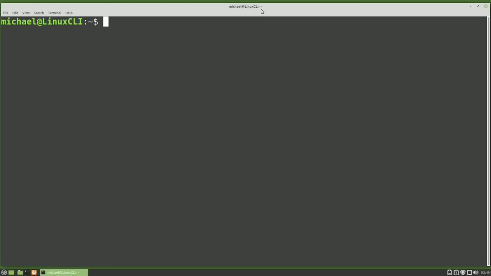
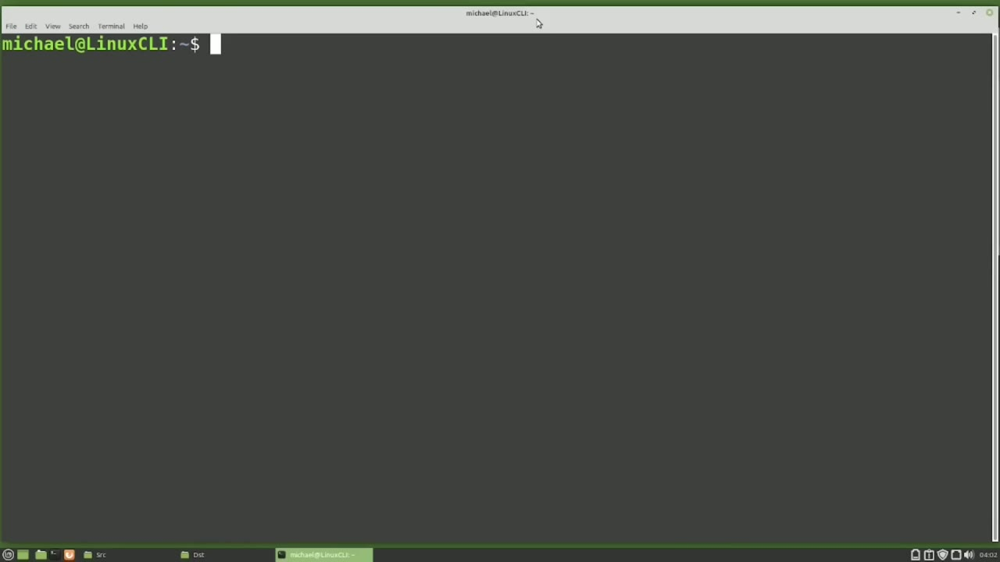
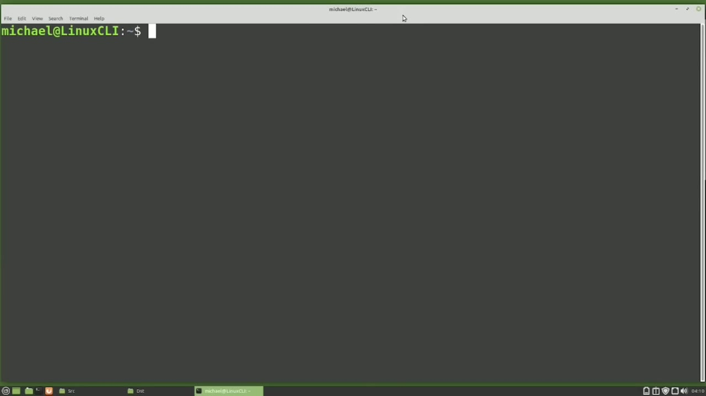
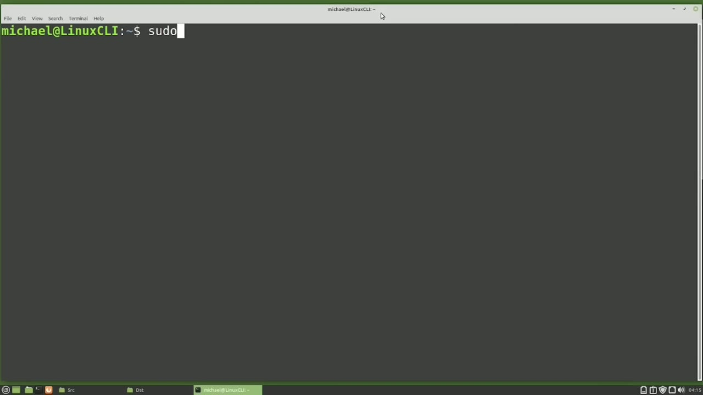

[← Course contents](../../01.md)

# 54. cron pt2

**Course:** [Linux Command Line - Entire Tutorial Series](https://www.youtube.com/watch?v=avg65oY7sj4)  
**Transcript:** [`Linux Command Line - Entire Tutorial Series transcript`](../../../../course_videos/Linux%20Command%20Line%20-%20Entire%20Tutorial%20Series/Linux%20Command%20Line%20-%20Entire%20Tutorial%20Series.txt)  
**Video:** 08:48:48–08:59:51 ([open at this time](https://www.youtube.com/watch?v=avg65oY7sj4&t=31728s))

## Introduction

Picking up from where we left off in the last video, we had created a Cron job to backup the lcl directory. I'm going back into Cron Tab Edit with CronTab -E. We have this backup scheduled to run every morning at 304 a.m. I'm going to change the day of the week to be one, so this will run once a week every Monday instead of every day.

## Detailed Explanation

<details>
  <summary>Step 1 — Run `crontab -E`, `ls -lh`, `rsync`</summary>

### Step 1 — Run `crontab -E`, `ls -lh`, `rsync`

- [x] **Use `crontab -E`**
  - Picking up from where we left off in the last video, we had created a Cron job to backup the lcl directory.
  - I'm going back into Cron Tab Edit with `crontab -E`.
  - We have this backup scheduled to run every morning at 304 a.m.

- [x] **I'm going to change the day of the week to be one, so this will run**
  - I'm going to change the day of the week to be one, so this will run once a week every Monday instead of every day.
  - The other thing we notice here is a backup file and the log file will be overwritten every time this Cron runs.
  - Because we're using the same file name. To make the file names unique, I'm going to add the date the file was created to the file name.

- [x] **That will make each file name unique and if we have a problem we can**
  - That will make each file name unique and if we have a problem we can check our log files for that date to find out what happened.
  - I'm going to the end of the file name just before the extension and I'm going to paste in some text.
  - Let's also add this same text to the Cron Log file.

- [x] **Use `ls -lh`**
  - file name. So this text I'm pasting in will add the date in in year, month, day format.
  - I'm going to test this out by just selecting the command itself, copy, and I'm going to exit out of our Cron tab file, and then paste in the command and run it.
  - Let's list out the content of the Backups Directory with `ls -lh` Backups.

- [x] **And this shows us that the backup file was created with the date**
  - And this shows us that the backup file was created with the date added to the file name as expected.
  - Now I want to add a cron for the R-sync command that we created in a previous video to sync the src source directory with the dst destination directory.
  - I'm going down to the bottom of the file and I'm going to...

- [x] **Add in a new Cronjob and I'm going to paste this in**
  - Add in a new Cronjob and I'm going to paste this in.
  - This R-Sync command will run every minute of every day and it will sync all the files in the Home Michael R-Sync src source directory to the Home Michael R-Sync dst destination directory and remove all the files in the dst destination directory that are not in the src source directory.
  - And I'm going to open up a file manager so we can see what's in the source directory.

- [x] **Use `rsync`**
  - And I'll need to move our terminal window over so we can see that.
  - And then I'll also add in a file manager, `rsync` for the destination directory.
  - Now I'm going to add a file to the source directory.

- [x] **Use `touch home`**
  - With `touch home` Michael R-Sync src new file 1.txte and let's add in new file 2.t And at the top of the next minute, we should see these files get copied over to the dst directory.
  - And they are. Now I'm going to remove one of those files with rm.
  - Home Michael R Sync src, New File 1.t.txte.

- [x] **And again, at the top of the next minute, that file should be removed**
  - And again, at the top of the next minute, that file should be removed from the dst directory.

```bash
crontab -E
ls -lh
rsync
touch home
```



</details>

<details>
  <summary>Step 2 — Run `sudo`, `su -dash`, `crontab`</summary>

### Step 2 — Run `sudo`, `su -dash`, `crontab`

- [x] **And it is. So our R Sync. Cron is working just as expected**
  - And it is. So our R Sync. Cron is working just as expected.
  - I'm going to close this window and then reopen it.
  - When we edit a Cron tab file with the Cron tab command, you may be wondering, where are the actual Cron tab files stored?

- [x] **Use `sudo`, `su -dash`**
  - So I'm going to switch to the root user with `sudo`.
  - `su -dash`.
  - And to see all the Cron tab files, we need to change the directory with cd, var, Spool, Cron, Cron, Tabs.

- [x] **Use `crontab`, `crontab -E`**
  - Here we see that Michael and Mary both have `crontab` files.
  - As the root user, I can update Michael's `crontab` file with Vim, Michael.
  - And we can see this is the same `crontab` file I was editing as Michael with `crontab -E`.

- [x] **Use `crontab`**
  - I'm going to exit out of this with colon X.
  - If I need to update the Michael user's `crontab` file, it's better for me to edit that file with Cron tab.
  - As the root user, I can edit the Michael `crontab` file as Michael with Cron tab -U, Michael, So this is telling us to switch to the user Michael and then edit the `crontab` file.

- [x] **And notice here the root user has Nano set up as their default editor**
  - And notice here the root user has Nano set up as their default editor.
  - I'm pressing Ctrl+X to exit out of that.
  - The other Cron tab commands work like that as well.

- [x] **I'm going to exit out of being the root user with Exit and clear the**
  - I'm going to exit out of being the root user with Exit and clear the screen.

```bash
sudo
su -dash
crontab
crontab -E
```



</details>

<details>
  <summary>Step 3 — Run `crontab`, `crontab -E`, `yes`</summary>

### Step 3 — Run `crontab`, `crontab -E`, `yes`

- [x] **Use `crontab`, `crontab -E`**
  - `crontab` is set up this way for security reasons, but the `crontab -E` does do some basic edit checking as well to help us out.
  - I'm going to edit our `crontab` file again with `crontab -E` and go down to the bottom.
  - And I'm going to change this first asteris to be 61.

- [x] **Use `yes`**
  - This first asteris is for minutes and there's only 60 minutes in an hour.
  - So when I try and get out of this with colon right quit, it's telling me that there is a bad minute and asking me if I want to retry the same edit.
  - I will type `yes`.

- [x] **I will fix these minutes by changing them back to an asteris**
  - I will fix these minutes by changing them back to an asteris.
  - And now I'm going over to the month here.
  - When I try and write quit this, it is now telling me that there is a bad month.

- [x] **Use `yes`**
  - And it's asking me if I want to retry the same edit.
  - I'll type `yes`.
  - And I'll fix that month to be an asteris.

- [x] **Use `crontab`**
  - So the Cron tab editor does do a little bit of basic error checking.
  - But `crontab` will not edit check my command or script in any way.
  - I'm going to write a quit out of here and clear the screen.

- [x] **Another thing that privileged users can do is deny a user from**
  - Another thing that privileged users can do is deny a user from updating their Cron tab file.
  - The privileged user just needs to add the user id to the Cron.Denai file in the /etc directory.

```bash
crontab
crontab -E
yes
```



</details>

<details>
  <summary>Step 4 — Run `sudo -vi -e -cron`, `crontab`, `crontab -E`</summary>

### Step 4 — Run `sudo -vi -e -cron`, `crontab`, `crontab -E`

- [x] **Use `sudo -vi -e -cron`**
  - Most likely there will not be a Cron. Deny file by default, but a privileged user can create one.
  - I will type `sudo -vi -e -cron`. Deni.
  - And I'll add in the name Michael and write and quit out of this file.

- [x] **Use `crontab`, `crontab -E`**
  - Now I'm going to try and edit my `crontab` file with `crontab -E`.
  - And I get the message you, Michael, are not allowed to use this program `crontab`.
  - If I want to check to see if I'm on that Deny file, I can...

- [x] **And here I see that Michael is on the Cron**
  - And here I see that Michael is on the Cron.
  - Dot Deny file to see if they're on the file, but only privileged users can update the Cron.
  - How the Cron. Deny works is that every user on the system has access to Cron tab unless they're on the Cron.

- [x] **Once they're on that list, they can no longer make changes to their**
  - Once they're on that list, they can no longer make changes to their Cron tab file.
  - The Michael user already has two Cron's set up, and those Cron's will continue to run, even though the Michael user can no longer update his Cron tab file.
  - There is also a Cron. Allow file that does not yet exist.

- [x] **Use `sudo`**
  - And again, you'll need to be a privileged user to add or update user IDs to the Cron.
  - I will create and update the Cron.A. Allow file with `sudo`, v-i, /etc, Cron.
  - And I will add the Michael user to this Cron.

- [x] **Use `crontab`, `crontab -E`**
  - .. And now I should be able to edit my `crontab` file with `crontab -E`.
  - The Cron. Dot Allow file has a priority over the Cron.
  - Meaning since the Michael users on both lists, the Cron Allow file has the priority and the Michael user will be able to once again make updates to his Cron tab file.

- [x] **Use `sudo rm /etc`**
  - The other key thing to know about the Cron.Allow file is, when the Cron.Allow file exists, only users on the Cron. Allow file will be able to make updates to their Cron tab file.
  - So if Mary tries to update her Cron tab file now, she would be denied because her user id is not listed on the Cron.
  - Allow file with `sudo`, rm, /etc, Cron.

- [x] **Use `sudo rm /etc`**
  - And also let's remove that Cron. Deny file with `sudo`, rm, /etc, Cron. Deny.
  - I can list out my Cron's with Cron tab -L.
  - And if I want to remove all of my crons, I can do that with Cron tab -R.

- [x] **Now all my Cron jobs are gone, but when I type Cron tab -E, it still**
  - Now all my Cron jobs are gone, but when I type Cron tab -E, it still remembers my selected editor and I still get the comments in the file, but all my crons are gone.
  - In the next video, we will continue looking at the Linux command line.

```bash
sudo -vi -e -cron
crontab
crontab -E
sudo
sudo rm /etc
```



</details>

<details>
  <summary>Questions and Answers</summary>

## Questions and Answers

### Question 1: What does `crontab -E` do in this chapter?

<details>
<summary>Answer</summary>

- [x] I'm going back into Cron Tab Edit with `crontab -E`.

</details>

### Question 2: What does `ls -lh` do in this chapter?

<details>
<summary>Answer</summary>

- [x] Let's list out the content of the Backups Directory with `ls -lh` Backups.

</details>

### Question 3: What does `rsync` do in this chapter?

<details>
<summary>Answer</summary>

- [x] And then I'll also add in a file manager, `rsync` for the destination directory.

</details>

### Question 4: What does `touch home` do in this chapter?

<details>
<summary>Answer</summary>

- [x] With `touch home` Michael R-Sync src new file 1.txte and let's add in new file 2.t And at the top of the next minute, we should see these files get copied over to the dst directory.

</details>

### Question 5: What does `sudo` do in this chapter?

<details>
<summary>Answer</summary>

- [x] So I'm going to switch to the root user with `sudo`.

</details>

### Question 6: What does `su -dash` do in this chapter?

<details>
<summary>Answer</summary>

- [x] `su -dash`.

</details>

### Question 7: What does `crontab` do in this chapter?

<details>
<summary>Answer</summary>

- [x] Here we see that Michael and Mary both have `crontab` files.

</details>

### Question 8: What does `yes` do in this chapter?

<details>
<summary>Answer</summary>

- [x] I will type `yes`.

</details>

### Question 9: What does `sudo -vi -e -cron` do in this chapter?

<details>
<summary>Answer</summary>

- [x] I will type `sudo -vi -e -cron`. Deni.

</details>

### Question 10: What does `sudo rm /etc` do in this chapter?

<details>
<summary>Answer</summary>

- [x] Allow file with Sudo, rm, /etc, Cron.

</details>

</details>

## Summary

This chapter, cron pt2, walks through Run crontab -E, ls -lh, rsync; Run sudo, su -dash, crontab; Run crontab, crontab -E, yes; Run sudo -vi -e -cron, crontab, crontab -E. Commands from the transcript: `crontab -E`, `ls -lh`, `rsync`, `touch home`, `sudo`, `su -dash`, `crontab`, `yes`, `sudo -vi -e -cron`, `sudo rm /etc`.

## References

- [Linux Command Line - Entire Tutorial Series (YouTube)](https://www.youtube.com/watch?v=avg65oY7sj4)
- [This chapter at 08:48:48](https://www.youtube.com/watch?v=avg65oY7sj4&t=31728s)
- [Local transcript](../../../../course_videos/Linux%20Command%20Line%20-%20Entire%20Tutorial%20Series/Linux%20Command%20Line%20-%20Entire%20Tutorial%20Series.txt)
