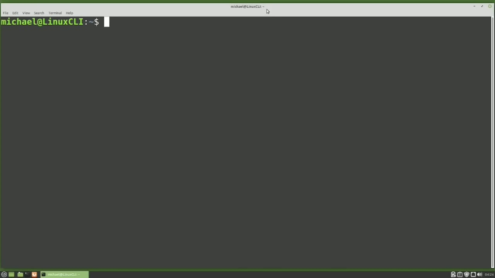
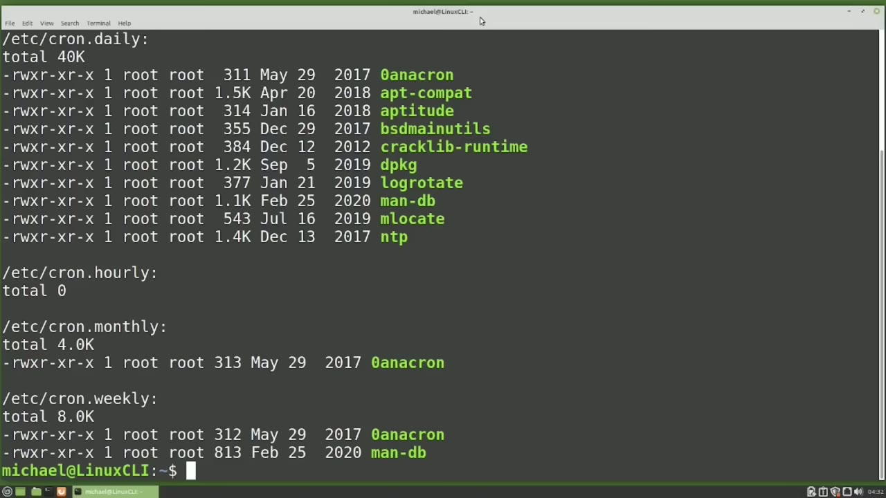
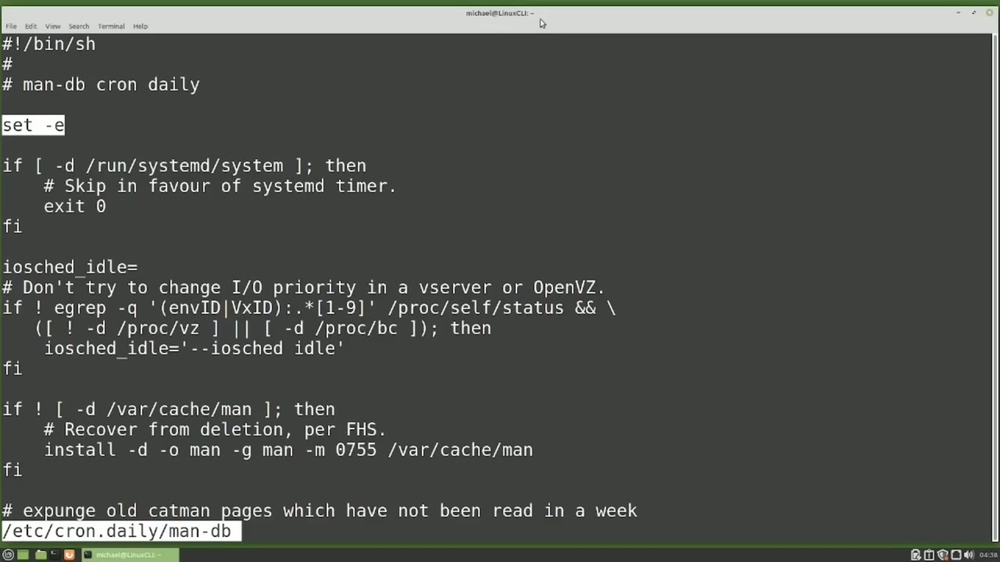
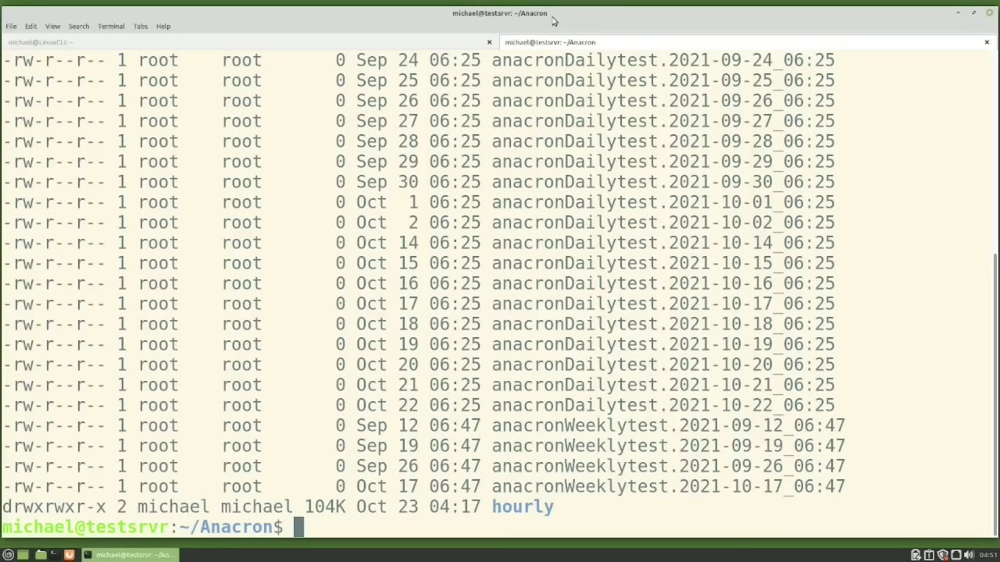
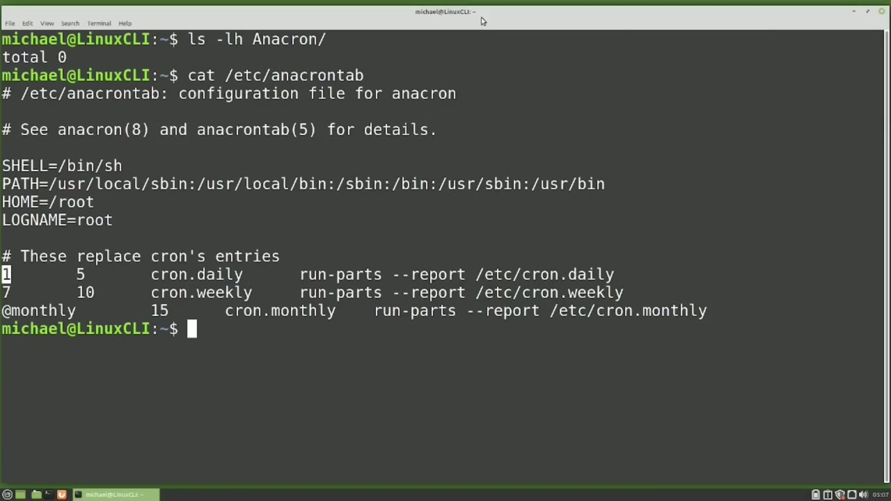

[← Course contents](../../01.md)

# 55. anacron

**Course:** [Linux Command Line - Entire Tutorial Series](https://www.youtube.com/watch?v=avg65oY7sj4)  
**Transcript:** [`Linux Command Line - Entire Tutorial Series transcript`](../../../../course_videos/Linux%20Command%20Line%20-%20Entire%20Tutorial%20Series/Linux%20Command%20Line%20-%20Entire%20Tutorial%20Series.txt)  
**Video:** 08:59:51–09:13:48 ([open at this time](https://www.youtube.com/watch?v=avg65oY7sj4&t=32391s))

## Introduction

Kron works well to schedule jobs that are running on a server or a computer that is running 24 hours a day. But a lot of computers and laptops are not running 24 hours a day. We turn them off when not in use. In our last few videos, we created a cron job to run a backup every Monday morning at 304 a.m. If the computer was not powered on at 304 a.m. on Monday morning, that cron would be skipped.

## Detailed Explanation

<details>
  <summary>Step 1 — Run `anacron`, `at`, `ls -lh /etc`</summary>

### Step 1 — Run `anacron`, `at`, `ls -lh /etc`

- [x] **Kron works well to schedule jobs that are running on a server or a**
  - Kron works well to schedule jobs that are running on a server or a computer that is running 24 hours a day.
  - But a lot of computers and laptops are not running 24 hours a day. We turn them off when not in use.
  - In our last few videos, we created a cron job to run a backup every Monday morning `at` 304 a.m.

- [x] **If the computer was not powered on at 304 a.m. on Monday morning**
  - If the computer was not powered on `at` 304 a.m. on Monday morning, that cron would be skipped.
  - And maybe missing one backup might not be bad.
  - But if that computer is off every Monday `at` 403 a.m.

- [x] **Use `anacron`**
  - That backup could be skipped for weeks, months, or maybe never run.
  - So instead of using Cron to schedule a backup, we may want to use `anacron`.
  - `anacron` can be used to run a command or script just like Cron, but instead of giving it a specific day and time, we give it a more general time frame of hourly, daily, weekly, or monthly.

- [x] **Use `anacron`, `at`**
  - When the computer is constantly powered on, `anacron` will run the `anacron` jobs regularly.
  - For each time frame of hour, day, week, and month.
  - For computers that are turned off and back on, when the computer starts up, the `anacron` jobs are checked to see if they need to run `at` Startup.

- [x] **Use `anacron`, `ls -lh /etc`**
  - We'll look `at` what `anacron` does `at` Startup later in this video.
  - `anacron` is a part of Cron, so let's look `at` the Cron files in the /etc directory with `ls -lh /etc` Cron Asteris.
  - The first thing we see is /etc Cron tab.

- [x] **We're going to come back to this later in this video**
  - We're going to come back to this later in this video.
  - The next thing found is the directory /etc Cron D.
  - The D is for Damon, so the files in this directory are for the Cron Damon.

- [x] **Use `anacron`**
  - We don't want to change anything in this directory, so we're going to leave this directory alone.
  - The next four directories, ETSCron Daily, ETSCron hourly, EtsyCron Monthly and EtsyCron Weekly, all these directories work the same way.
  - When that time frames `anacron` is run, all the scripts in that directory are run.

- [x] **Use `anacron`**
  - For example, when the Daily `anacron` runs, all the scripts in the EtsyCron Daily directory are run.
  - So if we want to add a script to be run by `anacron` on a daily basis, we would add our script to the /etc Cron Daily directory.
  - And we would do the same thing for the hourly, monthly, and weekly `anacron` scripts.

- [x] **Use `anacron`**
  - We would place our script in the directory for the time frame we would want `anacron` to run it.

```bash
anacron
at
ls -lh /etc
```



</details>

<details>
  <summary>Step 2 — Run `anacron`, `man -db`, `bash`</summary>

### Step 2 — Run `anacron`, `man -db`, `bash`

- [x] **Use `anacron`**
  - Looking at these files in these directories, we notice a few things about these files.
  - The first thing we notice is they all have an owner and user of root.
  - So we must be a privileged user if we want to set up an `anacron` job.

- [x] **Use `anacron`**
  - The second thing we notice is that none of the `anacron` file names have an extension, Looking at the Cron Daily, Cron Weekly, and Cron Monthly directories, they all have a file called Zero `anacron`.
  - That file will check to see the date the last time the group's `anacron` Scripts ran.
  - The hourly Anacrons directory does not need this file.

- [x] **Use `anacron`, `man -db`**
  - The hourly crons are going to run within the hour anyway, because they are set up to run every hour.
  - Let's check out one of the Daily `anacron` Scripts.
  - I'm going to choose the `man -db` script and show it with less /etc, Crondaily, `man -db`.

- [x] **Use `bash`, `anacron`**
  - The first thing I want to look at is the first line.
  - This is different than the Shabang bin `bash` we're used to seen.
  - `anacron` only allows s.h or Born Shell scripts.

- [x] **Use `bash`**
  - It does not understand the `bash`.
  - Born Again shell scripts we've been working with in this tutorial.
  - The `bash` Born Again shell is just an improved version of the Born shell and includes more commands and features.

- [x] **And it's these new commands and features that Anachron won't**
  - And it's these new commands and features that Anachron won't understand.
  - Everything we do in this video will be backward compatible with the Born shell.
  - Just in case you're trying some code that is only in the Bass shell and not in the Born Shell, it won't work with Anachron.

```bash
anacron
man -db
bash
```



</details>

<details>
  <summary>Step 3 — Run `anacron`, `sudo su -su -dash`, `chmod 755 etsycron`</summary>

### Step 3 — Run `anacron`, `sudo su -su -dash`, `chmod 755 etsycron`

- [x] **Use `anacron`**
  - What this line does is it tells the script to exit out if any line in the script fails.
  - We want to put this in our `anacron` script because if a line fails and it does not exit, it could continue to try and run and continue to use system resources.
  - The very last line of code in our script is Exit Zero.

- [x] **The Exit Zero is setting the exit status to zero**
  - The Exit Zero is setting the exit status to zero.
  - Meaning the script ended without any problems. Exit numbers higher than zero usually mean there was a problem with the script.
  - I'm going to clear the screen. Let's set up an anachron job.

- [x] **Use `sudo su -su -dash`, `anacron`**
  - The first thing I'll need to do is switch to the root user. I'll do that with `sudo su -su -dash`.
  - I'm going to create a daily `anacron` script with vi at C-Cron Daily `anacron` Daily Test.
  - This script will run daily and just create a file called `anacron` Daily Test with the date and time that file was created.

- [x] **Use `anacron`, `chmod 755 etsycron`**
  - And it'll place this in the directory Home Michael `anacron`.
  - We also want to make this file an executable.
  - I'll do that by pasting in `chmod 755 etsycron` Daily `anacron` Daily Test.

- [x] **Use `anacron`**
  - Let's also set up a weekly `anacron` job with vi at C-Cron Weekly and a Cron Weekly Test.
  - And I'm going to paste in the code here as well.
  - I'm pausing and copying the code here so you don't have to watch me type this all in.

- [x] **And also there's less opportunity for typos**
  - And also there's less opportunity for typos.
  - I'm going to write and quit out of here.
  - And we want to make this weekly file in executable as well.

- [x] **Use `anacron`**
  - Let's exit out of our root user with exit.
  - And now we want to create that `anacron` directory that we're going to put the daily and weekly files into.
  - I'll do that with MakeDur, Home, Michael, `anacron`.

- [x] **Use `anacron`**
  - So we have two `anacron` jobs that will run, one daily and one weekly.
  - I can pause this video and come back in a few days or weeks and we can check out the results.
  - Where I set up these same jobs a few weeks ago to run daily weekly and I've even added an hourly `anacron` job to that as well. Let's open up a new tab here and I'm going to make this a light tab just so we know the difference between the one we're working at and the server tab.

- [x] **Use `anacron`, `ls -lh`**
  - I'm going to log into the server with ssh192.168.1.42 and I'm going to cd into the `anacron` And let's list out what's in there with `ls -lh`.
  - Here we see all the `anacron` Daily Test files were created at 625 am.
  - And all the `anacron` Weekly test files were created on Sundays at 647 am.

- [x] **I put the hourly files in a sub-directory because I knew there would**
  - I put the hourly files in a sub-directory because I knew there would be a lot of them.

```bash
anacron
sudo su -su -dash
chmod 755 etsycron
ls -lh
```



</details>

<details>
  <summary>Step 4 — Run `ls -lh`, `anacron`, `at 625`</summary>

### Step 4 — Run `ls -lh`, `anacron`, `at 625`

- [x] **Use `ls -lh`, `anacron`**
  - Let's check them out with `ls -lh` hourly.
  - Here we see all the hourly files are created at 17 minutes after the hour.
  - Let's look at what happens when the `anacron` jobs run for a computer that is constantly powered on.

- [x] **To see that, we're going to look at the /etc Cron tab file**
  - To see that, we're going to look at the /etc Cron tab file.
  - We saw that file earlier and said we'd come back to it. Now's the time.
  - So let's see what's in that file with Cat, /etc Cron tab.

- [x] **Use `at 625`**
  - And here we see the /etc Cron hourly jobs will run every hour at 17 minutes after the hour.
  - That matches with what we saw on our server.
  - We also see the EtsyCron Daily files will run `at 625` every day.

- [x] **Use `at 647`**
  - And that matches with what we saw on the server.
  - And then we see the /etc Cron Weekly files are set to run `at 647` every Sunday, and that matches up with what we saw on the server.
  - And we didn't set up a monthly job, but those are scheduled to run at 6.52 a.m. on the first day of the month every month of the year.

- [x] **Use `anacron`**
  - That explains how the `anacron` jobs work on a computer that is not turned off.
  - When the computer is turned off and back on, when the computer starts up, `anacron` will want to check the date the last time the `anacron` jobs ran for each group, daily, weekly, and monthly.
  - The hourly `anacron`'s run every hour, so they're going to run within 60 minutes anyway.

- [x] **Use `anacron`, `ls`, `sudo`**
  - To check the last time the daily, weekly, and monthly `anacron` jobs ran, I'm going to cd into the directory, bar, spool, anachron.
  - And let's `ls` to see what's in here.
  - And here we can see the dates these files were last updated and most likely those will be the last dates the `anacron` jobs ran but not necessarily to see the actual anachron dates we're going to look inside the files I'm going to type `sudo` v i cron daily and we see a date for the last time the daily

- [x] **Use `anacron`**
  - `anacron` job ran I'm going to change this state back so when we restart the computer will force an anachron run Let's also do that with the weekly file.
  - We'll set this back to the same day, the first of the month.
  - And we could do that with the monthly as well.

- [x] **Use `anacron`, `reboot`, `sudo reboot`**
  - But since we don't have a monthly `anacron`, we're going to skip that.
  - Let's `reboot` the computer with `sudo reboot`.
  - And I'm going to check the `anacron` directory with `ls -lh` `anacron`.

- [x] **Use `anacron`**
  - So why didn't our `anacron` jobs work?
  - To find that out, we're going to check out the `anacron` Tab file with Cat, /etc, `anacron` Tab.
  - Now, in this file, the first line's telling us it must be using the Born Shell with the BinSH.

- [x] **We're going to talk about paths in an upcoming video**
  - We're going to talk about paths in an upcoming video.

```bash
ls -lh
anacron
at 625
at 647
ls
sudo
reboot
sudo reboot
```



</details>

<details>
  <summary>Step 5 — Run `anacron`, `anacron -cron`, `at`</summary>

### Step 5 — Run `anacron`, `anacron -cron`, `at`

- [x] **And then there's some lines letting us know that it must be the root**
  - And then there's some lines letting us know that it must be the root user.
  - And that's all good, but what we're really interested in are those three lines `at` the bottom of the file.
  - Let's start with the 1-5 Cron Daily line.

- [x] **Use `anacron`, `anacron -cron`, `at`**
  - The 1 is the period in days that `anacron` is going to check the date in the VAR-Spool `anacron -cron` Daily file, that file we just updated, to see if the date is `at` least one different than today's date.
  - The 5 is telling us to wait 5 minutes after the computer reboots and then run the Cron Daily `anacron` jobs.
  - And we're waiting five minutes just to make sure that there are not too many jobs running `at` the same time when the computer boots up.

- [x] **Use `anacron`**
  - So we wait five minutes, then do the daily `anacron` jobs.
  - Going down to the next line with the 710 Cron Weekly.
  - And the 7 is going to compare the dates just like the first one.

- [x] **Use `anacron`**
  - Instead of one day, we need 7 days between the current date and that date that is in the var, Spool, `anacron`, Cron Weekly file.
  - We just updated that file to make it more than 7.
  - As long as more than 7 days have passed, we move on to the next value.

- [x] **Use `anacron`**
  - And the 10 is telling `anacron` to wait 10 minutes after the computer boots up to run the Cron Weekly Anacrons. And now we're down to the last line. And that has `at` monthly instead of a one or a seven.
  - The `at` monthly is to check to see if it's a different month. Instead of going back 30 days, we're just checking the month. So if the last time this ran was on the last day of the month, and today is a new day, it'd be a new month. So this could potentially run two days in a row.
  - The 15 is telling us to wait 15 minutes after the computer starts to run the monthly jobs.

- [x] **Use `anacron`, `ls -lh`**
  - I'm going to check the `anacron` file again with `ls -lh` `anacron`.
  - And there we see both our jobs have completed.
  - We have our daily test and our weekly test.

- [x] **In the next video, we will continue looking at the Linux command line**
  - In the next video, we will continue looking `at` the Linux command line.

```bash
anacron
anacron -cron
at
ls -lh
```



</details>

<details>
  <summary>Questions and Answers</summary>

## Questions and Answers

### Question 1: What does `anacron` do in this chapter?

<details>
<summary>Answer</summary>

- [x] So instead of using Cron to schedule a backup, we may want to use `anacron`.

</details>

### Question 2: What does `at` do in this chapter?

<details>
<summary>Answer</summary>

- [x] For computers that are turned off and back on, when the computer starts up, the Anacron jobs are checked to see if they need to run `at` Startup.

</details>

### Question 3: What does `ls -lh /etc` do in this chapter?

<details>
<summary>Answer</summary>

- [x] Anacron is a part of Cron, so let's look at the Cron files in the /etc directory with `ls -lh /etc` Cron Asteris.

</details>

### Question 4: What does `man -db` do in this chapter?

<details>
<summary>Answer</summary>

- [x] I'm going to choose the `man -db` script and show it with less /etc, Crondaily, `man -db`.

</details>

### Question 5: What does `bash` do in this chapter?

<details>
<summary>Answer</summary>

- [x] This is different than the Shabang bin `bash` we're used to seen.

</details>

### Question 6: What does `sudo su -su -dash` do in this chapter?

<details>
<summary>Answer</summary>

- [x] The first thing I'll need to do is switch to the root user. I'll do that with `sudo su -su -dash`.

</details>

### Question 7: What does `chmod 755 etsycron` do in this chapter?

<details>
<summary>Answer</summary>

- [x] I'll do that by pasting in `chmod 755 etsycron` Daily Anacron Daily Test.

</details>

### Question 8: What does `ls -lh` do in this chapter?

<details>
<summary>Answer</summary>

- [x] I'm going to log into the server with ssh192.168.1.42 and I'm going to cd into the Anacron And let's list out what's in there with `ls -lh`.

</details>

### Question 9: What does `at 625` do in this chapter?

<details>
<summary>Answer</summary>

- [x] We also see the EtsyCron Daily files will run `at 625` every day.

</details>

### Question 10: What does `at 647` do in this chapter?

<details>
<summary>Answer</summary>

- [x] And then we see the /etc Cron Weekly files are set to run `at 647` every Sunday, and that matches up with what we saw on the server.

</details>

### Question 11: What does `ls` do in this chapter?

<details>
<summary>Answer</summary>

- [x] And let's `ls` to see what's in here.

</details>

### Question 12: What does `sudo` do in this chapter?

<details>
<summary>Answer</summary>

- [x] And here we can see the dates these files were last updated and most likely those will be the last dates the anacron jobs ran but not necessarily to see the actual anachron dates we're going to look inside the files I'm going to type `sudo` v i cron daily and we see a date for the last time the daily

</details>

</details>

## Summary

This chapter, anacron, walks through Run anacron, at, ls -lh /etc; Run anacron, man -db, bash; Run anacron, sudo su -su -dash, chmod 755 etsycron; Run ls -lh, anacron, at 625; Run anacron, anacron -cron, at. Commands from the transcript: `anacron`, `at`, `ls -lh /etc`, `man -db`, `bash`, `sudo su -su -dash`, `chmod 755 etsycron`, `ls -lh`, `at 625`, `at 647`, `ls`, `sudo`, `reboot`, `sudo reboot`.

## References

- [Linux Command Line - Entire Tutorial Series (YouTube)](https://www.youtube.com/watch?v=avg65oY7sj4)
- [This chapter at 08:59:51](https://www.youtube.com/watch?v=avg65oY7sj4&t=32391s)
- [Local transcript](../../../../course_videos/Linux%20Command%20Line%20-%20Entire%20Tutorial%20Series/Linux%20Command%20Line%20-%20Entire%20Tutorial%20Series.txt)
