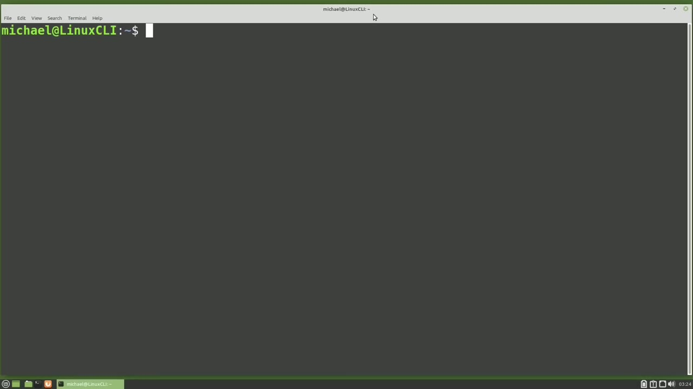
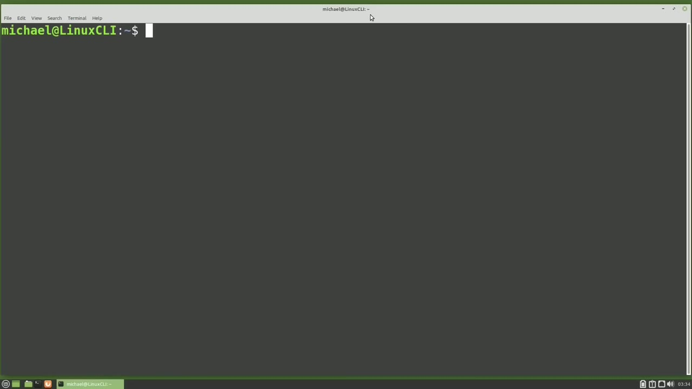
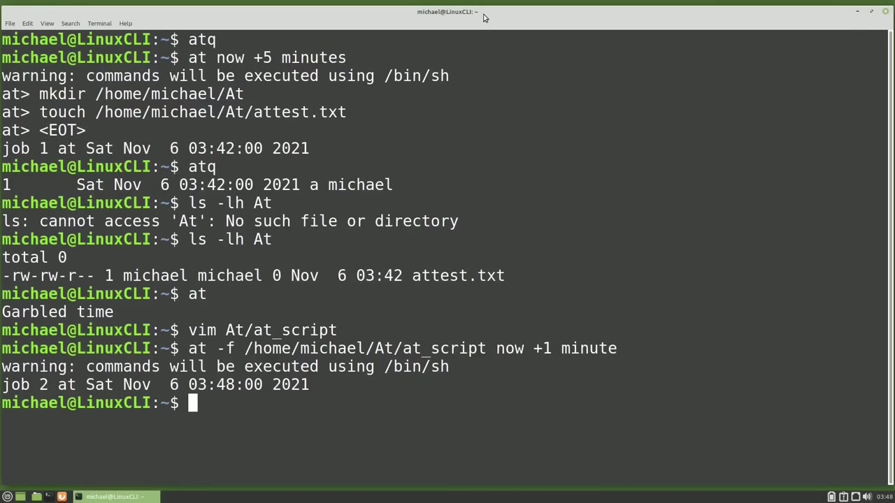
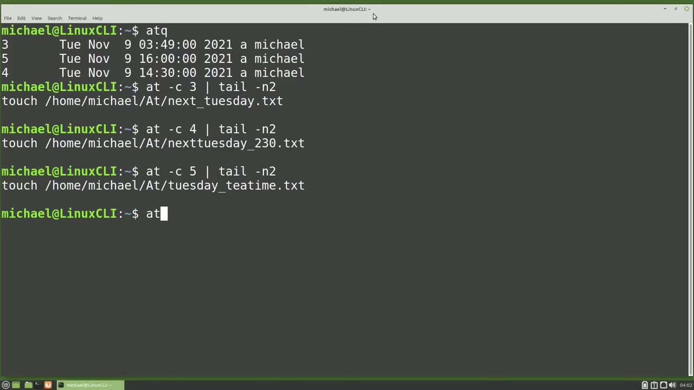
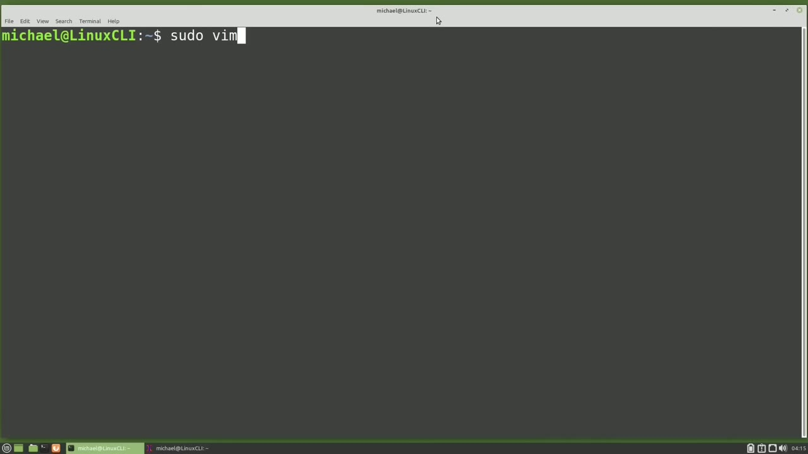

[← Course contents](../../01.md)

# 56. at

**Course:** [Linux Command Line - Entire Tutorial Series](https://www.youtube.com/watch?v=avg65oY7sj4)  
**Transcript:** [`Linux Command Line - Entire Tutorial Series transcript`](../../../../course_videos/Linux%20Command%20Line%20-%20Entire%20Tutorial%20Series/Linux%20Command%20Line%20-%20Entire%20Tutorial%20Series.txt)  
**Video:** 09:13:48–09:28:48 ([open at this time](https://www.youtube.com/watch?v=avg65oY7sj4&t=33228s))

## Introduction

Cron and Anacron are good for scheduling jobs to run over and over. But if we want a job to run in the future only one time, we can use at that some people call at. We call it at because we want to run a job at the time and date we give. To see what jobs at currently has scheduled to run, I will type atq for query at jobs.

## Detailed Explanation

<details>
  <summary>Step 1 — Run `anacron`, `at`, `atq`</summary>

### Step 1 — Run `anacron`, `at`, `atq`

- [x] **Use `anacron`, `at`**
  - Cron and `anacron` are good for scheduling jobs to run over and over.
  - But if we want a job to run in the future only one time, we can use `at` that some people call `at`.
  - We call it `at` because we want to run a job `at` the time and date we give.

- [x] **Use `atq`, `sudo app install`, `systemctl status`**
  - To see what jobs `at` currently has scheduled to run, I will type `atq` for query `at` jobs.
  - `at` is not installed on my version of Linux Mint, but I will install it with Sudo App, install, `at`. `at` is now installed and I'm seeing right here that the `at` service is called atd.
  - Service. I'm going to clear the screen and let's check the status of the service with `systemctl status` atd and we see that it's running. We can stop this service with the command `systemctl stop` atd and I'm asked for a password.

- [x] **Use `systemctl status`, `sudo systemctl`**
  - Let's check the status again with `systemctl status` atd.
  - And here we see that it's inactive or dead.
  - Let's start up that atd service again with `sudo systemctl`.

- [x] **And we see that it's running once again**
  - And we see that it's running once again.
  - I'm showing you this because not all Linux operating systems work like the Linux Mint Ubuntu operating system I'm working on here.
  - When I install the atd service on this operating system, it thinks that I wanted to start the service and that I want to start the service every time the computer boots up.

- [x] **Some Linux operating systems will only install the service requested**
  - Some Linux operating systems will only install the service requested when you install it.
  - Then it's up to you to start the service when you want it running.
  - And it will stop when the computer shuts down.

- [x] **Use `sudo systemctl enable`**
  - Then if you want the service to run every time the computer starts up, you will have to tell the computer you want that.
  - To tell Linux, we want to start this service every time the computer boots up, we would type Sudo, systemctl, enable, and then the service that we want to enable, which in this case is atd.
  - So enabling it, we'll have Linux start the atd service every time we start this computer.

- [x] **As I mentioned earlier, on our Ubuntu-based operating system, Ubuntu**
  - As I mentioned earlier, on our Ubuntu-based operating system, Ubuntu starts and enables our service when we install it.
  - So these steps were really not needed on this computer.

```bash
anacron
at
atq
sudo app install
systemctl status
systemctl stop
sudo systemctl
sudo systemctl enable
```



</details>

<details>
  <summary>Step 2 — Run `atq`, `at 5 minutes`, `touch`</summary>

### Step 2 — Run `atq`, `at 5 minutes`, `touch`

- [x] **Use `atq`, `at 5 minutes`**
  - Now that we have at installed and running and enabled, let's type `atq` again.
  - That's because we don't have any at job scheduled.
  - Let's create a job to run `at 5 minutes` from now.

- [x] **For that I will type at now plus 5 minutes**
  - For that I will type at now plus 5 minutes.
  - This opens a second prompt for me to type in the commands.
  - And when I say 5 minutes from now, I mean 5 minutes from when I pressed Enter for the at now plus 5 minutes command, not 5 minutes from when I complete my script.

- [x] **So if it takes more than five minutes to create the script, the**
  - So if it takes more than five minutes to create the script, the script won't start because the time to start the script has passed.
  - The other thing to note here is that it is telling us just like Antocron that At will only allow the s.h. Born Shell scripts and not the advanced commands that the Born Again Bass Shell includes.
  - I'm going to add the commands m.k. Durr. Home, Michael, at.

- [x] **Use `touch`**
  - Home, Michael, at, and the file we `touch` will be at test.t.
  - Now to write and get out of the secondary at prompt, I'm going to hold down control and press D for done.
  - This has created my at script and it will run in a couple of minutes.

- [x] **Use `atq`, `ls -lh`**
  - Now if I type `atq`, we see we have one job scheduled to run.
  - I'm going to type `ls -lh`.
  - A T and we see that that directory does not yet exist.

- [x] **The five minutes have passed. Let's see if our directory is there now**
  - The five minutes have passed. Let's see if our directory is there now.
  - And we see the new file is there so the directory and the file were both created by the at command.
  - If we type at by itself and press enter, we'll get the message garbled time.

- [x] **Use `touch`**
  - We can put a script in a file and run that with the at command.
  - I'll create a script in that new at directory with Vim, at, and we'll call the script at underscore script.
  - I'm going to add a line in here to `touch` a file in the Home Michael at directory, and to know we ran it from this script, we'll make that file name att underscore from script.t.TXT.

- [x] **Use `at -F`**
  - To run the at script, we will need to add a -F for file name to our at command.
  - I'll type `at -F` for file.
  - Home, Michael, at, and then the script name is at script.

- [x] **And we want this to run now plus one minute**
  - And we want this to run now plus one minute.

```bash
atq
at 5 minutes
touch
ls -lh
at -F
```



</details>

<details>
  <summary>Step 3 — Run `ls -lhat`, `touch`, `touch home`</summary>

### Step 3 — Run `ls -lhat`, `touch`, `touch home`

- [x] **Use `ls -lhat`**
  - Let's see if the file was created with `ls -lhat`.
  - From script.txt. I'm going to clear the screen.
  - So far, I've only used the time frame of minutes, but there are more time frame options.

- [x] **Use `touch`, `touch home`**
  - Let's run a job next Tuesday with at next Tuesday.
  - And we will have it `touch` a file next Tuesday.
  - `touch home` Michael at and we'll call this file next next.

- [x] **Tuesday.txty. I'm going to hold down control and press D for done**
  - Tuesday.txty. I'm going to hold down control and press D for done.
  - And we see this is scheduled to run next Tuesday at the time of day I pressed enter for the at next Tuesday command because I didn't give it a specific time of day.
  - If I want to give it a specific time of day, I will put that time before the day I wanted to run at 2.30 p.m. Tuesday.

- [x] **Use `touch home`**
  - And we can `touch home` Michael at next Tuesday to 30.t.
  - And Ctrl+D for done and this will run next Tuesday at 2.30 p.m.
  - For times of day we also have options like noon, midnight, or tea time.

- [x] **Use `touch home`**
  - `touch`, Home, Michael, at, Tuesday, T-Time.TxT.
  - And once again, holding down Control and D for done.
  - And we saw that we can use Now Plus One Minute, but we can also use Now Plus One Hour, Now Plus One Day, Now Plus One Year.

- [x] **Use `atq`, `at -l`**
  - And it does not have to be plus one. You can make that any positive number of days.
  - We already saw how to list out the jobs in the at Q with `atq`.
  - We can also use `at -l`, `at -l`, and `at -l` is just an alias for `atq`.

- [x] **Use `at -l`, `atq`**
  - We'll look at what an alias is in an upcoming video.
  - In short, when we type `at -l`, it just runs the `atq` command.
  - I'll clear the screen once again, and I'm going to list out those jobs again with `atq`.

- [x] **Use `at -C`**
  - Now we have three jobs out there scheduled with at and we want to remove one of the scheduled jobs, but we don't remember which job has which command in it.
  - To see the commands for an at job, we can type `at -C` for cat and then the job number that we want to see the commands of. In this case, it'll be job number three.
  - And here we see a lot of information about the scheduled at job, but when we get down to the bottom, we can see our command.

- [x] **Use `tail -n2`, `atq`**
  - And then there's a blank line after that.
  - We can make that easier to read by piping that into `tail -n2`.
  - Let's clear the screen and I'll type `atq` to check our app queue and cat out that file again with the `tail -n2`.

- [x] **Use `atrm 5`**
  - Let's try it again with job number four and then again with job number five.
  - Job number 5 is T-time. Let's remove that one.
  - To remove at job number 5, I'm going to type `atrm 5`.

- [x] **Use `at -d 5`, `at -rm5`, `at -d`**
  - Now that's not the only way to remove a job.
  - I could also have typed `at -d 5` or `at -rm5`.
  - `at -d` and `at -rm` are just aliases for `atrm`.

```bash
ls -lhat
touch
touch home
atq
at -l
at -C
tail -n2
atrm 5
at -d 5
at -rm5
at -d
at -rm
atrm
```



</details>

<details>
  <summary>Step 4 — Run `atrm 5`, `atq`, `sudo su -sud`</summary>

### Step 4 — Run `atrm 5`, `atq`, `sudo su -sud`

- [x] **Use `atrm 5`, `atq`**
  - So I will use the `atrm 5` to remove that at job.
  - And type `atq` again to show that it's gone.
  - To see where the actual at jobs are stored, we will need to switch to be the root user.

- [x] **Use `sudo su -sud`, `at -jabs`**
  - I'll do that with `sudo su -sud`.
  - Now we can change the directory with cd, var, Spool, Kron, `at -jabs`.
  - And typing l-s-l-h, Shows us the two at jobs. We can cat those files with cata 0003 and I'm tabbing to autocomplete and we see this is our at job to run next Tuesday.

- [x] **And we can pipe that output to tail and only show the last few lines**
  - And we can pipe that output to tail and only show the last few lines of the file.
  - I'm going to exit out of route with exit.
  - If we were Linux administrators and getting ready to do some system maintenance on a server with multiple users, we might want to send a message out to everyone logged in on the system that the computer will go down at a specific period of time for maintenance.

- [x] **And I will paste in the message that the system will be going down at**
  - And I will paste in the message that the system will be going down at 1 p.m. for maintenance.
  - And I'm going to pipe that out to wall, which means send out to everyone on the system.
  - I'm going to open up another terminal here to make sure this goes out to people.

- [x] **Use `at -f`**
  - And let's send out this message with `at -f`, Home Michael, at, at, Maint, msg, and we'll send that at now plus one minute.
  - That minute has passed and we don't see a message on this terminal.
  - When I switch to the X-Term terminal, we do get the message there.

- [x] **The reason we didn't receive the message in this terminal is because**
  - The reason we didn't receive the message in this terminal is because this terminal was designed for a desktop computer, which is normally used by a single user at a time.
  - So the terminal does not update the logged in user list U-Temp.
  - If we want to echo a message out to this terminal, we need to find out a little more about the terminal.

```bash
atrm 5
atq
sudo su -sud
at -jabs
at -f
```



</details>

<details>
  <summary>Step 5 — Run `sudo vim`, `at`, `sudo vim /etc`</summary>

### Step 5 — Run `sudo vim`, `at`, `sudo vim /etc`

- [x] **And it gives us slash dev slash pts slash O**
  - And it gives us slash dev slash pts slash O.
  - So let's try echoing a message out to that with echo hello.
  - And we're going to send that to slash device pts.

- [x] **So now we can update that maintenance message and get the message on**
  - So now we can update that maintenance message and get the message on this terminal as well.
  - And now let's run that job again to make sure it works.
  - And there we see the message in this terminal.

- [x] **Use `sudo vim`**
  - Like Cron, `at` also has deny and allow files.
  - And you must be a privileged user to update those.
  - I'll type `sudo vim`.

- [x] **We see there's a lot of users already in there**
  - We see there's a lot of users already in there.
  - I'm going down to the bottom and I'm going to add in Michael.
  - And now I'll try and create an `at` job with `at` now plus one minute.

- [x] **Use `at`**
  - And we get the message you do not have permissions to use `at`.
  - So just like Cron, adding a name to the `at` deny file denies the users in that list from creating and running `at` jobs.
  - But all the other users on the system can still create and edit `at` jobs.

- [x] **Use `sudo vim /etc`**
  - Now I'll create an `at` allow file with Sudo, Vim, /etc, `at` Allow. And I will add Michael in there.
  - And now let's run that maintenance message file again.
  - Dot allow file and `at`.deny files work just like the Cron.Allow file and Cron. Deny files.

- [x] **In the next tutorial, we will continue looking at the Linux command**
  - In the next tutorial, we will continue looking `at` the Linux command line.

```bash
sudo vim
at
sudo vim /etc
```



</details>

<details>
  <summary>Questions and Answers</summary>

## Questions and Answers

### Question 1: What does `anacron` do in this chapter?

<details>
<summary>Answer</summary>

- [x] Cron and `anacron` are good for scheduling jobs to run over and over.

</details>

### Question 2: What does `at` do in this chapter?

<details>
<summary>Answer</summary>

- [x] But if we want a job to run in the future only one time, we can use `at` that some people call `at`.

</details>

### Question 3: What does `atq` do in this chapter?

<details>
<summary>Answer</summary>

- [x] To see what jobs at currently has scheduled to run, I will type `atq` for query at jobs.

</details>

### Question 4: What does `sudo app install` do in this chapter?

<details>
<summary>Answer</summary>

- [x] At is not installed on my version of Linux Mint, but I will install it with Sudo App, install, At. At is now installed and I'm seeing right here that the at service is called atd.

</details>

### Question 5: What does `systemctl status` do in this chapter?

<details>
<summary>Answer</summary>

- [x] Service. I'm going to clear the screen and let's check the status of the service with `systemctl status` atd and we see that it's running. We can stop this service with the command systemctl stop atd and I'm asked for a password.

</details>

### Question 6: What does `systemctl stop` do in this chapter?

<details>
<summary>Answer</summary>

- [x] Service. I'm going to clear the screen and let's check the status of the service with systemctl Status atd and we see that it's running. We can stop this service with the command `systemctl stop` atd and I'm asked for a password.

</details>

### Question 7: What does `sudo systemctl` do in this chapter?

<details>
<summary>Answer</summary>

- [x] Let's start up that atd service again with `sudo systemctl`.

</details>

### Question 8: What does `sudo systemctl enable` do in this chapter?

<details>
<summary>Answer</summary>

- [x] To tell Linux, we want to start this service every time the computer boots up, we would type Sudo, systemctl, enable, and then the service that we want to enable, which in this case is atd.

</details>

### Question 9: What does `at 5 minutes` do in this chapter?

<details>
<summary>Answer</summary>

- [x] Let's create a job to run `at 5 minutes` from now.

</details>

### Question 10: What does `touch` do in this chapter?

<details>
<summary>Answer</summary>

- [x] Home, Michael, at, and the file we `touch` will be at test.t.

</details>

### Question 11: What does `ls -lh` do in this chapter?

<details>
<summary>Answer</summary>

- [x] I'm going to type `ls -lh`.

</details>

### Question 12: What does `at -F` do in this chapter?

<details>
<summary>Answer</summary>

- [x] I'll type `at -F` for file.

</details>

</details>

## Summary

This chapter, at, walks through Run anacron, at, atq; Run atq, at 5 minutes, touch; Run ls -lhat, touch, touch home; Run atrm 5, atq, sudo su -sud; Run sudo vim, at, sudo vim /etc. Commands from the transcript: `anacron`, `at`, `atq`, `sudo app install`, `systemctl status`, `systemctl stop`, `sudo systemctl`, `sudo systemctl enable`, `at 5 minutes`, `touch`, `ls -lh`, `at -F`, `ls -lhat`, `touch home`.

## References

- [Linux Command Line - Entire Tutorial Series (YouTube)](https://www.youtube.com/watch?v=avg65oY7sj4)
- [This chapter at 09:13:48](https://www.youtube.com/watch?v=avg65oY7sj4&t=33228s)
- [Local transcript](../../../../course_videos/Linux%20Command%20Line%20-%20Entire%20Tutorial%20Series/Linux%20Command%20Line%20-%20Entire%20Tutorial%20Series.txt)
