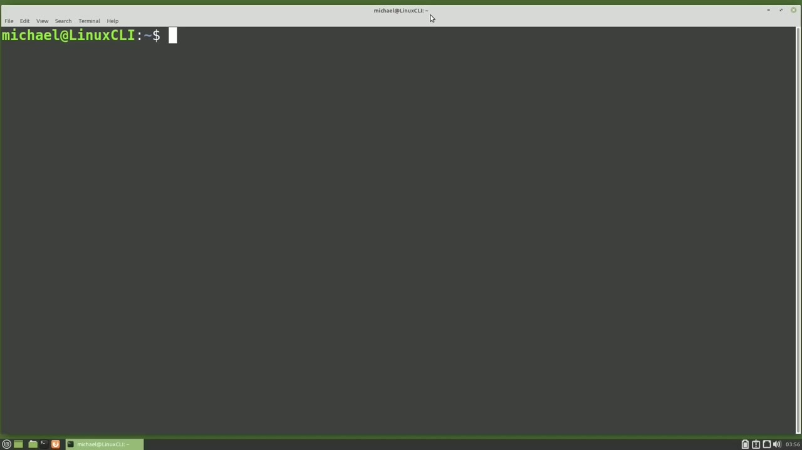
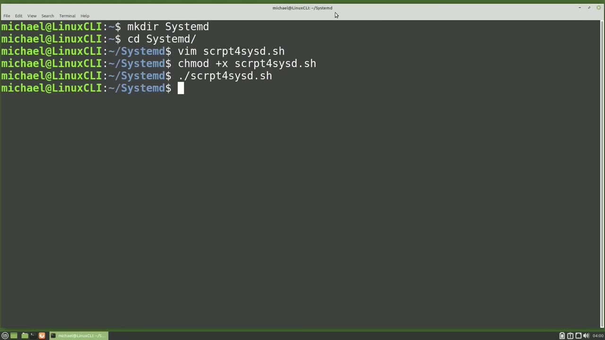
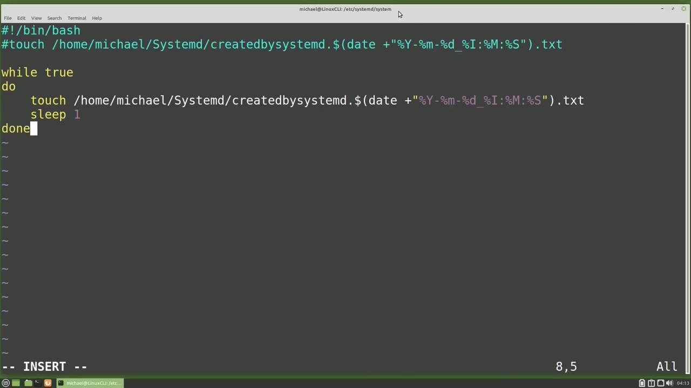
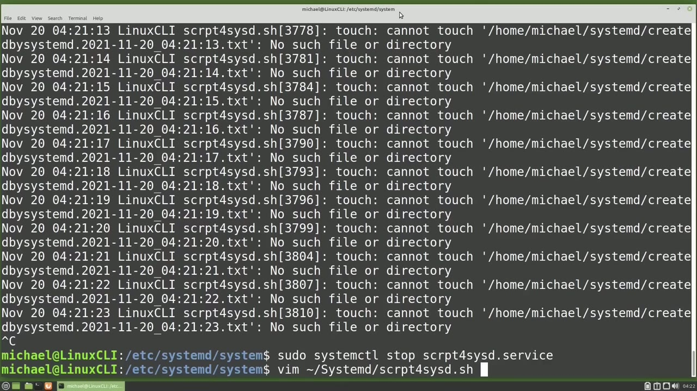

[← Course contents](../../01.md)

# 57. systemd.timer pt1

**Course:** [Linux Command Line - Entire Tutorial Series](https://www.youtube.com/watch?v=avg65oY7sj4)  
**Transcript:** [`Linux Command Line - Entire Tutorial Series transcript`](../../../../course_videos/Linux%20Command%20Line%20-%20Entire%20Tutorial%20Series/Linux%20Command%20Line%20-%20Entire%20Tutorial%20Series.txt)  
**Video:** 09:28:48–09:39:05 ([open at this time](https://www.youtube.com/watch?v=avg65oY7sj4&t=34128s))

## Introduction

Besides Cron, Linux computers running System D also have the option of scheduling jobs with System D timer. System D timer schedules jobs like Cron and Anacron, but there are some differences. The biggest difference is that three things are needed to schedule a System D timer. Those three things are the script you want to run on the schedule, a System D service to run that script, and a System D timer to start that scheduled System D service.

## Detailed Explanation

<details>
  <summary>Step 1 — Run `anacron`</summary>

### Step 1 — Run `anacron`

- [x] **Use `anacron`**
  - Besides Cron, Linux computers running System D also have the option of scheduling jobs with System D timer.
  - System D timer schedules jobs like Cron and `anacron`, but there are some differences.
  - The biggest difference is that three things are needed to schedule a System D timer.

- [x] **Those three things are the script you want to run on the schedule, a**
  - Those three things are the script you want to run on the schedule, a System D service to run that script, and a System D timer to start that scheduled System D service.
  - In this first video, we're going to create the script and the SystemD service.
  - Then in the next video, we're going to create the actual SystemD timer.

- [x] **I'm going to make a directory called SystemD and cd into that**
  - I'm going to make a directory called SystemD and cd into that directory.
  - Now let's create the script we want to run with the System D timer.
  - Vim s-c-r-p-t for script for SISTD.S-D.S-D.S-H.

- [x] **I'm going to paste in some code here, so you don't have to watch me**
  - I'm going to paste in some code here, so you don't have to watch me type it in.
  - And this will create a file in the Michael Home System D directory with the date and time the file was created.
  - I'm going to write and quit out of this file.

- [x] **And we want to make this file executable with Chmad plus X for the**
  - And we want to make this file executable with Chmad plus X for the script for sistd.sh.
  - Let's run this script to make sure it's working as we expect.

```bash
anacron
```



</details>

<details>
  <summary>Step 2 — Run `ls -lh`, `sudo`, `systemctl`</summary>

### Step 2 — Run `ls -lh`, `sudo`, `systemctl`

- [x] **Use `ls -lh`**
  - And view the directory with `ls -lh`.
  - And here we see the new created by SystemD.T file.
  - We have the first of our three things created.

- [x] **The second thing we need to create is a service to run our script**
  - The second thing we need to create is a service to run our script.
  - In the last video we saw how to stop, start, and enable a SystemD service that was included as an introduction to the SystemD Services.
  - In this video we're going to learn a little more about SystemD Services by creating a simple service and then stop, start, and talk about enabling that service.

- [x] **Use `sudo`**
  - System D Services are created in the /etc System D, System Directory.
  - We need to be a privileged user to create a SystemD service.
  - So I will start with `sudo`, then Vim, and the name of our service is going to be s-c-r-p-t-4, sisd.

- [x] **Service. I'm using the same name as our script**
  - Service. I'm using the same name as our script.
  - We don't have to, but I'd like to to keep things organized.
  - These are the only required lines of code for a system D service.

- [x] **For now, we're just adding in the minimum required lines**
  - For now, we're just adding in the minimum required lines.
  - Service and then under service, we're telling that service where to find the script we want to run.
  - And now we've added our service, but System D won't see the service until we reload the daemon with the command.

- [x] **Use `sudo`, `systemctl`, `sudo systemctl`**
  - `sudo`.
  - `systemctl`.
  - Damon reload. Now that System D can see our service, let's test it out by starting the service with `sudo systemctl`, Start scrpt for sisd. Service.

- [x] **Use `ls -lh`**
  - And to see if that worked as expected, I'm going to type `ls -lh` for the directory in my home directory, then System D.
  - Here we see the new file created, so the service worked as expected.
  - We do see that the file owner and the group are both root instead of Michael.

- [x] **I'm going to run this a second time with sudo-systemctl, start**
  - I'm going to run this a second time with sudo-`systemctl`, start script4Sysd.
  - And then we'll list out the file contents again.
  - And there we see a third txt file created.

- [x] **So our service is working the way we want it to work**
  - So our service is working the way we want it to work.
  - But that's not really how a service works.
  - To show how a service really works, I'm going to update my script with Vim.

- [x] **Go to the Home Directory, System D, and then we want to edit the file**
  - Go to the Home Directory, System D, and then we want to edit the file script for sistd.sh.
  - I'm going to comment out this line and then paste in some code.

```bash
ls -lh
sudo
systemctl
sudo systemctl
```



</details>

<details>
  <summary>Step 3 — Run `touch`, `sudo systemctl`, `ls -lh`</summary>

### Step 3 — Run `touch`, `sudo systemctl`, `ls -lh`

- [x] **Use `touch`**
  - And this code I just pasted in is going to run that same `touch` command, but it's going to put it in a loop and create a file, sleep for a second, then create another file.
  - And this will go on and on while the service continues to run.
  - Since we made the change to my script and not the SystemD service, we do not need to reload the daemon.

- [x] **Use `sudo systemctl`**
  - We can just start that service again with `sudo systemctl` Start scriptforcSD.Service.
  - And then looking in System D in our Home Directory, we see a lot more files.
  - Listing it again, there's even more files.

- [x] **Use `ls -lh`**
  - So we do see that the files continue to create as long as that System D service is running.
  - And let's check that out with `ls -lh` in the Home Directory, System D.
  - And the files have stopped being created.

- [x] **And checking it again, we see there's no change**
  - And checking it again, we see there's no change.
  - So the files have stopped being created. Things are working well, but what if I have a typo in my script?
  - I'm going to update my script with Vim, go to the Home Directory, SystemD, Script4, CystD.SH.

- [x] **And what I'm going to do is change the S in System D to a lowercase S**
  - And what I'm going to do is change the S in System D to a lowercase S.
  - Now I'm going to write and quit out of here and restart our service.
  - Now when we check that SystemD folder, we don't see any new files being created.

- [x] **Use `tail -f`, `touch`**
  - To find out what's wrong, we'll need to check the log files.
  - I'm going to tail the Syslog file with `tail -f`, var, Log, Syslog.
  - And here we see that we cannot `touch` the files because there's no such file or directory.

- [x] **Use `journalctl`, `sudo`, `touch`**
  - Another way to see what's wrong is to look in the `journalctl` file.
  - I'll do that with `sudo`, Journal, ctl, -U for unit, script for sisd, and then F for follow.
  - Cannot `touch` because there's no such file or directory.

- [x] **I'm going to stop our service and I'm going to edit our script again**
  - I'm going to stop our service and I'm going to edit our script again with Vim, go to the home directory, system D.

```bash
touch
sudo systemctl
ls -lh
tail -f
journalctl
sudo
```



</details>

<details>
  <summary>Step 4 — Run `touch`, `sudo systemctl edit`, `at`</summary>

### Step 4 — Run `touch`, `sudo systemctl edit`, `at`

- [x] **Use `touch`, `sudo systemctl edit`**
  - Script for sistd.sh. I'm going to delete out the six files and un-comment our original `touch` command.
  - Now let's update our service. And there is another way to update the service file.
  - That's with `sudo `systemctl` edit` and then our service name which is script without the I for sisd.

- [x] **And we do not add the service at the end. We'll put -dash, full. In**
  - And we do not add the service `at` the end. We'll put -dash, full. In this file, I want to add a description for our service.
  - So I'm going to put it right here `at` the top.
  - It's going to be under the unit and the description is the service will run the script Home Michael System D script for sisd dot s.h. And then under the service, I'm going to add in a line user equals Michael.

- [x] **Use `at`**
  - This will run the service as Michael. So the file owners will be Michael instead of root.
  - Now there is another section below this.
  - And under here we would tell it if we wanted to run `at` startup with wanted by equals graphical.

- [x] **Now we would use this if we had a laptop or a desktop computer that**
  - Now we would use this if we had a laptop or a desktop computer that has a GUI desktop that it boots into.
  - And we're saying start this service when we start up that GUI desktop.
  - But if we're on a server that does not have a graphical desktop, we would start this with wanted by multi-user.Target.

- [x] **Since we're going to start this script with a system D timer, we**
  - Since we're going to start this script with a system D timer, we don't want any install section `at` all.
  - So I'm going to take this out and write this file with Ctrl+X.
  - And yes, I want to save the modified changes with the same name.

- [x] **Use `sudo systemctl edit`, `systemctl status`**
  - So the advantage of using the `sudo `systemctl` edit` Script 4SysD -full is we do not need to run the Damon Reload for our changes to be recognized.
  - And we can see that by typing `systemctl status` script for sisd.
  - And here we see the comment that we just added to our service.

- [x] **Use `systemctl`, `sudo`, `ls -lh`**
  - `systemctl` Start, scripts for sisd.s.s.d. Service.
  - And I didn't add `sudo`, so it's asking me for the password.
  - And we'll see if that worked by checking our SystemD file with `ls -lh`.

- [x] **And here we see the file is created with a user and group of Michael**
  - And here we see the file is created with a user and group of Michael, just as we expect.
  - We'll pick it up from here in the next video.
  - Where we will create our SystemD timer for the Linux command line.

```bash
touch
sudo systemctl edit
at
systemctl status
systemctl
sudo
ls -lh
```



</details>

<details>
  <summary>Questions and Answers</summary>

## Questions and Answers

### Question 1: What does `anacron` do in this chapter?

<details>
<summary>Answer</summary>

- [x] System D timer schedules jobs like Cron and `anacron`, but there are some differences.

</details>

### Question 2: What does `ls -lh` do in this chapter?

<details>
<summary>Answer</summary>

- [x] And view the directory with `ls -lh`.

</details>

### Question 3: What does `sudo` do in this chapter?

<details>
<summary>Answer</summary>

- [x] So I will start with `sudo`, then Vim, and the name of our service is going to be s-c-r-p-t-4, sisd.

</details>

### Question 4: What does `systemctl` do in this chapter?

<details>
<summary>Answer</summary>

- [x] `systemctl`.

</details>

### Question 5: What does `sudo systemctl` do in this chapter?

<details>
<summary>Answer</summary>

- [x] Damon reload. Now that System D can see our service, let's test it out by starting the service with `sudo systemctl`, Start scrpt for sisd. Service.

</details>

### Question 6: What does `touch` do in this chapter?

<details>
<summary>Answer</summary>

- [x] And this code I just pasted in is going to run that same `touch` command, but it's going to put it in a loop and create a file, sleep for a second, then create another file.

</details>

### Question 7: What does `tail -f` do in this chapter?

<details>
<summary>Answer</summary>

- [x] I'm going to tail the Syslog file with `tail -f`, var, Log, Syslog.

</details>

### Question 8: What does `journalctl` do in this chapter?

<details>
<summary>Answer</summary>

- [x] Another way to see what's wrong is to look in the `journalctl` file.

</details>

### Question 9: What does `sudo systemctl edit` do in this chapter?

<details>
<summary>Answer</summary>

- [x] That's with `sudo systemctl edit` and then our service name which is script without the I for sisd.

</details>

### Question 10: What does `at` do in this chapter?

<details>
<summary>Answer</summary>

- [x] And under here we would tell it if we wanted to run `at` startup with wanted by equals graphical.

</details>

### Question 11: What does `systemctl status` do in this chapter?

<details>
<summary>Answer</summary>

- [x] And we can see that by typing `systemctl status` script for sisd.

</details>

</details>

## Summary

This chapter, systemd.timer pt1, walks through Run anacron; Run ls -lh, sudo, systemctl; Run touch, sudo systemctl, ls -lh; Run touch, sudo systemctl edit, at. Commands from the transcript: `anacron`, `ls -lh`, `sudo`, `systemctl`, `sudo systemctl`, `touch`, `tail -f`, `journalctl`, `sudo systemctl edit`, `at`, `systemctl status`.

## References

- [Linux Command Line - Entire Tutorial Series (YouTube)](https://www.youtube.com/watch?v=avg65oY7sj4)
- [This chapter at 09:28:48](https://www.youtube.com/watch?v=avg65oY7sj4&t=34128s)
- [Local transcript](../../../../course_videos/Linux%20Command%20Line%20-%20Entire%20Tutorial%20Series/Linux%20Command%20Line%20-%20Entire%20Tutorial%20Series.txt)
