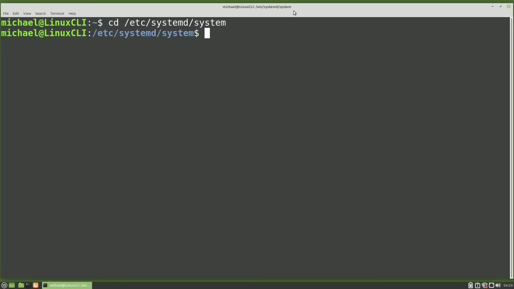
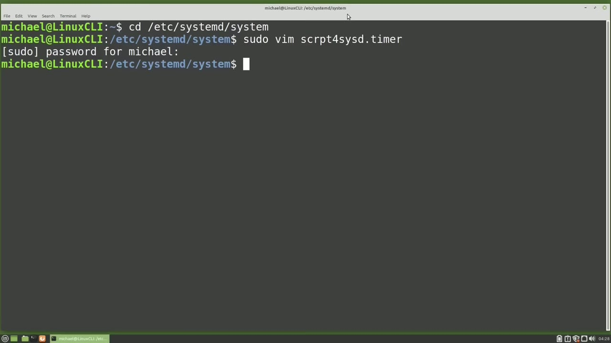
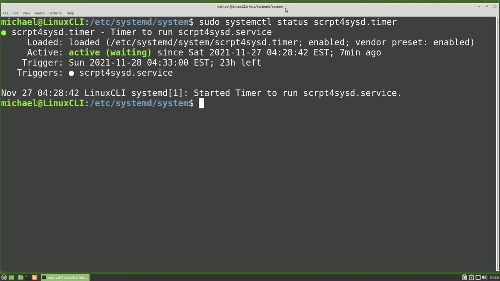
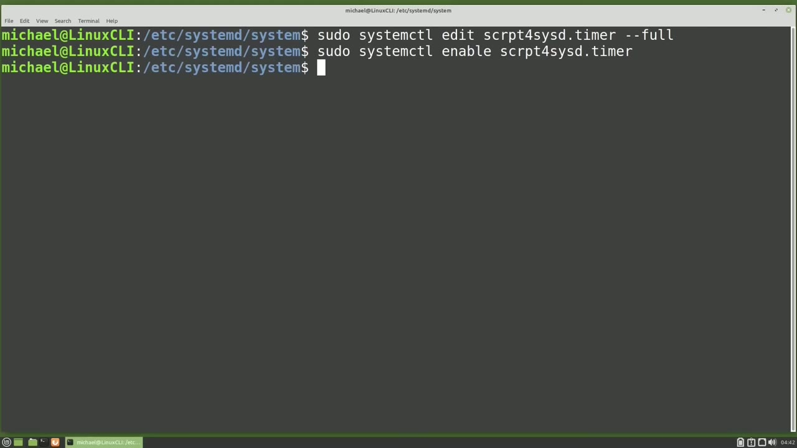
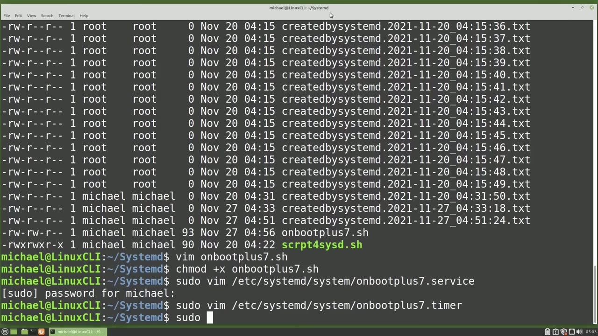

[← Course contents](../../01.md)

# 58. systemd.timer pt2

**Course:** [Linux Command Line - Entire Tutorial Series](https://www.youtube.com/watch?v=avg65oY7sj4)  
**Transcript:** [`Linux Command Line - Entire Tutorial Series transcript`](../../../../course_videos/Linux%20Command%20Line%20-%20Entire%20Tutorial%20Series/Linux%20Command%20Line%20-%20Entire%20Tutorial%20Series.txt)  
**Video:** 09:39:05–09:51:02 ([open at this time](https://www.youtube.com/watch?v=avg65oY7sj4&t=34745s))

## Introduction

Picking up from where we left off in the last video, we said that our SystemD timer needs three things. A script, a SystemD service to run that script, and a SystemD timer to tell that SystemD service when to run. In the previous video, we created the script and the SystemD service. Now we're going to create the SystemD Timer.

## Detailed Explanation

<details>
  <summary>Step 1 — Run `sudo`</summary>

### Step 1 — Run `sudo`

- [x] **Picking up from where we left off in the last video, we said that our**
  - Picking up from where we left off in the last video, we said that our SystemD timer needs three things.
  - A script, a SystemD service to run that script, and a SystemD timer to tell that SystemD service when to run.
  - In the previous video, we created the script and the SystemD service.

- [x] **Use `sudo`**
  - Now we're going to create the SystemD Timer.
  - SystemD timers are created in the same directory as SystemD services, so I will cd into /etc, SystemD, System.
  - We have to be a privileged user to create a SystemD timer, so I will start the command with `sudo`, then vim, and I'm going to keep the same name that we used for the script and the service, s-r-p-t for sisd, and then I'll add on the dot timer.

- [x] **And we see the timer file format is very similar to the service file**
  - And we see the timer file format is very similar to the service file.
  - We first have the unit that will have the description.
  - Remember for service, it was called service.

- [x] **In this section, we have the unit, which is the service we want to run**
  - In this section, we have the unit, which is the service we want to run.
  - And then we're giving it the time we want to run that system D service.
  - In this case, I'm using the on calendar option.

- [x] **Let's take a closer look at that on calendar format**
  - Let's take a closer look at that on calendar format.
  - The on calendar format starts with the day of the week, then a space, then the date in year month day format, then another space, then the time in hours, minutes, and seconds.
  - For example, if I want my calendar system D timer to run every Monday at 1.15 in the afternoon, I would type on calendar equals m-o-n for Mondays, then a space, then an asteris -asterisk for any year, any month, and any day.

- [x] **This part with the asteris is similar to how Kron works with asteris**
  - This part with the asteris is similar to how Kron works with asteris meaning any.
  - Then we've got a space, then 13 for 1pm in the 24 hour clock format, and then 15 for the minutes after the hour, and then I've got zeros in for the seconds.
  - Let's look at another on calendar example.

- [x] **In this example, we want the service to run on the first day of the**
  - In this example, we want the service to run on the first day of the month at 4 a.m.
  - The first of the month can be any day of the week, but I did not replace the day of the week with an asterisk like we'd expect.
  - I replaced the day of the week with nothing.

- [x] **System D timer interprets no day of the week to mean any**
  - System D timer interprets no day of the week to mean any.
  - So that's why the day of the week is missing.
  - Then we have any for a year and month, but we want this to run on the first day of the month.

- [x] **So we have a 1 for the day of the month**
  - So we have a 1 for the day of the month.
  - Then we have a 4 for the hours for 4 a.m.

```bash
sudo
```



</details>

<details>
  <summary>Step 2 — Run `sudo systemctl`, `sudo`, `ls -lh`</summary>

### Step 2 — Run `sudo systemctl`, `sudo`, `ls -lh`

- [x] **Use `sudo systemctl`**
  - Going back to our SystemD timer file, we want this to run in about 5 minutes.
  - So I'm going to change the time to be 433.
  - Because we made a change to the SystemD service, we will need to reload the Damon with `sudo`, systemctl, Daemon.

- [x] **Use `sudo`**
  - Reload. And then I want to start our system D timer with `sudo` system C tl start scrpt for sistd dot timer.
  - And let's check it out. Make sure everything looks all right with `sudo` System C tl status scrpt for sistd dot timer.
  - We see our comment and we see that it is active and waiting to run.

- [x] **Use `ls -lh`**
  - It's going to run in 3 minutes and 49 seconds and it's going to run our script for sisd.
  - Service. I'm going to pause the video and come back after the script has run.
  - Okay, it's past 433. Let's check the results with `ls -lh` Home Michael SystemD.

- [x] **And here we see the new script was created at 433 just as expected**
  - And here we see the new script was created at 433 just as expected.
  - Let's check the status of the timer now.
  - And we see it will run again in 23 hours.

- [x] **And as long as we don't turn the computer off, that will happen**
  - And as long as we don't turn the computer off, that will happen.
  - But if the computer is turned off before that runs, our timer will be missed.

```bash
sudo systemctl
sudo
ls -lh
```



</details>

<details>
  <summary>Step 3 — Run `at`, `systemctl enable`, `sudo systemctl`</summary>

### Step 3 — Run `at`, `systemctl enable`, `sudo systemctl`

- [x] **Use `at`**
  - Even if we turn the computer back on before that time.
  - And that's because we have not yet enabled our timer.
  - If we want our service, or in this case our timer, to run `at` startup, we need to enable it.

- [x] **Use `systemctl enable`**
  - I'm going to try and enable the timer right now with Soudou.
  - `systemctl enable` scrpt for sistd dot timer and I need to spell that correctly.
  - And here we see the message, No installation config wanted by.

- [x] **Use `sudo systemctl`**
  - We talked about this a little bit in the last video.
  - In short, we need to add the install configuration to our timer file.
  - I'm going to edit the timer file with `sudo systemctl`.

- [x] **Remember, we did this in the last video, but instead of script for**
  - Remember, we did this in the last video, but instead of script for cystid dot timer, we just left it as script for sisd.
  - If we don't give it the full name, it will default to the service.
  - I'm going to press Enter and going down.

- [x] **And here we're saying when the computer boots up, start this timer**
  - And here we're saying when the computer boots up, start this timer.
  - And I'm going to hold down control and X.
  - I want to save the modified buffer with Y and enter.

- [x] **Use `sudo systemctl`**
  - Because we edited the timer file this way, we do not need to reload the damon, but we still need to enable our timer.
  - We can do that with `sudo systemctl`.
  - Now that we have our script enabled, it will run on startup.

- [x] **But if the computer is not on when the timer is scheduled to run**
  - But if the computer is not on when the timer is scheduled to run, this timer will be missed.

```bash
at
systemctl enable
sudo systemctl
```



</details>

<details>
  <summary>Step 4 — Run `anacron`, `ls -lh`, `sudo vim /etc`</summary>

### Step 4 — Run `anacron`, `ls -lh`, `sudo vim /etc`

- [x] **Use `anacron`**
  - It will not run. To make the script run on startup, if it was missed, like we did with `anacron`, we will need to add Persistent to our Timer file. Let's edit that file again.
  - And in the Timer section, we want to add the text Persistent equals True.
  - Let's also change this timer, so it will run five minutes from now.

- [x] **at 449. I'm going to hold down control and press x, y, enter, and**
  - at 449. I'm going to hold down control and press x, y, enter, and that's saved.
  - Now we should not need to reload the daemon, but I'm going to do that anyway.
  - And I'm also going to start the script again.

- [x] **And let's check the status. We see it's scheduled to run in three**
  - And let's check the status. We see it's scheduled to run in three minutes and 16 seconds.
  - I'm going to power off the computer and power it back on sometime after 449.
  - I've restarted the computer after the time that script should have run, but I should still have a new file created with a timestamp that is greater than 449.

- [x] **Use `ls -lh`**
  - Let's cd into the System D directory and type `ls -lh`.
  - So adding Persistent to our timer file did work.
  - It did make the script run on Startup as we expected.

- [x] **This one, I want to run seven minutes after the computer boots up**
  - This one, I want to run seven minutes after the computer boots up.
  - The first thing we're going to do is create the script with Vim On Boot Plus7.SH.
  - This is almost exactly the same as our other text file, only we've changed the name to On Boot Plus 7.

- [x] **Use `sudo vim /etc`**
  - I want to make the script executable, so I'll type Chmad plus x on boot plus 7.sh.
  - Now we need to create the SystemD service.
  - Sudo, Vim, /etc, SystemD, SystemD, System, on Boot plus 7.

- [x] **And this text has the description under the unit**
  - And this text has the description under the unit.
  - And under the service, we've got the script to run.
  - And to run this script as Michael, just like the other service we created.

- [x] **And I'm going to save that with colon wq**
  - And I'm going to save that with colon wq.
  - And now let's create the timer with that same command, but changing service to timer.
  - And I'm going to paste in some more text.

- [x] **And here we see the description under the unit**
  - And here we see the description under the unit.
  - Then we have timer and under timer we see the unit that we want to run, but notice the next line isn't on calendar like we used in the other timer file.
  - This time we have on boot sec equals 7min.

- [x] **You may hear people talk about monotonic or real time system D timers**
  - You may hear people talk about monotonic or real time system D timers.

```bash
anacron
ls -lh
sudo vim /etc
```



</details>

<details>
  <summary>Step 5 — Run `sudo systemctl`, `sudo reboot`, `ls -lh`</summary>

### Step 5 — Run `sudo systemctl`, `sudo reboot`, `ls -lh`

- [x] **When we use the on calendar option, that was the real time system D**
  - When we use the on calendar option, that was the real time system D timer because we gave it a specific time to run.
  - which means we're not giving it a specific time of day to run.
  - We're saying seven minutes after this computer boots run the script, and we don't care what time of day that clock in the wall says.

- [x] **Use `sudo systemctl`**
  - Type `sudo systemctl`, Damon Reloode.
  - I need to enable this timer with `sudo systemctl`.
  - 7. Timer. Now every time this computer boots up, it's going to wait 7 minutes and then it's going to run this script.

- [x] **Use `sudo reboot`**
  - Right now and make sure it's working the way that we expect.
  - `sudo reboot`.
  - Okay, the computer's been restarted and sitting for seven minutes.

- [x] **Use `ls -lh`**
  - Let's check that out with `ls -lh` System D.
  - And here we see at 512, it created our On Boot Plus 7 file.
  - The last thing I want to show here is that we can show all our timers with...

- [x] **Use `systemctl`**
  - `systemctl`, list timers.
  - To see the timers, we need to go over to the right.
  - That last ran 25 minutes ago and it's scheduled to run again tomorrow at 451 a.m.

- [x] **In the next video, we'll continue looking at the Linux command line**
  - In the next video, we'll continue looking at the Linux command line.

```bash
sudo systemctl
sudo reboot
ls -lh
systemctl
```



</details>

<details>
  <summary>Questions and Answers</summary>

## Questions and Answers

### Question 1: What does `sudo` do in this chapter?

<details>
<summary>Answer</summary>

- [x] We have to be a privileged user to create a SystemD timer, so I will start the command with `sudo`, then vim, and I'm going to keep the same name that we used for the script and the service, s-r-p-t for sisd, and then I'll add on the dot timer.

</details>

### Question 2: What does `sudo systemctl` do in this chapter?

<details>
<summary>Answer</summary>

- [x] Because we made a change to the SystemD service, we will need to reload the Damon with sudo, systemctl, Daemon.

</details>

### Question 3: What does `ls -lh` do in this chapter?

<details>
<summary>Answer</summary>

- [x] Okay, it's past 433. Let's check the results with `ls -lh` Home Michael SystemD.

</details>

### Question 4: What does `at` do in this chapter?

<details>
<summary>Answer</summary>

- [x] If we want our service, or in this case our timer, to run `at` startup, we need to enable it.

</details>

### Question 5: What does `systemctl enable` do in this chapter?

<details>
<summary>Answer</summary>

- [x] `systemctl enable` scrpt for sistd dot timer and I need to spell that correctly.

</details>

### Question 6: What does `anacron` do in this chapter?

<details>
<summary>Answer</summary>

- [x] It will not run. To make the script run on startup, if it was missed, like we did with `anacron`, we will need to add Persistent to our Timer file. Let's edit that file again.

</details>

### Question 7: What does `sudo vim /etc` do in this chapter?

<details>
<summary>Answer</summary>

- [x] Sudo, Vim, /etc, SystemD, SystemD, System, on Boot plus 7.

</details>

### Question 8: What does `sudo reboot` do in this chapter?

<details>
<summary>Answer</summary>

- [x] `sudo reboot`.

</details>

### Question 9: What does `systemctl` do in this chapter?

<details>
<summary>Answer</summary>

- [x] `systemctl`, list timers.

</details>

</details>

## Summary

This chapter, systemd.timer pt2, walks through Run sudo; Run sudo systemctl, sudo, ls -lh; Run at, systemctl enable, sudo systemctl; Run anacron, ls -lh, sudo vim /etc; Run sudo systemctl, sudo reboot, ls -lh. Commands from the transcript: `sudo`, `sudo systemctl`, `ls -lh`, `at`, `systemctl enable`, `anacron`, `sudo vim /etc`, `sudo reboot`, `systemctl`.

## References

- [Linux Command Line - Entire Tutorial Series (YouTube)](https://www.youtube.com/watch?v=avg65oY7sj4)
- [This chapter at 09:39:05](https://www.youtube.com/watch?v=avg65oY7sj4&t=34745s)
- [Local transcript](../../../../course_videos/Linux%20Command%20Line%20-%20Entire%20Tutorial%20Series/Linux%20Command%20Line%20-%20Entire%20Tutorial%20Series.txt)
