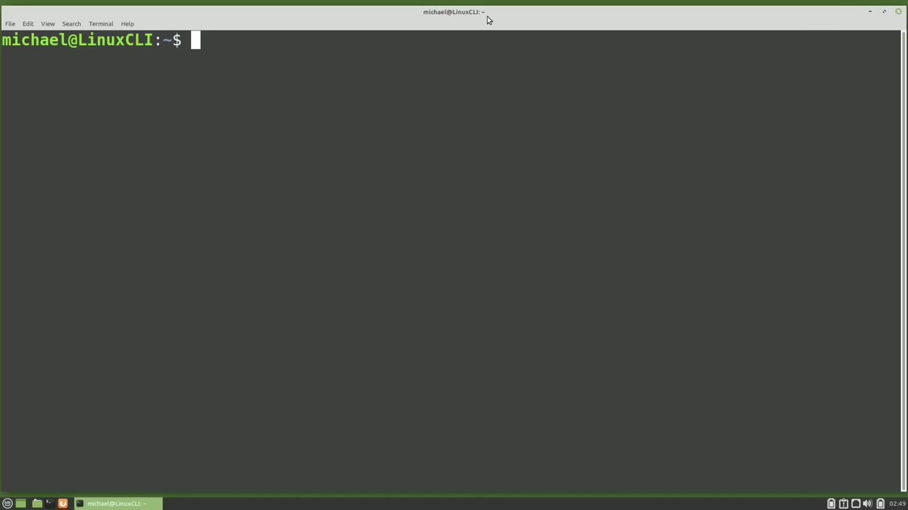
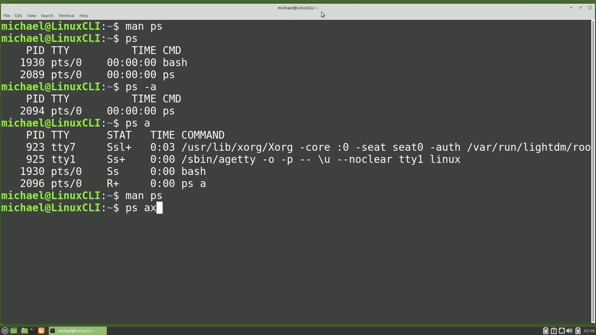
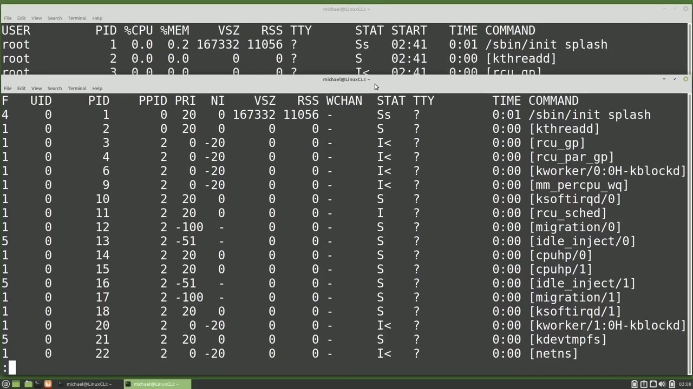
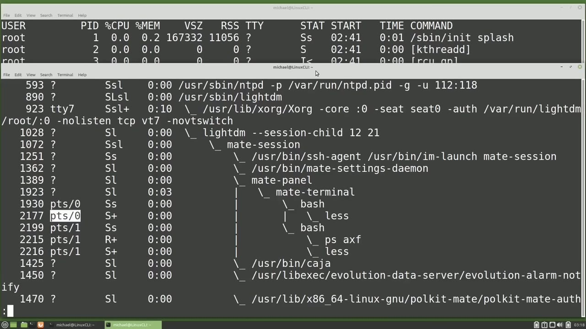
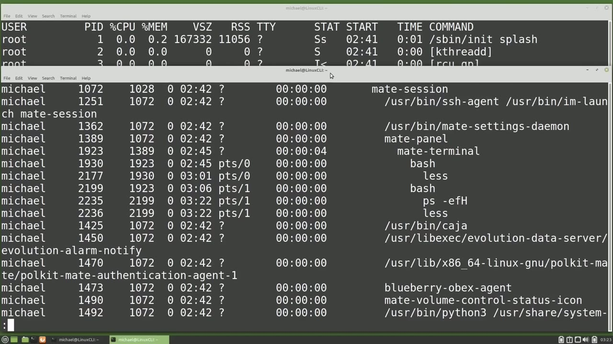

[← Course contents](../../01.md)

# 59. ps

**Course:** [Linux Command Line - Entire Tutorial Series](https://www.youtube.com/watch?v=avg65oY7sj4)  
**Transcript:** [`Linux Command Line - Entire Tutorial Series transcript`](../../../../course_videos/Linux%20Command%20Line%20-%20Entire%20Tutorial%20Series/Linux%20Command%20Line%20-%20Entire%20Tutorial%20Series.txt)  
**Video:** 09:51:02–10:03:26 ([open at this time](https://www.youtube.com/watch?v=avg65oY7sj4&t=35462s))

## Introduction

In this group of videos, we're going to look at the Linux processes. And the process is pretty much anything that goes through the Linux kernel, including programs, applications, reading and writing files and output, and any commands run. One way to see what processes are running on a Linux computer is by using the ps command. Some people think that ps stands for process status, but if you check the Man page with Man ps, We see Report a Snapshot of Current Processes.

## Detailed Explanation

<details>
  <summary>Step 1 — Run `ps`, `man ps`, `less`</summary>

### Step 1 — Run `ps`, `man ps`, `less`

- [x] **Use `ps`**
  - In this group of videos, we're going to look at the Linux processes.
  - And the process is pretty much anything that goes through the Linux kernel, including programs, applications, reading and writing files and output, and any commands run.
  - One way to see what processes are running on a Linux computer is by using the `ps` command.

- [x] **Use `man ps`, `ps`**
  - Some people think that `ps` stands for process status, but if you check the Man page with `man ps`, We see Report a Snapshot of Current Processes.
  - So it's also possible that `ps` stands for Print Snapshot of Current Processes.
  - When I type `ps` by itself and press Enter, it shows two processes.

- [x] **Every process will get a unique Process id starting with one and**
  - Every process will get a unique Process id starting with one and going up from there.
  - There is a limit to the number of process IDs, so if and when a process ends, that PID will become available for use again if needed.
  - The next field TTY shows what started this process, and in this case it's the terminal that we are in.

- [x] **For a lot of processes, we're going to see a question mark in this**
  - For a lot of processes, we're going to see a question mark in this column.
  - When we see that question mark, it means the kernel started the process.
  - Then we see the time it took the job to run.

- [x] **Use `less`**
  - And that time is CPU time, not clock on the wall time.
  - Here, both processes use `less` than a second of CPU time, so they show as 0 seconds.
  - And the last column is the command used to start this process.

- [x] **Use `ps`, `bash`**
  - When I add -A to the `ps` command and then press Enter, we see more or `less` the same thing.
  - Because this is a new execution of the `ps` command.
  - And we don't see the `bash` command in this output.

- [x] **Use `ps`**
  - When I type `ps` space A without the dash and press enter, we get slightly different results.
  - The reason is going to the man page again.
  - When we type `ps` without the dash, we're using the bsd options of the `ps` command.

- [x] **Use `ps`**
  - Depending on what we're doing, we may or may not want to use the dash with the `ps` command.
  - The A option for the `ps` command stands for all, meaning all of the commands by this user in this terminal.
  - To see all the processes running on this computer by all users will need to add the X option after the A.

```bash
ps
man ps
less
bash
```



</details>

<details>
  <summary>Step 2 — Run `less`, `at`, `ps -aux`</summary>

### Step 2 — Run `less`, `at`, `ps -aux`

- [x] **Use `less`, `at`**
  - Psax and I'm going to pipe this into the `less` command.
  - This shows all the jobs running right now by all the users on the system.
  - And as I scroll down a little bit, you'll see that there is a lot of things running `at` the moment.

- [x] **Use `ps -aux`**
  - But looking `at` this output, we cannot tell who is running what job.
  - To see what user is running what job, we can add the lowercase U to this, making our command, P S.
  - A-x-u. More often, we're going to see this command typed out as `ps -aux`, but the order of the options does not matter.

- [x] **Use `ps -axu`**
  - The output will be the same either way, and I'm going to use the format `ps -axu`.
  - And then I'm going to pipe that into `less`.
  - Here we see the first column is the user. The second column is the p-i-d that we already talked about.

- [x] **The third column is the percent of CPU used by this process**
  - The third column is the percent of CPU used by this process.
  - Rss is for resident set size, which is more or `less` just the RAM memory used.
  - We talked about TTY showing the question mark.

- [x] **Use `stat`**
  - These are processes submitted by the kernel.
  - Here they're showing with the user of root.
  - `stat`.

- [x] **Is for the current status of the job. The uppercase S is for a**
  - Is for the current status of the job. The uppercase S is for a process that is sleeping or waiting for something. The uppercase I means this process is idle `at` the moment. And a `less` than angle bracket next to that uppercase I means that this is a high priority task.
  - Then we have the start time, the time that the process started. And the time next to that is the CPU time used, which we talked about earlier.
  - And then on the far right, we have the command that started this process.

- [x] **And notice here that PID 1 shows as S-bin init for the initialization**
  - And notice here that PID 1 shows as S-bin init for the initialization process.
  - We will also see that PID 1 show as System D, depending on how the output is displayed.
  - I'm going to open another terminal and shrink this down a little bit.

- [x] **And this is so we can compare ps command output. Now instead of**
  - And this is so we can compare ps command output. Now instead of typing psaxu for user, I'm going to type psaxl for long format.
  - Here the first column is an F for flags.
  - The four means that the job was submitted with root privileges.

- [x] **Then we also see ones in that flag column and that one means that the**
  - Then we also see ones in that flag column and that one means that the job was forked but did not execute.
  - Then we see some have the flag of 5, which means both 4 and 1.

```bash
less
at
ps -aux
ps -axu
stat
```



</details>

<details>
  <summary>Step 3 — then if we have a 0 in that column, that means there are no flags for</summary>

### Step 3 — then if we have a 0 in that column, that means there are no flags for

- [x] **And then if we have a 0 in that column, that means there are no flags**
  - And then if we have a 0 in that column, that means there are no flags for that process.
  - After that, we have UID for user id, which shows us the user id instead of the username.
  - We talked about user IDs in Video 14, adding new users.

- [x] **Then we see PID, we already talked about that**
  - Then we see PID, we already talked about that.
  - Then we see pp id, which is the parent process id.
  - And here we'll notice that these first two PIDs, one and two, the init process and the system D kernel thread, are the only two processes without a parent process.

- [x] **Every other process will be started from another process**
  - Every other process will be started from another process.
  - Then we see pri and ni, which stand for priority and nice values.
  - We're going to look at those in more detail in an upcoming video, so I'm going to leave it there for now.

- [x] **Then the last value that we haven't talked about is W Chan. W Chan**
  - Then the last value that we haven't talked about is W Chan. W Chan shows the kernel function in which the process is sleeping.
  - I'm going to quit out of here. And now instead of typing psaxl, I'm going to type psaxf.
  - And this is another one where the options are usually shown differently. It's usually shown as psfax.

- [x] **But as I mentioned before, the order of the options does not make a**
  - But as I mentioned before, the order of the options does not make a difference.
  - And I'm showing it here as psaxf because here we can see them all together.



</details>

<details>
  <summary>Step 4 — Run `less`, `ps -uppercase`, `ps -E`</summary>

### Step 4 — Run `less`, `ps -uppercase`, `ps -E`

- [x] **We're using psax and just changing that last option**
  - We're using psax and just changing that last option.
  - And here the F stands for forest, meaning in a tree hierarchy.
  - I'm going to pipe this into `less` and press enter.

- [x] **And here on this first page we see a lot of jobs that have apparent**
  - And here on this first page we see a lot of jobs that have apparent process of the system D kernel thread.
  - Scrolling to the bottom with uppercase G and then going up a little bit.
  - Here we see the psaxf command we submitted here and we piped it into `less`.

- [x] **Use `less`**
  - And we see that these commands were submitted from the terminal pts 1.
  - And in the other terminal pts 0, we see the `less` command from that terminal as well.
  - And then we see apparent process of the Matte terminal, which has apparent process of the Matte panel and we can keep going up from there.

- [x] **Use `ps -uppercase`**
  - Those were all using the ps command options without the dash.
  - Now I'm going to type ps again and this time I'm going to add a -lowercase E is for everything and I'm also going to pipe that into `less`.
  - And instead of the -E, we can also type `ps -uppercase` a and I'll pipe that into `less` and that shows that we get the same output.

- [x] **Use `ps -E`, `ps -lowercase`**
  - So -lowercase E for everything and -uppercase A for all.
  - To see a little more output, we can type `ps -E` for everything and then F for full.
  - Or we can type `ps -lowercase` E uppercase F for extra full format.

- [x] **Use `ps -el`, `ps -ef`**
  - And then another one that's kind of comparable to what we've been looking at is the `ps -el`.
  - With the `ps -ef`, you may be thinking, how do I see that forest now?
  - Since we already use the F for full, well, here we're going to use an uppercase H for hierarchy.

- [x] **And this shows the child processes have a space or they're tabbed**
  - And this shows the child processes have a space or they're tabbed over to the right of the parent process.
  - It's more clear when we go down to the bottom and then up a little bit here.

```bash
less
ps -uppercase
ps -E
ps -lowercase
ps -el
ps -ef
```



</details>

<details>
  <summary>Step 5 — Run `ps -efh`, `ps -ef`, `ps -axu -sort`</summary>

### Step 5 — Run `ps -efh`, `ps -ef`, `ps -axu -sort`

- [x] **Use `ps -efh`, `ps -ef`**
  - And here we see the `ps -efh` command that we just submitted.
  - So this does work, but I prefer to see the hierarchy lines.
  - To show those hierarchy lines, I'm going to type `ps -ef` and then -F and I'll pipe that into less.

- [x] **And here's similar format that we've already seen**
  - And here's similar format that we've already seen.
  - Now looking in our other terminal here, we notice that the output is sorted by PID.
  - To change that sort order, we can type P-S-A-U-X-Sort and I'm going to sort it by the virtual memory size.

- [x] **So I'm going to place a single -now and the v-s-z for virtual memory**
  - So I'm going to place a single -now and the v-s-z for virtual memory.
  - And this is a little difficult to see with the word wrapping or line wrapping as the case may be.
  - So I'm going to press the -uppercase S and then enter.

- [x] **Use `ps -axu -sort`**
  - And here we see the virtual memory starts with the largest on `top`, and then the next largest below that, and the next largest below that, and it keeps going down.
  - Another common thing we might want to sort by is the CPU.
  - So I'm going to type `ps -axu -sort`.

- [x] **And then we need the -before what we want to sort by**
  - And then we need the -before what we want to sort by.
  - And we want the CPU, but it's got that percent sign to the left of it.
  - CPU and then I'm going to pipe that into less.

- [x] **And again, because of the word wrap, I'm going to press -uppercase S**
  - And again, because of the word wrap, I'm going to press -uppercase S and enter.
  - And here we can see that there's not much going on with that CPU.
  - And then below that we've got 0.2.2 and 0.1.1.

- [x] **Use `at`, `top`**
  - And this works out really well to show us all the processes running `at` this moment.
  - But this information can change a minute or two later or even a few seconds later.
  - The most common way to see the processes updated every few seconds on a Linux computer is with the `top` Command. And in the next video, we're going to look `at` the `top` Command for the Linux Command line.

```bash
ps -efh
ps -ef
ps -axu -sort
at
top
```



</details>

<details>
  <summary>Questions and Answers</summary>

## Questions and Answers

### Question 1: What does `ps` do in this chapter?

<details>
<summary>Answer</summary>

- [x] One way to see what processes are running on a Linux computer is by using the `ps` command.

</details>

### Question 2: What does `man ps` do in this chapter?

<details>
<summary>Answer</summary>

- [x] Some people think that ps stands for process status, but if you check the Man page with `man ps`, We see Report a Snapshot of Current Processes.

</details>

### Question 3: What does `less` do in this chapter?

<details>
<summary>Answer</summary>

- [x] Here, both processes use `less` than a second of CPU time, so they show as 0 seconds.

</details>

### Question 4: What does `bash` do in this chapter?

<details>
<summary>Answer</summary>

- [x] And we don't see the `bash` command in this output.

</details>

### Question 5: What does `at` do in this chapter?

<details>
<summary>Answer</summary>

- [x] And as I scroll down a little bit, you'll see that there is a lot of things running `at` the moment.

</details>

### Question 6: What does `ps -aux` do in this chapter?

<details>
<summary>Answer</summary>

- [x] A-x-u. More often, we're going to see this command typed out as `ps -aux`, but the order of the options does not matter.

</details>

### Question 7: What does `ps -axu` do in this chapter?

<details>
<summary>Answer</summary>

- [x] The output will be the same either way, and I'm going to use the format `ps -axu`.

</details>

### Question 8: What does `stat` do in this chapter?

<details>
<summary>Answer</summary>

- [x] `stat`.

</details>

### Question 9: What does `ps -uppercase` do in this chapter?

<details>
<summary>Answer</summary>

- [x] And instead of the -E, we can also type `ps -uppercase` a and I'll pipe that into less and that shows that we get the same output.

</details>

### Question 10: What does `ps -E` do in this chapter?

<details>
<summary>Answer</summary>

- [x] To see a little more output, we can type `ps -E` for everything and then F for full.

</details>

### Question 11: What does `ps -lowercase` do in this chapter?

<details>
<summary>Answer</summary>

- [x] Or we can type `ps -lowercase` E uppercase F for extra full format.

</details>

### Question 12: What does `ps -el` do in this chapter?

<details>
<summary>Answer</summary>

- [x] And then another one that's kind of comparable to what we've been looking at is the `ps -el`.

</details>

</details>

## Summary

This chapter, ps, walks through Run ps, man ps, less; Run less, at, ps -aux; then if we have a 0 in that column, that means there are no flags for; Run less, ps -uppercase, ps -E; Run ps -efh, ps -ef, ps -axu -sort. Commands from the transcript: `ps`, `man ps`, `less`, `bash`, `at`, `ps -aux`, `ps -axu`, `stat`, `ps -uppercase`, `ps -E`, `ps -lowercase`, `ps -el`, `ps -ef`, `ps -efh`.

## References

- [Linux Command Line - Entire Tutorial Series (YouTube)](https://www.youtube.com/watch?v=avg65oY7sj4)
- [This chapter at 09:51:02](https://www.youtube.com/watch?v=avg65oY7sj4&t=35462s)
- [Local transcript](../../../../course_videos/Linux%20Command%20Line%20-%20Entire%20Tutorial%20Series/Linux%20Command%20Line%20-%20Entire%20Tutorial%20Series.txt)
