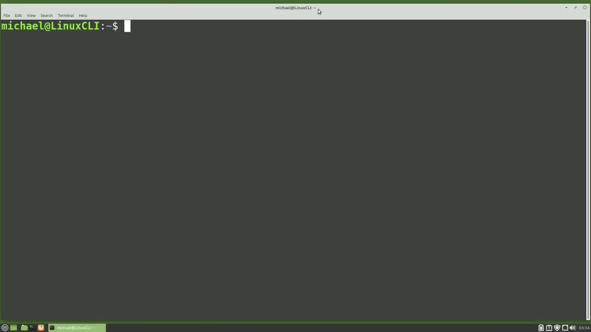
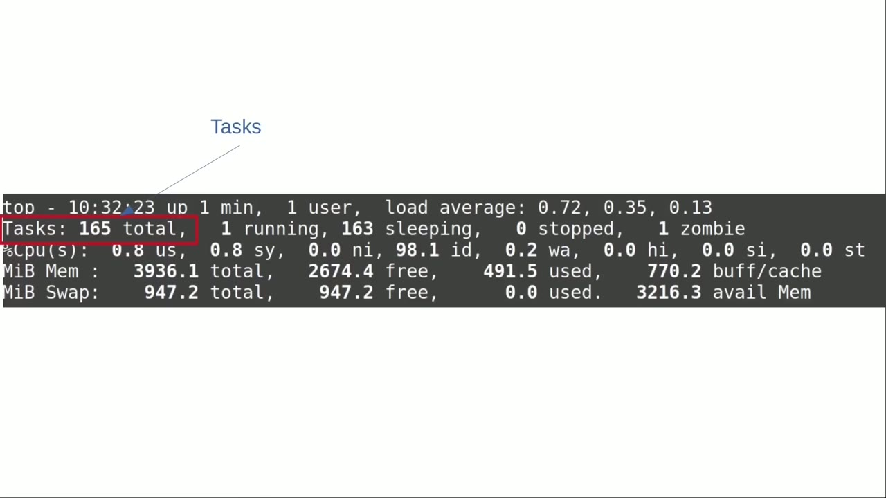
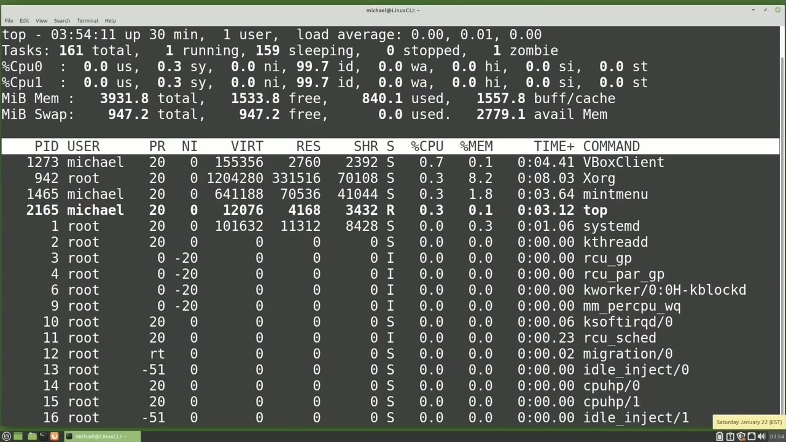
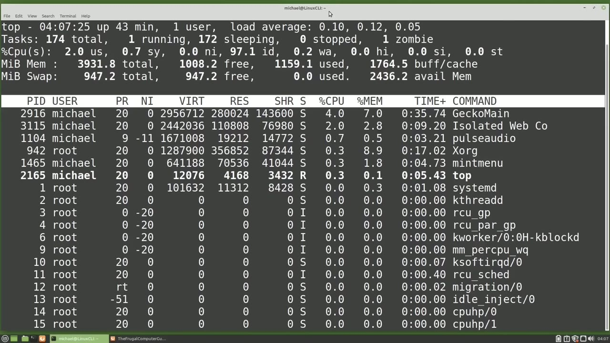

[← Course contents](../../01.md)

# 60. top pt1

**Course:** [Linux Command Line - Entire Tutorial Series](https://www.youtube.com/watch?v=avg65oY7sj4)  
**Transcript:** [`Linux Command Line - Entire Tutorial Series transcript`](../../../../course_videos/Linux%20Command%20Line%20-%20Entire%20Tutorial%20Series/Linux%20Command%20Line%20-%20Entire%20Tutorial%20Series.txt)  
**Video:** 10:03:26–10:14:00 ([open at this time](https://www.youtube.com/watch?v=avg65oY7sj4&t=36206s))

## Introduction

In this video and the Next, we're going to look at the Top Command. We can start the Top Command by typing Top in the Command line and pressing Enter. Top shows a lot of information, almost too much information. When we first look at the screen, it can be very overwhelming, but the screen is broken up into four sections.

## Detailed Explanation

<details>
  <summary>Step 1 — Run `top`, `ps`</summary>

### Step 1 — Run `top`, `ps`

- [x] **Use `top`**
  - In this video and the Next, we're going to look at the `top` Command.
  - We can start the `top` Command by typing `top` in the Command line and pressing Enter.
  - `top` shows a lot of information, almost too much information.

- [x] **When we first look at the screen, it can be very overwhelming, but**
  - When we first look at the screen, it can be very overwhelming, but the screen is broken up into four sections.
  - At the `top`, we have the Summary Data Area, which gives us an overall summary of what is happening on the system right now.
  - We'll take a closer look at this section in a moment.

- [x] **Use `ps`**
  - The next section we see is the column headers line, which tells us what fields are below that line.
  - We saw these fields and talked about them in the last video for the `ps` command.
  - Then the third section is the Task Information Process List.

- [x] **This is showing us information about the processes currently running**
  - This is showing us information about the processes currently running.
  - And then the fourth section here where we don't see anything at this moment is for the messages and prompts.
  - We'll see this in the next video, `top` Part 2.

- [x] **Now that we know the four sections, let's look at the Summary Data**
  - Now that we know the four sections, let's look at the Summary Data area in a little more detail.
  - We will start in the upper left corner where we see `top`.
  - This is just telling us the name of the program we're in. `top`.

- [x] **Next to that, we have the time the computer thinks it is in a 24 hour**
  - Next to that, we have the time the computer thinks it is in a 24 hour clock format.
  - To the right of time, we have the up time since the computer was started or rebooted.
  - This computer has been up for one minute.

- [x] **Then we see the number of users on this computer**
  - Then we see the number of users on this computer.
  - This is a desktop computer, so there's only one user, me.
  - And the last thing on the `top` line is the load average with three numbers.

- [x] **The number on the left is the current load average**
  - The number on the left is the current load average.
  - The number in the middle is the load average five minutes ago.
  - And the number on the right is the load average 15 minutes ago.

- [x] **And the idea behind showing us the three load averages is to help us**
  - And the idea behind showing us the three load averages is to help us see trends.
  - For example, in this screenshot, We see 15 minutes ago the load average was very low at.13.
  - Then 5 minutes ago the load average went up to 0.35 and currently the load average is.72.

- [x] **This tells us something in the last 10 minutes has put a bit of a**
  - This tells us something in the last 10 minutes has put a bit of a load on the system.

```bash
top
ps
```



</details>

<details>
  <summary>Step 2 — Run `at`</summary>

### Step 2 — Run `at`

- [x] **If those load average numbers were the other way around, with the 15**
  - If those load average numbers were the other way around, with the 15 minutes ago being the highest load average and the current load average being the lowest, we would think that whatever is causing that load is not a problem anymore.
  - When is a high load average a problem or what load average number is a problem for the computer?
  - And the answer is it depends on the number of CPUs on that computer.

- [x] **When we see a load average of 1.00, that means one CPU is processing**
  - When we see a load average of 1.00, that means one CPU is processing everything it can.
  - On a computer with a single CPU, a load of 1.00 is able to process everything `at` that moment and nothing has to wait to run.
  - If that load hits 1.01 or higher, that load is now more than a single CPU can keep up with, and some processes now have to wait to run.

- [x] **But if we have a load average of 1.00 and the computer has two CPUs**
  - But if we have a load average of 1.00 and the computer has two CPUs, A load average of 1.00 is only using half of the total CPU resources.
  - So a load average of 1.00 is not a problem for a computer with two or more CPUs.
  - But if that load gets higher than 2.00 for a computer with two CPUs, then we have more processes trying to run than we have CPU resources for.

- [x] **And some processes will have to wait to run**
  - And some processes will have to wait to run.
  - Today, most computers have more than one CPU.
  - So a load average of 1.00 is rarely a problem.

- [x] **Going back to our terminal, Top is an interactive program, meaning we**
  - Going back to our terminal, Top is an interactive program, meaning we can press a key and change the view we're looking `at`.
  - For example, I will press the lowercase L, and the load average line is hidden.
  - Pressing that lowercase L again brings back that load average line.

- [x] **Use `at`**
  - The next line in our summary data area, shows information about the tasks running.
  - Here we see we currently have 165 total tasks running `at` this time.
  - This is the total of one running plus 163 that are sleeping or waiting for input, plus zero stopped, and then we have one zombie process.

- [x] **A zombie process is a process that didn't end properly**
  - A zombie process is a process that didn't end properly.
  - They're usually harmless and don't use computer resources, but...
  - If the number of zombie processes gets above two or three, you may want to look into what is causing that zombie process.

- [x] **I mentioned that because if a couple of zombie processes are created**
  - I mentioned that because if a couple of zombie processes are created each day on a computer that is never turned off or restarted, and every day if more zombie processes are created, you have the potential of running out of process IDs.
  - Now don't worry too much about that happening.
  - There are more than enough process IDs and the process IDs are recycled, but if you have many zombie processes being created regularly and the computer has never restarted, there is a potential to run out of process IDs.

- [x] **The next line of the summary data area is about the CPU**
  - The next line of the summary data area is about the CPU.
  - This computer has two CPUs, but we only see one line of CPU information.
  - To see the information for all the CPUs on the system, I'm going to press the number 1.

- [x] **Now we see the CPU information for both CPUs**
  - Now we see the CPU information for both CPUs.

```bash
at
```



</details>

<details>
  <summary>Step 3 — CPU 0 is the first CPU and CPU 1 is the second CPU</summary>

### Step 3 — CPU 0 is the first CPU and CPU 1 is the second CPU

- [x] **CPU 0 is the first CPU and CPU 1 is the second CPU**
  - CPU 0 is the first CPU and CPU 1 is the second CPU.
  - If there were more CPUs they would show right here as well.
  - Let's take a look at each field on that CPU line.

- [x] **This is the amount of time the CPU spends running the processes that**
  - This is the amount of time the CPU spends running the processes that a user started.
  - This is the time the CPU spends running processes the kernel started.
  - The next number ni is for the nice value. We're going to talk about the nice value in an upcoming video.

- [x] **This is the amount of time the CPU spends executing processes with a**
  - This is the amount of time the CPU spends executing processes with a manually set nice value. After the nice value we have id, which stands for idle time.
  - And when this screen capture was taken, not much was running on that system.
  - So the idle time was way up at 98.1. Then we have w.a.

- [x] **which is the amount of time the CPU spends waiting for i.o. to**
  - which is the amount of time the CPU spends waiting for i.o. to complete.
  - H.i is the amount of time spent servicing hardware interrupts.
  - Si is the amount of time spent servicing software interrupts.

- [x] **And the last one, st, is first stolen time, or the time lost due to**
  - And the last one, st, is first stolen time, or the time lost due to running virtual machines.
  - We see that both the CPUs are still showing.
  - That shows us the CPU usage in an ASCy graph.

- [x] **Let's open up a browser window and see if that helps create some CPU**
  - Let's open up a browser window and see if that helps create some CPU usage.
  - Pressing the lowercase T a second time shows our CPU usage graph in a block graph.
  - Pressing that lowercase T a third time hides the CPU line.

- [x] **Pressing that lower case T a fourth time**
  - Pressing that lower case T a fourth time.
  - Shows the task line and the CPU lines once again.
  - And in this case, we have the show all CPUs toggled on, so we see both the CPU's information.

- [x] **I'm going to press that number one again and toggle off the show all**
  - I'm going to press that number one again and toggle off the show all CPUs information.
  - And we only have the single CPU line once again.
  - The next two lines of our summary data area are the lines for memory.

- [x] **The top line mem is for the standard memory or the RAM memory on this**
  - The top line mem is for the standard memory or the RAM memory on this machine.
  - That first number is the total memory 3936.1.
  - That is the sum of the free memory of 2674.4 plus the memory of 491.5 and the buffer cache memory of 770.2.

- [x] **If the swap memory gets really high very often, you may want to**
  - If the swap memory gets really high very often, you may want to consider increasing the RAM memory.



</details>

<details>
  <summary>Step 4 — Run `top`</summary>

### Step 4 — Run `top`

- [x] **This last value on the right, the available memory, is the memory**
  - This last value on the right, the available memory, is the memory that's expected to be recoverable from all the caches.
  - Going back to our terminal, I'm pressing the lowercase M.
  - This will show the memory as an ascii graph.

- [x] **Pressing the lowercase M a second time shows the memory used as a**
  - Pressing the lowercase M a second time shows the memory used as a block graph.
  - Pressing the lowercase M a third time hides the memory lines from view.
  - And pressing that lowercase M a fourth time will bring back the memory lines.

- [x] **The memory shows in megabytes by default**
  - The memory shows in megabytes by default.
  - Pressing the uppercase E for extended memory scaling will change that memory scaling to be in gigabytes, terabytes, petabytes, Xabytes, and then it goes back to kilobytes.
  - And then we're back to Megabytes, the default.

- [x] **We can also hide the entire summary data area by pressing the**
  - We can also hide the entire summary data area by pressing the lowercase L to hide the load average line.
  - And pressing the lowercase T three times to hide the task and CPU lines.
  - And pressing the lowercase M three times will hide the memory lines.

- [x] **But we still have the message and prompts line showing**
  - But we still have the message and prompts line showing.
  - I'm going to bring back the summary data area by pressing the L key.
  - The T key and the M key, and we have the Summary Data Area back.

- [x] **Use `top`**
  - We're going to stop this video here, and in the next video we'll complete our look at the `top` Command for the Linux Command line.
  - In the last video we discussed the four sections of the `top` Command and talked in detail about the Summary Data area here at the `top`.

```bash
top
```



</details>

<details>
  <summary>Questions and Answers</summary>

## Questions and Answers

### Question 1: What does `top` do in this chapter?

<details>
<summary>Answer</summary>

- [x] In this video and the Next, we're going to look at the `top` Command.

</details>

### Question 2: What does `ps` do in this chapter?

<details>
<summary>Answer</summary>

- [x] We saw these fields and talked about them in the last video for the `ps` command.

</details>

### Question 3: What does `at` do in this chapter?

<details>
<summary>Answer</summary>

- [x] Here we see we currently have 165 total tasks running `at` this time.

</details>

### Question 4: What does step 1 cover (Run top, ps)?

<details>
<summary>Answer</summary>

- [x] In this video and the Next, we're going to look at the `top` Command.
- [x] We can start the `top` Command by typing `top` in the Command line and pressing Enter.
- [x] `top` shows a lot of information, almost too much information.

</details>

### Question 5: What does step 2 cover (Run at)?

<details>
<summary>Answer</summary>

- [x] If those load average numbers were the other way around, with the 15 minutes ago being the highest load average and the current load average being the lowest, we would think that whatever is causing that load is not a problem anymore.
- [x] When is a high load average a problem or what load average number is a problem for the computer?
- [x] And the answer is it depends on the number of CPUs on that computer.

</details>

### Question 6: What does step 3 cover (CPU 0 is the first CPU and CPU 1 is the second CPU)?

<details>
<summary>Answer</summary>

- [x] CPU 0 is the first CPU and CPU 1 is the second CPU.
- [x] If there were more CPUs they would show right here as well.
- [x] Let's take a look at each field on that CPU line.

</details>

### Question 7: What does step 4 cover (Run top)?

<details>
<summary>Answer</summary>

- [x] This last value on the right, the available memory, is the memory that's expected to be recoverable from all the caches.
- [x] Going back to our terminal, I'm pressing the lowercase M.
- [x] This will show the memory as an ascii graph.

</details>

</details>

## Summary

This chapter, top pt1, walks through Run top, ps; Run at; CPU 0 is the first CPU and CPU 1 is the second CPU; Run top. Commands from the transcript: `top`, `ps`, `at`.

## References

- [Linux Command Line - Entire Tutorial Series (YouTube)](https://www.youtube.com/watch?v=avg65oY7sj4)
- [This chapter at 10:03:26](https://www.youtube.com/watch?v=avg65oY7sj4&t=36206s)
- [Local transcript](../../../../course_videos/Linux%20Command%20Line%20-%20Entire%20Tutorial%20Series/Linux%20Command%20Line%20-%20Entire%20Tutorial%20Series.txt)
