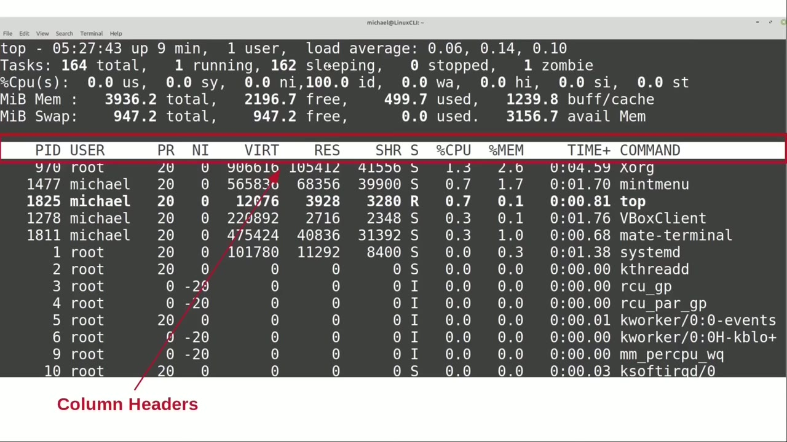
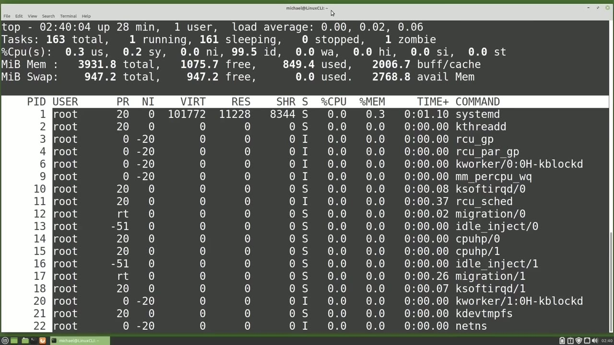
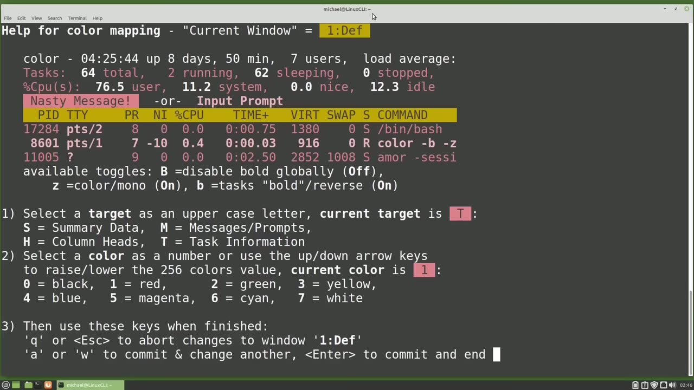
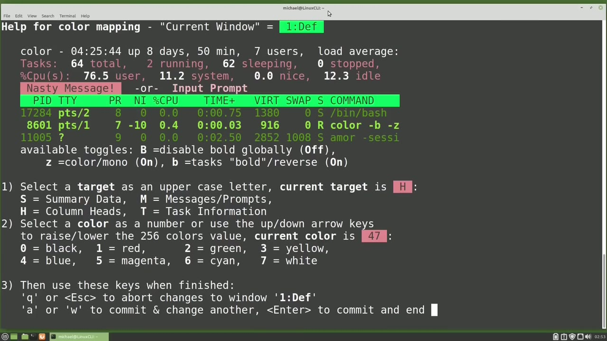
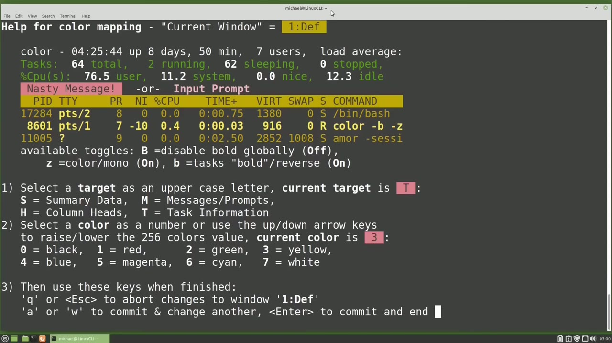

[← Course contents](../../01.md)

# 61. top pt2

**Course:** [Linux Command Line - Entire Tutorial Series](https://www.youtube.com/watch?v=avg65oY7sj4)  
**Transcript:** [`Linux Command Line - Entire Tutorial Series transcript`](../../../../course_videos/Linux%20Command%20Line%20-%20Entire%20Tutorial%20Series/Linux%20Command%20Line%20-%20Entire%20Tutorial%20Series.txt)  
**Video:** 10:14:00–10:29:07 ([open at this time](https://www.youtube.com/watch?v=avg65oY7sj4&t=36840s))

## Introduction

The second section, column headers, and the third section, Task Process Information, go together and the output looks a lot like the output from the ps command. I'm going over to a terminal and I'm going to type the Top command. Here we'll see that the data is updated every 3 seconds. We can change the amount of time between screen updates by pressing the lowercase D for delay time.

## Detailed Explanation

<details>
  <summary>Step 1 — Run `ps`, `top`, `at`</summary>

### Step 1 — Run `ps`, `top`, `at`

- [x] **Use `ps`, `top`**
  - The second section, column headers, and the third section, Task Process Information, go together and the output looks a lot like the output from the `ps` command.
  - I'm going over to a terminal and I'm going to type the `top` command.
  - Here we'll see that the data is updated every 3 seconds.

- [x] **We can change the amount of time between screen updates by pressing**
  - We can change the amount of time between screen updates by pressing the lowercase D for delay time.
  - Pressing the D shows us the fourth section.
  - The messages and prompts area where `top` is prompting us to give us a time in seconds to refresh the screen. I'm going to change it to 1 for 1 second. Now we see `top` is updating the screen every 1 second. I'm going to press the lowercase D again and change the delay time to 10.

- [x] **Now we have 10 seconds to look at the data before the numbers change**
  - Now we have 10 seconds to look `at` the data before the numbers change.
  - We can use the down and up arrows to scroll down and up.
  - We can also use the page down and page up to scroll down and up a page `at` a time.

- [x] **Notice the screen refreshes when we hit the page down and page up**
  - Notice the screen refreshes when we hit the page down and page up with those arrow keys.
  - We can also refresh the screen just by pressing the space bar or the enter key.
  - Brings up a prompt and it's asking us for what user we want to filter by.

- [x] **I can type in a name or if I know the user id, I can type that in**
  - I can type in a name or if I know the user id, I can type that in here as well.
  - Pressing that lowercase U again and then pressing Enter without typing in anything will show us the data for all users once again.
  - If we only want to see 10 lines of output, we can press the N key.

- [x] **Use `top`**
  - For a number of lines we want to view. I'll type in 10 and press enter.
  - Pressing that lowercase n again and then pressing 0 shows us all the lines of output once again.
  - I'm going to press the lowercase Q to quit out of `top` and then type `top` again and go back in and we see everything is reset to the default values.

- [x] **I'm pressing the uppercase B to toggle off the bold fields**
  - I'm pressing the uppercase B to toggle off the bold fields.
  - Pressing it again, toggles those bold fields back on.
  - It's a little difficult to see with the black and white screen, but most of the fields in the summary data area are bold.

- [x] **And the currently running processes are also shown in bold**
  - And the currently running processes are also shown in bold.
  - I'm going to press the uppercase B again to turn off the bold.
  - Now I'm going to press the lowercase I key.

- [x] **Use `at`, `top`**
  - To show only the active processes, the `top` command shown in bold is the only active process running `at` this moment.
  - To make the running processes stand out a little more, I'm going to press the lowercase B.
  - That will show the processes running in reverse.

- [x] **Or I like to think of it as lowercase B showing the background**
  - Or I like to think of it as lowercase B showing the background highlighting.

```bash
ps
top
at
```



</details>

<details>
  <summary>Step 2 — Run `column`</summary>

### Step 2 — Run `column`

- [x] **Now our running processes really stand out**
  - Now our running processes really stand out.
  - I'm going to toggle off the active processes by pressing the lowercase I again.
  - And this shows us all the processes once again.

- [x] **I'll also press that lowercase B again to toggle off the reverse**
  - I'll also press that lowercase B again to toggle off the reverse background highlighting.
  - When I press the lowercase X, top will highlight the `column` the output is sorted by.
  - The `column` highlighted is the CPU `column`.

- [x] **But again, with the black and white screen, it's a little difficult**
  - But again, with the black and white screen, it's a little difficult to tell what `column` is highlighted.
  - To make that `column` stand out a little more, I'm going to press that lowercase B.
  - To reverse background, that highlighted `column`.

- [x] **This also applies the reverse background to the running job we saw**
  - This also applies the reverse background to the running job we saw earlier.
  - To turn off the bold for the running job, I'm going to press the lowercase Y key.
  - Now just our CPU `column`, the `column` the data is sorted by.

- [x] **Is highlighted. If we want to sort this data by memory usage, we can**
  - Is highlighted. If we want to sort this data by memory usage, we can press the uppercase M. We can also press the uppercase T to sort by time.
  - To sort by CPU again, we don't use the C like you would think.
  - We use an uppercase P for percent of CPU usage.

- [x] **If we want to sort by P id, we cannot use the P because we just use**
  - If we want to sort by P id, we cannot use the P because we just use that for the percent of CPU.
  - So we will use the uppercase N to sort by PID.
  - And notice the PIDs are sorted in descending order or highest to lowest.

- [x] **Use `column`**
  - To reverse that, I'm going to press the uppercase R.
  - And the lowercase C toggles the command `column` between Process Command and the full command line.
  - This is where we can see Process id number one shows as S bin init and System D.

- [x] **Pressing the lowercase Z or Z as our friends across the pond like to**
  - Pressing the lowercase Z or Z as our friends across the pond like to refer to it makes our screen show in color.
  - Now I'm going to press the uppercase P to sort by CPU again.
  - And notice the CPU shows as zeros. That's because we still have the reverse on.

- [x] **I'll need to press the uppercase R again to reverse**
  - I'll need to press the uppercase R again to reverse.
  - The reverse sort and make our order descending again.
  - Now we see the sorted by percent of CPU shows as expected once again.

- [x] **Pressing the lowercase B still toggles on and off the reverse column**
  - Pressing the lowercase B still toggles on and off the reverse `column`.
  - And I would need to press the lowercase Y again to show the active jobs running.
  - Pressing the uppercase B still toggles off and on the bold fields.

- [x] **They do stand out a little better with everything in color**
  - They do stand out a little better with everything in color.
  - And we can turn off that highlighted sorted `column` by pressing the lowercase x.
  - If we want to change the default colors, we can change them from the screen we get to when we press uppercase Z.

```bash
column
```



</details>

<details>
  <summary>Step 3 — This screen can look a little scary if you're seeing it for the first</summary>

### Step 3 — This screen can look a little scary if you're seeing it for the first

- [x] **This screen can look a little scary if you're seeing it for the first**
  - This screen can look a little scary if you're seeing it for the first time, but once you know how to read the screen, you'll see that it is a lot more simple than it first looks.
  - The top line is telling us that we are in the Help for Color Mapping page.
  - And tells us the current window is 1-D-E-F.

- [x] **Below that, we have a little setting preview section**
  - Below that, we have a little setting preview section.
  - We'll see how that works in just a moment.
  - Under that, we see the available toggles that we already talked about.

- [x] **The uppercase B for bold, the lowercase B for reverse bold, and the**
  - The uppercase B for bold, the lowercase B for reverse bold, and the lowercase Z for toggling on and off the color.
  - The line number one is asking us what section do we want to change the color of?
  - Below that, they show us the four choices.

- [x] **S for Summary Data, M for Message and Promps, H for column headers**
  - S for Summary Data, M for Message and Promps, H for column headers, and T for task information.
  - The number two line is asking us what color do we want to make the section selected in line 1?
  - And then they give us the colors 0 through 7 and tell us that we can use any color between 0 and 255.

- [x] **And we see the current target for line 1 changes from a T to an S**
  - And we see the current target for line 1 changes from a T to an S.
  - Pressing the uppercase M changes it to M, pressing uppercase H, changes it to an H.
  - And pressing the uppercase T changes it back to the T.

- [x] **So now we're going to change the color of the task information by**
  - So now we're going to change the color of the task information by pressing the number 7.
  - And we see the color in our task preview section change to white.
  - Then I'll press 3 and it will change to yellow.

- [x] **Pressing 5 changes it to magenta and then pressing 2 makes the area**
  - Pressing 5 changes it to magenta and then pressing 2 makes the area green.
  - I'm going to press the uppercase H to change the header color.
  - And then I'm going to down arrow and we see the number changes to 2.

- [x] **Pressing that down arrow changes it to 1 then to 0**
  - Pressing that down arrow changes it to 1 then to 0.
  - And if I hold down the down arrow, it will keep scrolling down numbers.
  - Pressing the up arrow increases our numbers until we get to 255 and then it starts again at zero.

- [x] **I'm going to scroll all the way up to 47**
  - I'm going to scroll all the way up to 47.



</details>

<details>
  <summary>Step 4 — Run `top`</summary>

### Step 4 — Run `top`

- [x] **Use `top`**
  - Pressing Enter now will take us back to the `top` command where I can see the changes we just made.
  - And go back into the `top` command again by typing `top`.
  - And we'll notice that my color changes are gone.

- [x] **I'm going to press the lowercase Z again to turn back on the colors**
  - I'm going to press the lowercase Z again to turn back on the colors.
  - And then uppercase Z to go back into the help for color mapping page.
  - And we haven't talked about the number three area yet.

- [x] **Here we see Q or Escape abort the changes to the window**
  - Here we see Q or Escape abort the changes to the window.
  - And when it says abort the changes, it means we just change back to what we had coming into this window.
  - So if I changed the screen color to blue came in here and we changed to red, pressing the queue would take us back to what we had the blue coming into this window.

- [x] **Then we see the line A or W to commit and change another**
  - Then we see the line A or W to commit and change another.
  - Enter to commit and end. Well, we did the enter so we know how the commit and end works.
  - The first thing we notice is the colors in our preview area changed.

- [x] **And looking at the top line, we now see the current window is 2 colon**
  - And looking at the `top` line, we now see the current window is 2 colon job.
  - And pressing that lowercase A again, changes the colors again.
  - And pressing it a fourth time, changes the colors and the current window is 4 user.

- [x] **Pressing it again loops us around back to 1**
  - Pressing it again loops us around back to 1.
  - And then pressing the W does the same thing only backwards.
  - And we can change all those screen colors too, just like we did the one default screen, the one that we started with.

- [x] **To see these screens, we'll need to go back to the top page. So I**
  - To see these screens, we'll need to go back to the `top` page. So I will press Enter.
  - And I'm going to press the uppercase A to show all four alternate windows.
  - And notice we crashed here with a Signal 11 SegV.

- [x] **Use `top`**
  - So there is a bug in the `top` command.
  - And we will talk about what a Signal 11 is in the next video.
  - Pressing the lowercase Z to turn on our colors.

- [x] **Pressing the uppercase Z to go back to our color mapping page**
  - Pressing the uppercase Z to go back to our color mapping page.
  - And I'm going to press the uppercase S to change that summary data area to 2.
  - And I'm going to press the uppercase T to update the task area.

```bash
top
```



</details>

<details>
  <summary>Step 5 — Run `top`</summary>

### Step 5 — Run `top`

- [x] **Use `top`**
  - Now I'm not going to press the A or W this time because when you press the A or W, that's what causes the screen to crash when we go back to the `top` command.
  - So I'm pressing Enter to go back to that `top` output.
  - And I'm going to press the uppercase A again to show us the alternate windows.

- [x] **And with those alternate windows on, look in the upper left corner**
  - And with those alternate windows on, look in the upper left corner.
  - It now says 1 colon D ef instead of `top`.
  - Takes me down to 2 job. Pressing the lowercase A again takes me down to 3MM.

- [x] **And to show that I'm on that screen, I'm going to press the lowercase**
  - And to show that I'm on that screen, I'm going to press the lowercase Z.
  - And it colorized our third alternate window.
  - I'm going to press the W takes me back to the number 2 job.

- [x] **So I'm going to press the -sign and our number 2 window disappears**
  - So I'm going to press the -sign and our number 2 window disappears.
  - I'm still on that if you look in the upper left corner and I want to jump down to window 4.
  - So I'm going to press the G key and it's asking me which field group do I want to go to?

- [x] **I'm going to press 4 and again I'm going to press the -sign and we'll**
  - I'm going to press 4 and again I'm going to press the -sign and we'll notice now we only have 1 and 3 showing.
  - To view only 2 and 4 I can press the shift minus or underscore key and now I see 2 and 4 pressing the underscore key again.
  - Brings me back. I want to save these changes. To save them, I'm going to press the uppercase W for right. And we'll notice real quickly it shows us in that message and prompts area where it wrote that file to. I'm going to press the uppercase W again so we can get another quick look at it. And it's written to home michael.config ProcPS `top`

- [x] **Use `top`**
  - Rc. Now I can quit out of here by pressing the cue.
  - Or Ctrl+C and when I type `top`, it takes me back into the `top` command with the changes that I've already saved.
  - And if I want to change the fields showing on one of these windows, I'm going to go to that window with the A or the W or G to go to that group and then press the uppercase F.

- [x] **And here we see the fields showing on the page and what order they**
  - And here we see the fields showing on the page and what order they are in.
  - And the last thing we're going to do is quit out of here.
  - And we're going to change this back by removing the file in the...

- [x] **Use `top`**
  - I'm just going to rename that with the Move command.
  - `top` rc dot back now when i type `top` it shows us the default values and if i want to see my colored version again i can rename that file from back to the `top` rc and that would restore us back to the customized colors and fields that we've chosen in the next video we will continue looking at the linux command line

```bash
top
```



</details>

<details>
  <summary>Questions and Answers</summary>

## Questions and Answers

### Question 1: What does `ps` do in this chapter?

<details>
<summary>Answer</summary>

- [x] The second section, column headers, and the third section, Task Process Information, go together and the output looks a lot like the output from the `ps` command.

</details>

### Question 2: What does `top` do in this chapter?

<details>
<summary>Answer</summary>

- [x] I'm going over to a terminal and I'm going to type the `top` command.

</details>

### Question 3: What does `at` do in this chapter?

<details>
<summary>Answer</summary>

- [x] To show only the active processes, the top command shown in bold is the only active process running `at` this moment.

</details>

### Question 4: What does `column` do in this chapter?

<details>
<summary>Answer</summary>

- [x] And the lowercase C toggles the command `column` between Process Command and the full command line.

</details>

### Question 5: What does step 1 cover (Run ps, top, at)?

<details>
<summary>Answer</summary>

- [x] The second section, column headers, and the third section, Task Process Information, go together and the output looks a lot like the output from the `ps` command.
- [x] I'm going over to a terminal and I'm going to type the `top` command.
- [x] Here we'll see that the data is updated every 3 seconds.

</details>

### Question 6: What does step 2 cover (Run column)?

<details>
<summary>Answer</summary>

- [x] Now our running processes really stand out.
- [x] I'm going to toggle off the active processes by pressing the lowercase I again.
- [x] And this shows us all the processes once again.

</details>

### Question 7: What does step 3 cover (This screen can look a little scary if you're seeing it for the first)?

<details>
<summary>Answer</summary>

- [x] This screen can look a little scary if you're seeing it for the first time, but once you know how to read the screen, you'll see that it is a lot more simple than it first looks.
- [x] The top line is telling us that we are in the Help for Color Mapping page.
- [x] And tells us the current window is 1-D-E-F.

</details>

### Question 8: What does step 4 cover (Run top)?

<details>
<summary>Answer</summary>

- [x] Pressing Enter now will take us back to the `top` command where I can see the changes we just made.
- [x] And go back into the `top` command again by typing `top`.
- [x] And we'll notice that my color changes are gone.

</details>

### Question 9: What does step 5 cover (Run top)?

<details>
<summary>Answer</summary>

- [x] Now I'm not going to press the A or W this time because when you press the A or W, that's what causes the screen to crash when we go back to the `top` command.
- [x] So I'm pressing Enter to go back to that `top` output.
- [x] And I'm going to press the uppercase A again to show us the alternate windows.

</details>

</details>

## Summary

This chapter, top pt2, walks through Run ps, top, at; Run column; This screen can look a little scary if you're seeing it for the first; Run top; Run top. Commands from the transcript: `ps`, `top`, `at`, `column`.

## References

- [Linux Command Line - Entire Tutorial Series (YouTube)](https://www.youtube.com/watch?v=avg65oY7sj4)
- [This chapter at 10:14:00](https://www.youtube.com/watch?v=avg65oY7sj4&t=36840s)
- [Local transcript](../../../../course_videos/Linux%20Command%20Line%20-%20Entire%20Tutorial%20Series/Linux%20Command%20Line%20-%20Entire%20Tutorial%20Series.txt)
