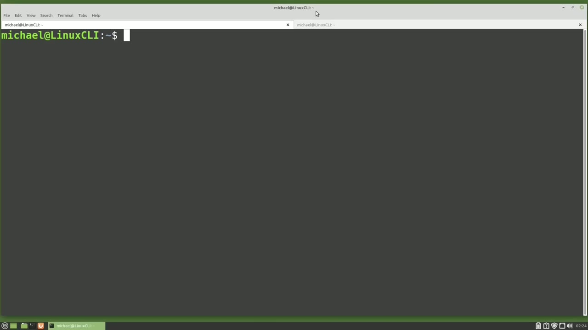
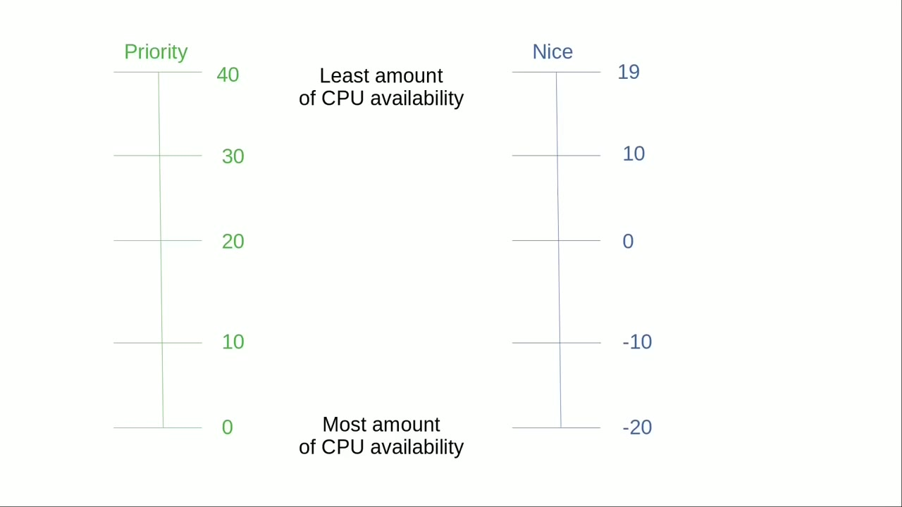
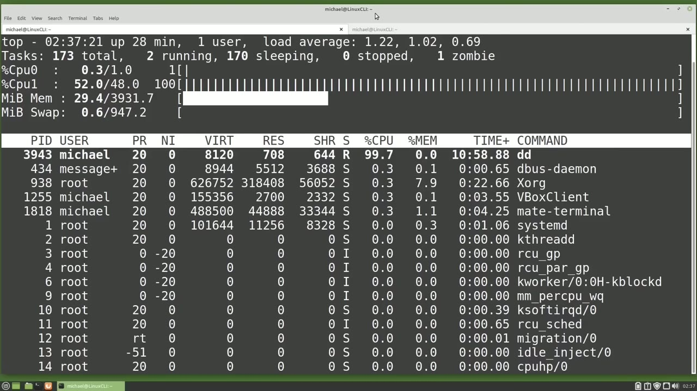
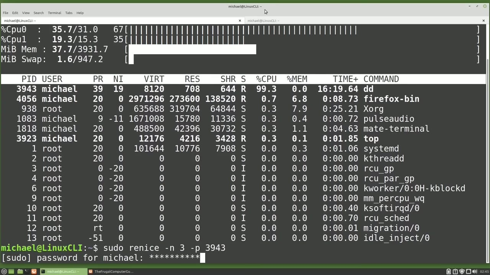

[← Course contents](../../01.md)

# 62. nice

**Course:** [Linux Command Line - Entire Tutorial Series](https://www.youtube.com/watch?v=avg65oY7sj4)  
**Transcript:** [`Linux Command Line - Entire Tutorial Series transcript`](../../../../course_videos/Linux%20Command%20Line%20-%20Entire%20Tutorial%20Series/Linux%20Command%20Line%20-%20Entire%20Tutorial%20Series.txt)  
**Video:** 10:29:07–10:38:27 ([open at this time](https://www.youtube.com/watch?v=avg65oY7sj4&t=37747s))

## Introduction

I'm going to start top by typing top and pressing Enter. I've got another open tab here, and in this tab I'm going to type in the command ddif equals slash dev slash zero space of equals slash dev slash null. We haven't talked about the dd command, but it's like the copy command. It's going to take the if input file of dev 0 and send that data to the of output file of Dev Null. In an earlier video we talked about the slash dev slash null being like a garbage can or a black hole where whatever we send to slash dev slash null is just gone.

## Detailed Explanation

<details>
  <summary>Step 1 — Run `top`, `dd`</summary>

### Step 1 — Run `top`, `dd`

- [x] **Use `top`, `dd`**
  - I'm going to start `top` by typing `top` and pressing Enter. I've got another open tab here, and in this tab I'm going to type in the command ddif equals slash dev slash zero space of equals slash dev slash null.
  - We haven't talked about the `dd` command, but it's like the copy command. It's going to take the if input file of dev 0 and send that data to the of output file of Dev Null.
  - In an earlier video we talked about the slash dev slash null being like a garbage can or a black hole where whatever we send to slash dev slash null is just gone.

- [x] **Slash dev slash zero on the other hand is an endless stream of random**
  - Slash dev slash zero on the other hand is an endless stream of random data.
  - So what we're doing with this command is sending an endless stream of random data to nothing.
  - When we run this command, it will stress out a single CPU and this will continue until we end the process.

- [x] **I've started the command. Let's go back over to the other tab**
  - I've started the command. Let's go back over to the other tab.
  - And right here at the `top`, we see our `dd` command using 100% of the CPU or 99% of the CPU.
  - I'm going to press the number 1 to show all the CPUs as we saw in the last video.

- [x] **And then I'm going to press the lowercase T to show the CPU usage as**
  - And then I'm going to press the lowercase T to show the CPU usage as an asc graph.
  - I'm also going to press the lowercase M 2 times.
  - To show the memory usage as a solid block.

- [x] **Now let's look at the priority and nice value of the dd process**
  - Now let's look at the priority and nice value of the `dd` process running.
  - We have a priority of 20 and a nice value of 0.

```bash
top
dd
```



</details>

<details>
  <summary>Step 2 — that's our default priority and nice value</summary>

### Step 2 — that's our default priority and nice value

- [x] **So that's our default priority and nice value**
  - So that's our default priority and nice value.
  - I have a chart here that shows a priority on the left and the nice value on the right.
  - In the center on the left we have a priority of 20.

- [x] **On the center on the right, we have a nice value of 0**
  - On the center on the right, we have a nice value of 0.
  - This means when the nice value is 0, the priority is 20.
  - And those are the default values for the job we just started.

- [x] **At the top of this chart, on the left we see a priority of 40, which**
  - At the top of this chart, on the left we see a priority of 40, which will happen when we have a nice value of 19.
  - And this is actually the lowest priority we can assign a process.
  - If we set the nice value to 19, we will get the least amount of available CPU resources.

- [x] **The lowest nice value we can assign a process is -20**
  - The lowest nice value we can assign a process is -20.
  - If we set the nice value to -20, we are giving that process the most available CPU resources we can assign a process.
  - In other words, if we have an important job that we need to run as quick as possible, we want to give it the most amount of CPU available.

- [x] **So we want to run this job with a nice value of -20**
  - So we want to run this job with a nice value of -20.
  - And if we have a job like a backup job that we want to run in the background, but we don't want it to slow down other jobs, we might want to give that job a value of 19.



</details>

<details>
  <summary>Step 3 — Run `dd`</summary>

### Step 3 — Run `dd`

- [x] **Let's change the nice value of the dd process running from 0 to 5**
  - Let's change the nice value of the `dd` process running from 0 to 5, meaning we will give it a lesser priority.
  - When we change the nice value, it's called re-nice.
  - So we want to re-nice the nice value of the `dd` process from 0 to 5.

- [x] **Use `dd`**
  - To re-nice the `dd` command, I will press the lowercase R for re-nice.
  - Top is asking me for the PID of the process I would like to re-nice.
  - I can put that PID here, or since the `dd` process is taking the most CPU, it is set as the default PID.

- [x] **And now it's asking me, what do I want that nice value to be?**
  - And now it's asking me, what do I want that nice value to be?
  - And press enter. Now we see the priority shows as 25 and the nice value shows as 5.
  - Let's re-nice that job again by pressing the lowercase R.

- [x] **And I want to re-nice that job again that 3943. So I'll press enter**
  - And I want to re-nice that job again that 3943. So I'll press enter.
  - And I want to give this job the lowest priority of 19. Even lower if I can. I'm going to type in 25.
  - We can only reneised to the value 19, so my job is reneced to the highest number I can assign, which is 19.

- [x] **And we notice here that even with the lowest priority, the dd job is**
  - And we notice here that even with the lowest priority, the `dd` job is still using 99 or 100% of the available CPU.
  - That's because nothing else is running, so 99 or 100% of the CPU is available.
  - If another process was running with a higher priority, that process or processes would have a priority over that `dd` process for the CPU resources.

- [x] **Use `dd`**
  - So let's open up a browser window now. When we do, we should see the CPU for our `dd` job go down while the browser opens.
  - And we see Firefox has a priority over the `dd` job.
  - Now I'm going to try to re-nice the `dd` command from 19 to 15.

- [x] **I'm pressing R, enter, and I'm going to make this 15**
  - I'm pressing R, enter, and I'm going to make this 15.
  - Pressing Enter, we get a permissions denied error.
  - The reason is standard users can only re-nice their own processes.

- [x] **Well, this is our own process. We see the user is Michael, but**
  - Well, this is our own process. We see the user is Michael, but standard users can only re-nice their own processes to a higher nice value, meaning a lower priority.
  - To re-nice a PID to a lower nice number, meaning a higher priority, I'll need to do that as a privileged user.
  - I'm going to press Q to quit out of top.

- [x] **From here, I can either restart Top as a privileged user, or I can**
  - From here, I can either restart Top as a privileged user, or I can submit the Re-Nice command from the command line as a privileged user.
  - To start the command, I'm going to type Soudou to be a privileged user, and then I will type Re-Nice for the Re-Nice command, and then I want to give it a -N for the nice value that I want to give.
  - which will be 3. And then I need to give it the PID too.

```bash
dd
```



</details>

<details>
  <summary>Step 4 — Run `sudo top`, `nice`, `sudo`</summary>

### Step 4 — Run `sudo top`, `nice`, `sudo`

- [x] **Use `sudo top`**
  - Pressing enter and here we see Process id 3943 had the old priority of 19 and the new priority is 3. I'm going to restart Top as a privileged user with `sudo top`.
  - And there we do see our job 39, 43 has a `nice` value of 3 and a priority of 23.
  - Once again, I'm going to press the lowercase R for re-`nice` and then enter for the default process.

- [x] **And then a negative 25 to see if I can make this lower than the**
  - And then a negative 25 to see if I can make this lower than the lowest value of negative 20.
  - Pressing enter, it only allows us to make this negative 20, which is a priority of 0.
  - Now looking at some of the other jobs, we see that there are some values less than negative 20.

- [x] **We see negative 51 and then we see an rt in there**
  - We see negative 51 and then we see an rt in there.
  - Those are processes with priorities higher than Linux users can assign.
  - This is to prevent users from stealing all the CPU resources from Linux.

- [x] **The lowest priority we Linux users can assign is -20**
  - The lowest priority we Linux users can assign is -20.
  - The actual priority a process can be assigned is much lower.
  - But those lower priority numbers can only be assigned to processes started by the kernel.

- [x] **And then the priority rt, this is for real time**
  - And then the priority rt, this is for real time.
  - And you can think of this as like a -100 or the lowest value available.
  - But since -100 doesn't fit on the line, rt shows there instead.

- [x] **Going back over to the other tab, I'm going to hold down control and**
  - Going back over to the other tab, I'm going to hold down control and press C to cancel out of that dd job running.
  - I want to run that job again, but I want to change the `nice` value when I start the job.
  - To do that, I'm going to press the arrow up to bring back that previous command.

- [x] **Use `nice`**
  - And then I'm going to hold down control and press A to go to the beginning of that line.
  - Now I'm going to enter `nice` and add the -N for the `nice` value I want to give this job.
  - And then we've got the command after it.

- [x] **Use `sudo`**
  - And if I wanted to set that `nice` value to something less than zero, I would have to add `sudo` to this command to become a privileged user.
  - I'm going to press Enter and then let's go over to the other tab.
  - And there we see the `nice` value is 7 and the priority is 27.

- [x] **In the next video, we'll continue looking at the Linux command line**
  - In the next video, we'll continue looking at the Linux command line.

```bash
sudo top
nice
sudo
```



</details>

<details>
  <summary>Questions and Answers</summary>

## Questions and Answers

### Question 1: What does `top` do in this chapter?

<details>
<summary>Answer</summary>

- [x] I'm going to start `top` by typing `top` and pressing Enter. I've got another open tab here, and in this tab I'm going to type in the command ddif equals slash dev slash zero space of equals slash dev slash null.

</details>

### Question 2: What does `dd` do in this chapter?

<details>
<summary>Answer</summary>

- [x] We haven't talked about the `dd` command, but it's like the copy command. It's going to take the if input file of dev 0 and send that data to the of output file of Dev Null.

</details>

### Question 3: What does `sudo top` do in this chapter?

<details>
<summary>Answer</summary>

- [x] Pressing enter and here we see Process id 3943 had the old priority of 19 and the new priority is 3. I'm going to restart Top as a privileged user with `sudo top`.

</details>

### Question 4: What does `nice` do in this chapter?

<details>
<summary>Answer</summary>

- [x] Now I'm going to enter `nice` and add the -N for the `nice` value I want to give this job.

</details>

### Question 5: What does `sudo` do in this chapter?

<details>
<summary>Answer</summary>

- [x] And if I wanted to set that nice value to something less than zero, I would have to add `sudo` to this command to become a privileged user.

</details>

### Question 6: What does step 1 cover (Run top, dd)?

<details>
<summary>Answer</summary>

- [x] I'm going to start `top` by typing `top` and pressing Enter. I've got another open tab here, and in this tab I'm going to type in the command ddif equals slash dev slash zero space of equals slash dev slash null.
- [x] We haven't talked about the `dd` command, but it's like the copy command. It's going to take the if input file of dev 0 and send that data to the of output file of Dev Null.
- [x] In an earlier video we talked about the slash dev slash null being like a garbage can or a black hole where whatever we send to slash dev slash null is just gone.

</details>

### Question 7: What does step 2 cover (that's our default priority and nice value)?

<details>
<summary>Answer</summary>

- [x] So that's our default priority and nice value.
- [x] I have a chart here that shows a priority on the left and the nice value on the right.
- [x] In the center on the left we have a priority of 20.

</details>

### Question 8: What does step 3 cover (Run dd)?

<details>
<summary>Answer</summary>

- [x] Let's change the nice value of the `dd` process running from 0 to 5, meaning we will give it a lesser priority.
- [x] When we change the nice value, it's called re-nice.
- [x] So we want to re-nice the nice value of the `dd` process from 0 to 5.

</details>

### Question 9: What does step 4 cover (Run sudo top, nice, sudo)?

<details>
<summary>Answer</summary>

- [x] Pressing enter and here we see Process id 3943 had the old priority of 19 and the new priority is 3. I'm going to restart Top as a privileged user with `sudo top`.
- [x] And there we do see our job 39, 43 has a `nice` value of 3 and a priority of 23.
- [x] Once again, I'm going to press the lowercase R for re-`nice` and then enter for the default process.

</details>

</details>

## Summary

This chapter, nice, walks through Run top, dd; that's our default priority and nice value; Run dd; Run sudo top, nice, sudo. Commands from the transcript: `top`, `dd`, `sudo top`, `nice`, `sudo`.

## References

- [Linux Command Line - Entire Tutorial Series (YouTube)](https://www.youtube.com/watch?v=avg65oY7sj4)
- [This chapter at 10:29:07](https://www.youtube.com/watch?v=avg65oY7sj4&t=37747s)
- [Local transcript](../../../../course_videos/Linux%20Command%20Line%20-%20Entire%20Tutorial%20Series/Linux%20Command%20Line%20-%20Entire%20Tutorial%20Series.txt)
