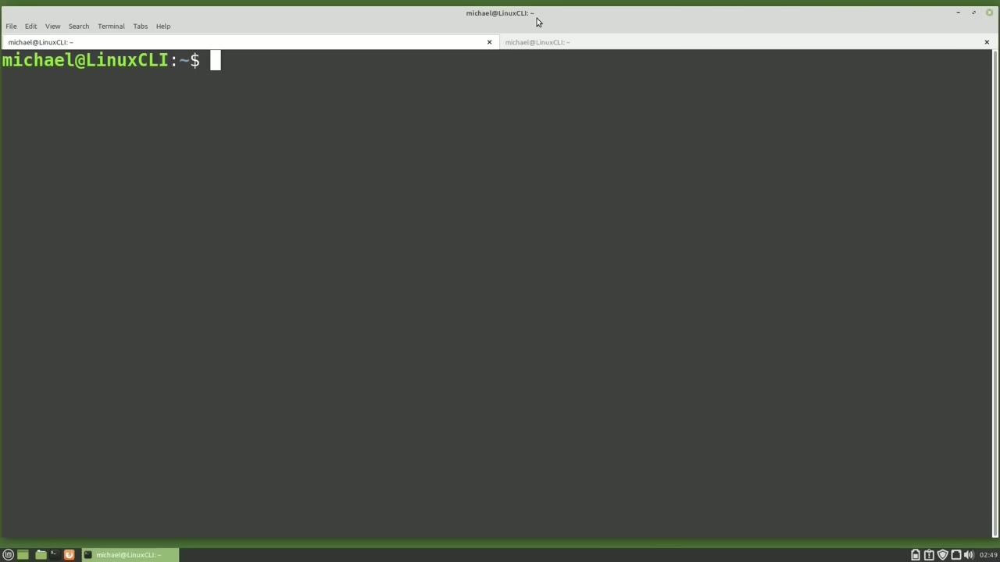
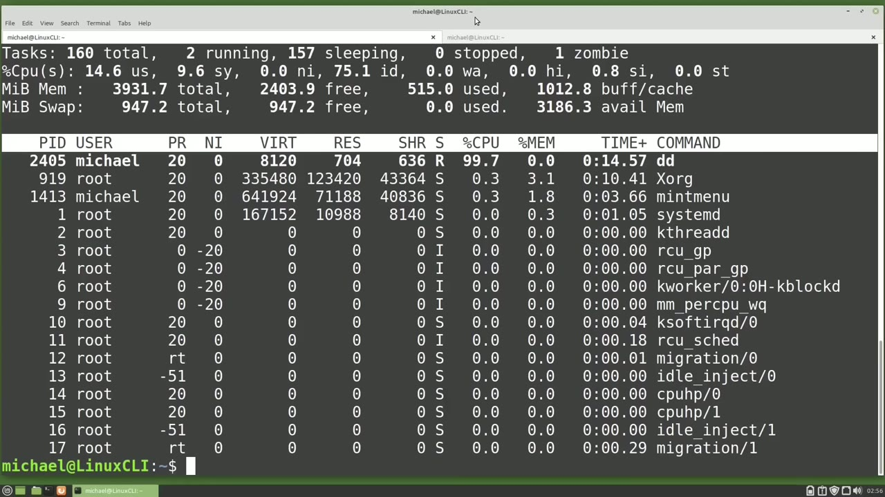
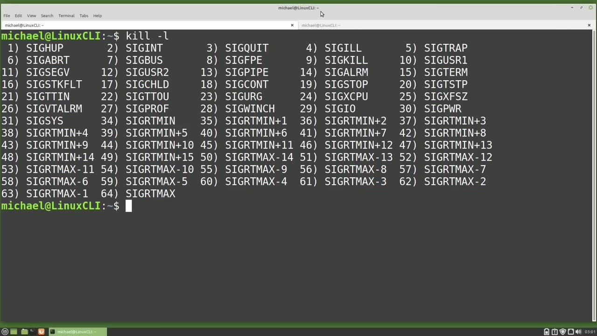
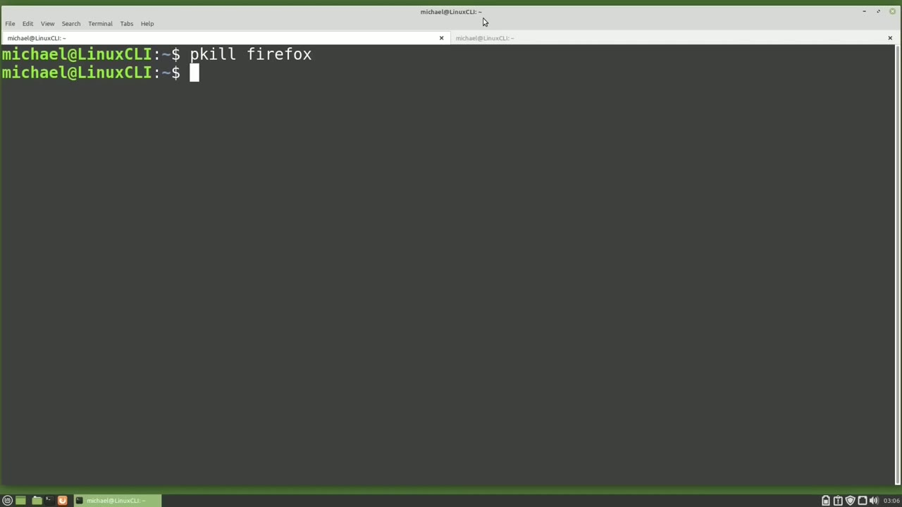

[← Course contents](../../01.md)

# 63. kill process

**Course:** [Linux Command Line - Entire Tutorial Series](https://www.youtube.com/watch?v=avg65oY7sj4)  
**Transcript:** [`Linux Command Line - Entire Tutorial Series transcript`](../../../../course_videos/Linux%20Command%20Line%20-%20Entire%20Tutorial%20Series/Linux%20Command%20Line%20-%20Entire%20Tutorial%20Series.txt)  
**Video:** 10:38:27–10:46:38 ([open at this time](https://www.youtube.com/watch?v=avg65oY7sj4&t=38307s))

## Introduction

I have the terminal open with two tabs and I'm going to type top in this first tab. And I'm going over to the other tab where I'm going to paste in that same command we've been working with the ddif equals dev 0, of equals dev no, and press enter and that is started. We see it over here in top running as PID 2321. In the last video To stop this job from running, we went into the tab where the job was running, held down Control and pressed C to cancel out of this job.

## Detailed Explanation

<details>
  <summary>Step 1 — Run `top`, `dd`, `kill`</summary>

### Step 1 — Run `top`, `dd`, `kill`

- [x] **Use `top`**
  - I have the terminal open with two tabs and I'm going to type `top` in this first tab.
  - And I'm going over to the other tab where I'm going to paste in that same command we've been working with the ddif equals dev 0, of equals dev no, and press enter and that is started.
  - We see it over here in `top` running as PID 2321.

- [x] **In the last video To stop this job from running, we went into the tab**
  - In the last video To stop this job from running, we went into the tab where the job was running, held down Control and pressed C to cancel out of this job.
  - In this video, we're going to stop this job from running in `top` and then we'll stop the job from running from the command line.
  - When we stop a process from running, it's called K to `kill` a process while in `top`, we'll press the lowercase K.

- [x] **Use `top`**
  - `top` shows us the message PID to signal `kill`, default PID, is 2321. Just like the Rehnice command, `top` thinks we want to `kill` the job using the most CPU and sets that as the default. And for us, that is correct. So I will press Enter.
  - Now `top` shows us the message. Send PID 2321 signal 15 sig term. It's not asking us for a confirmation of a Y or an N.
  - Pressing to enter will confirm this and pressing escape will stop this request and not run the Seg term to `kill` the job.

- [x] **Standard users can only kill their own jobs**
  - Standard users can only `kill` their own jobs.
  - Privileged users can `kill` their own jobs as well as jobs submitted by others.
  - But not even privileged users can `kill` jobs started by the kernel.

- [x] **The reason is because killing jobs submitted by the kernel may**
  - The reason is because killing jobs submitted by the kernel may accidentally or intentionally bring down the computer.
  - And if you want to bring down the computer.
  - You should shut down the computer gracefully.

- [x] **Use `dd`**
  - And we will do that at the end of this video.
  - I'm going to the other tab and I'm going to restart the `dd` command.
  - Going back over to `top`, we see that this is Job PID 2391 and I'm going to quit out of `top` by pressing Q.

- [x] **Use `kill`**
  - To `kill` the job from the command line, I will type `kill` and then the PID of the process we want to `kill`.
  - Pressing Enter, the job is killed to make sure I will restart `top`.
  - Going over to the other tab, I'm going to submit that `dd` command once more.

- [x] **Use `dd`**
  - We see that we now have the `dd` command running with a PID of 2405.
  - And I'm going to quit out of `top` by pressing Q.

```bash
top
dd
kill
```



</details>

<details>
  <summary>Step 2 — Run `kill -9`, `top`, `kill -L`</summary>

### Step 2 — Run `kill -9`, `top`, `kill -L`

- [x] **Use `kill -9`**
  - Occasionally, a job will not stop when we type Kill and the PID, but we still want to kill that job.
  - To force kill that job, we will add a -9 to our command.
  - So our command will be `kill -9` and then the PID, which in this case is 2405.

- [x] **Use `top`**
  - Press and enter. We have killed 9 that job. I'm going to type `top`.
  - And we see that that dd process was killed once again.
  - We always want to try kill before kill 9 when we kill a job because the kill by itself tries to terminate the job, whereas the kill 9 just stops that job from running and might leave some files in an improper state after that job was killed.

- [x] **Use `kill -L`**
  - I'm going to quit out of `top` and clear the screen to see a list of all the ways that we can kill a job.
  - I'm going to type `kill -L`.
  - This lists out all the different ways we can kill a job.

- [x] **Two videos back, it was supposed to be the last video, but it was two**
  - Two videos back, it was supposed to be the last video, but it was two videos back.
  - We saw that `top` crashed, showing us it crashed with a Signal 11, Sig Seg V.
  - Here we see that the Signal 11 is a Sig Seg V in this list of signal interrupts.

- [x] **And when I looked up what a Sig Seg V is, I found it means a program**
  - And when I looked up what a Sig Seg V is, I found it means a program tried to access a memory location that was not assigned to it.
  - When we killed the job from inside of `top`, it showed us it was going to kill the job with a 15 SigTerm.

```bash
kill -9
top
kill -L
```



</details>

<details>
  <summary>Step 3 — Run `kill -9`</summary>

### Step 3 — Run `kill -9`

- [x] **Use `kill -9`**
  - And 15 SigTerm is also what we used when we submitted the kill from the command line.
  - SigTerm 15 is the standard termination signal to end the process.
  - The other kill signal we used here was `kill -9` or sig kill.

- [x] **This will just end the process and may leave files in an improper**
  - This will just end the process and may leave files in an improper state.
  - Other signals we've used in this series are number two.
  - 2.2. Sigint is short for signal interrupt.

- [x] **This is sent when we hold down control and press the letter C**
  - This is sent when we hold down control and press the letter C.
  - The other one that we've used in this series, although it was a few videos back, was the Sig Quit number 3.
  - That submits a quit signal when we hold down control and press D as in dog.

- [x] **Sometimes we want to kill a process by the job name instead of the PID**
  - Sometimes we want to kill a process by the job name instead of the PID.
  - To do that, we can use P-Kill. I'm going to start a Firefox browser.
  - To kill the browser, I will type P-Kill Firefox.

- [x] **We see that the Firefox tab is now gone. It is killed**
  - We see that the Firefox tab is now gone. It is killed.
  - Occasionally when we use P-Kill to kill a job, the job will not end properly.

```bash
kill -9
```



</details>

<details>
  <summary>Step 4 — Run `kill`, `sudo`, `sudo kill`</summary>

### Step 4 — Run `kill`, `sudo`, `sudo kill`

- [x] **Use `kill`**
  - So we'll need to force `kill` it or `kill` 9 like we used with the `kill` command.
  - I'm going to restart Firefox and to force `kill` it we would type P-`kill` -F for force `kill` and then the application name which in this case is Firefox and the job is killed.
  - I'm going to pause this video for a moment or two.

- [x] **Use `kill`**
  - I'm back and now we see there is something using up a lot of memory and a lot of CPU and it looks like it's all from user George. I'm going to type you and bring up only the jobs used by George and we can see that he has a lot of things running.
  - I want to `kill` all the jobs that George is running right now.
  - To do that, I'm going into another terminal and I'm going to type `kill` All-U for user George.

- [x] **Use `sudo`**
  - So I'm going to `kill` everything that George is running.
  - We see that nothing is killed because I did not use `sudo`.
  - We must be a privileged user before we can `kill` all of George's jobs.

- [x] **Use `sudo kill`**
  - So `sudo kill` all dash you for user George putting in my password and now all of George's jobs are killed.
  - And we see that the memory goes down and the CPU usage goes down as well.
  - I'm going to close this little window and quit out of top.

- [x] **Use `sudo`**
  - And to end this video, I will shut down this computer gracefully with the command `sudo`.
  - -H for a halt and then we need to give it a time and I want it to shut down now.
  - In the next video we will continue looking at the Linux command line.

```bash
kill
sudo
sudo kill
```



</details>

<details>
  <summary>Questions and Answers</summary>

## Questions and Answers

### Question 1: What does `top` do in this chapter?

<details>
<summary>Answer</summary>

- [x] I have the terminal open with two tabs and I'm going to type `top` in this first tab.

</details>

### Question 2: What does `dd` do in this chapter?

<details>
<summary>Answer</summary>

- [x] I'm going to the other tab and I'm going to restart the `dd` command.

</details>

### Question 3: What does `kill` do in this chapter?

<details>
<summary>Answer</summary>

- [x] To `kill` the job from the command line, I will type `kill` and then the PID of the process we want to `kill`.

</details>

### Question 4: What does `kill -9` do in this chapter?

<details>
<summary>Answer</summary>

- [x] So our command will be `kill -9` and then the PID, which in this case is 2405.

</details>

### Question 5: What does `kill -L` do in this chapter?

<details>
<summary>Answer</summary>

- [x] I'm going to type `kill -L`.

</details>

### Question 6: What does `sudo` do in this chapter?

<details>
<summary>Answer</summary>

- [x] We see that nothing is killed because I did not use `sudo`.

</details>

### Question 7: What does `sudo kill` do in this chapter?

<details>
<summary>Answer</summary>

- [x] So `sudo kill` all dash you for user George putting in my password and now all of George's jobs are killed.

</details>

### Question 8: What does step 1 cover (Run top, dd, kill)?

<details>
<summary>Answer</summary>

- [x] I have the terminal open with two tabs and I'm going to type `top` in this first tab.
- [x] And I'm going over to the other tab where I'm going to paste in that same command we've been working with the ddif equals dev 0, of equals dev no, and press enter and that is started.
- [x] We see it over here in `top` running as PID 2321.

</details>

### Question 9: What does step 2 cover (Run kill -9, top, kill -L)?

<details>
<summary>Answer</summary>

- [x] Occasionally, a job will not stop when we type Kill and the PID, but we still want to kill that job.
- [x] To force kill that job, we will add a -9 to our command.
- [x] So our command will be `kill -9` and then the PID, which in this case is 2405.

</details>

### Question 10: What does step 3 cover (Run kill -9)?

<details>
<summary>Answer</summary>

- [x] And 15 SigTerm is also what we used when we submitted the kill from the command line.
- [x] SigTerm 15 is the standard termination signal to end the process.
- [x] The other kill signal we used here was `kill -9` or sig kill.

</details>

</details>

## Summary

This chapter, kill process, walks through Run top, dd, kill; Run kill -9, top, kill -L; Run kill -9; Run kill, sudo, sudo kill. Commands from the transcript: `top`, `dd`, `kill`, `kill -9`, `kill -L`, `sudo`, `sudo kill`.

## References

- [Linux Command Line - Entire Tutorial Series (YouTube)](https://www.youtube.com/watch?v=avg65oY7sj4)
- [This chapter at 10:38:27](https://www.youtube.com/watch?v=avg65oY7sj4&t=38307s)
- [Local transcript](../../../../course_videos/Linux%20Command%20Line%20-%20Entire%20Tutorial%20Series/Linux%20Command%20Line%20-%20Entire%20Tutorial%20Series.txt)
