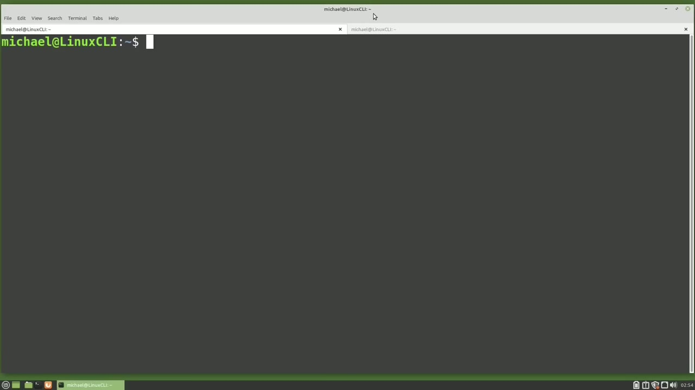
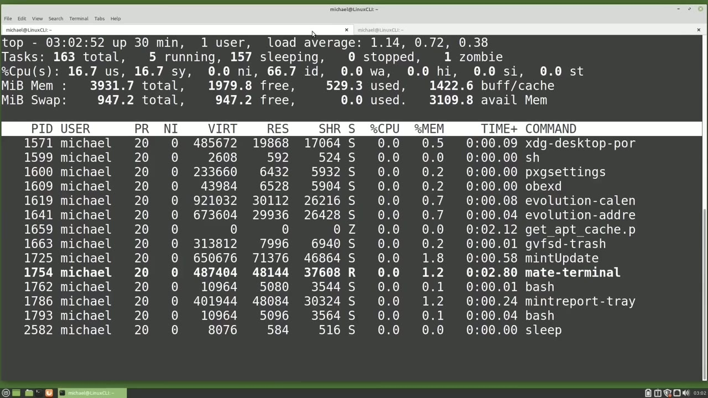
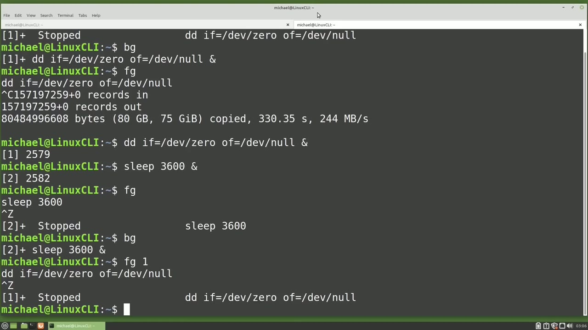
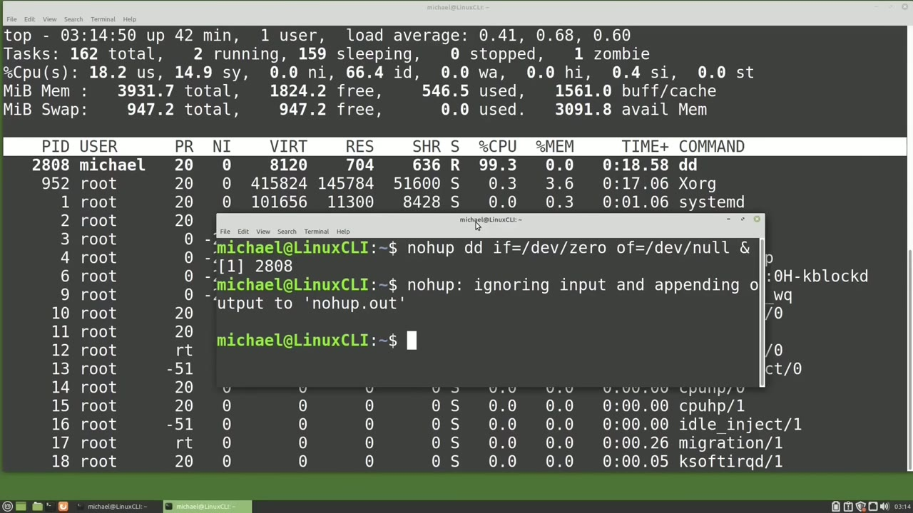

[← Course contents](../../01.md)

# 64. Foreground Background

**Course:** [Linux Command Line - Entire Tutorial Series](https://www.youtube.com/watch?v=avg65oY7sj4)  
**Transcript:** [`Linux Command Line - Entire Tutorial Series transcript`](../../../../course_videos/Linux%20Command%20Line%20-%20Entire%20Tutorial%20Series/Linux%20Command%20Line%20-%20Entire%20Tutorial%20Series.txt)  
**Video:** 10:46:38–10:55:25 ([open at this time](https://www.youtube.com/watch?v=avg65oY7sj4&t=38798s))

## Introduction

I have a terminal open with two tabs just like the last video and I'm typing top in this first tab going over to the other tab. I'm going to paste in that same command we've been working with that dd command and once I press Enter We cannot type anything else in the terminal now because the job we just submitted is running in the foreground. We see that dd job is running with a PID of 2528. We can send this job to the background, but first we need to pause the job.

## Detailed Explanation

<details>
  <summary>Step 1 — Run `top`, `bg`, `fg`</summary>

### Step 1 — Run `top`, `bg`, `fg`

- [x] **Use `top`**
  - I have a terminal open with two tabs just like the last video and I'm typing `top` in this first tab going over to the other tab. I'm going to paste in that same command we've been working with that dd command and once I press Enter We cannot type anything else in the terminal now because the job we just submitted is running in the foreground.
  - We see that dd job is running with a PID of 2528.
  - We can send this job to the background, but first we need to pause the job.

- [x] **To pause the job, I'm going to hold down control and press Z as in**
  - To pause the job, I'm going to hold down control and press Z as in Zebra.
  - The terminal shows us 1 in brackets is stopped and then shows us the command that is stopped.
  - Going over to the `top` tab, we no longer see that dd job running.

- [x] **Use `bg`**
  - I want to continue running this job, but from here I want this job to continue in the background.
  - To do that, I will type `bg` for background.
  - When I press Enter, We see the message 1 in brackets and then a plus sign and then the command we submitted.

- [x] **But notice now it also has an ampersand after the command**
  - But notice now it also has an ampersand after the command.
  - And clicking on the other tab, we see that that dd job is running once again.
  - So we have this job running in the background now, but notice we can no longer cancel the job by holding down control and pressing C.

- [x] **Use `fg`**
  - And if this program required input values from us, we would not be able to type in any input values because the job is now running in the background.
  - I want this job that is now running in the background to run in the foreground.
  - To do that, I will type `fg` for foreground.

- [x] **Pressing Enter. We see our command again and without the ampersand at**
  - Pressing Enter. We see our command again and without the ampersand at the end.
  - And we don't have any command prompt because the job is now running in the foreground.
  - Going over to `top`, we see that same PID, 2528 is still running.

- [x] **I'm going to hold down control and press C to cancel out of the**
  - I'm going to hold down control and press C to cancel out of the process running in the foreground.
  - And I'm going to re-submit this command, but this time I'm going to add the ampersand at the end.
  - To tell Linux we want to run this job in the background, pressing enter.

- [x] **We see it started job 1 in square brackets, and then the job number**
  - We see it started job 1 in square brackets, and then the job number 2579.
  - And going over to the `top` tab, we see that our dd job is now running with a PID of 2579.
  - Let's submit a second command in this terminal to run in the background.

- [x] **Use `sleep`**
  - It's going to be a `sleep` command. So I'm going to type `sleep` 3,600 ampersand to run in the background.
  - This will run a job that will `sleep` or wait for 3,600 seconds, which is one hour.
  - And I've added the ampersand at the end to make this job run in the background.

- [x] **To see this in top, I'm going over to the other tab**
  - To see this in `top`, I'm going over to the other tab.

```bash
top
bg
fg
sleep
```



</details>

<details>
  <summary>Step 2 — Run `sleep`, `fg`, `dd`</summary>

### Step 2 — Run `sleep`, `fg`, `dd`

- [x] **Use `sleep`**
  - I'm going to press you for user and change the user to be Michael, pressing enter and going all the way down to the bottom.
  - There we see the `sleep` command of 2582.
  - And it's not taking any resources because it is sleeping or waiting.

- [x] **Use `fg`, `dd`**
  - And then I'm going to press you and enter to bring back all of the users.
  - If I type `fg` for foreground now, it brings back that `sleep` command to the foreground.
  - But I want to bring back the `dd` command to the foreground.

- [x] **Use `sleep`, `bg`, `fg`**
  - So I'm going to pause the `sleep` command by holding down control and pressing Z and zebra.
  - And then I will type `bg` to continue this job running in the background.
  - To bring the `dd` command, the first command we submitted to the foreground, we will need to type `fg` for foreground, followed by the number 1.

- [x] **Pressing Enter, we see it brought our dd job to the foreground**
  - Pressing Enter, we see it brought our `dd` job to the foreground.
  - To pause this, I will hold down control and press the letter Z.
  - It's easy to remember which job is which when we only have two jobs running in the terminal.

- [x] **But what if we had four or five jobs running?**
  - But what if we had four or five jobs running?
  - We would want to be able to list out all of the jobs running in this terminal.

```bash
sleep
fg
dd
bg
```



</details>

<details>
  <summary>Step 3 — Run `jobs`, `bg`, `sleep`</summary>

### Step 3 — Run `jobs`, `bg`, `sleep`

- [x] **Use `jobs`**
  - We can do that by typing `jobs`.
  - This shows us Job 1 is our dd command and it is stopped, and Job 2 is our `sleep` Command and that is running.
  - And if we had other `jobs` submitted in this terminal, they would show here in this list as well.

- [x] **Use `bg`, `jobs`**
  - Let's start Job 1 to run in the background by typing `bg` space 1.
  - And now let's type `jobs` again.
  - And we will see that both `jobs` are running.

- [x] **Now notice we see a little plus sign and -sign by the job numbers**
  - Now notice we see a little plus sign and -sign by the job numbers.
  - The plus sign is the current default job and the -sign is the next in line default job.
  - To take the place of the default job when that one ends, the -sign will become the plus sign.

- [x] **Use `sleep`, `jobs`**
  - Default means if we type a command like fg for foreground without giving it a specific job number, That command will be applied to the default, which in this case is the `sleep` Command.
  - Let's add another `sleep` 7200 Ampestand to run this in the background.
  - Typing `jobs` again. We now see that the newest job submitted is the default job.

- [x] **Use `jobs`**
  - And what was the default job now has the -sign.
  - If we want to see the PIDs of these `jobs` as well, we can type `jobs`.
  - -L. And there we see the PIDs as well. I'm going to move this over a little bit and take this right tab and move it to the desktop. That just separates the two out. So if we bring this one back up, come over to the other. I'm going to make this smaller so that we can see both.

- [x] **I'm going to close this smaller terminal and when I do it's going to**
  - I'm going to close this smaller terminal and when I do it's going to kill all the `jobs` running in this smaller terminal.
  - And there we see the dd job has been killed.
  - The reason is when the terminal window is closed, the job running in the foreground will be killed and then the terminal sends a SIGHup command to all the processes running in the background of this terminal.

- [x] **We can get around this by adding no hub to the command we want to**
  - We can get around this by adding no hub to the command we want to continue after the terminal window is closed.
  - Let's open a new terminal window and I'm going to shrink this down a little bit.

```bash
jobs
bg
sleep
```



</details>

<details>
  <summary>Step 4 — Run `ls -lh`, `grep noh`, `nohup`</summary>

### Step 4 — Run `ls -lh`, `grep noh`, `nohup`

- [x] **And now I'm going to add that no hub and then paste in the command**
  - And now I'm going to add that no hub and then paste in the command.
  - And we're going to add the ampersand to run this in the background.
  - And now I'll press Enter and start that up.

- [x] **Use `ls -lh`**
  - Notice we get the message no hub is ignoring input.
  - And when we run this no hub, it will create a file.
  - Noh. We should be able to see that with `ls -lh`.

- [x] **Use `grep noh`, `nohup`**
  - Grep. Noh.
  - And there we see the `nohup`.
  - Dot out file. There's nothing in it. We see it has a size of zero.

- [x] **And we can delete this file later after the command ends**
  - And we can delete this file later after the command ends.
  - So now I'm going to close this terminal.
  - And our dd command should continue running.

- [x] **And we see that dd job does continue running even after I closed the**
  - And we see that dd job does continue running even after I closed the terminal window where I started it.
  - I'm going to kill that dd job by pressing K to kill and I do want to kill PID 2808.
  - In the next video, we will continue looking at the Linux command line.

```bash
ls -lh
grep noh
nohup
```



</details>

<details>
  <summary>Questions and Answers</summary>

## Questions and Answers

### Question 1: What does `top` do in this chapter?

<details>
<summary>Answer</summary>

- [x] I have a terminal open with two tabs just like the last video and I'm typing `top` in this first tab going over to the other tab. I'm going to paste in that same command we've been working with that dd command and once I press Enter We cannot type anything else in the terminal now because the job we just submitted is running in the foreground.

</details>

### Question 2: What does `bg` do in this chapter?

<details>
<summary>Answer</summary>

- [x] To do that, I will type `bg` for background.

</details>

### Question 3: What does `fg` do in this chapter?

<details>
<summary>Answer</summary>

- [x] To do that, I will type `fg` for foreground.

</details>

### Question 4: What does `sleep` do in this chapter?

<details>
<summary>Answer</summary>

- [x] It's going to be a `sleep` command. So I'm going to type `sleep` 3,600 ampersand to run in the background.

</details>

### Question 5: What does `dd` do in this chapter?

<details>
<summary>Answer</summary>

- [x] But I want to bring back the `dd` command to the foreground.

</details>

### Question 6: What does `jobs` do in this chapter?

<details>
<summary>Answer</summary>

- [x] We can do that by typing `jobs`.

</details>

### Question 7: What does `ls -lh` do in this chapter?

<details>
<summary>Answer</summary>

- [x] Noh. We should be able to see that with `ls -lh`.

</details>

### Question 8: What does `grep noh` do in this chapter?

<details>
<summary>Answer</summary>

- [x] Grep. Noh.

</details>

### Question 9: What does `nohup` do in this chapter?

<details>
<summary>Answer</summary>

- [x] And there we see the `nohup`.

</details>

</details>

## Summary

This chapter, Foreground Background, walks through Run top, bg, fg; Run sleep, fg, dd; Run jobs, bg, sleep; Run ls -lh, grep noh, nohup. Commands from the transcript: `top`, `bg`, `fg`, `sleep`, `dd`, `jobs`, `ls -lh`, `grep noh`, `nohup`.

## References

- [Linux Command Line - Entire Tutorial Series (YouTube)](https://www.youtube.com/watch?v=avg65oY7sj4)
- [This chapter at 10:46:38](https://www.youtube.com/watch?v=avg65oY7sj4&t=38798s)
- [Local transcript](../../../../course_videos/Linux%20Command%20Line%20-%20Entire%20Tutorial%20Series/Linux%20Command%20Line%20-%20Entire%20Tutorial%20Series.txt)
