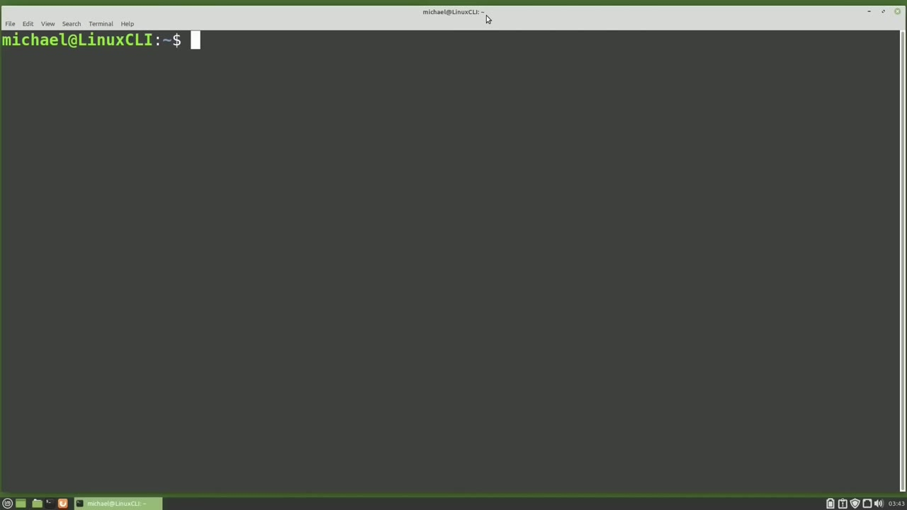
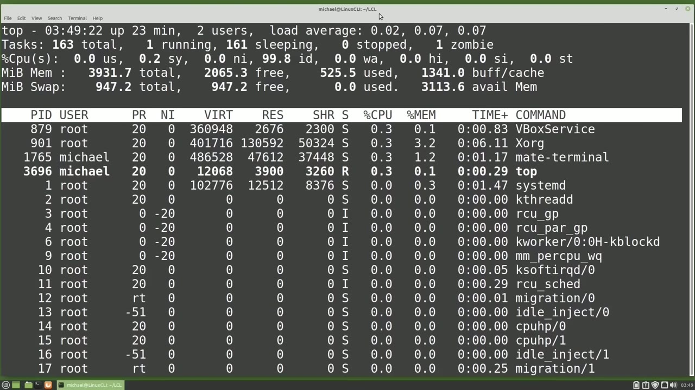
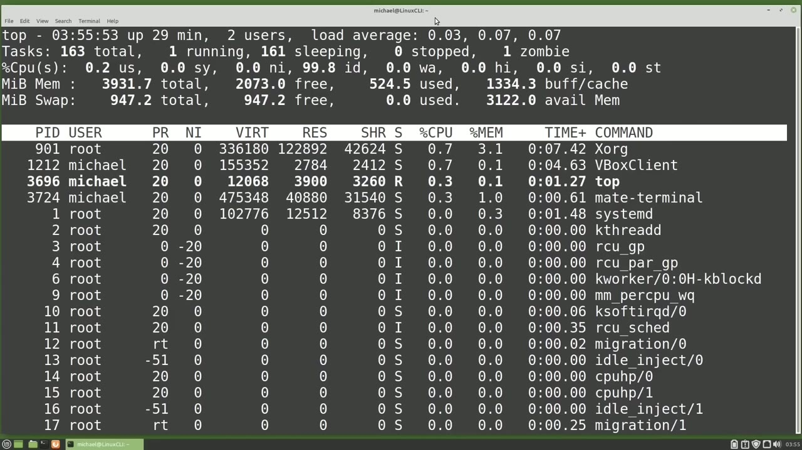
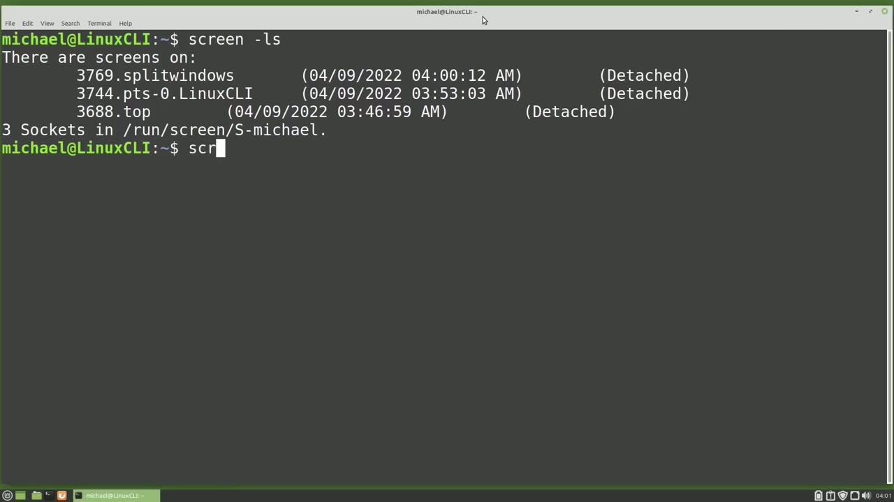

[← Course contents](../../01.md)

# 65. Screen pt1

**Course:** [Linux Command Line - Entire Tutorial Series](https://www.youtube.com/watch?v=avg65oY7sj4)  
**Transcript:** [`Linux Command Line - Entire Tutorial Series transcript`](../../../../course_videos/Linux%20Command%20Line%20-%20Entire%20Tutorial%20Series/Linux%20Command%20Line%20-%20Entire%20Tutorial%20Series.txt)  
**Video:** 10:55:25–11:06:17 ([open at this time](https://www.youtube.com/watch?v=avg65oY7sj4&t=39325s))

## Introduction

In the last video, we looked at running a job in the background and we added no hub to our command to allow that command to keep running even after we closed the terminal window. Another way to keep a job running after closing the terminal window is with the screen command. I'm typing in screen and pressing Enter. And we see that screen is not installed by default on this computer.

## Detailed Explanation

<details>
  <summary>Step 1 — Run `screen`, `sudo apt install`, `top`</summary>

### Step 1 — Run `screen`, `sudo apt install`, `top`

- [x] **Use `screen`**
  - In the last video, we looked at running a job in the background and we added no hub to our command to allow that command to keep running even after we closed the terminal window.
  - Another way to keep a job running after closing the terminal window is with the `screen` command.
  - I'm typing in `screen` and pressing Enter.

- [x] **Use `sudo apt install`, `screen`**
  - And we see that `screen` is not installed by default on this computer.
  - But Linux is telling me I can install `screen` with the command `sudo apt install` `screen`.
  - `screen` is now installed and I will type `screen` again.

- [x] **Use `screen`**
  - And when I press enter, we see the version of `screen`, the copyright information.
  - And at the bottom, we see press space bar for next page, return to end.
  - I will press return or enter and it looks like I'm placed back in my terminal window where I was before I type `screen`.

- [x] **But now I am in a screen session. To quit this screen session, I will**
  - But now I am in a `screen` session. To quit this `screen` session, I will type exit.
  - And we see the message `screen` is terminating.
  - Now we are out of the `screen` session and we ended that `screen` session.

- [x] **I'm going to change to a different directory with cdlcl**
  - I'm going to change to a different directory with cdlcl.
  - And again, I'm going to type in `screen` and press enter.
  - We see the information page. I'm going to press enter again.

- [x] **Use `top`**
  - And again, it looks like nothing happened.
  - To show how this works, I'm going to type `top` and start the `top` command.
  - Now I want to disconnect from the `screen`, but I don't want to end the `screen` session like we did when we typed exit.

- [x] **Use `screen`**
  - To disconnect from the `screen` but keep that `screen` session running, we will want to use a `screen` command to disconnect.
  - And the `screen` command to disconnect is pressing the letter D for disconnect.
  - But if I press the D key now, `top` will think I'm trying to submit the D key to `top`.

```bash
screen
sudo apt install
top
```



</details>

<details>
  <summary>Step 2 — Run `screen -ls`, `screen -R`, `ls`</summary>

### Step 2 — Run `screen -ls`, `screen -R`, `ls`

- [x] **So we need to add a prefix to our command to tell Linux, The next key**
  - So we need to add a prefix to our command to tell Linux, The next key I press is going to be a screen command.
  - And the prefix for a screen command is Control A.
  - So I want to hold down the control key and press the letter A to tell Linux that I'm going to send a screen command.

- [x] **Then I'm going to press the letter D, which is the actual screen**
  - Then I'm going to press the letter D, which is the actual screen command to disconnect.
  - So the whole command I'm going to use right now is Control A, D.
  - But it is still running in the background.

- [x] **Use `screen -ls`, `screen -R`**
  - I can even close this terminal window and the screen session is still running in the background on this computer.
  - I'm going to open up a new terminal window and to see the screen sessions running, I will type `screen -ls`. Since we only have a single screen session running now, I can reconnect to that screen with `screen -R`.
  - And here we see `top` is running just how we left it when we disconnected from the screen.

- [x] **I'm going to disconnect from this screen again with Control A, D**
  - I'm going to disconnect from this screen again with Control A, D.
  - And I'm disconnected from the screen session.
  - But the screen session is still active in running in the background.

- [x] **As long as this computer is not turned off, that screen will continue**
  - As long as this computer is not turned off, that screen will continue to run.
  - Often, screen is used after SSHing into a computer.
  - For example, someone might log into a server from their work desktop, start a screen session on that server, then disconnect from that screen session, running on the server, then they can turn off their work desktop computer, go home to their home computer, SSH back into that same server where that screen is running,

- [x] **Use `ls`**
  - Reconnect to that screen session and continue working from there.
  - Let's start another screen session by typing screen and enter and enter again.
  - And I'm just going to run the `ls` command here.

- [x] **Connect from the screen with Control A, D**
  - Connect from the screen with Control A, D.
  - I'm out of the screen session that we just started.
  - Now we have two screen sessions running.

- [x] **Use `screen -ls`, `top`, `ls`**
  - I can see that when I type `screen -ls`.
  - I want to go back into the screen running the `top` command.
  - We know which one this is because it was in the first `ls` command when we only have the one screen to reconnect to that screen that starts with 3688.

- [x] **I will type Screen DashR for Reconnect**
  - I will type Screen DashR for Reconnect.
  - And then I need to type in enough of the title to make it unique.
  - So if I type 3688, that's enough to make it unique.

- [x] **Now from here, I can either press Enter or I can press the tab key**
  - Now from here, I can either press Enter or I can press the tab key, which will auto complete the title.

```bash
screen -ls
screen -R
ls
top
```



</details>

<details>
  <summary>Step 3 — Run `top`, `screen -ls`, `ls -lh`</summary>

### Step 3 — Run `top`, `screen -ls`, `ls -lh`

- [x] **Use `top`**
  - And we're back in that `top` screen session.
  - And I am certain we are in the screen session running `top`.
  - And I want to rename this screen session to have `top` in the title.

- [x] **To do that, I will hold down control and press A**
  - To do that, I will hold down control and press A.
  - If we put a colon after that control A, that means we're going to type a screen command.
  - And the screen command I'm going to type is session name.

- [x] **And we're going to give this session name top**
  - And we're going to give this session name `top`.
  - Pressing Enter will complete the command.
  - And I'll press Control A, D to disconnect from that screen.

- [x] **Use `screen -ls`, `top`**
  - And type `screen -ls`.
  - And now we see that the screen number 3688 has `top` in the title.
  - So we know that's the one that is running the `top` command.

- [x] **And I want to give this screen session a name**
  - And I want to give this screen session a name.
  - So to do that, I'm going to add a -uppercase s for screen session name.
  - Now before I press enter, we're going to notice that when I give a screen session a name, it skips that screen information page and takes me right into the screen session.

- [x] **Use `ls -lh`, `screen -ls`**
  - Pressing enter, we see we're right into the screen session.
  - In this window, I'm going to type `ls -lh`, and I'm going to disconnect from this screen right now by pressing Control A, D, and then clear the screen.
  - I'm going to list out the screen sessions again with `screen -ls`, and we see that we have three screen sessions.

- [x] **One screen session is called top. A second one has the default name**
  - One screen session is called `top`. A second one has the default name, and the third one is called Split Windows.
  - We don't need the screen session that we didn't rename and we want to exit out of that.
  - I could reconnect to that screen and type exit to end that screen session.

```bash
top
screen -ls
ls -lh
```



</details>

<details>
  <summary>Step 4 — Run `screen -xs`, `screen -ls`, `screen -S`</summary>

### Step 4 — Run `screen -xs`, `screen -ls`, `screen -S`

- [x] **Use `screen -xs`**
  - Or we could just type `screen -xs`.
  - Then we want to type in enough of that name to make it unique.
  - I'm going to type in the 3744 and then quit.

- [x] **Use `screen -ls`**
  - And that screen session should have ended.
  - `screen -ls`. Now we only have two screen sessions running.
  - This shows we did end the screen session with the job id of 3744.

- [x] **Use `screen -S`, `sleep`**
  - Now there are times when you might have a long running job that you need to run and you want to run this in a screen.
  - Let's start a screen for that. `screen -S` and we're going to give this screen session name long.
  - Running job. And the job we're going to run is a `sleep` command. Let's cat this out.

- [x] **Use `sleep`**
  - Cat `sleep` 15.Sh. It's just a `sleep` command that will `sleep` for 15 seconds.
  - We're going to use this as our long running job, but we made it short just for the video.
  - We want to run this job in a screen and then we want to exit out of the screen as soon as this job ends.

- [x] **Use `sleep`**
  - Dot slash sleep15. s.h. Then I'm going to put a semicolon, `which` is a command separator.
  - We talked about this in an earlier video. And then exit. So we want to run that `sleep` command and then exit out as soon as this `sleep` command is done. Pressing enter. The `sleep` command is running.
  - I can disconnect from the screen now is what I would normally do. But we're going to stay here and watch it exit out as soon as we.

- [x] **Use `screen -uppercase`**
  - And here we see that we were exited out of that screen as soon as that job ended.
  - We can also do that same thing without even entering into the screen command.
  - We'll do that by typing `screen -uppercase` S long running job -D -M.

- [x] **Use `which`**
  - And then we'll give it the job to run, `which` is dot slash.
  - So this will start up the long running job screen and then run that `sleep` 15.
  - As soon as that's done, it should exit us out of that long running job screen session.

- [x] **Use `screen -ls`, `ls`**
  - Pressing Enter starts it up and I will type `screen -ls`.
  - Now we see that that long running job is running.
  - Screen `ls` again shows it is still running.

- [x] **Use `ls`**
  - And as soon as that 15 second job ends, let's run that Screen `ls` again.
  - And in the next video, we will continue our look at Screen for the Linux command line.

```bash
screen -xs
screen -ls
screen -S
sleep
screen -uppercase
which
ls
```



</details>

<details>
  <summary>Questions and Answers</summary>

## Questions and Answers

### Question 1: What does `screen` do in this chapter?

<details>
<summary>Answer</summary>

- [x] Another way to keep a job running after closing the terminal window is with the `screen` command.

</details>

### Question 2: What does `sudo apt install` do in this chapter?

<details>
<summary>Answer</summary>

- [x] But Linux is telling me I can install screen with the command `sudo apt install` screen.

</details>

### Question 3: What does `top` do in this chapter?

<details>
<summary>Answer</summary>

- [x] To show how this works, I'm going to type `top` and start the `top` command.

</details>

### Question 4: What does `screen -ls` do in this chapter?

<details>
<summary>Answer</summary>

- [x] I'm going to open up a new terminal window and to see the screen sessions running, I will type `screen -ls`. Since we only have a single screen session running now, I can reconnect to that screen with Screen -R.

</details>

### Question 5: What does `screen -R` do in this chapter?

<details>
<summary>Answer</summary>

- [x] I'm going to open up a new terminal window and to see the screen sessions running, I will type Screen -ls. Since we only have a single screen session running now, I can reconnect to that screen with `screen -R`.

</details>

### Question 6: What does `ls` do in this chapter?

<details>
<summary>Answer</summary>

- [x] And I'm just going to run the `ls` command here.

</details>

### Question 7: What does `ls -lh` do in this chapter?

<details>
<summary>Answer</summary>

- [x] In this window, I'm going to type `ls -lh`, and I'm going to disconnect from this screen right now by pressing Control A, D, and then clear the screen.

</details>

### Question 8: What does `screen -xs` do in this chapter?

<details>
<summary>Answer</summary>

- [x] Or we could just type `screen -xs`.

</details>

### Question 9: What does `screen -S` do in this chapter?

<details>
<summary>Answer</summary>

- [x] Let's start a screen for that. `screen -S` and we're going to give this screen session name long.

</details>

### Question 10: What does `sleep` do in this chapter?

<details>
<summary>Answer</summary>

- [x] Running job. And the job we're going to run is a `sleep` command. Let's cat this out.

</details>

### Question 11: What does `screen -uppercase` do in this chapter?

<details>
<summary>Answer</summary>

- [x] We'll do that by typing `screen -uppercase` S long running job -D -M.

</details>

### Question 12: What does `which` do in this chapter?

<details>
<summary>Answer</summary>

- [x] And then we'll give it the job to run, `which` is dot slash.

</details>

</details>

## Summary

This chapter, Screen pt1, walks through Run screen, sudo apt install, top; Run screen -ls, screen -R, ls; Run top, screen -ls, ls -lh; Run screen -xs, screen -ls, screen -S. Commands from the transcript: `screen`, `sudo apt install`, `top`, `screen -ls`, `screen -R`, `ls`, `ls -lh`, `screen -xs`, `screen -S`, `sleep`, `screen -uppercase`, `which`.

## References

- [Linux Command Line - Entire Tutorial Series (YouTube)](https://www.youtube.com/watch?v=avg65oY7sj4)
- [This chapter at 10:55:25](https://www.youtube.com/watch?v=avg65oY7sj4&t=39325s)
- [Local transcript](../../../../course_videos/Linux%20Command%20Line%20-%20Entire%20Tutorial%20Series/Linux%20Command%20Line%20-%20Entire%20Tutorial%20Series.txt)
