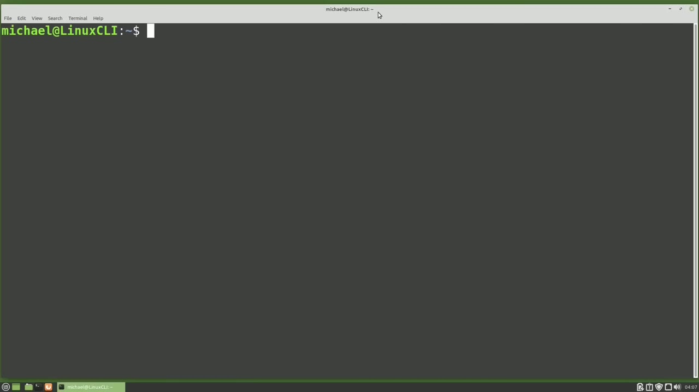
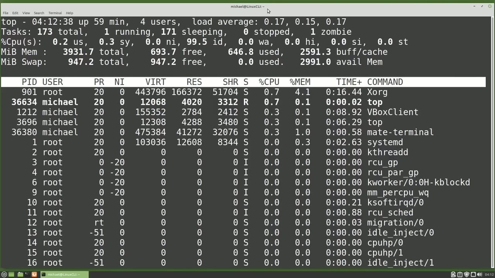
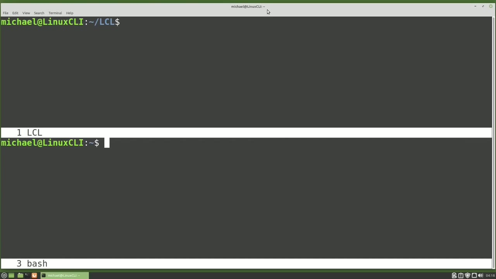
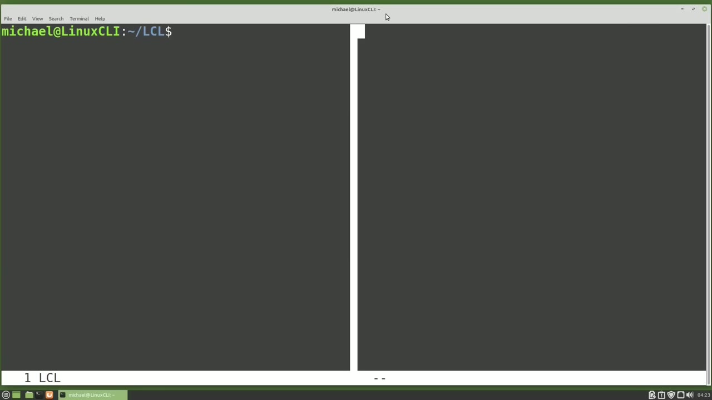

[← Course contents](../../01.md)

# 66. Screen pt2

**Course:** [Linux Command Line - Entire Tutorial Series](https://www.youtube.com/watch?v=avg65oY7sj4)  
**Transcript:** [`Linux Command Line - Entire Tutorial Series transcript`](../../../../course_videos/Linux%20Command%20Line%20-%20Entire%20Tutorial%20Series/Linux%20Command%20Line%20-%20Entire%20Tutorial%20Series.txt)  
**Video:** 11:06:17–11:15:33 ([open at this time](https://www.youtube.com/watch?v=avg65oY7sj4&t=39977s))

## Introduction

We are picking up from where we left off in the last video looking at the screen command. After recording the Screen Part 1 video. I learned that the screen command is no longer supported in Red Hat 8. So in the next video we will look at Screen Alternative tmux.

## Detailed Explanation

<details>
  <summary>Step 1 — Run `tmux`, `screen -l -ls`, `bash`</summary>

### Step 1 — Run `tmux`, `screen -l -ls`, `bash`

- [x] **We are picking up from where we left off in the last video looking at**
  - We are picking up from where we left off in the last video looking at the screen command.
  - After recording the Screen Part 1 video.
  - I learned that the screen command is no longer supported in Red Hat 8.

- [x] **Use `tmux`, `screen -l -ls`**
  - So in the next video we will look at Screen Alternative `tmux`.
  - Continuing on with the Screen Part 2 tutorial, I'm going to type `screen -l -ls` to remind us of where we left off in the last video.
  - We have two screen sessions opened, one called `top` and the other called Split Windows.

- [x] **I'm going to reattach to the screen session called Split Windows by**
  - I'm going to reattach to the screen session called Split Windows by typing Screen DashR Split and pressing Enter.
  - And I'm back in my Split Windows screen session.
  - I want to create a new window in this screen session.

- [x] **To do that, I'm going to type the screen prefix of Control A and then**
  - To do that, I'm going to type the screen prefix of Control A and then I'll press a lowercase C for Create New Window.
  - Let's change the directory to the lcl directory with cdlcl.
  - To see the windows we have open in our screen session, I'm going to press the screen prefix of Control A and then the double quote.

- [x] **Use `bash`**
  - We see two windows, zero `bash` and one `bash`. Those names are not very descriptive.
  - While on this page, I can use my arrow up and down keys to choose which window I would like to return to.
  - I'm going to put the highlight on the 1 `bash` and press Enter.

- [x] **Use `bash`**
  - And I'm back in the lcl directory window.
  - Let's rename this window to lcl by pressing Control A and then the uppercase A.
  - We see Set Window Title down on the lower left and right now it's showing us the default of `bash`.

- [x] **I'm going to press the Backspace key four times**
  - I'm going to press the Backspace key four times.
  - And then I'll add in the lcl that we want to change this window to and press enter.
  - To see the windows we have open now, I'm going to press the prefix of Control A again and then the double quote.

- [x] **Use `bash`**
  - And we now see that window 1 shows as lcl.
  - I'm moving my highlight over the Zero `bash` window and pressing enter to return to that window.
  - And then C again to create another new window.

- [x] **Use `top`**
  - And in this window, I'm going to type `top`.
  - So `top` is running. I want to rename this window to `top`.

```bash
tmux
screen -l -ls
bash
top
```



</details>

<details>
  <summary>Step 2 — Run `bash`</summary>

### Step 2 — Run `bash`

- [x] **Use `bash`**
  - So I'll press Control A, uppercase A, backspace out the `bash`, and type in top.
  - Now we have three different windows open.
  - To go to the next window, I'm going to press the screen prefix of Control A and then N for next.

- [x] **I'll do the same thing again, Control A. N for next**
  - I'll do the same thing again, Control A. N for next.
  - Or I can press Control A P for the previous window.
  - I'm going to press Control A double quote again to show me all the open windows.

- [x] **And we see we've got three open windows numbered zero to two**
  - And we see we've got three open windows numbered zero to two.
  - To go to a specific window, I can move my highlight over that number like we saw earlier.
  - Or from any window, including this one, I can press Control A and then the number of the window I want to go to.

- [x] **I will press Control a2 and go to the top window**
  - I will press Control a2 and go to the top window.
  - And then Control a1 will take me to the lcl window.
  - So now we have three different ways to get around these windows that are open and screen.

- [x] **To do that, I will type the screen prefix of Control A and then in**
  - To do that, I will type the screen prefix of Control A and then in uppercase S for split.
  - We see a horizontal line halfway through the screen.

```bash
bash
```



</details>

<details>
  <summary>Step 3 — Run `bash`, `ls`, `bash 3`</summary>

### Step 3 — Run `bash`, `ls`, `bash 3`

- [x] **So we have split this window horizontally**
  - So we have split this window horizontally.
  - And the bottom window doesn't have anything in it at the moment and the name shows as two dashes. To move the cursor to the bottom window, I'm going to use the screen prefix of Control A and then press the tab key. So Control A tab will move me to the next window.
  - From this new empty window, I can create a new window with Control A, C for Create.

- [x] **Use `bash`**
  - And we see at the bottom this window is called 3 `bash`.
  - We can make this window one of our other screen windows by typing Control A and then the number of the window we want this to be.
  - Let's make this window our top window by pressing Control a2.

- [x] **Use `ls`, `bash`**
  - Or we can make both these windows the same thing by pressing Control a1.
  - And here I'll type `ls` and it shows the same thing in both windows.
  - I'm going to change this bottom window back to the new `bash` window with Control a3.

- [x] **Use `bash 3`**
  - To kill the `bash 3` window, I can type exit, but I want to keep the `bash 3` screen window running.
  - To do that, I'm going to make sure that I'm in the split that I want to close, and then I will press Control a uppercase X.
  - When we unsplit the horizontal window, it worked, but it...

- [x] **Use `clear`**
  - Needs a little cleaning up, so I will type `clear`.
  - And now it's more `clear` that we have unsplit that window.
  - If you accidentally press the lowercase X instead of the uppercase X, I'll do that now with Control a lowercase X.

- [x] **To unlock screen, you can just type in your Linux login password**
  - To unlock screen, you can just type in your Linux login password.
  - Now I want to split the screen vertically.
  - To get to the new split, I'll press Control A tab.

```bash
bash
ls
bash 3
clear
```



</details>

<details>
  <summary>Step 4 — Run `bash`, `screen`, `clear`</summary>

### Step 4 — Run `bash`, `screen`, `clear`

- [x] **Use `bash`**
  - And then I'll create a new window in here with Control a C. And we see our new window is called 4 `bash`.
  - When we split the window, `screen` tries to split the window in half.
  - I want this new window to be three quarters of the `screen`.

- [x] **Use `screen`**
  - To do that, I will type Control a colon, which allows us to type in a `screen` command, and I'm going to type in resize 75%. And pressing Enter, resizes my window.
  - Now my new window has 75% of the `screen` window, and the other side of the split has 25% of the `screen` window. I can also reduce or increase the size of this window by a number of columns by adding a plus or -after the resize.
  - I'll press Control A colon and then type in Resize -5.

- [x] **And when I press Enter, we reduced our window by five columns**
  - And when I press Enter, we reduced our window by five columns.
  - If I don't give it a plus or minus and just put in a number, it will make our window that many columns.
  - We've resized our window. If I want to make all the windows the same size, I can do that with Control A colon and then type in resize space equals. And now our windows are equal in size.

- [x] **I'm going to add a horizontal split here with Control A, uppercase S**
  - I'm going to add a horizontal split here with Control A, uppercase S.
  - And I want to make this window 30% of the split. I'll do that with Control A Colen, resize 30%.
  - And then if I want to close all the windows, except the window I am in, I can type Control A uppercase Q.

- [x] **Use `clear`**
  - And after closing the other windows, it leaves this one in a odd position.
  - I'm going to type `clear` to show that we only have the one open.
  - To exit and remove this window from the `screen` session, I will type exit.

- [x] **Use `bash`**
  - And then Control A double quote shows that we have closed the 4 `bash` window.
  - And then going into the 0 `bash` window, I will exit out of that.
  - Quit out of top and exit out of that window.

- [x] **And then exit out of the lcl screen window**
  - And then exit out of the lcl `screen` window.
  - And we have one more open. I'll exit out of that one as well.
  - And we see the message `screen` is terminated, so we have ended the `screen` session.

- [x] **Use `tmux`**
  - In the next video, we're going to look at `tmux` for the Linux command line.

```bash
bash
screen
clear
tmux
```



</details>

<details>
  <summary>Questions and Answers</summary>

## Questions and Answers

### Question 1: What does `screen` do in this chapter?

<details>
<summary>Answer</summary>

- [x] We are picking up from where we left off in the last video looking at the `screen` command.

</details>

### Question 2: What does `tmux` do in this chapter?

<details>
<summary>Answer</summary>

- [x] So in the next video we will look at Screen Alternative `tmux`.

</details>

### Question 3: What does `screen -l -ls` do in this chapter?

<details>
<summary>Answer</summary>

- [x] Continuing on with the Screen Part 2 tutorial, I'm going to type `screen -l -ls` to remind us of where we left off in the last video.

</details>

### Question 4: What does `bash` do in this chapter?

<details>
<summary>Answer</summary>

- [x] We see two windows, zero `bash` and one `bash`. Those names are not very descriptive.

</details>

### Question 5: What does `top` do in this chapter?

<details>
<summary>Answer</summary>

- [x] And in this window, I'm going to type `top`.

</details>

### Question 6: What does `ls` do in this chapter?

<details>
<summary>Answer</summary>

- [x] And here I'll type `ls` and it shows the same thing in both windows.

</details>

### Question 7: What does `bash 3` do in this chapter?

<details>
<summary>Answer</summary>

- [x] To kill the `bash 3` window, I can type exit, but I want to keep the `bash 3` screen window running.

</details>

### Question 8: What does `clear` do in this chapter?

<details>
<summary>Answer</summary>

- [x] Needs a little cleaning up, so I will type `clear`.

</details>

</details>

## Summary

This chapter, Screen pt2, walks through Run tmux, screen -l -ls, bash; Run bash; Run bash, ls, bash 3; Run bash, screen, clear. Commands from the transcript: `tmux`, `screen -l -ls`, `bash`, `top`, `ls`, `bash 3`, `clear`, `screen`.

## References

- [Linux Command Line - Entire Tutorial Series (YouTube)](https://www.youtube.com/watch?v=avg65oY7sj4)
- [This chapter at 11:06:17](https://www.youtube.com/watch?v=avg65oY7sj4&t=39977s)
- [Local transcript](../../../../course_videos/Linux%20Command%20Line%20-%20Entire%20Tutorial%20Series/Linux%20Command%20Line%20-%20Entire%20Tutorial%20Series.txt)
