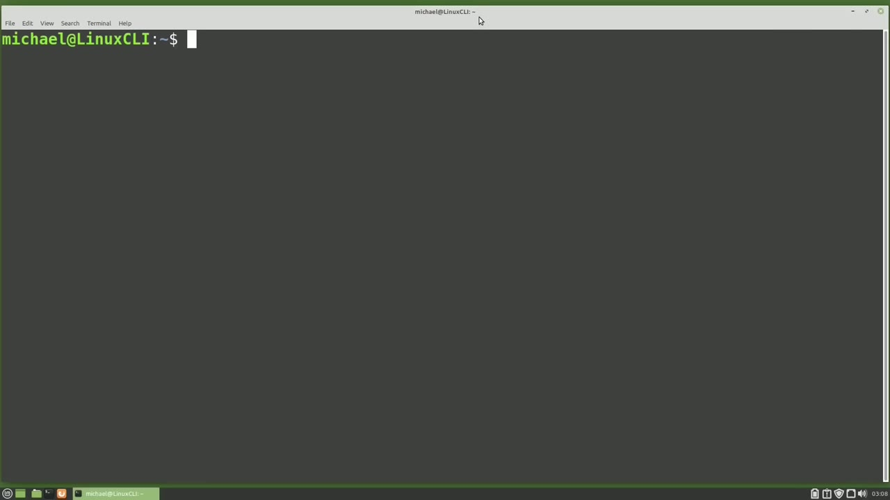
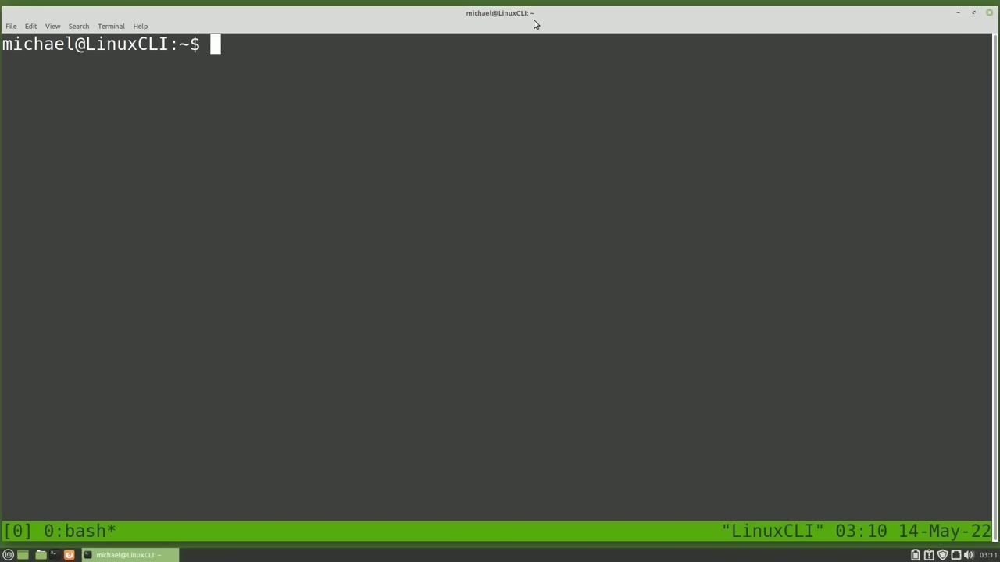
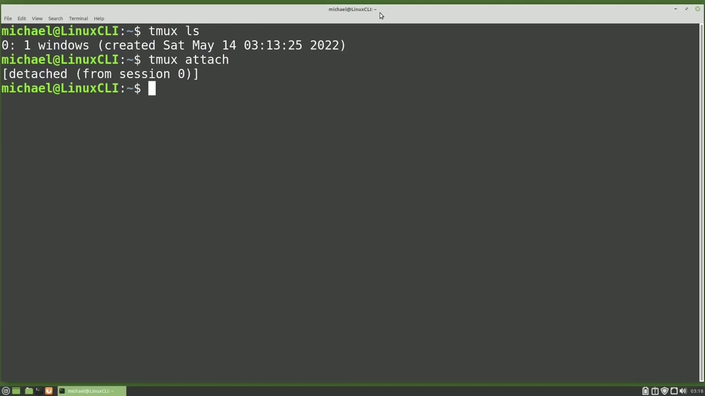
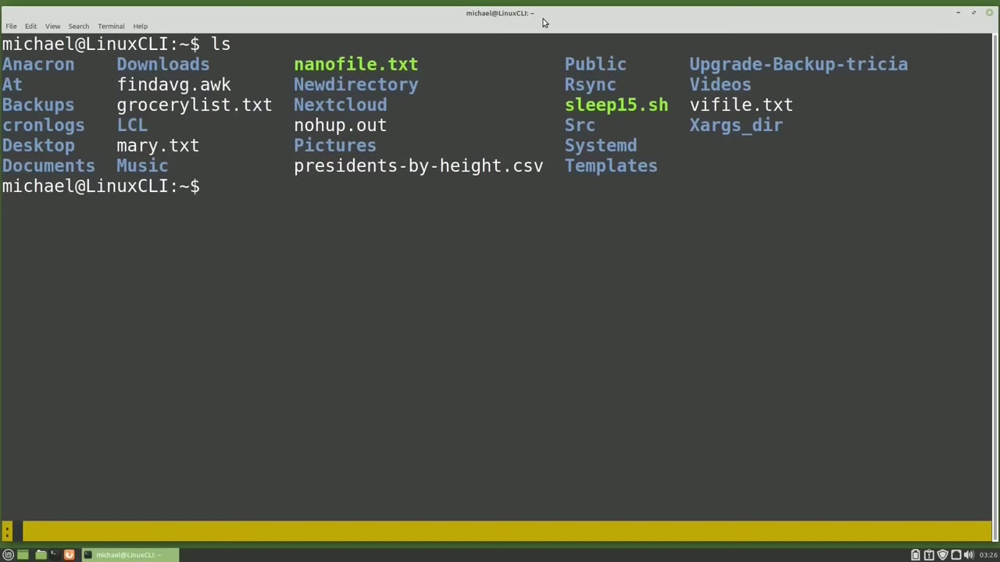
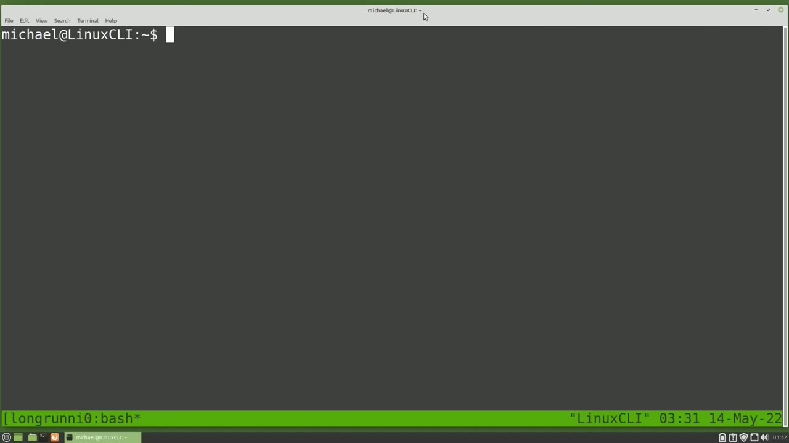

[← Course contents](../../01.md)

# 67. tmux pt1

**Course:** [Linux Command Line - Entire Tutorial Series](https://www.youtube.com/watch?v=avg65oY7sj4)  
**Transcript:** [`Linux Command Line - Entire Tutorial Series transcript`](../../../../course_videos/Linux%20Command%20Line%20-%20Entire%20Tutorial%20Series/Linux%20Command%20Line%20-%20Entire%20Tutorial%20Series.txt)  
**Video:** 11:15:33–11:27:14 ([open at this time](https://www.youtube.com/watch?v=avg65oY7sj4&t=40533s))

## Introduction

tmux is short for Terminal Multiplexer and is similar to Screen that we looked at in the last two videos. We looked at Screen after talking about background processes, where we wanted a process to keep running in the background even after we closed the terminal window. And tmux can do that just like screen did. I'm going to type tmux to start the terminal multiplexer.

## Detailed Explanation

<details>
  <summary>Step 1 — Run `tmux`</summary>

### Step 1 — Run `tmux`

- [x] **Use `tmux`**
  - `tmux` is short for Terminal Multiplexer and is similar to Screen that we looked at in the last two videos.
  - We looked at Screen after talking about background processes, where we wanted a process to keep running in the background even after we closed the terminal window.
  - And `tmux` can do that just like screen did.

- [x] **Use `tmux`**
  - I'm going to type `tmux` to start the terminal multiplexer.
  - I'm going to install it now by copying this command and pasting and running it.
  - `tmux` is now installed.

- [x] **Use `tmux`**
  - I will type `tmux` and enter.
  - And unlike screen, `tmux` lets me know right away.
  - That I'm in a `tmux` session by showing a green line at the bottom of the screen.

- [x] **In the lower left corner we see 0 in brackets showing me that I'm in**
  - In the lower left corner we see 0 in brackets showing me that I'm in the zero session.

```bash
tmux
```



</details>

<details>
  <summary>Step 2 — Run `bash`, `tmux`, `top`</summary>

### Step 2 — Run `bash`, `tmux`, `top`

- [x] **Use `bash`, `tmux`**
  - Next to that is the window. I am in the window 0 with the name `bash`.
  - And over on the right we have the name of the computer we are on.
  - And then the time and date. I'm going to type exit and our green line disappears, letting us know that we are out of the `tmux` session.

- [x] **Use `tmux`**
  - We see exited in brackets letting us know that we exited out of the `tmux` session and that the `tmux` session has ended.
  - I'm going to clear the screen and now I'm going to type `tmux` again.
  - And I've started another `tmux` session.

- [x] **Use `top`, `tmux`**
  - I'm going to type `top` to get `top` running and I want to disconnect from `tmux`, but I want to keep the `tmux` session running so that my `top` Command will keep running.
  - The `tmux` command to detach from the `tmux` session is the D key, D for Detach, but if I press that D key right now, `top` will think I'm trying to send that key press to `top`.
  - So what I need to do is add a prefix to my command to let Linux know that the next command I give is going to be a `tmux` command.

- [x] **Use `tmux`**
  - The prefix for `tmux` is to hold down the control key and press the B as in Bravo key.
  - I'm holding down control and pressing B.
  - And we see the green line at the bottom is gone.

- [x] **And we see the message detached from session zero**
  - And we see the message detached from session zero.
  - And the T-Muck session is still running.
  - And to see any T-Muck sessions running, I will type.

- [x] **Use `tmux`, `ls`**
  - `tmux` space `ls`.
  - Note there's no -before the `ls`, just a space between the two.
  - And this shows us that we have a single `tmux` session running, and we see the `tmux` session zero.

- [x] **Use `tmux`, `tmux attach`, `top`**
  - Then we see one Windows, and then the date and time it was created.
  - Since there's only one `tmux` session, we can re-attach to that by typing `tmux attach`.
  - And here we see the `top` command is still running.

- [x] **I'm going to detach again by holding down control, pressing B, and**
  - I'm going to detach again by holding down control, pressing B, and then the D key.

```bash
bash
tmux
top
ls
tmux attach
```



</details>

<details>
  <summary>Step 3 — Run `tmux`, `ls`, `tmux rename -session`</summary>

### Step 3 — Run `tmux`, `ls`, `tmux rename -session`

- [x] **Use `tmux`**
  - And I'm now detached from the `tmux` session, but it's still running.
  - As long as this computer is still running, that `tmux` session will keep running.
  - Often, `tmux` is used after S-Shing in from a different computer.

- [x] **Use `tmux`**
  - For example, someone might log into a server from their work computer at their office, start a `tmux` session on that server.
  - Then at the end of their workday, they detach from the `tmux` session and server and turn off their work computer, go home to their home computer.
  - They can log back into that same server where they started that `tmux` session, reconnect to that same `tmux` session, and continue working from where they left off.

- [x] **Use `tmux`, `ls`**
  - I'm going to create another `tmux` session by typing `tmux`.
  - Again, I see the green line at the bottom of the screen, and in the lower left corner, now I have a 1 in the brackets, telling me this is the second `tmux` session I've started.
  - Being the first. And I'm going to run the `ls` command here.

- [x] **Use `tmux`**
  - And now I'm going to detach from this `tmux` session by holding down Control B and then D.
  - Now we have two `tmux` sessions started. I can see this with `tmux` l-s.
  - And we see the two `tmux` sessions running here with the names 0 and 1.

- [x] **Use `tmux`, `tmux rename -session`**
  - Each has one window open and then we see the time each one was started.
  - The `tmux` Session 0 is running our `top` command and I want to give that session a more descriptive name.
  - To do that, I'm going to type `tmux rename -session` space -T and then I'll give it the old name of 0.

- [x] **Use `tmux`**
  - And then the new name I want to give it, which is `top`.
  - And now I'm going to arrow up two times, pressing enter.
  - `tmux` Session 1 and `tmux` Session `top`.

- [x] **Use `top`, `tmux attach`**
  - So it's clear which is running the `top` command.
  - I'm going to reattach to Session 1, where we ran the l-s command.
  - To do that, I will type `tmux attach`.

- [x] **Use `tmux`**
  - But now I need to tell `tmux` which `tmux` session I want to attach to.
  - To do that, I will add a -T, and then the session name, 1.
  - And I'm back in `tmux` Session 1.

- [x] **Use `ls`, `tmux`**
  - I can see that in the lower left corner where we see the 1 in the square brackets.
  - I want to rename this session to be called `ls`. To do that, I will start with the `tmux` prefix of holding down control and pressing B. And then I'm going to press the dollar sign.
  - And here we see rename session and then we have the current name of 1. I'm going to hit the backspace and then I'm just going to type `ls` and pressing enter.

- [x] **Use `ls`, `tmux`**
  - We now see `ls` in that lower left corner in the brackets.
  - Now we could also have typed the `tmux` prefix, Control B, and then a colon.
  - This brings up an area where we can type up a `tmux` command.

```bash
tmux
ls
tmux rename -session
top
tmux attach
```



</details>

<details>
  <summary>Step 4 — Run `tmux rename`, `ls`, `tmux`</summary>

### Step 4 — Run `tmux rename`, `ls`, `tmux`

- [x] **Use `tmux rename`, `ls`**
  - And the command I would type would be `tmux`, rename Session -T, space 1, space `ls`.
  - This is the same thing that we typed in the terminal.
  - Since we already rename the session, I'm going to press escape and get out of that.

- [x] **Use `tmux`**
  - I'm going to detach from this session with Control B, D, and type `tmux` space l-s.
  - And now we see both of our `tmux` sessions have names.
  - Now I want to start a new `tmux` session, and I want to give it a name when I start the session.

- [x] **Use `tmux`**
  - To do that, I will type `tmux`, new-S, so I can assign a session name.
  - And then I'll give it the session name I want to give it, which is split windows.
  - In the lower left corner, we see that we are in the new `tmux` session called split windows, but we only see the first 10 characters of our `tmux` session name.

- [x] **Use `tmux`**
  - We will fix that later, but not in this video.
  - In this window, I'm going to type l-s-l-h and then detach with Control b-d.
  - And typing `tmux` l-s.

- [x] **Use `tmux`**
  - And we see we've got three `tmux` sessions currently running.
  - One called l-s, another one called Split Windows, and a third one called Top.
  - We don't need the `tmux` session called l-s.

- [x] **Use `tmux kill`, `tmux`**
  - So I'm going to kill that with `tmux`, kill Session-T, and then the name of the session we want to kill, which is l-s.
  - Pressing the arrow up two times shows us that that session is killed.
  - If we want to kill all of the `tmux` sessions running with one command, we would type `tmux kill` Server.

- [x] **Use `tmux`**
  - That will kill off every `tmux` session we have.
  - I don't want to do that now, so I'm going to press Ctrl+C to cancel out of that command.
  - We may have a long-running job that we need to run, and we want to run it in a `tmux` session.

- [x] **Use `tmux`**
  - But then we want the `tmux` session to end once the job completes.
  - To do that, I will create a new `tmux` session called Long-Running Job with `tmux`, New-T-Long-Running Job.
  - And my long-running job is really only 15 seconds.

```bash
tmux rename
ls
tmux
tmux kill
```



</details>

<details>
  <summary>Step 5 — Run `bash`, `tmux`, `ls`</summary>

### Step 5 — Run `bash`, `tmux`, `ls`

- [x] **Use `bash`**
  - It's a `bash` script called Sleep 15, and I will cat that out right now with Cat.
  - Sleep15.sh and we see that it's just a script with a sleep 15 seconds in there.
  - To run this command, I will type dot slash sleep 15.

- [x] **Then I'm going to add a semicolon and then I'm going to type exit**
  - Then I'm going to add a semicolon and then I'm going to type exit.
  - So this will run the sleep 15 script and then it will exit out.
  - I'm going to press enter and start the job.

- [x] **Use `tmux`**
  - And from here, normally I would press Control B, D to detach from the `tmux` session.
  - But since it's going to run so quickly, I'll just stay here where I am.
  - And we will see when it ends when it kicks me out of the `tmux` session.

- [x] **Use `tmux`**
  - We are bumped out of the `tmux` session and typing `tmux` l-s shows us the `tmux` long-running job is no longer running.
  - We can also run a long-running job in `tmux` right from the command line.
  - To do that, I would type `tmux` new -D.

- [x] **Use `tmux`**
  - And the -D is telling us we can run this command detached from the `tmux` session.
  - Then we're adding in a -S to give this a session name of long-running job.
  - And now we're going to put in the command.

- [x] **Use `tmux`, `ls`**
  - And I'm going to put it in single quotes.
  - And this is going to be a shell command.
  - -C and then in double quotes we're going to put the command that we want to run dot slash sleep 15 dot sh and double quote and single quote and pressing enter we'll start this typing `tmux` `ls` shows us that the long running job is now running and pressing `tmux` `ls` again

- [x] **Use `tmux`**
  - Shows that it is still running and pressing the arrow up again the 15 seconds should have ended and it has so the long running job has ended this is a good breaking point we will continue looking at `tmux` in the next video for the Linux command line

```bash
bash
tmux
ls
```



</details>

<details>
  <summary>Questions and Answers</summary>

## Questions and Answers

### Question 1: What does `tmux` do in this chapter?

<details>
<summary>Answer</summary>

- [x] `tmux` is short for Terminal Multiplexer and is similar to Screen that we looked at in the last two videos.

</details>

### Question 2: What does `bash` do in this chapter?

<details>
<summary>Answer</summary>

- [x] Next to that is the window. I am in the window 0 with the name `bash`.

</details>

### Question 3: What does `top` do in this chapter?

<details>
<summary>Answer</summary>

- [x] I'm going to type `top` to get `top` running and I want to disconnect from tmux, but I want to keep the tmux session running so that my `top` Command will keep running.

</details>

### Question 4: What does `ls` do in this chapter?

<details>
<summary>Answer</summary>

- [x] tmux space `ls`.

</details>

### Question 5: What does `tmux attach` do in this chapter?

<details>
<summary>Answer</summary>

- [x] Since there's only one tmux session, we can re-attach to that by typing `tmux attach`.

</details>

### Question 6: What does `tmux rename -session` do in this chapter?

<details>
<summary>Answer</summary>

- [x] To do that, I'm going to type `tmux rename -session` space -T and then I'll give it the old name of 0.

</details>

### Question 7: What does `tmux rename` do in this chapter?

<details>
<summary>Answer</summary>

- [x] And the command I would type would be tmux, rename Session -T, space 1, space ls.

</details>

### Question 8: What does `tmux kill` do in this chapter?

<details>
<summary>Answer</summary>

- [x] So I'm going to kill that with tmux, kill Session-T, and then the name of the session we want to kill, which is l-s.

</details>

</details>

## Summary

This chapter, tmux pt1, walks through Run tmux; Run bash, tmux, top; Run tmux, ls, tmux rename -session; Run tmux rename, ls, tmux; Run bash, tmux, ls. Commands from the transcript: `tmux`, `bash`, `top`, `ls`, `tmux attach`, `tmux rename -session`, `tmux rename`, `tmux kill`.

## References

- [Linux Command Line - Entire Tutorial Series (YouTube)](https://www.youtube.com/watch?v=avg65oY7sj4)
- [This chapter at 11:15:33](https://www.youtube.com/watch?v=avg65oY7sj4&t=40533s)
- [Local transcript](../../../../course_videos/Linux%20Command%20Line%20-%20Entire%20Tutorial%20Series/Linux%20Command%20Line%20-%20Entire%20Tutorial%20Series.txt)
