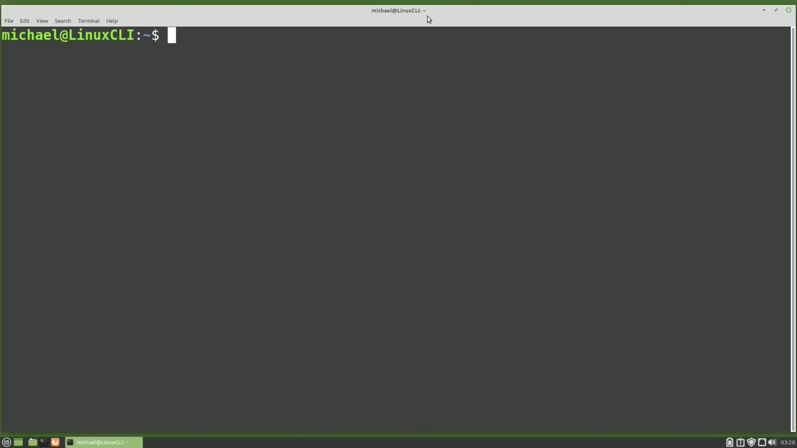
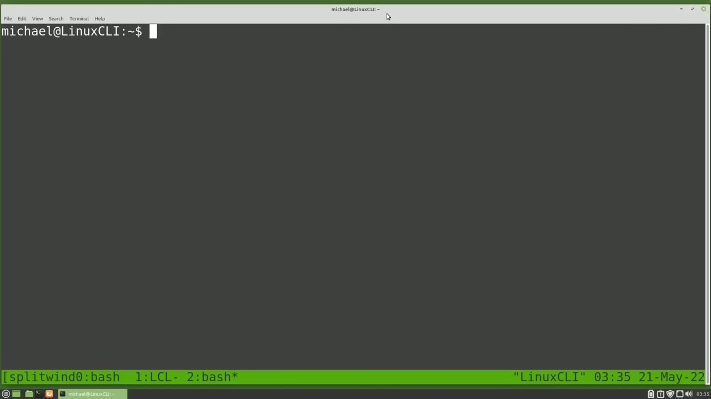
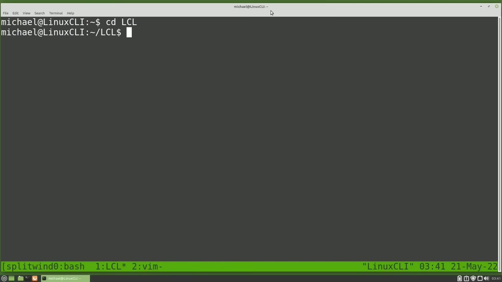
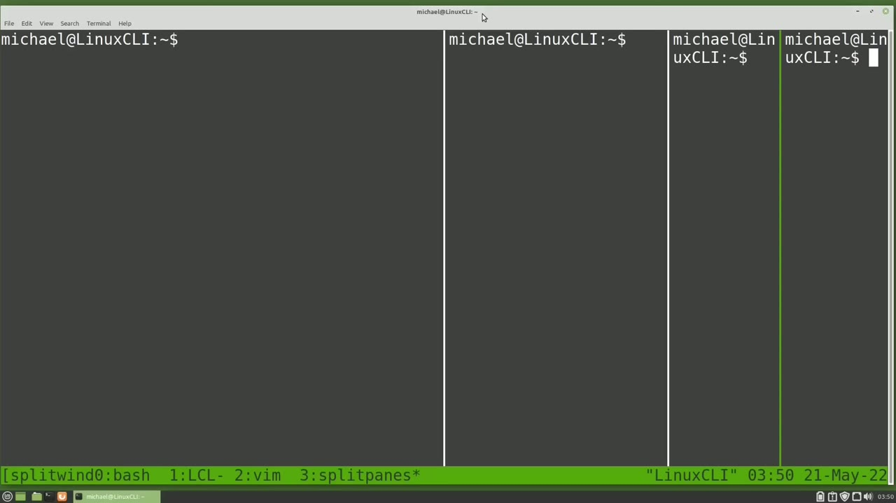
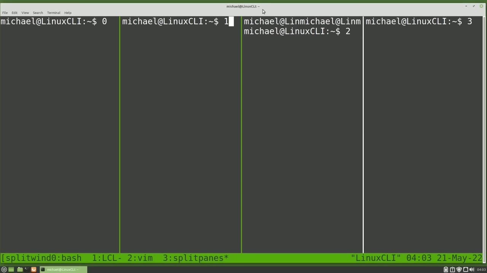

[← Course contents](../../01.md)

# 68. tmux pt2

**Course:** [Linux Command Line - Entire Tutorial Series](https://www.youtube.com/watch?v=avg65oY7sj4)  
**Transcript:** [`Linux Command Line - Entire Tutorial Series transcript`](../../../../course_videos/Linux%20Command%20Line%20-%20Entire%20Tutorial%20Series/Linux%20Command%20Line%20-%20Entire%20Tutorial%20Series.txt)  
**Video:** 11:27:14–11:41:50 ([open at this time](https://www.youtube.com/watch?v=avg65oY7sj4&t=41234s))

## Introduction

We are picking up from where we left off in the last video tmux part one I'm typing I see Split Windows with one window open and Top with one window open. I'm going to reconnect to the tmux session Split Windows by typing tmux Attach-T-T-Split. We only need enough of the session name to make it unique, and I'll press Enter, and I'm back in my Split Windows tmux session. We see the output of the ls command we ran in the last video.

## Detailed Explanation

<details>
  <summary>Step 1 — Run `tmux`, `ls`, `bash`</summary>

### Step 1 — Run `tmux`, `ls`, `bash`

- [x] **Use `tmux`**
  - We are picking up from where we left off in the last video `tmux` part one I'm typing I see Split Windows with one window open and Top with one window open.
  - I'm going to reconnect to the `tmux` session Split Windows by typing `tmux` Attach-T-T-Split.
  - We only need enough of the session name to make it unique, and I'll press Enter, and I'm back in my Split Windows `tmux` session.

- [x] **Use `ls`, `tmux`**
  - We see the output of the `ls` command we ran in the last video.
  - Down at the bottom we see the green line that has the `tmux` session name of split windows on the far left.
  - But our session name is cut off after the first 10 characters.

- [x] **Use `tmux`**
  - We'll look at how to fix that in the next video.
  - After the session name, we have the window name of 0-B with an asterisk next to it.
  - To do that, I will type the `tmux` prefix of Control B, and then I will press the lowercase C.

- [x] **Use `bash`**
  - To create a new window. Our screen is cleared and looking down on the green status bar at the bottom of the screen, we now see our window is 1 colon `bash` with the asteris next to it. The asteris means we are in window 1 colon `bash`.
  - And there is a dash or -sign next to window 0 colon `bash`, letting us know that that was the window we were in previously.
  - I'm going to change to the lcl directory with cd, lcl.

- [x] **Use `tmux`, `bash`**
  - And now I want to rename this window to lcl.
  - I'll do that by typing the `tmux` prefix of Control B.
  - And now in the status bar we see rename window `bash`.

- [x] **Use `bash`**
  - I'm going to hit the backspace to take out the `bash` and type in uppercase lcl.
  - And now we see the window we are in is called lcl.
  - And we know what's the window we are in because it has the asteris right next to the lcl.

- [x] **I'm pressing Control B, C again to create another window**
  - I'm pressing Control B, C again to create another window.

```bash
tmux
ls
bash
```



</details>

<details>
  <summary>Step 2 — Run `bash`, `top`, `vim test`</summary>

### Step 2 — Run `bash`, `top`, `vim test`

- [x] **Use `bash`, `top`**
  - Notice our new window in the green status bar shows as 2 colon `bash`.
  - With the asteris showing us we are now in that window.
  - I'm going to start `top` by typing `top`.

- [x] **Use `bash`**
  - And notice our window name in the status line now shows as `top`.
  - I'm going to press Q to quit out of `top`.
  - And our window name is renamed back to `bash`.

- [x] **Use `vim test`**
  - I'm going to type `vim test`. txt and press Enter to edit a new file called test. txt in vim.
  - And our window name is now updated to vim.
  - The window auto rename works in this window because we have not updated the window name.

- [x] **We're still using the default window name**
  - We're still using the default window name.
  - The window auto rename will not work when we are in the lcl window because we already gave that window and name.
  - But it will work in Windows 0 because we have not renamed that window yet.

- [x] **Use `bash`, `tmux`**
  - So now we have three different windows open.
  - Zero `bash`, one lcl and two Vim.
  - To go to the next window, which would be the zero `bash` window, I can type the `tmux` prefix of Control B and then N to go to the next window.

- [x] **Use `bash`**
  - And we're now in the zero `bash` window.
  - I'll press the Control B and again to go to the next window.
  - And I can press Control B. P to go to the previous window.

- [x] **Use `tmux`**
  - So we can move from window to window with the `tmux` prefix and then the lowercase N for the next window or lowercase P for the previous window.
  - I can also go directly to a specific window by pressing the `tmux` prefix and then the window number I want to go to.
  - I'll press Control b2 to take me to window 2, the Vim window, or Control b1 to take me to the lcl window.

- [x] **So there's a second way to get around the open windows in this session**
  - So there's a second way to get around the open windows in this session.

```bash
bash
top
vim test
tmux
```



</details>

<details>
  <summary>Step 3 — Run `tmux`, `bash`</summary>

### Step 3 — Run `tmux`, `bash`

- [x] **Use `tmux`**
  - When I press Control bw, we see all of the open `tmux` windows.
  - Not just the open `tmux` windows of this `tmux` session.
  - But all of the `tmux` session windows for all of the `tmux` sessions we have open right now.

- [x] **Use `tmux`**
  - The top `tmux` session we have open.
  - Below that we have one arrow showing that we have one window open in that session.
  - If we press Enter on either 4 or 5, it will take us to the only window open in that session.

- [x] **So pressing Enter on either one of these will do the same thing**
  - So pressing Enter on either one of these will do the same thing.
  - And now I'm in the T-Muck session top and we see that in the lower left corner.
  - I'm going to press Control bw again to bring back all of the window sessions.

- [x] **I'm going to arrow up to the top and highlight the zero split windows**
  - I'm going to arrow up to the top and highlight the zero split windows.
  - And we see a preview of all three windows at the bottom of the screen.
  - The lcl window is showing in red because that was the last active window.

- [x] **Use `bash`**
  - If I press enter here, I will be taken into the lcl window.
  - Pressing the arrow down shows me a preview of the split windows, zero `bash` window.
  - Pressing the arrow down takes me down to the lcl window.

- [x] **Use `tmux`**
  - And we can see an asteris next to lcl showing us that that is the current active window.
  - So I'll press enter here and go back to the lcl window in the split Windows `tmux` session.
  - I'm going to add another window with control B.

- [x] **Use `tmux`**
  - C and let's rename this window with Control B comma.
  - And now I want to split this window into two panes.
  - To do that, I will type the `tmux` prefix of Control B and then the double quote.

- [x] **And my window is split horizontally. We are in the lower pane**
  - And my window is split horizontally. We are in the lower pane.
  - To get to the upper pane, I will type the prefix of Control B.
  - And then arrow up. And to get back down to the lower pane, Control B, arrow down.

- [x] **To exit out of a split pane and end that session, I can type exit**
  - To exit out of a split pane and end that session, I can type exit.
  - Let's bring that split pane back again with Control B, double quote.
  - I can also exit out of this pane with Control B lowercase X.

- [x] **When I use the Control B lowercase X to exit out, I'll get a**
  - When I use the Control B lowercase X to exit out, I'll get a confirmation asking me if I really want to close this pane.
  - I do so I will press the Y to confirm and my split pain is gone.
  - I can also split the window vertically by pressing Control B percent sign.

- [x] **I'll do that again. Control B percent sign and then one more time**
  - I'll do that again. Control B percent sign and then one more time.
  - Control B percent sign. Now I have four vertical split panes in this window, but they're not split evenly.

```bash
tmux
bash
```



</details>

<details>
  <summary>Step 4 — Run `tmux`</summary>

### Step 4 — Run `tmux`

- [x] **Use `tmux`**
  - To do that, I'll press the `tmux` prefix of Control B, and then I'm going to hold down Alt and press the number 1.
  - Each pane has a number just like our windows.
  - We just cannot see the pain numbers at this time.

- [x] **To see the pain numbers, I'm going to press the prefix, Control B**
  - To see the pain numbers, I'm going to press the prefix, Control B, and then Q to query those pain numbers.
  - We have to look really quick because those numbers only show for a second or two.
  - But we see that zero is on the far left and then one and two and then three is on the right.

- [x] **I want to put a number in each pane to show which pain is which**
  - I want to put a number in each pane to show which pain is which.
  - So I'm going to put a three in this pane.
  - And then I'm going to press the prefix of Control B.

- [x] **Use `tmux`**
  - Arrow right to go to the pane on the far left where I will put in a zero.
  - Arrow right to take me to pain one and then control b arrow right will take me into pain number two and i'm going to press the control b q again to see if our numbers match up and they do and notice the pain that we are in is in a different color when i press that `tmux` prefix q if i press one of those
  - Numbers while those numbers are showing i can jump right to that pain let's try it with Control B, q1. And now I'm in pane number one.

- [x] **Use `tmux`**
  - To make things easier, I want to increase the time those numbers show on the screen.
  - I can do this with a `tmux` command.
  - So I'm going to bring up my `tmux` command line with Control B colon.

- [x] **And I'm going to type in the command, Set-G, and the G is for Global**
  - And I'm going to type in the command, Set-G, and the G is for Global.
  - Four seconds should be plenty of time for me to press the pain number and switch to that pain.
  - I'm in pain one. I'm going to press Control bq two.

- [x] **Use `tmux`**
  - And now I'm in pain two. And notice once I press that pain number, `tmux` stops displaying those numbers. So it doesn't have to wait the whole four seconds every time.
  - I want to go down to pain number zero. So I'll press the control bq.
  - And from here I want to rotate all the pains.

- [x] **To do that, I will press Control B, Control O for rotate**
  - To do that, I will press Control B, Control O for rotate.
  - Now notice I'm still in the pain on the far left, but that pain is now pain number 1.
  - Pressing Control B, Control lowercase O again.

- [x] **Use `tmux`**
  - Rotates everything again and I'm still in the pain on the far left, but now I'm in pain number two.
  - Our pain positions have changed. But notice now when I press Control B Q, the pain numbers are still zero on the far left and then one, two, three, going from left to right.
  - So `tmux` doesn't give the pain a number. It's the position of that pain that gets the number.

- [x] **I'm going to press Control B, Control lowercase O again**
  - I'm going to press Control B, Control lowercase O again.
  - And one more time, Control B, Control lowercase O to set things back to where we started.
  - Now I want to move this pain, one pain to the right.

- [x] **So I'm going to press Control B, right or closing curly brace**
  - So I'm going to press Control B, right or closing curly brace.
  - And now my pain zero is between pains one and two.

```bash
tmux
```



</details>

<details>
  <summary>Step 5 — Run `tmux`, `last`</summary>

### Step 5 — Run `tmux`, `last`

- [x] **Pressing Control B, right or closing curly brace again**
  - Pressing Control B, right or closing curly brace again.
  - Moves pain zero between pains two and three.
  - So to move that back to the left, I'm going to press Control B left or opening curly brace.

- [x] **And then Control B left or opening curly brace again**
  - And then Control B left or opening curly brace again.
  - I'm going to move over into Pain 1 with Control B arrow right.
  - And in this window, I want to increase the size of this pane by one unit.

- [x] **Use `tmux`**
  - Control arrow right. And let's do it again. Control B.
  - Control arrow right. And then to make the paint smaller, it will be control B control arrow left. Control B control arrow left. So that moves it one unit at a time.
  - To make a window larger smaller by more than one unit at a time. I'm going to type a `tmux` command. So control be colon.

- [x] **Use `tmux`**
  - To bring up the `tmux` command line.
  - And then we need to tell it which way we want to resize.
  - I want to resize to the -uppercase R for the right.

- [x] **Use `tmux`, `last`**
  - To increase this window size and let's put in the number seven pressing enter it increases our window by seven units and then to make this window smaller I'm going to press the control B colon to bring up the `tmux` command line and I'm pressing the arrow up to bring up the `last` command and instead of R we want to make this
  - One L so we'll resize the pane to the left seven and pressing enter we see that it's resized back 7. Now we cannot test the U and the D for up and down while our screen is split this way.
  - So I'm going to press Control B and then the space bar. And we see our layout changes to show the panes horizontally.

- [x] **Pressing Control B spacebar a second time makes the far left window**
  - Pressing Control B spacebar a second time makes the far left window zero large and the other three windows are small showing at the bottom of the screen.
  - Pressing Control B spacebar a third time makes the zero window large and the other three windows small showing on the right of the screen.
  - And then pressing Control B spacebar a fourth time makes all the windows the same.

- [x] **Now we can also zoom into the window we are in with Control B, Z for**
  - Now we can also zoom into the window we are in with Control B, Z for zoom.
  - And notice at the bottom on the split panes we've got an uppercase z next to the asteris, showing that we are zoomed in to one of the panes.
  - Pressing Control B, Z again, zooms us back out to view all of the panes once again, and removes the Z from the status line.

- [x] **Use `tmux`**
  - In the next video, we will continue looking at `tmux` for the Linux command line.

```bash
tmux
last
```



</details>

<details>
  <summary>Questions and Answers</summary>

## Questions and Answers

### Question 1: What does `tmux` do in this chapter?

<details>
<summary>Answer</summary>

- [x] We are picking up from where we left off in the last video `tmux` part one I'm typing I see Split Windows with one window open and Top with one window open.

</details>

### Question 2: What does `ls` do in this chapter?

<details>
<summary>Answer</summary>

- [x] We see the output of the `ls` command we ran in the last video.

</details>

### Question 3: What does `bash` do in this chapter?

<details>
<summary>Answer</summary>

- [x] To create a new window. Our screen is cleared and looking down on the green status bar at the bottom of the screen, we now see our window is 1 colon `bash` with the asteris next to it. The asteris means we are in window 1 colon `bash`.

</details>

### Question 4: What does `top` do in this chapter?

<details>
<summary>Answer</summary>

- [x] I'm going to start `top` by typing `top`.

</details>

### Question 5: What does `vim test` do in this chapter?

<details>
<summary>Answer</summary>

- [x] I'm going to type `vim test`. txt and press Enter to edit a new file called test. txt in vim.

</details>

### Question 6: What does `last` do in this chapter?

<details>
<summary>Answer</summary>

- [x] To increase this window size and let's put in the number seven pressing enter it increases our window by seven units and then to make this window smaller I'm going to press the control B colon to bring up the tmux command line and I'm pressing the arrow up to bring up the `last` command and instead of R we want to make this

</details>

### Question 7: What does step 1 cover (Run tmux, ls, bash)?

<details>
<summary>Answer</summary>

- [x] We are picking up from where we left off in the last video `tmux` part one I'm typing I see Split Windows with one window open and Top with one window open.
- [x] I'm going to reconnect to the `tmux` session Split Windows by typing `tmux` Attach-T-T-Split.
- [x] We only need enough of the session name to make it unique, and I'll press Enter, and I'm back in my Split Windows `tmux` session.

</details>

### Question 8: What does step 2 cover (Run bash, top, vim test)?

<details>
<summary>Answer</summary>

- [x] Notice our new window in the green status bar shows as 2 colon `bash`.
- [x] With the asteris showing us we are now in that window.
- [x] I'm going to start `top` by typing `top`.

</details>

### Question 9: What does step 3 cover (Run tmux, bash)?

<details>
<summary>Answer</summary>

- [x] When I press Control bw, we see all of the open `tmux` windows.
- [x] Not just the open `tmux` windows of this `tmux` session.
- [x] But all of the `tmux` session windows for all of the `tmux` sessions we have open right now.

</details>

### Question 10: What does step 4 cover (Run tmux)?

<details>
<summary>Answer</summary>

- [x] To do that, I'll press the `tmux` prefix of Control B, and then I'm going to hold down Alt and press the number 1.
- [x] Each pane has a number just like our windows.
- [x] We just cannot see the pain numbers at this time.

</details>

</details>

## Summary

This chapter, tmux pt2, walks through Run tmux, ls, bash; Run bash, top, vim test; Run tmux, bash; Run tmux; Run tmux, last. Commands from the transcript: `tmux`, `ls`, `bash`, `top`, `vim test`, `last`.

## References

- [Linux Command Line - Entire Tutorial Series (YouTube)](https://www.youtube.com/watch?v=avg65oY7sj4)
- [This chapter at 11:27:14](https://www.youtube.com/watch?v=avg65oY7sj4&t=41234s)
- [Local transcript](../../../../course_videos/Linux%20Command%20Line%20-%20Entire%20Tutorial%20Series/Linux%20Command%20Line%20-%20Entire%20Tutorial%20Series.txt)
