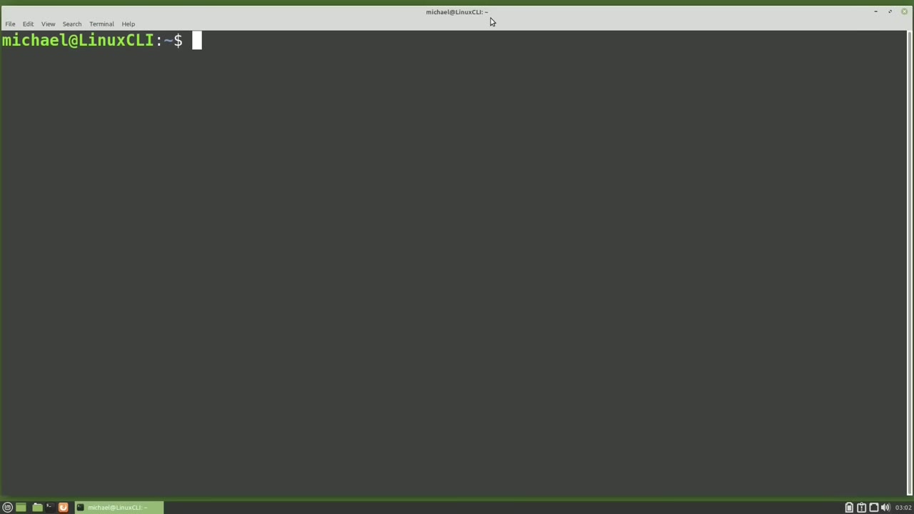
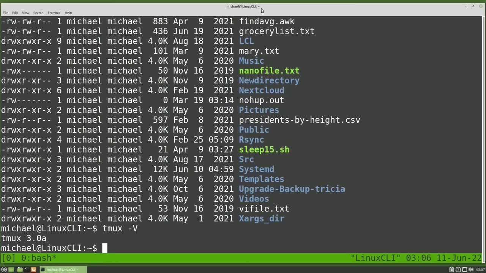
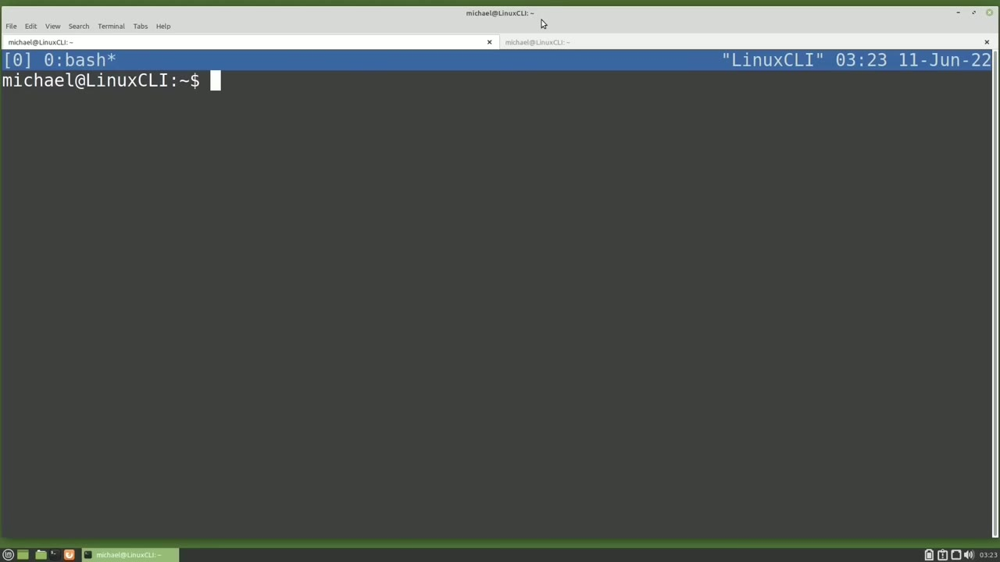
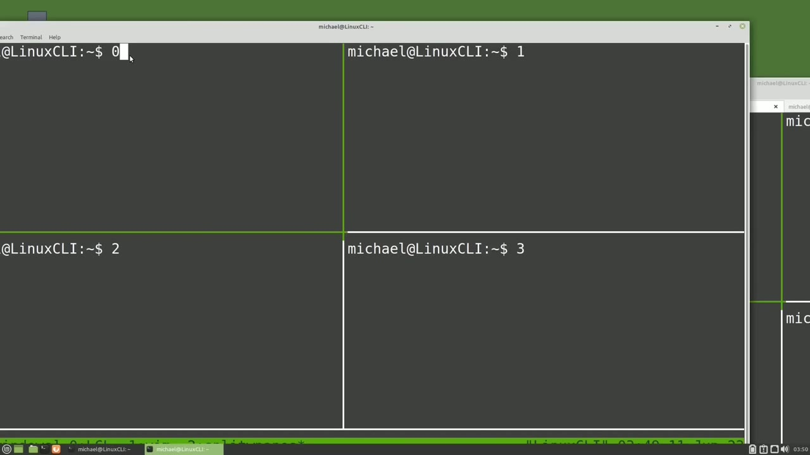

[← Course contents](../../01.md)

# 69. tmux pt3 .tmux.conf pt1

**Course:** [Linux Command Line - Entire Tutorial Series](https://www.youtube.com/watch?v=avg65oY7sj4)  
**Transcript:** [`Linux Command Line - Entire Tutorial Series transcript`](../../../../course_videos/Linux%20Command%20Line%20-%20Entire%20Tutorial%20Series/Linux%20Command%20Line%20-%20Entire%20Tutorial%20Series.txt)  
**Video:** 11:41:50–11:53:04 ([open at this time](https://www.youtube.com/watch?v=avg65oY7sj4&t=42110s))

## Introduction

When I'm in a terminal and I type ls -lh, sometimes like right now, the text is more than one screen. And to see something at the top of the text, I'll use my mouse wheel and scroll up. I'm going to start a tmux session by typing tmux. And again, typing ls -lh, we have more than one screen of text.

## Detailed Explanation

<details>
  <summary>Step 1 — Run `ls -lh`, `tmux`, `tmux version`</summary>

### Step 1 — Run `ls -lh`, `tmux`, `tmux version`

- [x] **Use `ls -lh`, `tmux`**
  - When I'm in a terminal and I type `ls -lh`, sometimes like right now, the text is more than one screen.
  - And to see something at the top of the text, I'll use my mouse wheel and scroll up.
  - I'm going to start a `tmux` session by typing `tmux`.

- [x] **Use `ls -lh`, `tmux`**
  - And again, typing `ls -lh`, we have more than one screen of text.
  - When I use my scroll wheel, it does not...
  - Scroll up as we expect. That's because the mouse is not enabled for default for `tmux`.

- [x] **Use `tmux`**
  - We can enable the mouse in `tmux` by typing a `tmux` command.
  - To bring up the `tmux` command line, I'll put in the `tmux` prefix of Control B and then a colon.
  - And now I'm going to type in the `tmux` command, Set -G, and the G is for Global, mouse on.

- [x] **Use `tmux`**
  - If you're using a version of `tmux` less than 2.1, instead of mouse on, you would type in mode-mouse on.
  - But since I'm using a version higher than 2.1, I'm just going to use the Set-G mouse on.
  - Pressing Enter and then trying my mouse wheel, I can now scroll up with my mouse wheel just like I did before I started `tmux`.

- [x] **Use `tmux`, `tmux version`**
  - I mentioned the version of `tmux`.
  - To see what version of `tmux` you're using, you can type in `tmux` space -uppercase V.
  - And we can see I'm using `tmux version` 3.0A.

```bash
ls -lh
tmux
tmux version
```



</details>

<details>
  <summary>Step 2 — Run `tmux`, `pwd`</summary>

### Step 2 — Run `tmux`, `pwd`

- [x] **Use `tmux`**
  - So now we have our mouse enabled and we can scroll up and down just like we did before starting `tmux`.
  - The problem with enabling the mouse this way is when I exit out of `tmux`, and go back into `tmux`, my scroll wheel does not work anymore.
  - That's because `tmux` was reset to the default settings.

- [x] **Use `tmux`**
  - If you have another `tmux` session open right now, your scroll wheel will still work because you did not exit out of `tmux`.
  - You just exited out of one `tmux` session.
  - I only have this one `tmux` session open right now.

- [x] **Use `tmux`**
  - So when I exited out, I exited out of `tmux`.
  - I want to enable the mouse every time I enter a `tmux` session.
  - And to do that, we will want to update the `tmux` configuration file.

- [x] **Use `pwd`, `tmux`**
  - I'm going to open up a new terminal tab and type `pwd` to show that I am in my home directory.
  - And that's where we want to put this new `tmux` configuration file.
  - I'm going to open the new configuration file with Vim.

- [x] **Use `tmux`**
  - `tmux`.comf. This is a new file, so it's empty. I'm going to paste in that same code that we typed into the `tmux` command line, as well as a comment before that command to remind us of what that line of code is for. I'm going to save this configuration file and going back over to the other
  - Terminal tab. When I try my scroll wheel, it doesn't work.
  - I need to exit out of `tmux` and then go back in, so `tmux` can reset back to the defaults and then apply the settings in the `tmux` configuration file.

- [x] **Use `tmux`**
  - Now when I use my scroll wheel, it works as expected.
  - We're going to make a lot of changes to the dot `tmux`.comf file, and I don't want to have to exit out of `tmux` and go back in every time I make an update to our `tmux` configuration file.
  - So I'm going back over to our other terminal tab.

- [x] **Use `tmux`**
  - And this text is going to bind the lowercase R key, meaning when I press Control b.r, it will source the dot `tmux`.comf file and then display the message.
  - I'm going to save this and go over to the `tmux` Terminal tab.
  - Again, we're going to have to exit out of the `tmux` session.

- [x] **Use `tmux`**
  - And go back in so `tmux` can read the updated configuration file.
  - Now I'm going to try it out by pressing the `tmux` prefix of Control B and then a lowercase R and in the status bar for just a moment we see the message that we added in the configuration file.`tmux`.comf reloaded.
  - Now to make sure this worked, let's go back over to our other tab and I'm going to Paste in some more text. This line will move the status line to the top of the screen with Set Option -G and the G is for Global Status Position Top. I'm also going to add in the text

- [x] **Use `tmux`**
  - To change the color of the status line to be blue with white text. And here we're setting the option -G status style bg for background to blue and fg for foreground to white. I'm saving the file and going over to the `tmux` terminal tab.
  - When I press Control B lowercase R, we see the reloaded message at the top of the screen now and then the status bar is now at the top of the screen and it is now blue with white text.
  - So the reload worked just as we wanted it to. Let's go back to the `tmux` configuration file and I'm going to comment out these lines, write the file, go back over to the `tmux` Terminal tab, and when I press the Control b-r, notice it did not reset the status bar back to the defaults.

- [x] **Use `tmux`**
  - Loading the `tmux` configuration file just reads and loads in the new configuration.
  - We did not make any new changes to the status bar line. We just commented out.
  - The move to the top screen and the change the color.

```bash
tmux
pwd
```



</details>

<details>
  <summary>Step 3 — Run `tmux`, `tmux -ls`</summary>

### Step 3 — Run `tmux`, `tmux -ls`

- [x] **Use `tmux`**
  - So in order to change these back to the defaults, we'll need to exit out of `tmux` and then go back in.
  - And now we see the status bars back at the bottom of the screen with the default green with black text.
  - And it did this when we entered the `tmux` session.

- [x] **Use `tmux`, `tmux -ls`**
  - It set the defaults and then apply the changes in the dot `tmux`.com file.
  - Ctrl+D to disconnect from this `tmux` session and clear the screen.
  - Typing `tmux -ls` shows us only the one session that we have open.

- [x] **Use `tmux`**
  - And through the magic of video editing, I've created the Split Windows `tmux` session that we left off in in the last video.
  - `tmux` l-s will show us now we have two sessions going, and one of them is called Split Windows.
  - I'm going to reattach to the Split Windows `tmux` session with `tmux` Attach-T-T-Split.

- [x] **Use `tmux`**
  - And now we're back to where we left off at the end of the last video.
  - We are in a `tmux` session called Split Windows and down in the lower left corner we only see the first-hand characters, Split Wind.
  - To fix that, I'm going over to the other terminal tab and I'm going to paste in some more code.

- [x] **Use `tmux`**
  - This code will increase the status bar status left length to be 30 characters.
  - I'm going to write this out and go over to the `tmux` terminal tab and press the Control b-r to reload the configuration file.
  - And now we see the entire length of the Split Windows session name.

- [x] **Use `tmux`**
  - Another feature of `tmux` is that you can share a `tmux` session meaning more than one person can be in the same `tmux` session.
  - To show what I mean, I'm going to move this over a little bit and open another terminal.
  - Typing `tmux` l.s.

- [x] **Use `tmux`**
  - We'll show us all the `tmux` sessions we have open.
  - And I'm going to reattach to the Split Windows session in this terminal.
  - And I'm also in it in the other terminal that we have over here on our right.

```bash
tmux
tmux -ls
```



</details>

<details>
  <summary>Step 4 — Run `ls`, `tmux`, `su`</summary>

### Step 4 — Run `ls`, `tmux`, `su`

- [x] **Use `ls`**
  - I'm going over to the 0 pane in the upper left, and I'm going to type `ls`.
  - When I go over to the other terminal, we see that the command was executed in both terminals.
  - Now, this is pretty good, but I'm still logged in as the Michael user.

- [x] **Use `tmux`**
  - I'm going down to the logout screen, and I'm going to switch user.
  - So I'm going to stay logged in here as Michael.
  - So my `tmux` sessions are going to keep running.

- [x] **Now, instead of logging in as Michael, I'm going to go up**
  - Now, instead of logging in as Michael, I'm going to go up.
  - So we don't want to log in as her because we know that she can log in as Michael.
  - But going up to Lisa, Lisa is a standard user.

- [x] **Use `su`**
  - So Lisa is logged into the same computer as Michael.
  - So from Lisa, we need to switch over to the Michael user.
  - So I'll type `su` Michael.

- [x] **Use `tmux`**
  - This needs to be Michael's password, not Lisa's password.
  - And we can list out the `tmux` sessions with `tmux` l-s.
  - And now I'm going to connect to the split windows from the l-suz.

- [x] **Use `tmux`, `ls`**
  - `tmux` Attach-T-T-Split.
  - And we see the `ls` command that we just submitted when we are logged in as the Michael user.
  - So we can share a `tmux` session from anywhere in the world as long as we are logged into the same server as the same user.

- [x] **Use `at`, `tmux`**
  - Only one person can type `at` a time, but we can view the same thing on multiple `tmux` sessions `at` the same time.
  - This is a good breaking point, so we'll pick it up from here in the next video and complete our look `at` `tmux` for the Linux command line.

```bash
ls
tmux
su
at
```



</details>

<details>
  <summary>Questions and Answers</summary>

## Questions and Answers

### Question 1: What does `ls -lh` do in this chapter?

<details>
<summary>Answer</summary>

- [x] When I'm in a terminal and I type `ls -lh`, sometimes like right now, the text is more than one screen.

</details>

### Question 2: What does `tmux` do in this chapter?

<details>
<summary>Answer</summary>

- [x] I'm going to start a `tmux` session by typing `tmux`.

</details>

### Question 3: What does `tmux version` do in this chapter?

<details>
<summary>Answer</summary>

- [x] And we can see I'm using `tmux version` 3.0A.

</details>

### Question 4: What does `pwd` do in this chapter?

<details>
<summary>Answer</summary>

- [x] I'm going to open up a new terminal tab and type `pwd` to show that I am in my home directory.

</details>

### Question 5: What does `tmux -ls` do in this chapter?

<details>
<summary>Answer</summary>

- [x] Typing `tmux -ls` shows us only the one session that we have open.

</details>

### Question 6: What does `ls` do in this chapter?

<details>
<summary>Answer</summary>

- [x] I'm going over to the 0 pane in the upper left, and I'm going to type `ls`.

</details>

### Question 7: What does `su` do in this chapter?

<details>
<summary>Answer</summary>

- [x] So I'll type `su` Michael.

</details>

### Question 8: What does `at` do in this chapter?

<details>
<summary>Answer</summary>

- [x] Only one person can type `at` a time, but we can view the same thing on multiple tmux sessions `at` the same time.

</details>

</details>

## Summary

This chapter, tmux pt3 .tmux.conf pt1, walks through Run ls -lh, tmux, tmux version; Run tmux, pwd; Run tmux, tmux -ls; Run ls, tmux, su. Commands from the transcript: `ls -lh`, `tmux`, `tmux version`, `pwd`, `tmux -ls`, `ls`, `su`, `at`.

## References

- [Linux Command Line - Entire Tutorial Series (YouTube)](https://www.youtube.com/watch?v=avg65oY7sj4)
- [This chapter at 11:41:50](https://www.youtube.com/watch?v=avg65oY7sj4&t=42110s)
- [Local transcript](../../../../course_videos/Linux%20Command%20Line%20-%20Entire%20Tutorial%20Series/Linux%20Command%20Line%20-%20Entire%20Tutorial%20Series.txt)
