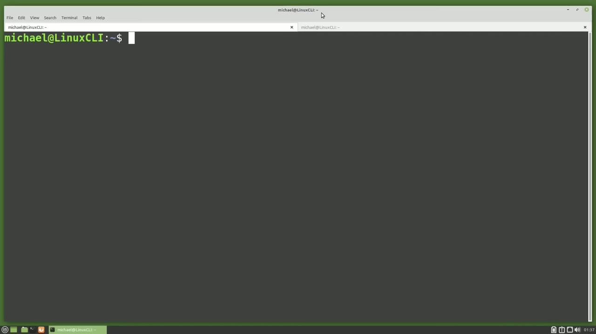
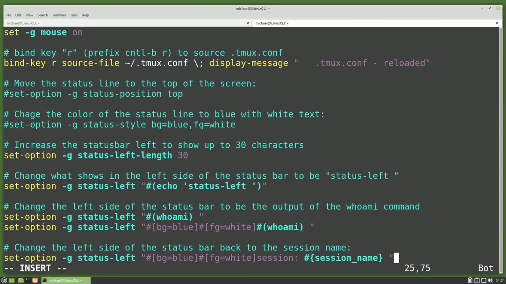
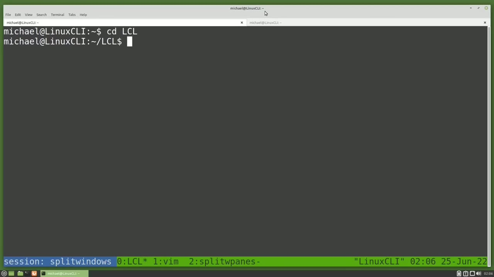
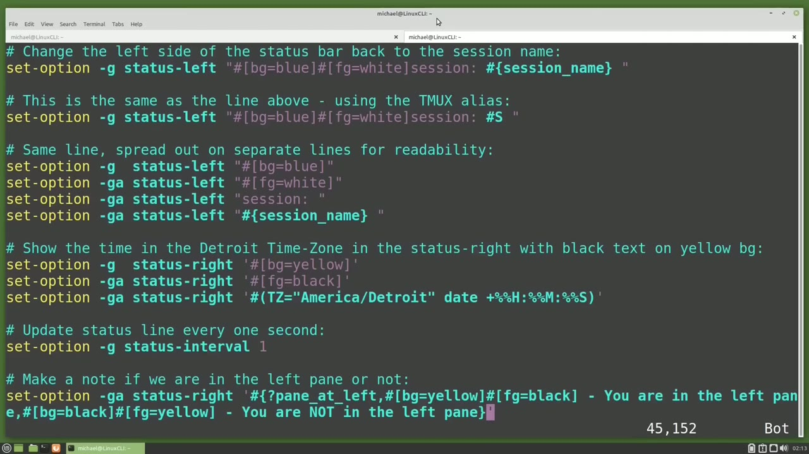
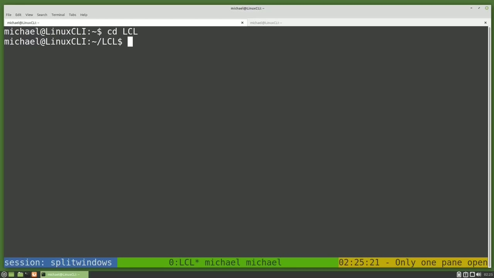

[← Course contents](../../01.md)

# 70. tmux pt4 .tmux.conf pt2

**Course:** [Linux Command Line - Entire Tutorial Series](https://www.youtube.com/watch?v=avg65oY7sj4)  
**Transcript:** [`Linux Command Line - Entire Tutorial Series transcript`](../../../../course_videos/Linux%20Command%20Line%20-%20Entire%20Tutorial%20Series/Linux%20Command%20Line%20-%20Entire%20Tutorial%20Series.txt)  
**Video:** 11:53:04–12:07:07 ([open at this time](https://www.youtube.com/watch?v=avg65oY7sj4&t=42784s))

## Introduction

In the last video we left off logged in as Lisa. I've logged off of Lisa and logged back in as the Michael user and I have detached from both tmux sessions. But I still have them running and we can see that when I type tmux l.s. I'm going to reattach to the Split Windows tmux session with tmux Attach-T-Split. And I'm going to switch to the lcl window with Control B 0.

## Detailed Explanation

<details>
  <summary>Step 1 — Run `tmux`, `who`</summary>

### Step 1 — Run `tmux`, `who`

- [x] **Use `tmux`**
  - In the last video we left off logged in as Lisa. I've logged off of Lisa and logged back in as the Michael user and I have detached from both `tmux` sessions.
  - But I still have them running and we can see that when I type `tmux` l.s.
  - I'm going to reattach to the Split Windows `tmux` session with `tmux` Attach-T-Split.

- [x] **And I'm going to switch to the lcl window with Control B 0**
  - And I'm going to switch to the lcl window with Control B 0.
  - In the last video we made a change to the `tmux`.com file to show the entire session name split windows in the lower left corner.
  - But the lower left corner does not have to be the session name.

- [x] **Use `tmux`**
  - Let's go back over to our `tmux`.com file and I'm going to change the left status to be the output of a Linux command. The Linux command is going to be echo and it's going to echo out the text status left. I'm going to save this and go back over to our `tmux` window and pressing
  - Control B R. We now see the lower left corner of our status bar says status -left.
  - I'm going back over to the `tmux` comp file.

- [x] **Use `who`, `tmux`**
  - And I'm going to paste in some more text.
  - And this text will show the output of the Linux command, `who` Am I?
  - I'll save this and I'll swap over to the `tmux` tab.

- [x] **Use `tmux`**
  - And now we see Michael, the output of the `who` Am I command, in the status left.
  - Going back to the `tmux` Comp file, we see that we overwrote the status left output with the `who` Am I.
  - Output. Let's add some color to this status left. To do that, I'm going to paste in some more text.

- [x] **And we start off with the set option -G. G is for global. Then status**
  - And we start off with the set option -G. G is for global. Then status left. We've seen that already. Then in the double quotes, we have hashtag symbol, left square bracket, then bg for background color. We're setting that to blue. Then we've got our closing square bracket.
  - Then we've got a hashtag symbol, Open square bracket fg for foreground color, which will be our text, and we're setting that equal to white, and then we've got a closing square bracket.
  - Then we have another hashtag symbol and then our Linux command in parentheses.

- [x] **Use `tmux`**
  - The things to note here are the formatting changes go in square brackets and the Linux commands go in parentheses.
  - And a hashtag symbol is needed before either one of these.
  - And go back over to the `tmux` session and reload that `tmux` comp file with Control b.r.

- [x] **And we see our output of the who Ami command is now in white text**
  - And we see our output of the `who` Ami command is now in white text with a blue background.
  - And I'm going to paste in some text for that as well.
  - And we see here after we change the foreground color to white, we have the word session with a colon and a space following it.

```bash
tmux
who
```



</details>

<details>
  <summary>Step 2 — Run `echo`, `tmux`</summary>

### Step 2 — Run `echo`, `tmux`

- [x] **Use `echo`**
  - I'm not using the Linux `echo` command here.
  - We don't need that to add text inside these quotes.
  - I was just using the `echo` command earlier to show the output of a Linux command in the status line.

- [x] **Use `tmux`**
  - And then we have a hashtag symbol and the `tmux` variable.
  - And because this is a `tmux` variable, we will need to change the parentheses that we used for the Linux command to be curly braces for the `tmux` variable.
  - And where did I get that session name variable and what other variables are available?

- [x] **Use `tmux`**
  - For that I used the `tmux` Man page and I went down to the format section.
  - And then we see the variable name, alias, if there is one, and what it will show.
  - Going down to session name, we see it has the alias of a hashtag symbol and an uppercase S.

- [x] **Use `tmux`**
  - And then the description name of session.
  - Because this has an alias of a hashtag symbol uppercase S, I can use that in place of the variable name.
  - Back in our `tmux` configuration file, I will paste in the line here to print out the session name using the alias of hashtag symbol.

- [x] **Use `tmux`**
  - Uppercase s which will be the equivalent of the hashtag symbol session name inside the curly braces these both work the same saving this and going back to the `tmux` session i'm going to reload the `tmux` comp file and now we see session colon and then the session name in white
  - Text with a blue background in the left side of the status bar going back to the `tmux` comp file Paste in some text here. So what I've pasted in is the same line as the two lines above.
  - Only I've split it up into four lines. The first line, set option -G will replace what was in the status left with the bg equals blue. Then the next three lines have status G G, A, which will append on to the status left with what is in the double quotes.

- [x] **And then I'm using the hashtag Curly Braces session name instead of**
  - And then I'm using the hashtag Curly Braces session name instead of the hashtag uppercase s to show that they both work the same way.
  - I will save this and switch over to the other tab.

```bash
echo
tmux
```



</details>

<details>
  <summary>Step 3 — Run `tmux`, `tmux status`</summary>

### Step 3 — Run `tmux`, `tmux status`

- [x] **Use `tmux`**
  - Pressing Control B R reloads the `tmux` comp file but doesn't change anything at all.
  - So the changes I made were just for readability.
  - Now I want to change the right status to show the time in my time zone.

- [x] **To do that, I'm going to paste in the text**
  - To do that, I'm going to paste in the text.
  - And this is slightly different because I'm using double quotes for my time zone.
  - So I'm using single quotes as my outside quotes.

- [x] **And then I'm using black text with a yellow background to make that**
  - And then I'm using black text with a yellow background to make that stand out a little bit.
  - I will save this, switch tabs and reload the page.
  - We see the time in the lower right corner with the yellow background in black text.

- [x] **Use `tmux status`**
  - The seconds are only updating every 15 seconds.
  - To make it update every second, I need to paste in some more text.
  - This line will update the `tmux status` interval every one second.

- [x] **Saving this, going to the other tab and refreshing the configuration**
  - Saving this, going to the other tab and refreshing the configuration file shows the time updating every second.
  - Going back to the Man Page Formats, They show us an example of a conditional, which is also known as an if statement.
  - In their example, they're using the pain in mode.

- [x] **I've created an example here for us, and I'm going to paste in the**
  - I've created an example here for us, and I'm going to paste in the code.
  - In this example, we will check to see if we are in the left pane.
  - If we are in the left pane, we will see the message, You are in the left pane in the same color as the time.

```bash
tmux
tmux status
```



</details>

<details>
  <summary>Step 4 — Run `tmux`</summary>

### Step 4 — Run `tmux`

- [x] **Use `tmux`**
  - If we are not in the left pane, The color will be reversed showing yellow text on a black background and will show the message you are not in the left pane.
  - I will save this and go to the `tmux` window, reloading the configuration file.
  - And we are in the left pane because there is only one pane at this time.

- [x] **Let's add another pane with Control B percent sign and our message**
  - Let's add another pane with Control B percent sign and our message has changed color and tells us we are no longer in the left pane.
  - Pressing Control B arrow left puts us back into the left pane and Control B arrow right shows us we are no longer in the left pane.
  - I'm going to exit out of this pane and once again we're in the left pane.

- [x] **Use `tmux`**
  - I'm going to delete the last two lines what we added and then paste in some text, which adds that line back but comments it out.
  - And I've added in another line here that will do another if statement.
  - And my message will change if there's more than one pane open by using the `tmux` window panes variable.

- [x] **I'm checking that to see if the value of the window panes is greater**
  - I'm checking that to see if the value of the window panes is greater than the number 1.
  - If it is, we show the message more than one pane is open.
  - Otherwise, we'll show the message only one pane open.

- [x] **Use `tmux`**
  - So this if statement works the same as the other one, but there's just a little more to it.
  - Let's save this. Go back to our `tmux` session and refresh the `tmux` Comp file.
  - We see that there is only one pane open.

- [x] **Let's open another pane with Control B percent sign**
  - Let's open another pane with Control B percent sign.
  - And we see that our message changes to more than one pane open.
  - And we're back to having only one pane open.

- [x] **We also have the middle section here and right now it is justified**
  - We also have the middle section here and right now it is justified left.
  - I'm going to center that section by pasting in some code to justify center.
  - And notice that center is not using the us American spelling of center.

- [x] **Use `tmux`**
  - It's got the re switched around. Saving that and switching back.
  - Refreshing the `tmux` comp file. And we have now centered that middle section.
  - Now this middle section is meant to show the window information.

- [x] **For example, we see we are in the lcl window because it has the**
  - For example, we see we are in the lcl window because it has the asteris next to it.
  - And the previous window we were in is the split panes window because it has the -next to it. But we do not have to show window information there.
  - Switching tabs. I'm going to paste in some text.

```bash
tmux
```



</details>

<details>
  <summary>Step 5 — Run `tmux`, `echo`</summary>

### Step 5 — Run `tmux`, `echo`

- [x] **This will update the window status format**
  - This will update the window status format.
  - To be the output of the Who Am I command. Saving this and switching tabs, refreshing.
  - And now we see the output of the Who Ami command two times, one for each open window that is not the current window.

- [x] **Use `tmux`, `echo`**
  - Going back to the `tmux` comp file and pasting in some text.
  - And this will update the current window status to be the output of the `echo` command, Let's write this out, swap back over to our `tmux` session and refresh the page with Control br.
  - And now we see current format Michael Michael, which isn't very helpful.

- [x] **This will change the settings of the current window to be bold with**
  - This will change the settings of the current window to be bold with white text.
  - And it will also show the window index, window name, and the window flags.
  - That is the asteris or the -showing whether we are in the current window or the previous window.

- [x] **And then for the other open windows, we'll have them underscored in**
  - And then for the other open windows, we'll have them underscored in white.
  - And then we'll also have the window index, window name, and then the window flags.
  - Let's save this and swapping back to the T-Muck session.

- [x] **Use `tmux`**
  - And there we see the current window is bold and the others are underscored.
  - One last thing I want to mention is that I've been using Control B R as the prefix.
  - We can change that prefix. Going back to the `tmux` Comp file, we can probably get away with just pasting in the line. Set option -G prefix, uppercase C -a.

- [x] **Use `tmux`**
  - C means hold down Control A. So we're basically changing our prefix to be the same as the control A instead of Control B. But a little better way to do this would be to unbind the current prefix with unbind key uppercase C for Control -B. Then we set the `tmux` prefix to be Control A.
  - And then we also bind the Control A prefix. I'm going to save this and swap over to the `tmux` screen.
  - I'll need to use Control B and then R to reload the `tmux` comp file.

- [x] **But now if I do Control B R, it prints out the R**
  - But now if I do Control B R, it prints out the R.
  - But if I use Control A R, it reloads a screen.
  - So now I would need to use Control A percent sign to split the screen.

- [x] **In the next tutorial, we will continue looking at the Linux command**
  - In the next tutorial, we will continue looking at the Linux command line.

```bash
tmux
echo
```



</details>

<details>
  <summary>Questions and Answers</summary>

## Questions and Answers

### Question 1: What does `tmux` do in this chapter?

<details>
<summary>Answer</summary>

- [x] In the last video we left off logged in as Lisa. I've logged off of Lisa and logged back in as the Michael user and I have detached from both `tmux` sessions.

</details>

### Question 2: What does `who` do in this chapter?

<details>
<summary>Answer</summary>

- [x] And this text will show the output of the Linux command, `who` Am I?

</details>

### Question 3: What does `echo` do in this chapter?

<details>
<summary>Answer</summary>

- [x] I was just using the `echo` command earlier to show the output of a Linux command in the status line.

</details>

### Question 4: What does `tmux status` do in this chapter?

<details>
<summary>Answer</summary>

- [x] This line will update the `tmux status` interval every one second.

</details>

### Question 5: What does step 1 cover (Run tmux, who)?

<details>
<summary>Answer</summary>

- [x] In the last video we left off logged in as Lisa. I've logged off of Lisa and logged back in as the Michael user and I have detached from both `tmux` sessions.
- [x] But I still have them running and we can see that when I type `tmux` l.s.
- [x] I'm going to reattach to the Split Windows `tmux` session with `tmux` Attach-T-Split.

</details>

### Question 6: What does step 2 cover (Run echo, tmux)?

<details>
<summary>Answer</summary>

- [x] I'm not using the Linux `echo` command here.
- [x] We don't need that to add text inside these quotes.
- [x] I was just using the `echo` command earlier to show the output of a Linux command in the status line.

</details>

### Question 7: What does step 3 cover (Run tmux, tmux status)?

<details>
<summary>Answer</summary>

- [x] Pressing Control B R reloads the `tmux` comp file but doesn't change anything at all.
- [x] So the changes I made were just for readability.
- [x] Now I want to change the right status to show the time in my time zone.

</details>

### Question 8: What does step 4 cover (Run tmux)?

<details>
<summary>Answer</summary>

- [x] If we are not in the left pane, The color will be reversed showing yellow text on a black background and will show the message you are not in the left pane.
- [x] I will save this and go to the `tmux` window, reloading the configuration file.
- [x] And we are in the left pane because there is only one pane at this time.

</details>

### Question 9: What does step 5 cover (Run tmux, echo)?

<details>
<summary>Answer</summary>

- [x] This will update the window status format.
- [x] To be the output of the Who Am I command. Saving this and switching tabs, refreshing.
- [x] And now we see the output of the Who Ami command two times, one for each open window that is not the current window.

</details>

</details>

## Summary

This chapter, tmux pt4 .tmux.conf pt2, walks through Run tmux, who; Run echo, tmux; Run tmux, tmux status; Run tmux; Run tmux, echo. Commands from the transcript: `tmux`, `who`, `echo`, `tmux status`.

## References

- [Linux Command Line - Entire Tutorial Series (YouTube)](https://www.youtube.com/watch?v=avg65oY7sj4)
- [This chapter at 11:53:04](https://www.youtube.com/watch?v=avg65oY7sj4&t=42784s)
- [Local transcript](../../../../course_videos/Linux%20Command%20Line%20-%20Entire%20Tutorial%20Series/Linux%20Command%20Line%20-%20Entire%20Tutorial%20Series.txt)
