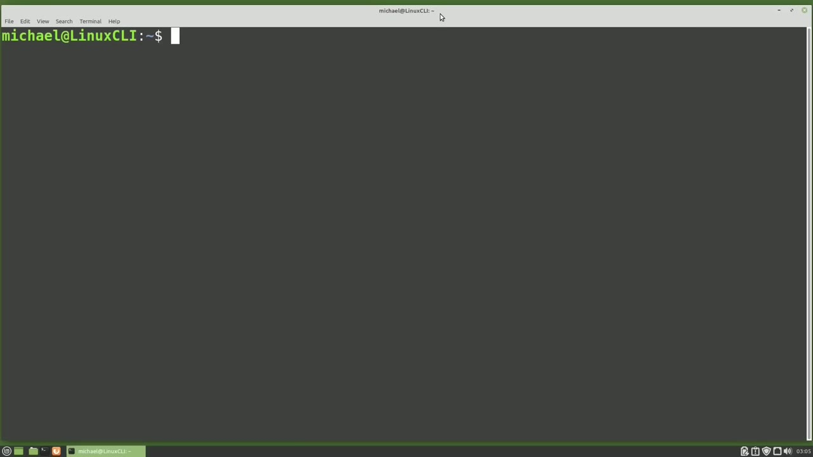
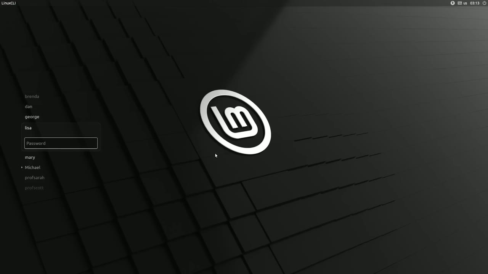
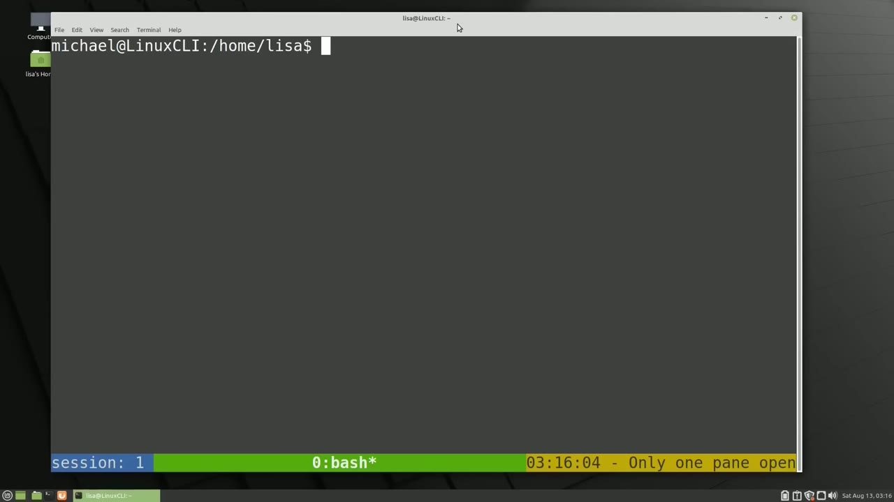

[← Course contents](../../01.md)

# 71. Share a tmux session

**Course:** [Linux Command Line - Entire Tutorial Series](https://www.youtube.com/watch?v=avg65oY7sj4)  
**Transcript:** [`Linux Command Line - Entire Tutorial Series transcript`](../../../../course_videos/Linux%20Command%20Line%20-%20Entire%20Tutorial%20Series/Linux%20Command%20Line%20-%20Entire%20Tutorial%20Series.txt)  
**Video:** 12:07:07–12:12:32 ([open at this time](https://www.youtube.com/watch?v=avg65oY7sj4&t=43627s))

## Introduction

Originally, I had no intentions of creating this video, but there were some comments for Video 69, tmux.comf Part 1 by Google Google and r.s. Underscore that led me to create this video. In Video 69, tmux Comp Part 1, I ended the video showing how two people from two different locations can log in and share a tmux session. Google Google points out that the two people are not sharing a tmux session. Because they're both logged in as the same user.

## Detailed Explanation

<details>
  <summary>Step 1 — Run `tmux`, `tmux -uppercase`, `ls -lh /tmp`</summary>

### Step 1 — Run `tmux`, `tmux -uppercase`, `ls -lh /tmp`

- [x] **Use `tmux`**
  - Originally, I had no intentions of creating this video, but there were some comments for Video 69, `tmux`.comf Part 1 by Google Google and r.s. Underscore that led me to create this video.
  - In Video 69, `tmux` Comp Part 1, I ended the video showing how two people from two different locations can log in and share a `tmux` session.
  - Google Google points out that the two people are not sharing a `tmux` session.

- [x] **Use `tmux`**
  - Because they're both logged in as the same user.
  - Rs underscore commented that it is possible to have two different users share that same `tmux` session if they both share the same `tmux` socket.
  - So in this video we're going to look at how that works.

- [x] **Use `tmux`, `tmux -uppercase`**
  - Currently, I'm logged in as the Michael user and I'm going to start a t-muk session.
  - Rs underscore tells us in the comments that if we want to share a `tmux` session, we should open it in a socket in a location both users have access to, like the slash temp directory.
  - So as rs underscore suggests, I will type `tmux -uppercase` S /tmp slash my socket.

- [x] **Use `ls -lh /tmp`**
  - Rs underscore tells us we must make sure both users have access privileges to this file.
  - So let's check out the file permissions by looking at the My Socket file permissions in the /tmp directory with `ls -lh /tmp` slash My Socket.
  - We see that the user in the group both have read, write, and execute privileges, but the user and the group are both Michael.

- [x] **Use `ls -lh /tmp`**
  - We want to share this socket with Lisa, so we will give the Lisa group privileges with Sudo-Chone Michael.Lisa /tmp slash My Socket.
  - If you have multiple people you want to share this file with, you may want to revisit videos 23 and 24 about group permissions.
  - Let's make sure those file permissions look good by listing them out again with `ls -lh /tmp` My Socket.

- [x] **And here we see Michael, the owner, has read, write, and execute**
  - And here we see Michael, the owner, has read, write, and execute privileges.
  - And Lisa, who is part of the Lisa group, will also have read, write, and execute privileges.
  - One other thing I want to note here is, looking in the lower left corner, we see we are in session zero.

- [x] **Now I'm going to log out as the Michael user and log in as Lease**
  - Now I'm going to log out as the Michael user and log in as Lease.
  - By going down and logging out and switching user.

```bash
tmux
tmux -uppercase
ls -lh /tmp
```



</details>

<details>
  <summary>Step 2 — Run `tmux`, `tmux -uppercase`</summary>

### Step 2 — Run `tmux`, `tmux -uppercase`

- [x] **Use `tmux`**
  - I'm going to start a standard `tmux` session as Lisa just to see how that looks.
  - And we see the green status bar at the bottom of the screen showing Lisa does not have any customizations, just the standard `tmux` look and feel.
  - And now I want to attach to the shared `tmux` session with Michael.

- [x] **Use `tmux -uppercase`, `tmux`**
  - So I will do that with `tmux -uppercase` s /tmp slash My Socket.
  - And we're now in the shared My Socket `tmux` session.
  - We can tell that by the customized status bar.

- [x] **This shows that we're in the home directory of Lisa**
  - This shows that we're in the home directory of Lisa.
  - The Michael user was looking at the file permissions for the /tmp slash My socket file.
  - Looking in the lower left corner, we see Lisa is in session 1.

```bash
tmux
tmux -uppercase
```



</details>

<details>
  <summary>Step 3 — Run `tmux`</summary>

### Step 3 — Run `tmux`

- [x] **Use `tmux`**
  - To switch the `tmux` session, I'm going to hold down control and press A and then the S key.
  - I changed my prefix to be Control A instead of Control B in the last video.
  - Now I'm going to use my Arrow Up key to take me up to session 0 and press enter.

- [x] **And now we see what the Michael user was looking at**
  - And now we see what the Michael user was looking at.
  - I'm going to split this window with Control a percent sign and then split this one more time with Control a double quote.
  - And now I'm going to switch back to the Michael user with Log out switch user.

- [x] **Use `tmux`**
  - Logged back in as Michael. We see the changes we just made as the Lisa user are now on the Michael user screen.
  - To share a `tmux` session between two different users if we use the same socket.
  - Thank you Google Google for your comment and thank you rs underscore for your explanation of how to share a t-muk socket.

- [x] **I learned something new and I'm happy I'm able to share it with all**
  - I learned something new and I'm happy I'm able to share it with all of you.
  - In the next video we'll continue looking at the Linux command line.

```bash
tmux
```



</details>

<details>
  <summary>Questions and Answers</summary>

## Questions and Answers

### Question 1: What does `tmux` do in this chapter?

<details>
<summary>Answer</summary>

- [x] In Video 69, `tmux` Comp Part 1, I ended the video showing how two people from two different locations can log in and share a `tmux` session.

</details>

### Question 2: What does `tmux -uppercase` do in this chapter?

<details>
<summary>Answer</summary>

- [x] So as rs underscore suggests, I will type `tmux -uppercase` S /tmp slash my socket.

</details>

### Question 3: What does `ls -lh /tmp` do in this chapter?

<details>
<summary>Answer</summary>

- [x] So let's check out the file permissions by looking at the My Socket file permissions in the /tmp directory with `ls -lh /tmp` slash My Socket.

</details>

### Question 4: What does step 1 cover (Run tmux, tmux -uppercase, ls -lh /tmp)?

<details>
<summary>Answer</summary>

- [x] Originally, I had no intentions of creating this video, but there were some comments for Video 69, `tmux`.comf Part 1 by Google Google and r.s. Underscore that led me to create this video.
- [x] In Video 69, `tmux` Comp Part 1, I ended the video showing how two people from two different locations can log in and share a `tmux` session.
- [x] Google Google points out that the two people are not sharing a `tmux` session.

</details>

### Question 5: What does step 2 cover (Run tmux, tmux -uppercase)?

<details>
<summary>Answer</summary>

- [x] I'm going to start a standard `tmux` session as Lisa just to see how that looks.
- [x] And we see the green status bar at the bottom of the screen showing Lisa does not have any customizations, just the standard `tmux` look and feel.
- [x] And now I want to attach to the shared `tmux` session with Michael.

</details>

### Question 6: What does step 3 cover (Run tmux)?

<details>
<summary>Answer</summary>

- [x] To switch the `tmux` session, I'm going to hold down control and press A and then the S key.
- [x] I changed my prefix to be Control A instead of Control B in the last video.
- [x] Now I'm going to use my Arrow Up key to take me up to session 0 and press enter.

</details>

</details>

## Summary

This chapter, Share a tmux session, walks through Run tmux, tmux -uppercase, ls -lh /tmp; Run tmux, tmux -uppercase; Run tmux. Commands from the transcript: `tmux`, `tmux -uppercase`, `ls -lh /tmp`.

## References

- [Linux Command Line - Entire Tutorial Series (YouTube)](https://www.youtube.com/watch?v=avg65oY7sj4)
- [This chapter at 12:07:07](https://www.youtube.com/watch?v=avg65oY7sj4&t=43627s)
- [Local transcript](../../../../course_videos/Linux%20Command%20Line%20-%20Entire%20Tutorial%20Series/Linux%20Command%20Line%20-%20Entire%20Tutorial%20Series.txt)
