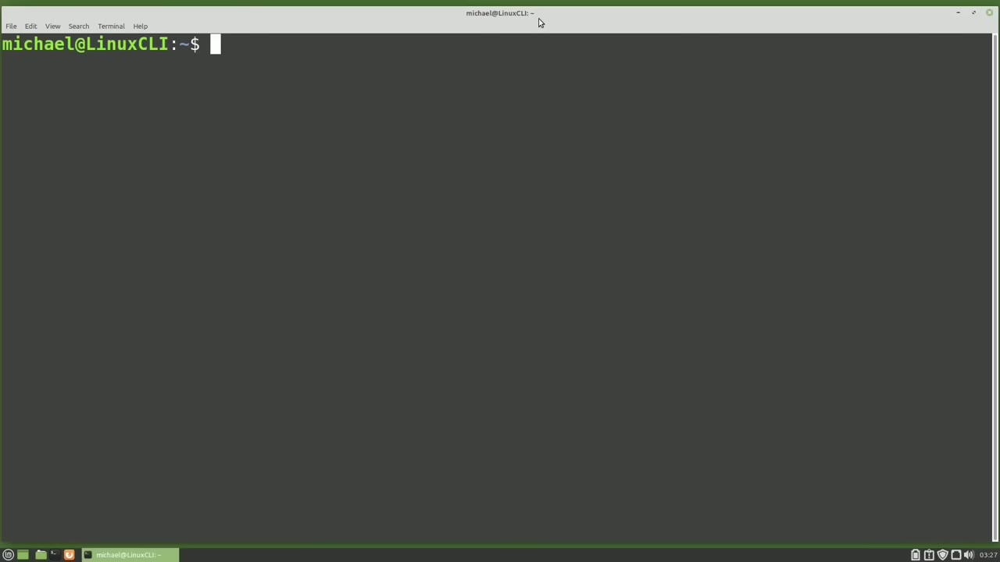
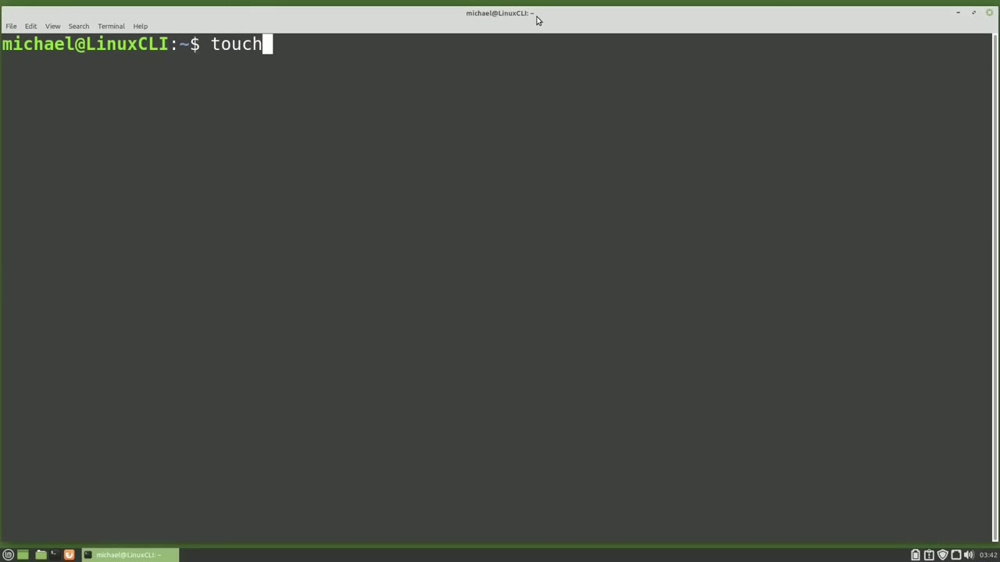
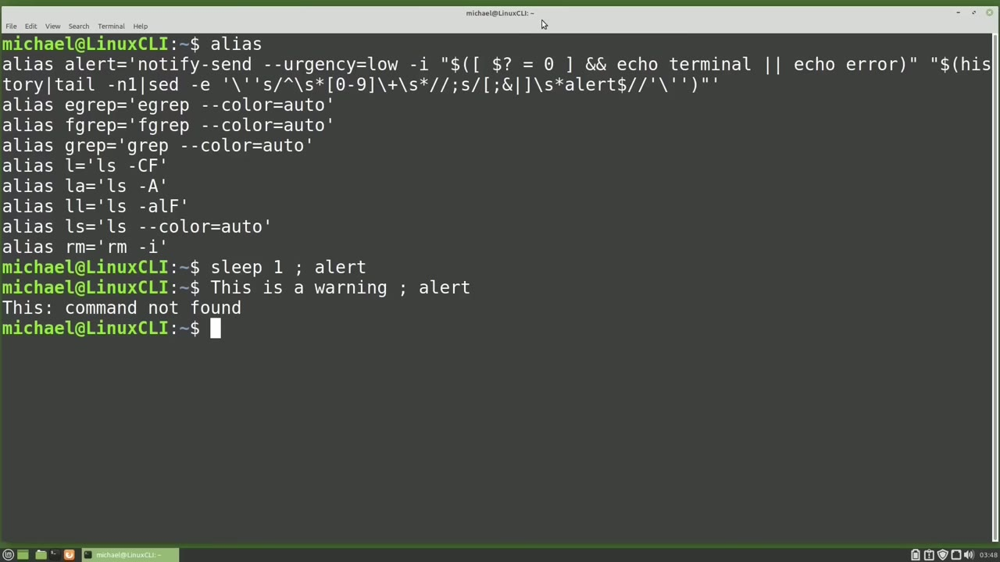
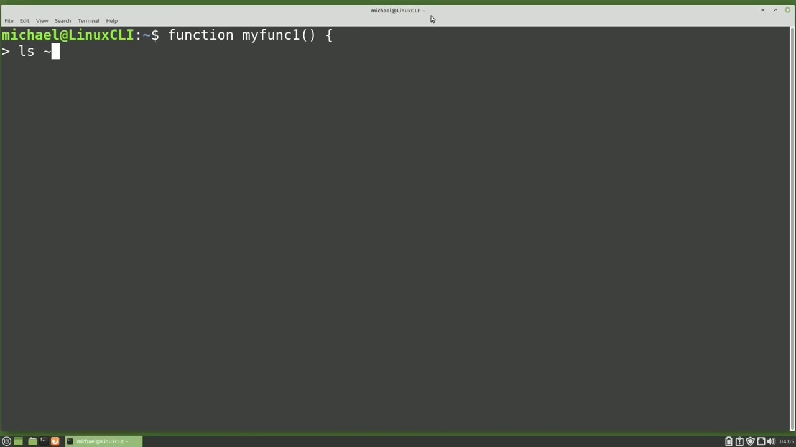
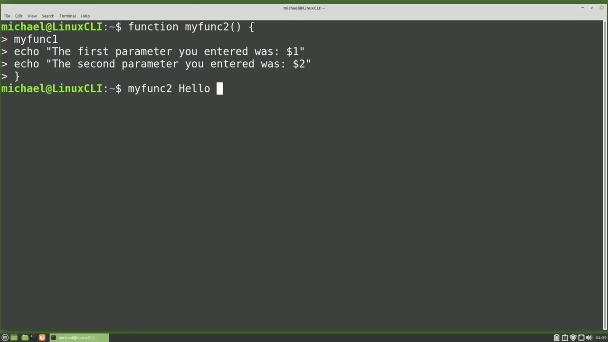

[← Course contents](../../01.md)

# 72. Bash Environment Variables, Alias, Functions

**Course:** [Linux Command Line - Entire Tutorial Series](https://www.youtube.com/watch?v=avg65oY7sj4)  
**Transcript:** [`Linux Command Line - Entire Tutorial Series transcript`](../../../../course_videos/Linux%20Command%20Line%20-%20Entire%20Tutorial%20Series/Linux%20Command%20Line%20-%20Entire%20Tutorial%20Series.txt)  
**Video:** 12:12:32–12:26:04 ([open at this time](https://www.youtube.com/watch?v=avg65oY7sj4&t=43952s))

## Introduction

In this video, we're going to take a look at Bash Environment variables, aliases, and functions. Environment variables can be used to pass information about the current operating system to programs and scripts. We can see all the environment variables currently set by typing env. This list is over a page, but here we see User Equals Michael.

## Detailed Explanation

<details>
  <summary>Step 1 — Run `bash`, `env`, `echo`</summary>

### Step 1 — Run `bash`, `env`, `echo`

- [x] **Use `bash`, `env`**
  - In this video, we're going to take a look at `bash` Environment variables, aliases, and functions.
  - Environment variables can be used to pass information about the current operating system to programs and scripts.
  - We can see all the environment variables currently set by typing `env`.

- [x] **Use `env`, `bash`**
  - This list is over a page, but here we see User Equals Michael.
  - I'm going to type `env` again, but this time I will pipe it into Less.
  - Here we see the shell is set to Bin `bash`.

- [x] **pwd Print Working Directory is set to Home Michael and the log name**
  - pwd Print Working Directory is set to Home Michael and the log name is set to Michael.
  - I'm going to press Q to quit out of les and clear the screen.
  - As I mentioned earlier, environment variables are a way to pass information to programs and scripts.

- [x] **Use `echo`**
  - To get the value of an environment variable in a script, we will use the dollar sign.
  - This will tell Linux what we are expecting after that dollar sign.
  - Is an environment variable. For example, to `echo` out the value of environment variable pwd, I will type `echo`, then a space, then a dollar sign, followed by the environment variable pwd. So the dollar sign is not part of the environment variable, but it tells Linux what follows this dollar sign is going to be an environment variable.

- [x] **We can create our own environment variables**
  - We can create our own environment variables.
  - I'll make one here with tfcg equals the frugal computer guy.
  - Note, environment variables should be all uppercase.

- [x] **They don't have to be, but it's a Linux standard to make environment**
  - They don't have to be, but it's a Linux standard to make environment variables all uppercase.
  - And we should try to use Linux standards whenever possible.
  - Pressing Enter, we'll create my environment variable.

```bash
bash
env
echo
```



</details>

<details>
  <summary>Step 2 — Run `touch`, `rm delete`, `rm --i delete`</summary>

### Step 2 — Run `touch`, `rm delete`, `rm --i delete`

- [x] **And we can see the new environment variable by echoing out the value**
  - And we can see the new environment variable by echoing out the value with echo dollar sign tfcg. Or maybe we want to change our environment variable.
  - I'll change that by just reassigning it. tfcg equals https colon forward slash forward slash the frugal computer guy.com and pressing enter.
  - We'll update the tfcg environment variable with a new value.

- [x] **And we can now see that with echo dollar sign tfcg**
  - And we can now see that with echo dollar sign tfcg.
  - This new environment variable that I just created is only going to be available while this terminal is open. Once I close the terminal, my new tfcg variable will be gone.
  - We'll look at a better way of creating environment variables in the next video.

- [x] **Use `touch`, `rm delete`**
  - An `alias` is just a shortcut of a command, sometimes with different command options.
  - I'm going to `touch` a file called delete me.txte.
  - And I can delete this file with the rm command, rm, delete me.TXT.

- [x] **And the file is gone, which is what we wanted**
  - And the file is gone, which is what we wanted.
  - But I want a warning before I delete a file.
  - So I'm going to press the arrow up again.

- [x] **Use `touch`, `rm --i delete`**
  - To `touch` that delete me.T. file.
  - And I'm going to type `rm --i delete` me. txt.
  - Now when I press Enter, I get a warning asking me, do I really want to remove this file?

- [x] **Use `alias`, `rm -I`**
  - I'll press N for no because I don't really want to remove it at this time.
  - I want to get that warning message every time I type rm to remove a file.
  - To make that happen, I'm going to create an `alias`. To create this `alias`, I will start off by typing `alias`, then a space, and what I want this `alias` name to be, which is rm, then we have an equal sign, and then in quotes, I will add the command I want to execute when I type my `alias`, which will be `rm -I`.

- [x] **Use `rm -I`, `alias`**
  - So now every time I type rm, Linux will send the command `rm -I`.
  - And I'll try it out with rm, delete me.T, and it's asking me, do you really want to remove this file?
  - I'm going to clear the screen and I'm going to type `alias` all by itself.

- [x] **This shows us all of the aliases currently set**
  - This shows us all of the aliases currently set.
  - Linux Mint has set up some aliases for me and at the top we see an alert.
  - An alert just sends a message to the desktop. I'll show this with Sleep 1, Semi-colon, alert. So it will wait one second and then it will show us the alert.

- [x] **And there in the upper right corner we see the Sleep 1. It shows us**
  - And there in the upper right corner we see the Sleep 1. It shows us that Sleep 1 command.
  - We can make this alert box look a little more like a warning.
  - If I type something like this is a warning, semicolon, alert.

```bash
touch
rm delete
rm --i delete
alias
rm -I
```



</details>

<details>
  <summary>Step 3 — Run `bash`, `rm -i`, `alias`</summary>

### Step 3 — Run `bash`, `rm -i`, `alias`

- [x] **Use `bash`**
  - This time when I press enter, we get the red warning symbol up there.
  - And then we also get the `bash` message this command not found.
  - So this is not a real `bash` command.

- [x] **That is why we're getting that warning symbol up there**
  - That is why we're getting that warning symbol up there.
  - The Sleep one was an actual Linux command.
  - So we did not see that error warning in the alert box.

- [x] **Use `rm -i`**
  - Looking back at the other aliases created for me by Linux Mint, we have L, L, A, L, L, L, S to use the color option.
  - And at the bottom, we see the `alias` rm equals `rm -i`, the one we just created.
  - Now let's say I have to delete a lot of files, and I don't want to have to press that confirm for every file I delete. I want to remove my `alias`. We can just overwrite it.

- [x] **Use `alias`**
  - By creating a new `alias` and type `alias` rm equals rm.
  - That would work, but that's not really the cleanest way.
  - A better way, in my opinion, to remove this `alias` is with the unalius command.

- [x] **Use `alias`**
  - I will unalias the rm `alias` by typing unalius rm.
  - And typing `alias` shows the rm `alias` has now been removed.
  - An `alias` does not have to be an existing command.

- [x] **We can put more than one command in an alias**
  - We can put more than one command in an `alias`.
  - We just need to separate the commands with semicolons.
  - I'm going to create a new `alias` with `alias`.

- [x] **Use `ls`**
  - And we'll call this one tfcg lowercase this time, because Linux is case sensitive.
  - And the first thing I want to do is list out.
  - The content of the current directory with the `ls` command.

- [x] **Use `cal`**
  - Then I'm going to type `cal` to show us a calendar.
  - And then I'm going to echo out the value and we'll put this in a double quote.
  - The value of environment variable tfcg is dollar sign tfcg.

- [x] **We'll have the ending double quote, ending single quote and pressing**
  - We'll have the ending double quote, ending single quote and pressing enter created our new `alias`.
  - Let's test it out by typing lowercase tfcg.
  - And here we see it lists out the files and directories in the current directory.

```bash
bash
rm -i
alias
ls
cal
```



</details>

<details>
  <summary>Step 4 — Run `ls tilday`</summary>

### Step 4 — Run `ls tilday`

- [x] **And then we see the value of environment variable tfcg is HTTPS colon**
  - And then we see the value of environment variable tfcg is HTTPS colon forward slash forward slash the frugal computer guy.com.
  - Like the environment variable we created earlier in this video, this alias will only last until we close our terminal window.
  - We will look at a better way of creating our aliases in the next video.

- [x] **We were able to get a couple of commands in the alias, but if we**
  - We were able to get a couple of commands in the alias, but if we really want to run multiple commands by typing a keyword, we will want to create a function.
  - Functions are created by typing the word function, and then what we want to call this function, or the name we want to give it.
  - I'm going to give it the name My Funk 1.

- [x] **Use `ls tilday`**
  - And then we need opening and closing parentheses, a space, and an open curly brace pressing enter will give us a new line and this is where we're going to put our commands of our function the first thing i'm going to do is list out the files in the home directory
  - With `ls tilday` and then i'm going to echo out the value in my tfcg environment variable we'll keep this function simple and only leave it to these two lines to end our function i use the closing curly brace and our function is created.
  - We can run the function by typing my funk one.

- [x] **And there we see the content of the home directory**
  - And there we see the content of the home directory.
  - And then we see the value of the variable tfcg is and the value.
  - I'm going to clear the screen again and I'm going to create another function.

- [x] **So let's start off with function and I'm going to call this one my**
  - So let's start off with function and I'm going to call this one my Funk 2. Then I've got my open and closing parentheses and the opening curly brace.
  - And the first thing I wanted to do in this function is call my funk 1.

```bash
ls tilday
```



</details>

<details>
  <summary>Step 5 — Run `type`, `ls semicolon`, `wc`</summary>

### Step 5 — Run `type`, `ls semicolon`, `wc`

- [x] **So functions can call other functions. And we can also add input**
  - So functions can call other functions. And we can also add input parameters to our function.
  - So what I'll do in this next line is echo out.
  - The first parameter you entered was and then a dollar sign 1.

- [x] **We'll print out the first parameter that we add**
  - We'll print out the first parameter that we add.
  - And then I will echo out the second parameter you entered was dollar sign two, which will be the second parameter.
  - I'm going to end this function by adding in the closing curly brace.

- [x] **Use `type`**
  - And let's run our new function. I'll `type` in my funk two.
  - And then I'm going to add the parameters.
  - Hello and then space world pressing enter we see it first prints out what is in the my funk one and then we see the first parameter we entered was hello the second parameter we entered was world clearing the screen when we `type` in one of these custom commands an easy way to tell if it's a function or an alias is to use the `type` command I will `type` my

- [x] **Use `type`, `ls semicolon`**
  - Funk 2. And here we see My Funk 2 is a function and then it shows us what is in that function.
  - Let's try the `type` command now with tfcg, the lowercase tfcg. Pressing Enter.
  - We see that that is alias to ls, Semicolon, kel, semicolon, and then the echo.

- [x] **Use `type`, `wc`, `bash`**
  - We can also use `type` with Linux commands like `wc`.
  - Here we see it's going to run `wc` from the user bin directory.
  - And we see that cd is built into the `bash` shell.

- [x] **Use `bash`**
  - The next thing we want to look at is the Set command.
  - I'm going to clear the screen and `type` Set.
  - The Set command shows us all the environment variables and functions that are set up for this `bash` session.

- [x] **Use `grep`, `grep tfcg`**
  - To see the tfcg environment variable, we need to `grep` for that.
  - So set `grep tfcg`.
  - And here we're grabbing the tfcg environment variable, but we also have tfcg and that echo out from our MyFunk 1.

- [x] **We can also unset our functions and environment variables**
  - We can also unset our functions and environment variables.
  - And now if I try to run it, my funk 1 command not found.
  - And typing set, we see the my funk 2, but we no longer see the my funk 1.

- [x] **I will echo out the dollar sign tfcg to show that it's there**
  - I will echo out the dollar sign tfcg to show that it's there.
  - Tfcg, it prints out nothing because it's no longer there.
  - In the next video, we're going to continue looking at the Linux command line.

```bash
type
ls semicolon
wc
bash
grep
grep tfcg
```



</details>

<details>
  <summary>Questions and Answers</summary>

## Questions and Answers

### Question 1: What does `bash` do in this chapter?

<details>
<summary>Answer</summary>

- [x] In this video, we're going to take a look at `bash` Environment variables, aliases, and functions.

</details>

### Question 2: What does `env` do in this chapter?

<details>
<summary>Answer</summary>

- [x] We can see all the environment variables currently set by typing `env`.

</details>

### Question 3: What does `echo` do in this chapter?

<details>
<summary>Answer</summary>

- [x] Is an environment variable. For example, to `echo` out the value of environment variable pwd, I will type `echo`, then a space, then a dollar sign, followed by the environment variable pwd. So the dollar sign is not part of the environment variable, but it tells Linux what follows this dollar sign is going to be an environment variable.

</details>

### Question 4: What does `touch` do in this chapter?

<details>
<summary>Answer</summary>

- [x] I'm going to `touch` a file called delete me.txte.

</details>

### Question 5: What does `rm delete` do in this chapter?

<details>
<summary>Answer</summary>

- [x] And I can delete this file with the rm command, rm, delete me.TXT.

</details>

### Question 6: What does `rm --i delete` do in this chapter?

<details>
<summary>Answer</summary>

- [x] And I'm going to type `rm --i delete` me. txt.

</details>

### Question 7: What does `rm` do in this chapter?

<details>
<summary>Answer</summary>

- [x] I want to get that warning message every time I type `rm` to remove a file.

</details>

### Question 8: What does `alias` do in this chapter?

<details>
<summary>Answer</summary>

- [x] To make that happen, I'm going to create an `alias`. To create this `alias`, I will start off by typing `alias`, then a space, and what I want this `alias` name to be, which is rm, then we have an equal sign, and then in quotes, I will add the command I want to execute when I type my `alias`, which will be rm -I.

</details>

### Question 9: What does `rm -I` do in this chapter?

<details>
<summary>Answer</summary>

- [x] To make that happen, I'm going to create an alias. To create this alias, I will start off by typing alias, then a space, and what I want this alias name to be, which is rm, then we have an equal sign, and then in quotes, I will add the command I want to execute when I type my alias, which will be `rm -I`.

</details>

### Question 10: What does `ls` do in this chapter?

<details>
<summary>Answer</summary>

- [x] The content of the current directory with the `ls` command.

</details>

### Question 11: What does `cal` do in this chapter?

<details>
<summary>Answer</summary>

- [x] Then I'm going to type `cal` to show us a calendar.

</details>

### Question 12: What does `ls tilday` do in this chapter?

<details>
<summary>Answer</summary>

- [x] With `ls tilday` and then i'm going to echo out the value in my tfcg environment variable we'll keep this function simple and only leave it to these two lines to end our function i use the closing curly brace and our function is created.

</details>

</details>

## Summary

This chapter, Bash Environment Variables, Alias, Functions, walks through Run bash, env, echo; Run touch, rm delete, rm --i delete; Run bash, rm -i, alias; Run ls tilday; Run type, ls semicolon, wc. Commands from the transcript: `bash`, `env`, `echo`, `touch`, `rm delete`, `rm --i delete`, `alias`, `rm -I`, `rm -i`, `ls`, `cal`, `ls tilday`, `type`, `ls semicolon`.

## References

- [Linux Command Line - Entire Tutorial Series (YouTube)](https://www.youtube.com/watch?v=avg65oY7sj4)
- [This chapter at 12:12:32](https://www.youtube.com/watch?v=avg65oY7sj4&t=43952s)
- [Local transcript](../../../../course_videos/Linux%20Command%20Line%20-%20Entire%20Tutorial%20Series/Linux%20Command%20Line%20-%20Entire%20Tutorial%20Series.txt)
