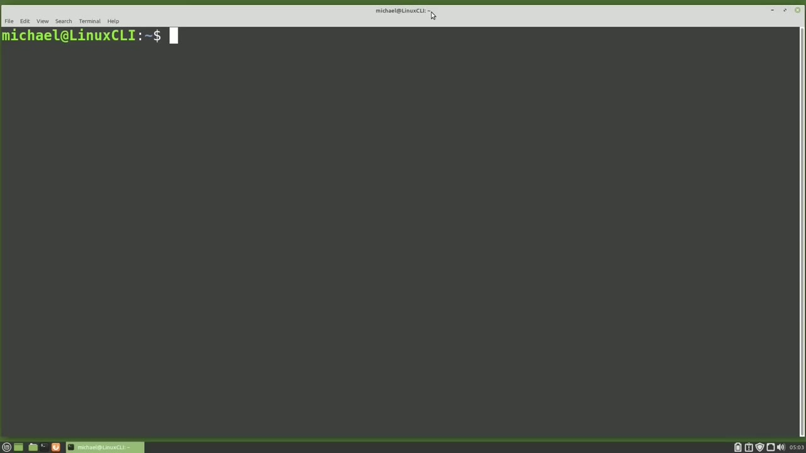
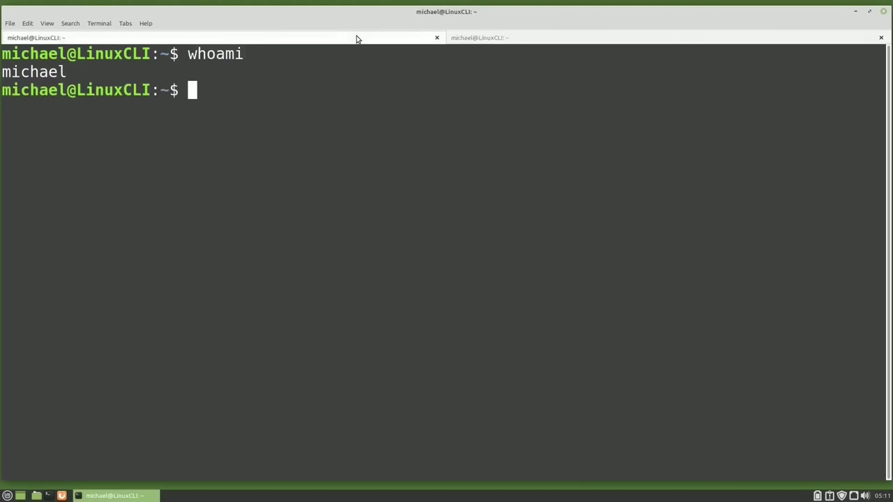
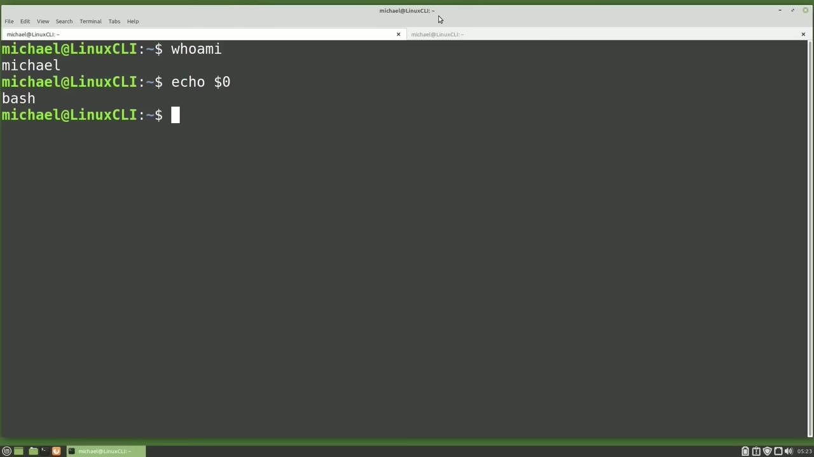
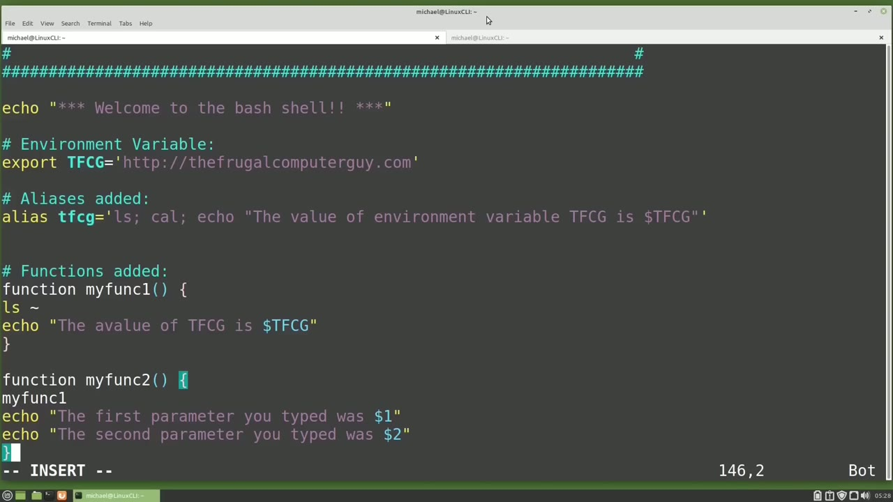

[← Course contents](../../01.md)

# 73. Login Shell, Non-Login Shell

**Course:** [Linux Command Line - Entire Tutorial Series](https://www.youtube.com/watch?v=avg65oY7sj4)  
**Transcript:** [`Linux Command Line - Entire Tutorial Series transcript`](../../../../course_videos/Linux%20Command%20Line%20-%20Entire%20Tutorial%20Series/Linux%20Command%20Line%20-%20Entire%20Tutorial%20Series.txt)  
**Video:** 12:26:04–12:37:12 ([open at this time](https://www.youtube.com/watch?v=avg65oY7sj4&t=44764s))

## Introduction

There are two main shell environments that you should be aware of. The interactive login shell and the interactive non-login shell. The first one we're going to look at is the interactive non-login shell. And to open an interactive non-login shell, I'm going to click to open the Linux Mata terminal that we've been using throughout this tutorial series.

## Detailed Explanation

<details>
  <summary>Step 1 — Run `who`, `ssh`, `echo`</summary>

### Step 1 — Run `who`, `ssh`, `echo`

- [x] **There are two main shell environments that you should be aware of**
  - There are two main shell environments that you should be aware of.
  - The interactive login shell and the interactive non-login shell.
  - The first one we're going to look at is the interactive non-login shell.

- [x] **Use `who`**
  - And to open an interactive non-login shell, I'm going to click to open the Linux Mata terminal that we've been using throughout this tutorial series.
  - This is a non-login shell because Linux already knows `who` we are.
  - From when we logged into the Linux desktop, when I type, `who` am I?

- [x] **Linux knows that I'm already logged in as Michael**
  - Linux knows that I'm already logged in as Michael.
  - An interactive login shell, on the other hand, is a shell that requires us to type in our username and password before we can start typing commands.
  - So we need to log in to the shell before we can start using it.

- [x] **One example of an interactive login shell is when we have a keyboard**
  - One example of an interactive login shell is when we have a keyboard and a screen connected to a server with no desktop.
  - When that computer powers up that server with no desktop, it shows a screen that looks like this.
  - Then I type in my username and press Enter, and the shell will prompt me for a password.

- [x] **Use `ssh`**
  - Once I type in that password, we're logged in to the interactive login shell.
  - We can also see an interactive login shell by SSHing into a server.
  - I'm going to open a new tab and I'm going to type `ssh` Michael at 127.0.0.1.

- [x] **To ssh into this computer. And to make this work, I did have to**
  - To `ssh` into this computer. And to make this work, I did have to install OpenSSH on this computer.
  - The IP 127.0.0.1 is this computer. So I'm SSHing into this computer that I'm already logged into as Michael. When I press Enter, Linux asks me for my password. I'll type that in.
  - And it logs us in, and once we're logged in, it looks just like the Linux non-login shell.

- [x] **We have the same prompt, and it looks the same**
  - We have the same prompt, and it looks the same.
  - So how do I tell if I'm in an interactive login shell or an interactive non-login shell?
  - One way to tell which type of shell you're logged into is by echoing out the number zero environment variable.

- [x] **Use `echo`**
  - We learned about environment variables in the last video.
  - To `echo` out the number zero environment variable, we would type `echo` dollar sign zero.
  - And here we see -bash. So when we see -bash, we are in the interactive login shell.

```bash
who
ssh
echo
```



</details>

<details>
  <summary>Step 2 — Run `echo`, `bash`, `more`</summary>

### Step 2 — Run `echo`, `bash`, `more`

- [x] **Use `echo`, `bash`**
  - Going to the other tab and typing `echo` dollar sign zero, we see `bash` without that dash.
  - When we don't see the dash, we are in an Interactive non-login shell.
  - So why do we care if we're in an interactive login shell or an interactive non-login shell if the terminals look and act the same?

- [x] **And often they will be the same, but sometimes there will be a**
  - And often they will be the same, but sometimes there will be a difference.
  - When we log into an interactive login shell, it's going to start running the file slash /etc slash profile.
  - I'm going to less into that /etc profile with less /etc profile. Note the top line. It's telling us this is run when we are using the Born shell, which is that bashed shell that we've been using throughout this series.

- [x] **If you're using something like the Z shell or something other than**
  - If you're using something like the Z shell or something other than the Born shell, this will probably not apply to you.
  - This first block of code is looking at the ps1 environment variable.
  - We're going to talk about customizing the command prompt in an upcoming video.

- [x] **The other thing that this file is doing is to source every file in**
  - The other thing that this file is doing is to source every file in the /etc Profile.D directory.
  - And then after that, it's going to source the dot profile file from our home directory.
  - I'm going to less into the dot profile file.

- [x] **Use `more`, `bash`**
  - If we were using `more` of a red hat distribution, we might see this profile called dot `bash` underscore profile. But for me, it is called dot profile.
  - Now notice the first two lines of this file say this file is executed for login shells and that this file will not be read if there is a dot `bash` underscore profile or dot `bash` underscore login file found in this directory.
  - This file is doing three things. The first one is it is checking for a home.

- [x] **bashRC file. If there is one, that file will be sourced. We will talk**
  - .bashRC file. If there is one, that file will be sourced. We will talk about sourcing the dot bashRC file in the next video.
  - The second thing it's doing is it's checking for a home /bin directory.
  - If there is one, it will append that directory to our path.

- [x] **We'll talk about the path in the next video as well**
  - We'll talk about the path in the next video as well.
  - And then the third thing it's doing is it's checking for a home slash dot local /bin file.
  - If there is one, that will be appended to the path as well.

- [x] **I'm going to quit out of the less, but I'm going to edit this file**
  - I'm going to quit out of the less, but I'm going to edit this file.
  - I'm going to add the line, `echo`, and then it's going to print out the message home slash dot profile is sourced.
  - So when this file is sourced, that line will show on our screen.

- [x] **Going to save this and going over to the non-login shell tab**
  - Going to save this and going over to the non-login shell tab.

```bash
echo
bash
more
```



</details>

<details>
  <summary>Step 3 — Run `bash`</summary>

### Step 3 — Run `bash`

- [x] **Use `bash`**
  - When an interactive non-login shell is started, it only reads one file, the dot `bash` rc file.
  - So we're loading the `bash` Resource file when we open an interactive non-login shell.
  - Let's look at the BashRc file with less.

- [x] **And you may or may not have a dot BashRc file**
  - And you may or may not have a dot BashRc file.
  - The Linux Mint team did create one for us here and put in some default information.
  - We'll notice here at the very top, the first line shows that This is for non-login shells.

- [x] **So the point here is that non-login shells source the dot-bash-rc**
  - So the point here is that non-login shells source the dot-bash-rc file only, and then the login shells source the dot profile file only.
  - Now on this computer, the dot profile file does source the dot bashrc file, but on other Linux, Unix distributions, that may not be the case.
  - They may only source the dot profile file.

- [x] **I'm going to quit out of this less and I'm going to edit this file**
  - I'm going to quit out of this less and I'm going to edit this file, Vim.
  - I'm going down to the bottom of this file where I'm going to paste in some code here, which is the custom environment variables, aliases, and functions that we created in the last video.
  - Notice here I added a line, Welcome to the Bass shell that will echo out every time this file is sourced.

```bash
bash
```



</details>

<details>
  <summary>Step 4 — Run `bash`</summary>

### Step 4 — Run `bash`

- [x] **Use `bash`**
  - Often people like to have a custom message they see every time they log into a `bash` shell.
  - Some people have elaborate, asky text pictures, and then some people add the date.
  - If you want to add a date, we talked about dates and date formatting in Video 30.

- [x] **Another thing to notice here is I added Export before my environment**
  - Another thing to notice here is I added Export before my environment variable.
  - Let's go over to the other tab and look at why I would want to do that.
  - I'm going to type envar 1 equals lowercase envar 1 and then I'm going to create another environment variable and I'm going to export this one.

- [x] **Use `bash`**
  - Export envar 2 equals lowercase envar 2.
  - Now when I view these with echo dollar sign, envar 1. We see the value and echo dollar sign envar 2. That value is also available.
  - But if I open a new `bash` sub shell by typing `bash` and it looks like I did not save my file here yet.

- [x] **Use `bash`**
  - Let's save this. Right quit. Going back over. I want to exit out of that sub shell.
  - And let's try going back in `bash`.
  - Now we see the welcome to the `bash` shell.

- [x] **Use `bash`**
  - So we are sourcing our `bash` rc file.
  - But we're actually looking at the envar 1 and 2 right now because we created them.
  - And now I'm going to echo dollar sign in var 1.

- [x] **Use `bash`**
  - So using that export allows those environment variables to be passed on to a `bash` sub shell.
  - Now we have that in our `bash` Rc file, which is not really needed because that was sourced.
  - As we see there with the welcome message, but if we're putting environment variables into the dot profile file, that is when we're really going to want to use that export so that those environment variables get carried into the sub shells.

- [x] **Use `bash`**
  - I'm going to exit out of our sub shell and then I'm going to exit out of our SSH that we logged into and clear the screen.
  - And here we see it sources the home Michael profile.
  - As well as sources are `bash` shell.

- [x] **Use `bash`**
  - And if I open a non-login shell, we only see the Welcome to the `bash` shell.
  - So now we know the difference between an interactive login shell and an interactive non-login shell.
  - In the next video, we will continue looking at the Linux command line.

```bash
bash
```



</details>

<details>
  <summary>Questions and Answers</summary>

## Questions and Answers

### Question 1: What does `who` do in this chapter?

<details>
<summary>Answer</summary>

- [x] From when we logged into the Linux desktop, when I type, `who` am I?

</details>

### Question 2: What does `ssh` do in this chapter?

<details>
<summary>Answer</summary>

- [x] I'm going to open a new tab and I'm going to type `ssh` Michael at 127.0.0.1.

</details>

### Question 3: What does `echo` do in this chapter?

<details>
<summary>Answer</summary>

- [x] To `echo` out the number zero environment variable, we would type `echo` dollar sign zero.

</details>

### Question 4: What does `bash` do in this chapter?

<details>
<summary>Answer</summary>

- [x] Going to the other tab and typing echo dollar sign zero, we see `bash` without that dash.

</details>

### Question 5: What does `more` do in this chapter?

<details>
<summary>Answer</summary>

- [x] If we were using `more` of a red hat distribution, we might see this profile called dot bash underscore profile. But for me, it is called dot profile.

</details>

### Question 6: What does step 1 cover (Run who, ssh, echo)?

<details>
<summary>Answer</summary>

- [x] There are two main shell environments that you should be aware of.
- [x] The interactive login shell and the interactive non-login shell.
- [x] The first one we're going to look at is the interactive non-login shell.

</details>

### Question 7: What does step 2 cover (Run echo, bash, more)?

<details>
<summary>Answer</summary>

- [x] Going to the other tab and typing `echo` dollar sign zero, we see `bash` without that dash.
- [x] When we don't see the dash, we are in an Interactive non-login shell.
- [x] So why do we care if we're in an interactive login shell or an interactive non-login shell if the terminals look and act the same?

</details>

### Question 8: What does step 3 cover (Run bash)?

<details>
<summary>Answer</summary>

- [x] When an interactive non-login shell is started, it only reads one file, the dot `bash` rc file.
- [x] So we're loading the `bash` Resource file when we open an interactive non-login shell.
- [x] Let's look at the BashRc file with less.

</details>

### Question 9: What does step 4 cover (Run bash)?

<details>
<summary>Answer</summary>

- [x] Often people like to have a custom message they see every time they log into a `bash` shell.
- [x] Some people have elaborate, asky text pictures, and then some people add the date.
- [x] If you want to add a date, we talked about dates and date formatting in Video 30.

</details>

</details>

## Summary

This chapter, Login Shell, Non-Login Shell, walks through Run who, ssh, echo; Run echo, bash, more; Run bash; Run bash. Commands from the transcript: `who`, `ssh`, `echo`, `bash`, `more`.

## References

- [Linux Command Line - Entire Tutorial Series (YouTube)](https://www.youtube.com/watch?v=avg65oY7sj4)
- [This chapter at 12:26:04](https://www.youtube.com/watch?v=avg65oY7sj4&t=44764s)
- [Local transcript](../../../../course_videos/Linux%20Command%20Line%20-%20Entire%20Tutorial%20Series/Linux%20Command%20Line%20-%20Entire%20Tutorial%20Series.txt)
