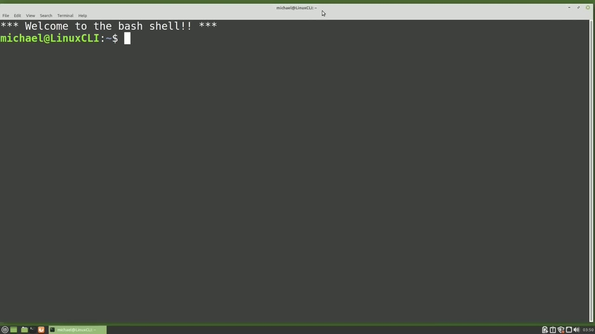
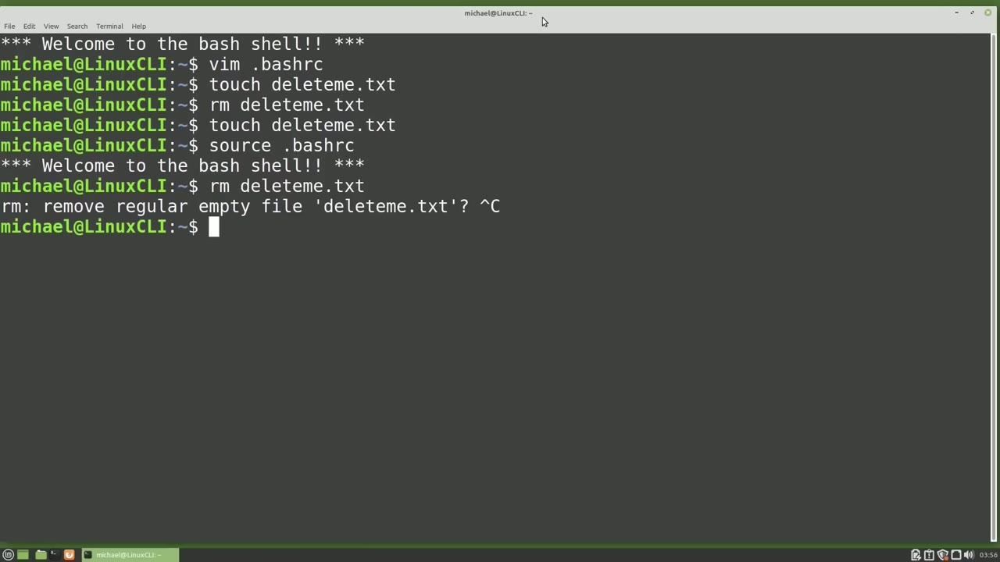
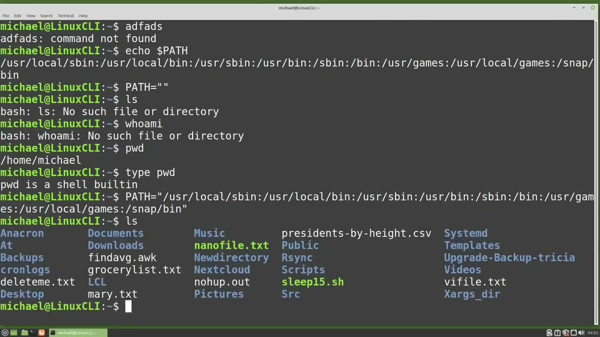
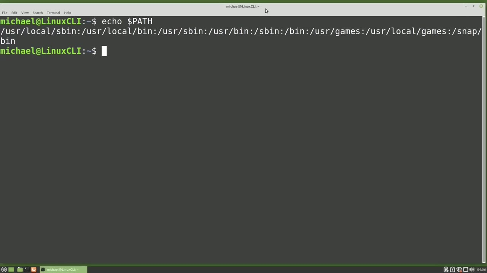

[← Course contents](../../01.md)

# 74. .source / PATH

**Course:** [Linux Command Line - Entire Tutorial Series](https://www.youtube.com/watch?v=avg65oY7sj4)  
**Transcript:** [`Linux Command Line - Entire Tutorial Series transcript`](../../../../course_videos/Linux%20Command%20Line%20-%20Entire%20Tutorial%20Series/Linux%20Command%20Line%20-%20Entire%20Tutorial%20Series.txt)  
**Video:** 12:37:12–12:47:45 ([open at this time](https://www.youtube.com/watch?v=avg65oY7sj4&t=45432s))

## Introduction

In the last video, we updated our Bash rc file and we said that rc stands for resources. So we updated our Bash Resource file. I'm going to Vim into the dot-BashRC file now. And where we added our aliases, we missed the alias we created to prompt us for a confirmation before deleting a file.

## Detailed Explanation

<details>
  <summary>Step 1 — Run `bash`, `rm -I`, `touch delete`</summary>

### Step 1 — Run `bash`, `rm -I`, `touch delete`

- [x] **Use `bash`**
  - In the last video, we updated our `bash` rc file and we said that rc stands for resources.
  - So we updated our `bash` Resource file.
  - I'm going to Vim into the dot-BashRC file now.

- [x] **Use `rm -I`, `touch delete`**
  - And where we added our aliases, we missed the alias we created to prompt us for a confirmation before deleting a file.
  - Alias rm equals, quote, `rm -I`, end quote.
  - To try this out, I will create a file to delete with `touch delete` me.tXT.

- [x] **Use `rm delete`**
  - And now I'll type rm, delete me.tXT.
  - And it deleted the file without prompt to me for confirmation.
  - I'll add that back by arrowing up twice and pressing enter.

- [x] **Use `bash`, `tmux`**
  - That's because `bash` didn't know we made any changes to the `bash` rc file.
  - The problem here is just like the problem we had with the `tmux` configuration file, a few videos back.
  - Every time we made a change to that `tmux` config file, we had to reload the `tmux` config file.

- [x] **Use `bash`**
  - For `bash` to know we changed our BashRC file, we need to either close and reopen our terminal, or we need to source our BashRC file. To source our BashRC file, I will type Source.bashrc. If I was not in the Home Directory, I would want to add the tilda forward slash to source the BashRC in the Home Directory. But since I'm already in
  - The Home Directory, I just need to type Source.BashRC. Pressing Enter.
  - And we see the Welcome to the `bash` shell.

- [x] **Use `bash`**
  - This is the text that we echo out when we open a new terminal.
  - We see it shows when we source the `bash` rc file.
  - And when we open a new terminal, the BashRC file is sourced.

- [x] **And that is why we see it when we open a new terminal**
  - And that is why we see it when we open a new terminal.
  - And now I'll show the new code we added to our BashRc file is recognized by typing in rm, delete me.
  - And now it prompts me for that confirmation.

```bash
bash
rm -I
touch delete
rm delete
tmux
```



</details>

<details>
  <summary>Step 2 — Run `bash`, `ls`, `who`</summary>

### Step 2 — Run `bash`, `ls`, `who`

- [x] **Use `bash`**
  - We also have a shortcut for the source, BashRC file.
  - So if I `type` period or dot space dot `bash` rc pressing enter shows us the welcome to the `bash` shell so that also sources our `bash` rc file so if you make changes to your `bash` rc file most likely you'll want to source that `bash` rc file with dot `bash` rc or source dot bashrc after making those changes
  - So if I `type` in some random characters like adf ads, when I press Enter, we get the message command not found.

- [x] **Linux thinks I wanted to run a command named adf ads, which does not**
  - Linux thinks I wanted to run a command named adf ads, which does not exist.
  - But where did Linux look for the command?
  - And that is where the path environment variable comes in.

- [x] **Often when people start talking about the path environment variable**
  - Often when people start talking about the path environment variable, they give you the warning that you could really screw things up if you don't do it correctly.
  - Let's echo out the path environment variable with echo dollar sign, path.
  - And now I'm going to set that path to nothing with path equals empty quotes.

- [x] **Use `ls`, `who`**
  - Now if I `type` the `ls` command, it doesn't work.
  - If I `type` `who` Am I? That doesn't work.
  - So now we see what people were talking about when they said things could really go wrong if you set up your path incorrectly.

- [x] **Use `pwd`, `type`**
  - I'm going to `type` `pwd` and that command does work.
  - When I `type` `type` `pwd`, we see that `pwd` is a shell built in.
  - But for commands not built into the shell, we need that path variable.

- [x] **So let's set this path variable back by selecting what we echoed out**
  - So let's set this path variable back by selecting what we echoed out earlier and setting our path variable equal to this with path equals, double quote, paste, double quote, and enter.

```bash
bash
ls
who
pwd
type
```



</details>

<details>
  <summary>Step 3 — Run `ls`, `bash`, `echo`</summary>

### Step 3 — Run `ls`, `bash`, `echo`

- [x] **Use `ls`**
  - Now when I type `ls`, my command works.
  - And yes, I could have just closed and reopened this terminal to reset the path.
  - Because my changes are only made in this terminal.

- [x] **Use `bash`**
  - So if the path is not set correctly, it could affect a lot of commands, and if you make changes to your path in your `bash` rc file and you make a mistake, it can be a little tricky to get that fixed depending on what changes were made.
  - So if you are making changes to the path variable, you may want to try those changes in a terminal first that you can close and reopen and reset before adding them to your BashRC file.
  - But I'm getting ahead of myself. We haven't seen how to make changes to our path.

- [x] **Use `echo`**
  - Let's look at the path command. I'm going to clear the screen and type `echo` dollar sign path again showing us what is in the path environment variable. If you're not familiar with the path environment variable, it can look a little confusing. But taking a closer look at this, we see that it is a series of paths separated by colons.
  - The first path is User Local Bin and the second one is User Local S Bin.
  - I'm going to reformat this list of paths and take out the colon's so we can see it better.

- [x] **Use `bash`**
  - Now we can see the list of paths in order from top to bottom.
  - When we type in a command, `bash` will first look in the User Local Bin directory.
  - If the command is not found in User Local Bin, `bash` will then look in the User Local S-bin directory and keep checking each path going down in order until it finds the command.

- [x] **When it gets down to the Snap Bin, if it's not found in Snapbin, then**
  - When it gets down to the Snap Bin, if it's not found in Snapbin, then we get the message command not found.
  - In Video 44, we created the Auk script rectangle.auch, and I have copied that into the directory.

```bash
ls
bash
echo
```



</details>

<details>
  <summary>Step 4 — Run `ls -lh`, `awk`, `bash`</summary>

### Step 4 — Run `ls -lh`, `awk`, `bash`

- [x] **Use `ls -lh`, `awk`, `bash`**
  - Home slash michael slash scripts and i'll show that now with `ls -lh` scripts and here we see the rectangle dot ock and a file called `cp` when i `type` rectangle dot ock we get the message rectangle dot ock command not found and that's because rectangle dot ock is not found in any of those paths
  - In the path variable. To make this work, I want to add home slash Michael slash scripts to our path environment variable. To do that, I will `type` path equals quote dollar sign path colon /home slash Michael slash scripts. Pressing enter. Now when I `type` rectangle that `awk`
  - `bash` runs our script and asks me for the height of the rectangle.

- [x] **Inside that scripts directory, we also have a file called cp**
  - Inside that scripts directory, we also have a file called `cp`.
  - And we see the script will echo out the line.
  - This is run from Home Michael Scripts `cp`.

- [x] **Use `cp`, `type`**
  - When I `type` `cp` into the command line, we get the message `cp`.
  - Missing FileOperand because this is trying to run the copy command and not my version of the `cp` command.
  - Typing `type` `cp`, we see that the command is run from the /bin directory.

- [x] **Looking at our list of files, we see that the /bin file comes before**
  - Looking at our list of files, we see that the /bin file comes before the /home slash Michael slash scripts directory, which is at the bottom of the list.
  - To run my command, I want to put Home Michael scripts at the top of this list.
  - And I will do that by typing Path equals, quote, /home slash Michael slash scripts, colon, dollar sign, path, end quote.

- [x] **When I echo the path out now, we see that we have Home Michael**
  - When I echo the path out now, we see that we have Home Michael scripts at the beginning.
  - As well as at the end of our path. Now this is really not the cleanest code, but it won't be a problem.
  - There's just a chance that the same directory might be searched two times.

- [x] **Use `cp`**
  - And this is all in a terminal anyway. So once I close this terminal, the path will go away.
  - And opening a new terminal will restore the original path.
  - So now that Home Michael Scripps is at the top of the path, when I `type` `cp`, We now see this is from Home Michael's Scripts `cp`.

- [x] **Use `bash`**
  - So now `bash` finds my `cp` script first and we'll run that instead of the copy command.
  - And the point of all this is that the order of the directories in the Path environment variable does matter.
  - In the next tutorial, we will continue looking at the Linux command line.

- [x] **When I hit the up arrow and the down arrow,**
  - When I hit the up arrow and the down arrow,

```bash
ls -lh
awk
bash
cp
type
```



</details>

<details>
  <summary>Questions and Answers</summary>

## Questions and Answers

### Question 1: What does `bash` do in this chapter?

<details>
<summary>Answer</summary>

- [x] In the last video, we updated our `bash` rc file and we said that rc stands for resources.

</details>

### Question 2: What does `rm -I` do in this chapter?

<details>
<summary>Answer</summary>

- [x] Alias rm equals, quote, `rm -I`, end quote.

</details>

### Question 3: What does `touch delete` do in this chapter?

<details>
<summary>Answer</summary>

- [x] To try this out, I will create a file to delete with `touch delete` me.tXT.

</details>

### Question 4: What does `rm delete` do in this chapter?

<details>
<summary>Answer</summary>

- [x] And now I'll type rm, delete me.tXT.

</details>

### Question 5: What does `tmux` do in this chapter?

<details>
<summary>Answer</summary>

- [x] The problem here is just like the problem we had with the `tmux` configuration file, a few videos back.

</details>

### Question 6: What does `ls` do in this chapter?

<details>
<summary>Answer</summary>

- [x] Now if I type the `ls` command, it doesn't work.

</details>

### Question 7: What does `who` do in this chapter?

<details>
<summary>Answer</summary>

- [x] If I type `who` Am I? That doesn't work.

</details>

### Question 8: What does `pwd` do in this chapter?

<details>
<summary>Answer</summary>

- [x] I'm going to type `pwd` and that command does work.

</details>

### Question 9: What does `type` do in this chapter?

<details>
<summary>Answer</summary>

- [x] When I `type` `type` pwd, we see that pwd is a shell built in.

</details>

### Question 10: What does `echo` do in this chapter?

<details>
<summary>Answer</summary>

- [x] Let's look at the path command. I'm going to clear the screen and type `echo` dollar sign path again showing us what is in the path environment variable. If you're not familiar with the path environment variable, it can look a little confusing. But taking a closer look at this, we see that it is a series of paths separated by colons.

</details>

### Question 11: What does `ls -lh` do in this chapter?

<details>
<summary>Answer</summary>

- [x] Home slash michael slash scripts and i'll show that now with `ls -lh` scripts and here we see the rectangle dot ock and a file called cp when i type rectangle dot ock we get the message rectangle dot ock command not found and that's because rectangle dot ock is not found in any of those paths

</details>

### Question 12: What does `awk` do in this chapter?

<details>
<summary>Answer</summary>

- [x] In the path variable. To make this work, I want to add home slash Michael slash scripts to our path environment variable. To do that, I will type path equals quote dollar sign path colon /home slash Michael slash scripts. Pressing enter. Now when I type rectangle that `awk`

</details>

</details>

## Summary

This chapter, .source / PATH, walks through Run bash, rm -I, touch delete; Run bash, ls, who; Run ls, bash, echo; Run ls -lh, awk, bash. Commands from the transcript: `bash`, `rm -I`, `touch delete`, `rm delete`, `tmux`, `ls`, `who`, `pwd`, `type`, `echo`, `ls -lh`, `awk`, `cp`.

## References

- [Linux Command Line - Entire Tutorial Series (YouTube)](https://www.youtube.com/watch?v=avg65oY7sj4)
- [This chapter at 12:37:12](https://www.youtube.com/watch?v=avg65oY7sj4&t=45432s)
- [Local transcript](../../../../course_videos/Linux%20Command%20Line%20-%20Entire%20Tutorial%20Series/Linux%20Command%20Line%20-%20Entire%20Tutorial%20Series.txt)
