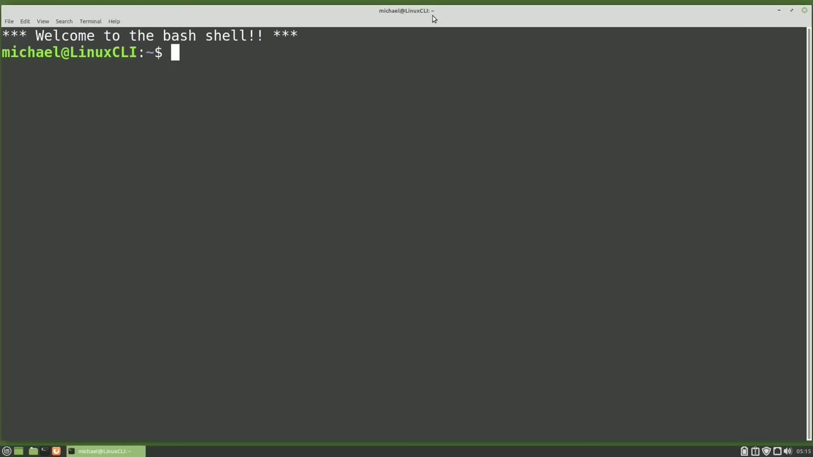
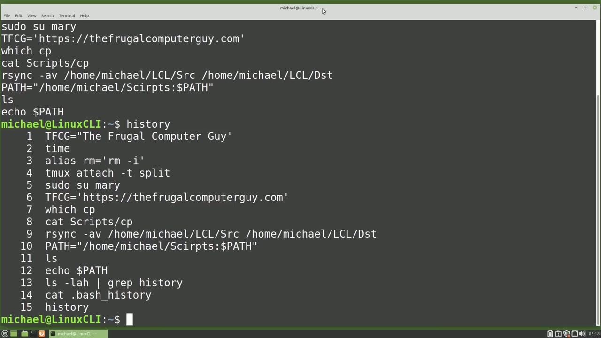
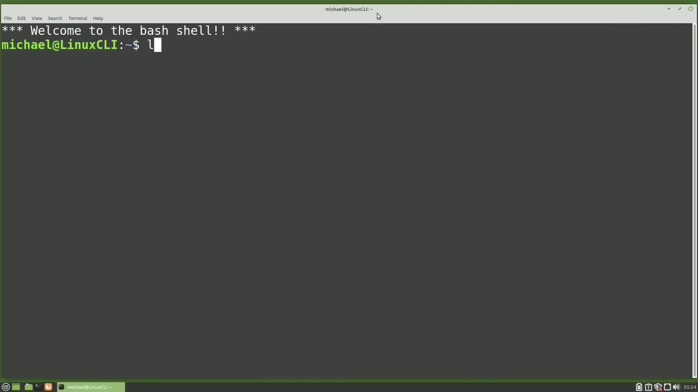
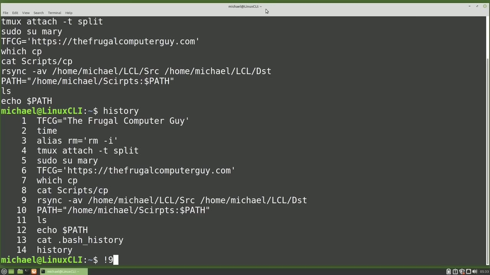
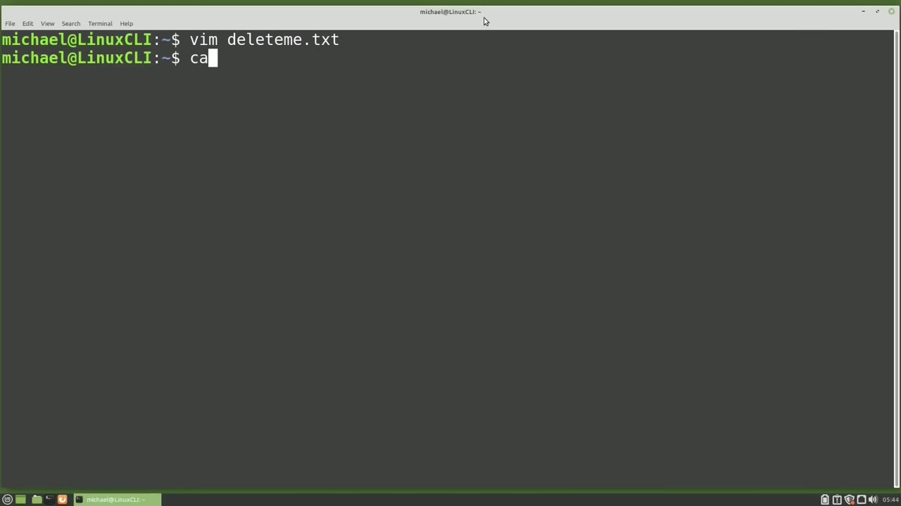

[← Course contents](../../01.md)

# 75. history pt1

**Course:** [Linux Command Line - Entire Tutorial Series](https://www.youtube.com/watch?v=avg65oY7sj4)  
**Transcript:** [`Linux Command Line - Entire Tutorial Series transcript`](../../../../course_videos/Linux%20Command%20Line%20-%20Entire%20Tutorial%20Series/Linux%20Command%20Line%20-%20Entire%20Tutorial%20Series.txt)  
**Video:** 12:47:45–12:59:46 ([open at this time](https://www.youtube.com/watch?v=avg65oY7sj4&t=46065s))

## Introduction

We see that Bash remembers the last commands I typed in, even if the computer has been turned off and back on. So Bash must be storing this Bash History in a file somewhere and it is. To see that file I will type ls -lah pipe grepH history. And we see the History file is a hidden file called.bash History.

## Detailed Explanation

<details>
  <summary>Step 1 — Run `bash`, `bash history`, `ls -lah`</summary>

### Step 1 — Run `bash`, `bash history`, `ls -lah`

- [x] **Use `bash`, `bash history`, `ls -lah`**
  - We see that `bash` remembers the last commands I typed in, even if the computer has been turned off and back on.
  - So `bash` must be storing this `bash history` in a file somewhere and it is.
  - To see that file I will type `ls -lah` pipe grepH `history`.

- [x] **Use `bash history`**
  - And we see the `history` file is a hidden file called.`bash history`.
  - To see what is in that file, I will type Cat.`bash history`.
  - I don't have a lot in my `bash history` file at the moment because I've recently cleared it out.

- [x] **Use `bash history`, `ls -lh`, `grep history`**
  - But looking at the last commands in the Dot `bash history` file, we don't see the `ls -lh` pipe `grep history` or the Cat.`bash history` commands we just typed.
  - To see those, I will need to type `history`.
  - Now I see all the commands in the dot `bash history` file and the commands I just typed when I started this terminal session.

- [x] **Use `bash history`**
  - The reason the dot `bash history` file does not show the commands we just typed is because the terminal session `history` is held in memory.
  - Then when the terminal session ends, that `history` is then written to the dot `bash history` file.

```bash
bash
bash history
ls -lah
ls -lh
grep history
history
```



</details>

<details>
  <summary>Step 2 — Run `cat`, `ls -lah`, `bash`</summary>

### Step 2 — Run `cat`, `ls -lah`, `bash`

- [x] **Use `cat`, `ls -lah`**
  - I can show this by typing `cat`.
  - And again, we see that the `ls -lah` pipegrap history is not in the dot-`bash history` file.
  - I'll close this terminal and open a new one and type `cat`.

- [x] **Use `ls -lah`, `bash`, `bash history`**
  - And now we see the `ls -lah` pipegrap history as well as the `cat`.
  - Dot `bash` underscore history.
  - There are times when a command requires a password, or maybe we're typing some commands and we don't want those written to our `bash history` file for some reason.

- [x] **Use `echo`, `history -C`**
  - I will type `echo` password equals.
  - Secret password. I don't want this command to be written to my terminal history.
  - One way to do that is to clear out the current terminal history with `history -C` and the C is for clear out the history in memory.

- [x] **Use `bash history`, `cat`**
  - Now when I type history, it only shows the one command.
  - It does not show us what is in the dot-`bash history` file anymore, but Catting out the dot `bash history` file shows all the commands are still there.
  - And closing the terminal and opening a new one and typing `cat`.

- [x] **Use `bash history`, `history -C`**
  - Dot `bash history` shows everything up to and including the `history -C` command was not saved.
  - But the two commands I typed after `history -C`, the history and the `cat` dot `bash history` did get written to the dot `bash history` file.
  - So if we want to wipe out our entire `bash history`, we would want to first remove the dot `bash history` file with rm.

- [x] **Use `history -C`**
  - Then we would also want to remove what is in our current terminal history with `history -C`.
  - Then close the terminal, open a new one.

```bash
cat
ls -lah
bash
bash history
echo
history -C
```



</details>

<details>
  <summary>Step 3 — Run `ls -lah`, `history -W`, `bash history`</summary>

### Step 3 — Run `ls -lah`, `history -W`, `bash history`

- [x] **Use `ls -lah`, `history -W`**
  - And typing `ls -lah` pipe grip history shows our dot-`bash history` file is gone.
  - It will be recreated when I exit this terminal and our terminal history is written to the dot-`bash history` file.
  - Or I can write what is in the current terminal history at the moment to the dot-`bash history` file with `history -W`.

- [x] **Use `ls -lah`, `bash history`, `grep history`**
  - `ls -lah` grab history shows our dot `bash history` file now exists and cadding out the `bash history` file shows the two commands the `ls -lah` `grep history` and the `history -W` command commands I type from here forward will again be in memory until I either write them to the dot `bash history` file clear them out of the memory
  - Or exit out of the terminal, which will write them to the dot `bash history` file.
  - I'm going to pause the recording of this video for a moment to reset the `bash history` file, so we have something to work with.

- [x] **Use `bash history`**
  - And typing cat.`bash history` shows I've reset the commands in the dot `bash history` file.
  - And to update this file, I did use the GUI File Manager.
  - That's why we don't see any commands in the `bash history` for this file update.

- [x] **Use `bash history`**
  - Most of the time when we're looking at the `bash history`, we are going to want to use the History Command in not the Dot `bash history` file.
  - Typing History shows a complete history of what is in the Dot `bash history` file as well as what is in the current terminal history stored in memory.
  - Looking at this output from the History Command, we'll notice a number to the left of the commands.

- [x] **Use `bash history`**
  - And we will see here that our oldest command is number 1 and our most recent is number 14.
  - Yours may show in the thousands, but the default is usually around 1,000, depending on what version of Linux you are using.
  - So if your last line is 3,000, your `bash history` may only hold the commands 2,000 through 3,000.

- [x] **We'll talk more about how many lines of history commands are stored**
  - We'll talk more about how many lines of history commands are stored in the next video.
  - We can use that number to the left of the Command History to rerun a command.
  - For example, that R-Sync command on line number 9 is really long.

- [x] **I can rerun this command by typing exclamation point or bang and then**
  - I can rerun this command by typing exclamation point or bang and then the number 9.

```bash
ls -lah
history -W
bash history
grep history
```



</details>

<details>
  <summary>Step 4 — Run `bash history`, `grep`, `grep r-sync`</summary>

### Step 4 — Run `bash history`, `grep`, `grep r-sync`

- [x] **Use `bash history`**
  - So bang 9 will run the command number 9 of the `bash history`.
  - And notice it shows us the command it's going to run before that command is run.
  - And if we arrow up, It also shows us the entire command, not the bang 9.

- [x] **This is helpful if we want to make a slight change the command before**
  - This is helpful if we want to make a slight change the command before we run it again.
  - Maybe we want to change our output to dst 2.
  - If we can't remember what exactly Bang 9 does, but we think we're correct and we want to just print out the command without running it, we can type Bang 9 colon P for print.

- [x] **Use `grep`, `grep r-sync`**
  - And here we see the command without running it.
  - Maybe that bang 9 was not the exact R-Sync command I was looking for.
  - I can also `grep` my `history` file with `history` pipe `grep r-sync`.

- [x] **Use `history`**
  - And from here I see just the R-Sync commands, and I might want to single out a single command with Bang-16-P, so it just prints out the one line.
  - And typing `history` shows the line before I typed `history` is the command that I just printed out.
  - And I can run that command now with bang -2, or I could print that out with a colon P if I wasn't sure if that's the command I want or not.

- [x] **Use `sudo`, `ls`, `sudo su`**
  - But this is, so I'll run this with bang -2.
  - And now that -2 will be -3, or it will also be the most recent command, so I can show that command with bang -1 colon p and bang -1 is the same as!! bang the command we've talked about and used many times throughout this tutorial series
  - Most of the time i use this command is when i need to rerun the same command again but adding `sudo` to the command like if i type `ls` root we get a permissions denied so i'll type `sudo`!! `su` do!! now shows us what is in the `ls` root directory i'll do the same thing `ls slash`

- [x] **Use `su`, `history`, `bash`**
  - Root it's telling us we need permissions and typing `su` do bang -one shows us what is in the root directory i'm going to type `history` now i want to rerun the last time i ran that echo command `bash` to start at that bottom of the `history` file and work its way up each line until it finds the last time I ran that echo command.
  - And if I'm not sure if this is the correct command or not, I can use that colon P.
  - And it'll show us Echo Path, which is in the `history` line number 12.

- [x] **Use `history`**
  - And now that's going to be added to the bottom of the `history` file again.
  - So if I type `history`.
  - And now we see Echo is line 27 with Echo Path as if we had run it as well as in line number 12.

- [x] **Use `vim delete`**
  - But we can still run the last one, which would now be 27 with Bang Echo.
  - I'm going to clear the screen and type `vim delete` me.txt.
  - And now I want to cat out the file I just edited.

```bash
bash history
grep
grep r-sync
history
sudo
ls
sudo su
ls slash
su
bash
vim delete
```



</details>

<details>
  <summary>Step 5 — Run `cat bang`, `which`, `history -D`</summary>

### Step 5 — Run `cat bang`, `which`, `history -D`

- [x] **Use `cat bang`**
  - I will type cat, bang, dollar sign.
  - And what that dollar sign will do is bring back the argument, in this case the file name from the previous command.
  - So when I press Enter, we see that it did cat out the delete me.T file.

- [x] **Use `which`**
  - And now I'll use that dollar sign to remove the file, so rm.
  - So it will bring in the argument or the delete me.txte from that previous command, that cat command, `which` brought it in from the command before that, `which` was the Vim delete me.txte.
  - I'm being asked to confirm to delete the delete me.txte file.

- [x] **Use `history -D`**
  - I'm going to type history again.
  - And looking through this history, We see line number 6 equals hetps colon forward slash forward slash the frugal computer guy.com.
  - To remove line 6 from the history, I will type `history -D` for delete and then 6, `which` is the line I want to delete.

- [x] **Now typing history again and going up to line number 6**
  - Now typing history again and going up to line number 6.
  - We see that the environment variable is gone.
  - What was in line number 7 is now moved up to line number 6 and everything else shifted up one position.

- [x] **This is a good breaking spot, so we're going to end this video here**
  - This is a good breaking spot, so we're going to end this video here, and in the next video we'll continue looking at the History Command for the Linux Command line.
  - We are picking up from where we left off in the last video with the History Command.

```bash
cat bang
which
history -D
```



</details>

<details>
  <summary>Questions and Answers</summary>

## Questions and Answers

### Question 1: What does `bash` do in this chapter?

<details>
<summary>Answer</summary>

- [x] We see that `bash` remembers the last commands I typed in, even if the computer has been turned off and back on.

</details>

### Question 2: What does `bash history` do in this chapter?

<details>
<summary>Answer</summary>

- [x] So Bash must be storing this `bash history` in a file somewhere and it is.

</details>

### Question 3: What does `ls -lah` do in this chapter?

<details>
<summary>Answer</summary>

- [x] To see that file I will type `ls -lah` pipe grepH history.

</details>

### Question 4: What does `ls -lh` do in this chapter?

<details>
<summary>Answer</summary>

- [x] But looking at the last commands in the Dot Bash History file, we don't see the `ls -lh` pipe grep history or the Cat.bash History commands we just typed.

</details>

### Question 5: What does `grep history` do in this chapter?

<details>
<summary>Answer</summary>

- [x] But looking at the last commands in the Dot Bash History file, we don't see the ls -lh pipe `grep history` or the Cat.bash History commands we just typed.

</details>

### Question 6: What does `history` do in this chapter?

<details>
<summary>Answer</summary>

- [x] To see those, I will need to type `history`.

</details>

### Question 7: What does `cat` do in this chapter?

<details>
<summary>Answer</summary>

- [x] I can show this by typing `cat`.

</details>

### Question 8: What does `echo` do in this chapter?

<details>
<summary>Answer</summary>

- [x] I will type `echo` password equals.

</details>

### Question 9: What does `history -C` do in this chapter?

<details>
<summary>Answer</summary>

- [x] One way to do that is to clear out the current terminal history with `history -C` and the C is for clear out the history in memory.

</details>

### Question 10: What does `history -W` do in this chapter?

<details>
<summary>Answer</summary>

- [x] Or I can write what is in the current terminal history at the moment to the dot-bash history file with `history -W`.

</details>

### Question 11: What does `grep` do in this chapter?

<details>
<summary>Answer</summary>

- [x] I can also `grep` my history file with history pipe `grep` R-sync.

</details>

### Question 12: What does `grep r-sync` do in this chapter?

<details>
<summary>Answer</summary>

- [x] I can also grep my history file with history pipe `grep r-sync`.

</details>

</details>

## Summary

This chapter, history pt1, walks through Run bash, bash history, ls -lah; Run cat, ls -lah, bash; Run ls -lah, history -W, bash history; Run bash history, grep, grep r-sync; Run cat bang, which, history -D. Commands from the transcript: `bash`, `bash history`, `ls -lah`, `ls -lh`, `grep history`, `history`, `cat`, `echo`, `history -C`, `history -W`, `grep`, `grep r-sync`, `sudo`, `ls`.

## References

- [Linux Command Line - Entire Tutorial Series (YouTube)](https://www.youtube.com/watch?v=avg65oY7sj4)
- [This chapter at 12:47:45](https://www.youtube.com/watch?v=avg65oY7sj4&t=46065s)
- [Local transcript](../../../../course_videos/Linux%20Command%20Line%20-%20Entire%20Tutorial%20Series/Linux%20Command%20Line%20-%20Entire%20Tutorial%20Series.txt)
