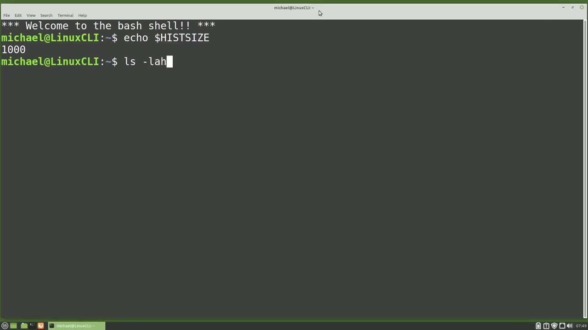
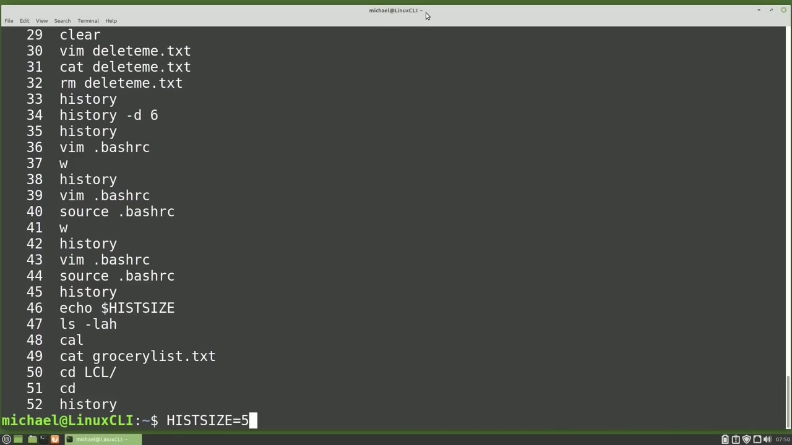
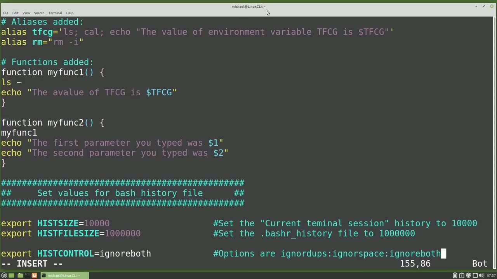
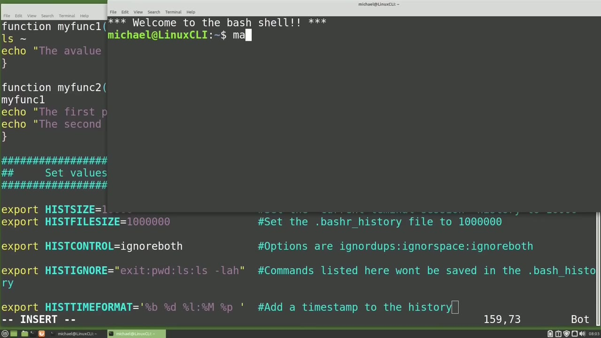

[← Course contents](../../01.md)

# 76. history pt2

**Course:** [Linux Command Line - Entire Tutorial Series](https://www.youtube.com/watch?v=avg65oY7sj4)  
**Transcript:** [`Linux Command Line - Entire Tutorial Series transcript`](../../../../course_videos/Linux%20Command%20Line%20-%20Entire%20Tutorial%20Series/Linux%20Command%20Line%20-%20Entire%20Tutorial%20Series.txt)  
**Video:** 12:59:46–13:06:50 ([open at this time](https://www.youtube.com/watch?v=avg65oY7sj4&t=46786s))

## Introduction

And I want to look at the environment variable, hist size. To see the value of hist size, I will type. And we see the hist size is set to 1,000 on my machine. Your machine may show something different. In the last video, we talked about the history of the current terminal session being held in memory.

## Detailed Explanation

<details>
  <summary>Step 1 — Run `ls -lh`, `bash history`, `history`</summary>

### Step 1 — Run `ls -lh`, `bash history`, `history`

- [x] **And I want to look at the environment variable, hist size. To see the**
  - And I want to look at the environment variable, hist size. To see the value of hist size, I will type.
  - And we see the hist size is set to 1,000 on my machine.
  - Your machine may show something different.

- [x] **In the last video, we talked about the history of the current**
  - In the last video, we talked about the `history` of the current terminal session being held in memory.
  - The Hist size environment variable is the number of lines the current terminal `history` can hold in memory.
  - I'm going to type in a few more commands.

- [x] **Use `ls -lh`, `bash history`**
  - `ls -lh`.
  - Kale, Cat, GrocerlyLST, txt, cd, lcl, and cd.
  - Now we have some commands in the terminal `history` that haven't yet been written to our dot `bash history` file.

- [x] **Use `history`**
  - Typing `history` shows us everything below the hist size command.
  - We're typed in in this terminal session.

```bash
ls -lh
bash history
history
```



</details>

<details>
  <summary>Step 2 — Run `history`, `bash history`, `bash`</summary>

### Step 2 — Run `history`, `bash history`, `bash`

- [x] **Use `history`**
  - Equals 5 to change the current terminal `history` to 5 and then type `history`.
  - Now we only see the 5 most recent commands of the current terminal `history`.
  - This shows hist size is the number of lines held in memory for the current terminal session.

- [x] **Use `bash history`**
  - The next thing I want to look at is the environment variable hist file size and I'll show that with echo dollar sign.
  - Hist file size. And for me, we see that value is 2000.
  - This is the maximum number of lines the dot `bash history` file can hold.

- [x] **Use `bash history`**
  - It will keep the most recent 2,000 commands and roll off the oldest commands.
  - I'm going to cat out the dot `bash history` file.
  - And we see it has more than one page of commands.

- [x] **Use `bash history`, `bash`**
  - Size equals 7 and now catting out the `bash history` we only see the 7 most recent commands in the `bash history` file now I'm going to edit my dot `bash` rc file and set these values to something a little more reasonable than 5 and 7 Vim dot `bash` rc because I'm in the home
  - Directory I do not need the till day backslash I'm going to Insert mode and I'm going to paste in some text here.
  - The first couple of lines are just some comments letting us know that below these lines are going to be settings for the `bash history` file.

- [x] **Use `bash history`**
  - Then I'm setting the hist size to the value of 10,000 and the hist file size to 1 million.
  - Those numbers should be big enough to keep my entire `history` and I've got a large enough disk drive that space should not be a problem.
  - If at some point I do see the `bash history` file is taking up too much disk space, I can change those settings at that time.

- [x] **I'm going to paste in some more code here**
  - I'm going to paste in some more code here.
  - For the hist control, and I'm setting the hist control to ignore both.
  - The other two options are ignore dupes and ignore space.

```bash
history
bash history
bash
```



</details>

<details>
  <summary>Step 3 — Run `ls`, `bash history`, `pwd`</summary>

### Step 3 — Run `ls`, `bash history`, `pwd`

- [x] **Use `ls`, `bash history`**
  - Ignore dupes will ignore commands typed in repeatedly, like if I type in the `ls` command.
  - Two or more times in a row, it will only save it to the `bash history` file once.
  - If I type in `ls` and then another command and then `ls` again, it will show twice.

- [x] **Use `bash history`**
  - The same command will have to be typed in two or more times in a row for that command to be ignored.
  - The ignore space will ignore the command if I start that command with a space.
  - That's there in case I need to type in a password or the like, and I don't want to have to take that extra step of deleting it out of the `bash history` file.

- [x] **Use `bash history`**
  - If I just start the command with the space, that command will be ignored and not added to the `bash history`.
  - And this one is pretty easy to understand.
  - It will ignore all the commands I listed in the double quotes, separated by colones.

- [x] **Use `pwd`, `ls`, `ls -lh`**
  - For example, it will ignore the exit command, `pwd`, `ls`, or `ls -lh`.
  - And you'll notice that I do have `ls` and `ls -lah` listed separately.
  - Otherwise, it will only ignore the `ls` commands.

- [x] **Use `ls -lh`**
  - It will not ignore `ls -lh`.
  - So that's why it's listed in there that way.
  - Other than that, it's pretty straightforward.

- [x] **It will ignore the commands listed in the quotes separated by columns**
  - It will ignore the commands listed in the quotes separated by columns.

```bash
ls
bash history
pwd
ls -lh
ls -lah
```



</details>

<details>
  <summary>Step 4 — Run `man date`, `history`, `bash history`</summary>

### Step 4 — Run `man date`, `history`, `bash history`

- [x] **The last thing I want to add into my dot-bash-rc file is a way for me**
  - The last thing I want to add into my dot-bash-rc file is a way for me to add the time and date to my `history`, meaning I want to know the date and time when I typed each command.
  - This will show us the date and time I typed the command, and we can decode that formatting I used by checking the Man page.
  - Let's open up another terminal and I'll shrink this down a little.

- [x] **Use `man date`**
  - And I'll type `man date`.
  - Going down a little bit, we see the format controls and the first one is percent sign B, which will be the abbreviated month.
  - After that, we have the percent sign lowercase D and percent sign lowercase D is day of the month.

- [x] **Then we've got the uppercase M for a minute and the lowercase P for**
  - Then we've got the uppercase M for a minute and the lowercase P for am or pm.
  - I'm quitting out of the man page and closing this window.
  - I'm going to press escape to get out of insert mode and type wq for write quit.

- [x] **Use `history`, `bash history`, `bash`**
  - And now typing `history`.
  - And we see since all of the commands were typed in this terminal session, it was able to keep the correct time and date stamps.
  - If you had a lot of `history` in your `bash history` file, those would probably be set to the current time and date because `bash` has no way of accounting for what time and date they were created.

- [x] **In the next tutorial, we will continue looking at the Linux command**
  - In the next tutorial, we will continue looking at the Linux command line.

```bash
man date
history
bash history
bash
```



</details>

<details>
  <summary>Questions and Answers</summary>

## Questions and Answers

### Question 1: What does `ls -lh` do in this chapter?

<details>
<summary>Answer</summary>

- [x] `ls -lh`.

</details>

### Question 2: What does `bash history` do in this chapter?

<details>
<summary>Answer</summary>

- [x] Now we have some commands in the terminal history that haven't yet been written to our dot `bash history` file.

</details>

### Question 3: What does `history` do in this chapter?

<details>
<summary>Answer</summary>

- [x] Typing `history` shows us everything below the hist size command.

</details>

### Question 4: What does `bash` do in this chapter?

<details>
<summary>Answer</summary>

- [x] Size equals 7 and now catting out the `bash` history we only see the 7 most recent commands in the `bash` history file now I'm going to edit my dot `bash` rc file and set these values to something a little more reasonable than 5 and 7 Vim dot `bash` rc because I'm in the home

</details>

### Question 5: What does `ls` do in this chapter?

<details>
<summary>Answer</summary>

- [x] Ignore dupes will ignore commands typed in repeatedly, like if I type in the `ls` command.

</details>

### Question 6: What does `pwd` do in this chapter?

<details>
<summary>Answer</summary>

- [x] For example, it will ignore the exit command, `pwd`, ls, or ls -lh.

</details>

### Question 7: What does `ls -lah` do in this chapter?

<details>
<summary>Answer</summary>

- [x] And you'll notice that I do have ls and `ls -lah` listed separately.

</details>

### Question 8: What does `man date` do in this chapter?

<details>
<summary>Answer</summary>

- [x] And I'll type `man date`.

</details>

</details>

## Summary

This chapter, history pt2, walks through Run ls -lh, bash history, history; Run history, bash history, bash; Run ls, bash history, pwd; Run man date, history, bash history. Commands from the transcript: `ls -lh`, `bash history`, `history`, `bash`, `ls`, `pwd`, `ls -lah`, `man date`.

## References

- [Linux Command Line - Entire Tutorial Series (YouTube)](https://www.youtube.com/watch?v=avg65oY7sj4)
- [This chapter at 12:59:46](https://www.youtube.com/watch?v=avg65oY7sj4&t=46786s)
- [Local transcript](../../../../course_videos/Linux%20Command%20Line%20-%20Entire%20Tutorial%20Series/Linux%20Command%20Line%20-%20Entire%20Tutorial%20Series.txt)
