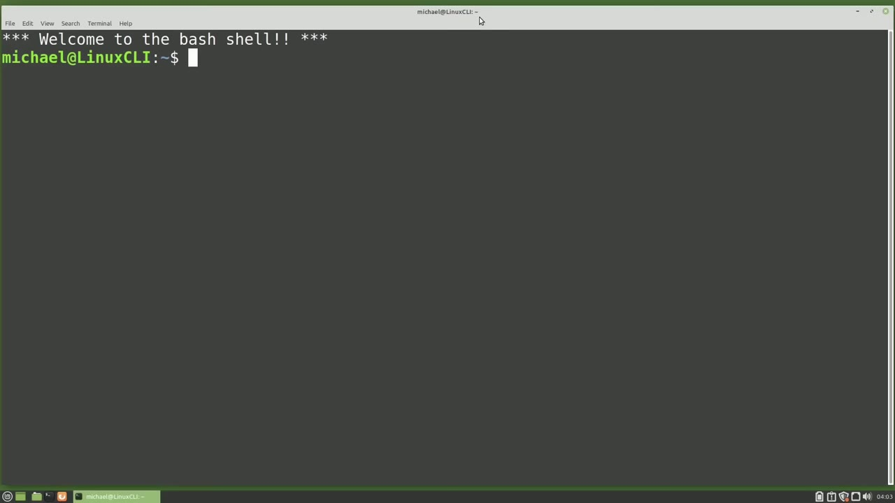
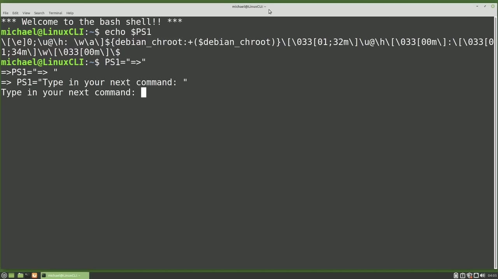
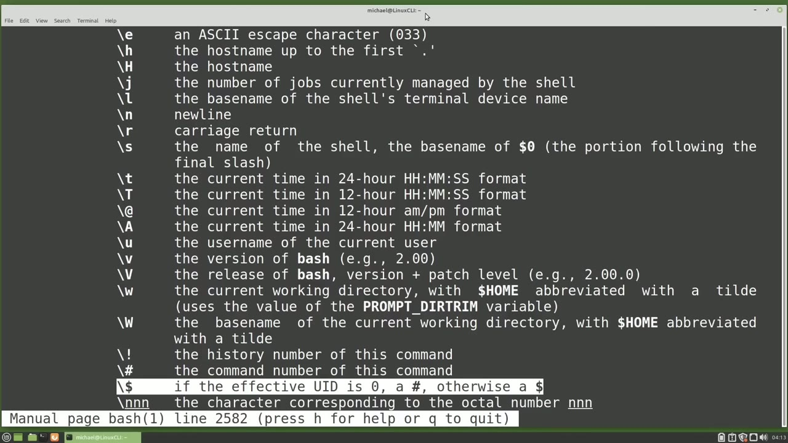
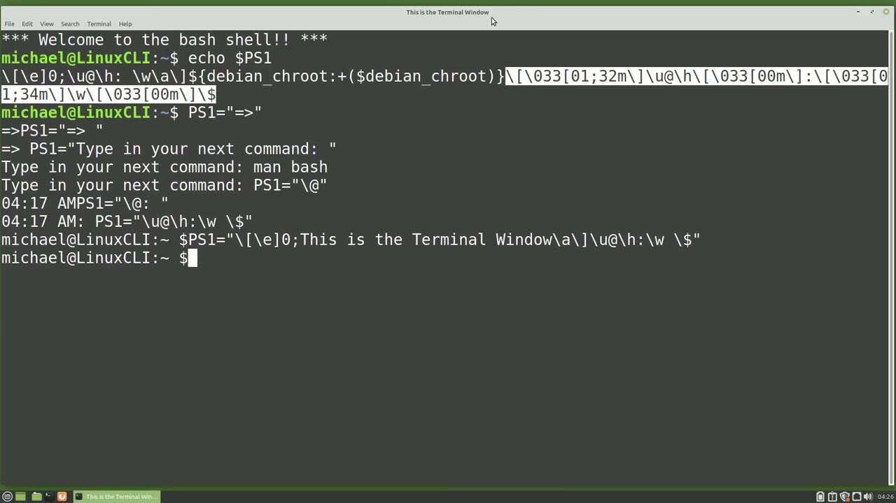
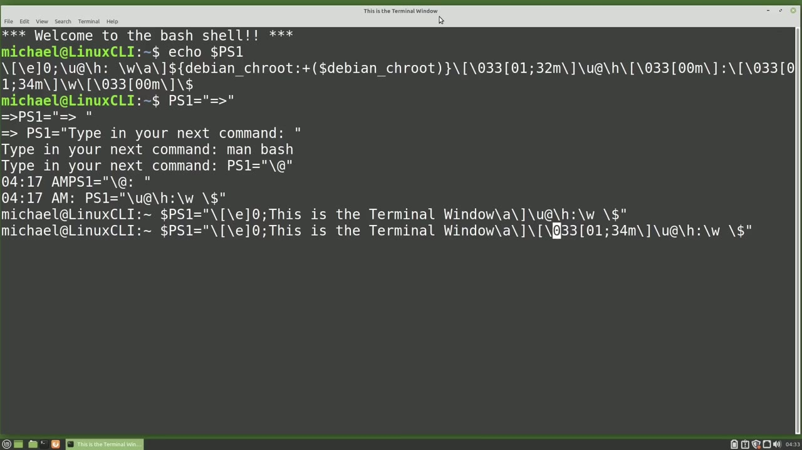

[← Course contents](../../01.md)

# 77. Custom Prompt

**Course:** [Linux Command Line - Entire Tutorial Series](https://www.youtube.com/watch?v=avg65oY7sj4)  
**Transcript:** [`Linux Command Line - Entire Tutorial Series transcript`](../../../../course_videos/Linux%20Command%20Line%20-%20Entire%20Tutorial%20Series/Linux%20Command%20Line%20-%20Entire%20Tutorial%20Series.txt)  
**Video:** 13:06:50–13:17:52 ([open at this time](https://www.youtube.com/watch?v=avg65oY7sj4&t=47210s))

## Introduction

We're going to change the command prompt. The command prompt format is stored in the environment variable ps1. We can see the value of ps1 with Echo dollar sign ps1. That looks pretty confusing, but you will understand it all by the end of this video.

## Detailed Explanation

<details>
  <summary>Step 1 — Run `bash`</summary>

### Step 1 — Run `bash`

- [x] **We're going to change the command prompt**
  - We're going to change the command prompt.
  - The command prompt format is stored in the environment variable ps1.
  - We can see the value of ps1 with Echo dollar sign ps1.

- [x] **That looks pretty confusing, but you will understand it all by the**
  - That looks pretty confusing, but you will understand it all by the end of this video.
  - The first thing I'm going to do is just change the value of ps1 to change my prompt.
  - I will make ps1 equal to Quote, equals, greater than sign, quote.

- [x] **Note there's no space between the ps1 and the equals sign**
  - Note there's no space between the ps1 and the equals sign.
  - If there is, when you press Enter, you'd get an error.
  - Also notice there's no space after the greater than sign, so the cursor is right up against that greater than sign.

- [x] **I'm going to press the arrow up and add a space after that greater**
  - I'm going to press the arrow up and add a space after that greater than sign.
  - Now we have a space between the prompt and the next command.
  - So we can make our command prompt say anything we like.

- [x] **Use `bash`**
  - I'm going to set mine to be, type in your next command.
  - Now that we know how to change the command prompt, to learn more about that default command prompt, I'm going to open up the `bash` Man page with Man.
  - `bash`. And I'm going to search for ps1 by typing forward slash ps1.

- [x] **And press enter. This first one is not what I'm looking for, so I'm**
  - And press enter. This first one is not what I'm looking for, so I'm going to press N to go to the next occurrence of ps1. And pressing N again and again. And one more time, this is what I'm looking for.
  - I'm just going to scroll down a little bit. This tells us what those backslash characters will show in the command prompt. Looking at our command prompt again, we see a lot of backslash letters.
  - I've highlighted them in red so they stand out.

- [x] **We see the backslash E, the backslash H, the backslash U, the**
  - We see the backslash E, the backslash H, the backslash U, the backslash a.
  - And at the far end, we've got backslash dollar sign.
  - Our man page is showing us that the backslash a is the Asky Bell character.

- [x] **And the backslash E is the Asky Escape Character 033**
  - And the backslash E is the Asky Escape Character 033.
  - Those two have special meaning and we'll look at them more in just a moment.
  - Right now I want to focus on the backslash H, which will show us the host name up to the first dot.

- [x] **The backslash U, which will show us the username of the current user**
  - The backslash U, which will show us the username of the current user.
  - And the backslash W, which will show us the current working directory, with the home environment variable abbreviated with a tillday.
  - I need to scroll down a little bit for this last one.

```bash
bash
```





</details>

<details>
  <summary>Step 2 — that is the back slash dollar sign, which will switch to the pound sign</summary>

### Step 2 — that is the back slash dollar sign, which will switch to the pound sign

- [x] **And that is the back slash dollar sign, which will switch to the**
  - And that is the back slash dollar sign, which will switch to the pound sign if we're the root user.
  - Otherwise, it will show us a dollar sign.
  - I want to set my command prompt to one of these values that is not not in the default command prompt. I'm going to choose the forward slash at sign that will show the time in 12 hour format with am and pm. I'm going to press Q to quit out of the man page and now type ps1 equals quote backslash at sign quote.

- [x] **And now our prompt shows a 12 hour format with am or pm**
  - And now our prompt shows a 12 hour format with am or pm.
  - I'm going to add a colon space at the end.
  - So I'm going to change the prompt again to ps1 equals quote.

- [x] **And then I'm going to use the characters that we just saw on the man**
  - And then I'm going to use the characters that we just saw on the man page.
  - I'm going to use the backslash you for user.
  - And now I'm going to use the at sign without the backslash.

- [x] **For the host name then I'm going to add a colon backslash w to show**
  - For the host name then I'm going to add a colon backslash w to show us the working directory. I'm going to add a space and then backslash dollar sign.
  - So that will show as a dollar sign or a pound sign if I switch to the root user.
  - And my end quote. So now we have the username at host name working directory and the dollar sign in our command prompt, just like that default prompt.

- [x] **But taking a closer look at our default command prompt, we see that**
  - But taking a closer look at our default command prompt, we see that the username and host name are in there twice. When we were looking at the man pages, we saw that the backslash e was an ascii code 33 and that's a special code. When we add the zero after the ascii code 33,
  - It means show this in the terminal window title bar.
  - And a forward slash closing bracket that ends the title text.

- [x] **And I'm going to add it to my command prompt here**
  - And I'm going to add it to my command prompt here.
  - But I'm going to change this title text.
  - Instead of showing the username and host name that we see up in the title right now.

- [x] **I'm going to change this to say, this is the terminal window**
  - I'm going to change this to say, this is the terminal window.
  - And we'll see that title at the top of this terminal window change as soon as I press enter.
  - And now we see this is the terminal window up in the terminal window title text.

- [x] **So that explains this first section of code. That's setting the**
  - So that explains this first section of code. That's setting the terminal window title.
  - This next section of code, we see this Debian underscore Cheroot colon plus Debian Cheroot.
  - In short, what this will do is it will display the value of environment variable Debian underscore root in parentheses if Debian underscore true has a value. Let's show this in a new window.

- [x] **I'm going to assign the environment variable. Debian underscore true**
  - I'm going to assign the environment variable. Debian underscore true root equal to root. And when I press enter, we now see root showing in parentheses to the left of our command prompt.
  - And changing the value of Debian true root.
  - To nothing removes it from the command prompt.

- [x] **So that's all that that section is doing**
  - So that's all that that section is doing.



</details>

<details>
  <summary>Step 3 — going to close this window and looking at this last part of the Linux</summary>

### Step 3 — going to close this window and looking at this last part of the Linux

- [x] **I'm going to close this window and looking at this last part of the**
  - I'm going to close this window and looking at this last part of the Linux Mint default prompt. We see a lot of 033s.
  - Taking a closer look at this and showing the command prompt right below it, we see that the 01 semicolon 32m sets the username and host name to be bold and green.
  - 01 semicolon 34m sets the working directory to be bold and blue.

- [x] **Although it's tough here to tell, but it is bold**
  - Although it's tough here to tell, but it is bold.
  - And then 0M again sets the dollar sign to white, as well as the text we type after that.
  - Before we try this out, let's take a look at some of the options we have for the font style.

- [x] **0 normal, 1 bold, 2 dim, 4 underlined, 5 blinking, and 7 reverse**
  - 0 normal, 1 bold, 2 dim, 4 underlined, 5 blinking, and 7 reverse.
  - We saw 1 bold, so I'll try the options 7 reverse, and then 5 blinking.
  - And then for the colors, I'm showing 8 colors here.

- [x] **If you Google around, you can probably find how to add more colors**
  - If you Google around, you can probably find how to add more colors.
  - I'm just showing the basics here, enough to get you started.
  - And I'm going to try the colors purple, 35, and then red 31.

- [x] **So I'm going to copy one of these colors and then bring back our**
  - So I'm going to copy one of these colors and then bring back our cursor by arrowing up.
  - And after we set that terminal message, I'm going to paste in to change the style and the color.



</details>

<details>
  <summary>Step 4 — earlier, we said that 033 was the same as lowercase E</summary>

### Step 4 — earlier, we said that 033 was the same as lowercase E

- [x] **Now earlier, we said that 033 was the same as lowercase E**
  - Now earlier, we said that 033 was the same as lowercase E.
  - So I'm going to change that to a backslash lowercase E take off the 33.
  - 7 reverse and then the color 35 purple and now we'll notice that when I press the arrow up all the text is purple not just my cursor so now what I'm going to do is I'm going to change this text color I wanted to make it blink so I'm going to change that to be a 5

- [x] **For blinking and change the 35 to be 31 which is red but before I get**
  - For blinking and change the 35 to be 31 which is red but before I get to that dollar sign I'm going to paste in again the color changing code.
  - I'm going to take off the style altogether and just make this 0.0m to change it back to the default white.
  - So there we've got the blinking red text in reverse. It's still reverse because I did not clear that out.

- [x] **But I did clear it with the dollar sign**
  - But I did clear it with the dollar sign.
  - So if I press the arrow up again and enter.
  - And then to turn off the blinking, I will change that from a 5 to a 0.

- [x] **And now we've got the red text with no blinking**
  - And now we've got the red text with no blinking.
  - Now to turn on the reverse, we can also just change that from 31 to 41.
  - And the last thing I want to show is the website easyprompt.net.

- [x] **Easy way to set your prompt. I'm clicking on username. Extra**
  - Easy way to set your prompt. I'm clicking on username. Extra character is going to add back to the basic character's host name. We see a preview of it here what it will look like. If I want to make it green, I'm going to change the foreground. We see it only changes the host name. It may take a little work to make this the format you really want.
  - But they do include this status elements, which has error code and get status.
  - That was not covered in this video, but may be of interest to some of you.

- [x] **I didn't think there was a widespread interest so I didn't cover it**
  - I didn't think there was a widespread interest so I didn't cover it.
  - So that's going to wrap it up for this video.
  - In the next video, we will continue looking at the Linux command line.



</details>

<details>
  <summary>Questions and Answers</summary>

## Questions and Answers

### Question 1: What does `bash` do in this chapter?

<details>
<summary>Answer</summary>

- [x] Now that we know how to change the command prompt, to learn more about that default command prompt, I'm going to open up the `bash` Man page with Man.

</details>

### Question 2: What does step 1 cover (Run bash)?

<details>
<summary>Answer</summary>

- [x] We're going to change the command prompt.
- [x] The command prompt format is stored in the environment variable ps1.
- [x] We can see the value of ps1 with Echo dollar sign ps1.

</details>

### Question 3: What does step 2 cover (that is the back slash dollar sign, which will switch to the pound sign)?

<details>
<summary>Answer</summary>

- [x] And that is the back slash dollar sign, which will switch to the pound sign if we're the root user.
- [x] Otherwise, it will show us a dollar sign.
- [x] I want to set my command prompt to one of these values that is not not in the default command prompt. I'm going to choose the forward slash at sign that will show the time in 12 hour format with am and pm. I'm going to press Q to quit out of the man page and now type ps1 equals quote backslash at sign quote.

</details>

### Question 4: What does step 3 cover (going to close this window and looking at this last part of the Linux)?

<details>
<summary>Answer</summary>

- [x] I'm going to close this window and looking at this last part of the Linux Mint default prompt. We see a lot of 033s.
- [x] Taking a closer look at this and showing the command prompt right below it, we see that the 01 semicolon 32m sets the username and host name to be bold and green.
- [x] 01 semicolon 34m sets the working directory to be bold and blue.

</details>

### Question 5: What does step 4 cover (earlier, we said that 033 was the same as lowercase E)?

<details>
<summary>Answer</summary>

- [x] Now earlier, we said that 033 was the same as lowercase E.
- [x] So I'm going to change that to a backslash lowercase E take off the 33.
- [x] 7 reverse and then the color 35 purple and now we'll notice that when I press the arrow up all the text is purple not just my cursor so now what I'm going to do is I'm going to change this text color I wanted to make it blink so I'm going to change that to be a 5

</details>

</details>

## Summary

This chapter, Custom Prompt, walks through Run bash; that is the back slash dollar sign, which will switch to the pound sign; going to close this window and looking at this last part of the Linux; earlier, we said that 033 was the same as lowercase E. Commands from the transcript: `bash`.

## References

- [Linux Command Line - Entire Tutorial Series (YouTube)](https://www.youtube.com/watch?v=avg65oY7sj4)
- [This chapter at 13:06:50](https://www.youtube.com/watch?v=avg65oY7sj4&t=47210s)
- [Local transcript](../../../../course_videos/Linux%20Command%20Line%20-%20Entire%20Tutorial%20Series/Linux%20Command%20Line%20-%20Entire%20Tutorial%20Series.txt)
