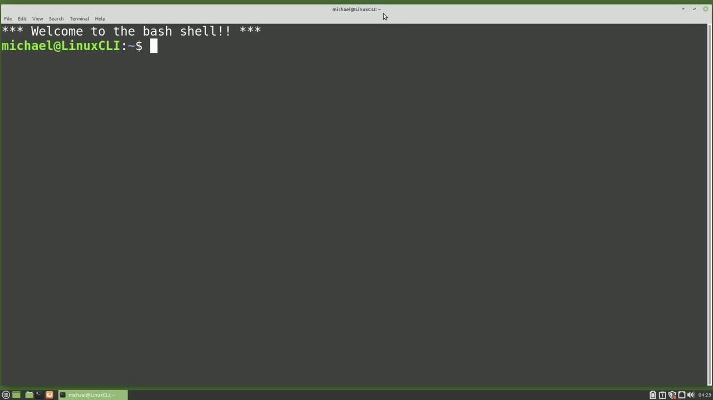
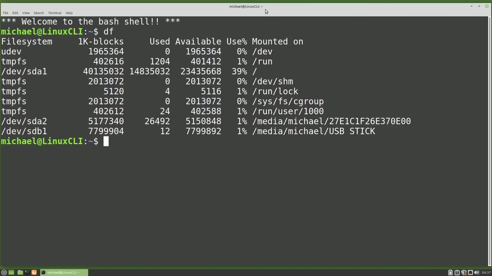
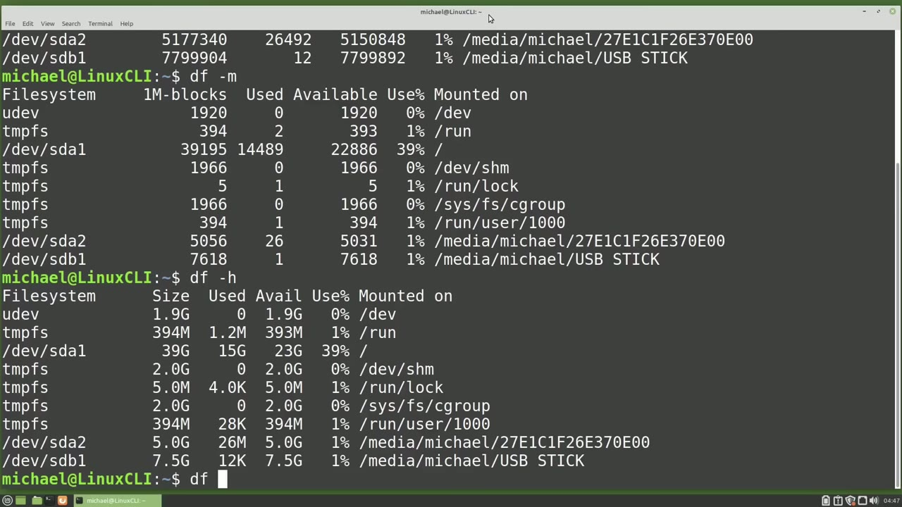
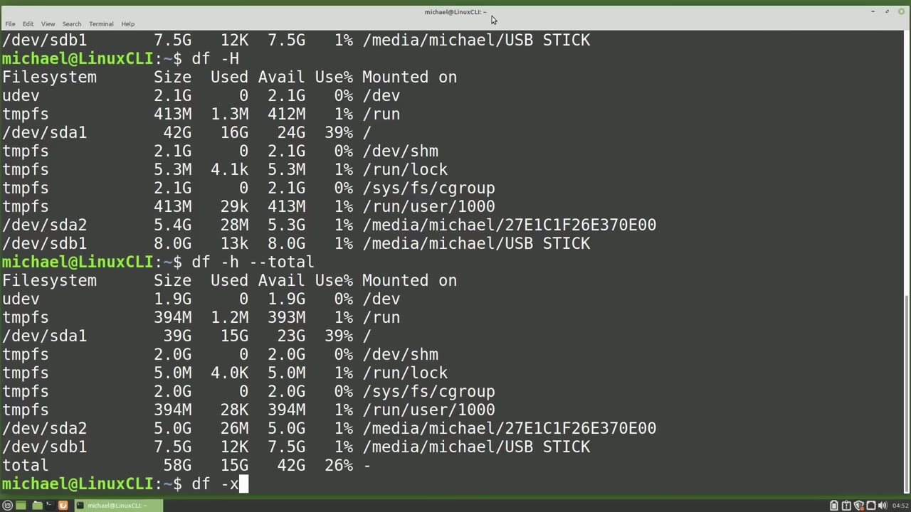

[← Course contents](../../01.md)

# 78. df

**Course:** [Linux Command Line - Entire Tutorial Series](https://www.youtube.com/watch?v=avg65oY7sj4)  
**Transcript:** [`Linux Command Line - Entire Tutorial Series transcript`](../../../../course_videos/Linux%20Command%20Line%20-%20Entire%20Tutorial%20Series/Linux%20Command%20Line%20-%20Entire%20Tutorial%20Series.txt)  
**Video:** 13:17:52–13:26:47 ([open at this time](https://www.youtube.com/watch?v=avg65oY7sj4&t=47872s))

## Introduction

One way to see how much this space is available on a hard drive or partition is with the df command. df is short for disk file system and will give us a report of the file systems on the computer. Typing df by itself shows 9 lines of output and a header line for this computer. 5 of those lines have a file system of tmpfs. Tempfs is short for temporary file system and these are a combination of RAM and swap disk space that are set up to help Linux run as quick as possible.

## Detailed Explanation

<details>
  <summary>Step 1 — Run `df`</summary>

### Step 1 — Run `df`

- [x] **Use `df`**
  - One way to see how much this space is available on a hard drive or partition is with the `df` command.
  - `df` is short for disk file system and will give us a report of the file systems on the computer.
  - Typing `df` by itself shows 9 lines of output and a header line for this computer.

- [x] **5 of those lines have a file system of tmpfs. Tempfs is short for**
  - 5 of those lines have a file system of tmpfs. Tempfs is short for temporary file system and these are a combination of RAM and swap disk space that are set up to help Linux run as quick as possible.
  - When we power down the computer, these files will go away, and then in the next system power-up, new TempFS files will be created.
  - We also see a file system type of U-Dev.

- [x] **It is a Linux sub system that's running constantly and checking to**
  - It is a Linux sub system that's running constantly and checking to see if a new device like a USB drive is plugged into the computer.
  - We're not interested in either one of those at this time.
  - The line that has mounted on with the forward slash That's the one that I'm most interested in.

- [x] **That is the Linux root directory on this computer, and the file**
  - That is the Linux root directory on this computer, and the file system is on forward slash dev, forward slash sda1.
  - The slash dev is for device, and then we see sda, which some people will call System Drive A.
  - Sd really stands for SCSI device or SATA drive.

- [x] **Scuzzy is just short for small computer system interface**
  - Scuzzy is just short for small computer system interface.
  - And SATA is short for Serial Advanced Technology Attachment.
  - These will typically be a spinning hard drive or an ssd drive.

- [x] **Another common file system you might see is forward slash dev**
  - Another common file system you might see is forward slash dev, forward slash NVME, and then some letters and numbers.
  - That's a hard drive on a card, and that card has a specific slot on the motherboard so it doesn't use the cables a spinning disk or an ssd use.
  - So it will show up as NVME And then some numbers.

- [x] **Letters following it. Our output shows a system of slash dev slash**
  - Letters following it. Our output shows a system of slash dev slash sda2 and slash dev slash sdb1. The A is given to the first hard drive Linux finds.
  - B is given to the second hard drive Linux finds.
  - Slash dev slash sda2 is just a second partition on the sda hard drive.

- [x] **We'll talk more about partitions in future videos**
  - We'll talk more about partitions in future videos.
  - For now we'll just say that a partition is just a section of the hard drive that Linux treats like a separate hard drive.
  - So that's what the number next to sda is.

- [x] **The 1 is for Partition 1 and the 2 is for Partition 2**
  - The 1 is for Partition 1 and the 2 is for Partition 2.
  - And your system may even have more than that.
  - That's a second hard drive, which in this case is a USB stick.

- [x] **If we plug in another USB stick, it will become slash dev slash sdc1**
  - If we plug in another USB stick, it will become slash dev slash sdc1.

```bash
df
```



</details>

<details>
  <summary>Step 2 — not going to focus on the mount points of sda1 and sdb1 at this time</summary>

### Step 2 — not going to focus on the mount points of sda1 and sdb1 at this time

- [x] **We're not going to focus on the mount points of sda1 and sdb1 at this**
  - We're not going to focus on the mount points of sda1 and sdb1 at this time.
  - We're just going to notice that they're both mounted on forward slash media, forward slash Michael.
  - And we'll look more into this in future videos.

- [x] **Going back to our forward slash Linux root directory mounted on slash**
  - Going back to our forward slash Linux root directory mounted on slash dev slash sda1.
  - df shows us how much disk space is available on that partition, as well as how much disk space is used, and then how much disk space is still available.
  - These numbers are shown in kilobytes, which makes that hard to read.

- [x] **We do see that we've got 39% of the disk space still available**
  - We do see that we've got 39% of the disk space still available.
  - To make those numbers a little easier to read, we can view those numbers in megabytes by adding the -lowercase M option after df.
  - That's better, but still not real helpful.

- [x] **A better way to run this command is with the -Lowercase H option**
  - A better way to run this command is with the -Lowercase H option.
  - This shows us the disk file systems in human readable form.
  - And now it's clear to see that slash dev slash sda1 has a partition size of 39 gigabytes.

- [x] **I have 15 gigabytes and I have 23 gigabytes still available for use**
  - I have 15 gigabytes and I have 23 gigabytes still available for use on this partition.
  - You probably noticed that 23 gigabytes available and 15 gigabytes used added together only adds up to 38 gigabytes and not 39.



</details>

<details>
  <summary>Step 3 — Run `df -uppercase`, `df -lowercase`</summary>

### Step 3 — Run `df -uppercase`, `df -lowercase`

- [x] **Use `df -uppercase`**
  - Most likely there's a zombie process running or maybe some deleted log files that are waiting for the process holding them to release them.
  - This is common and nothing to worry about.
  - When I type `df -uppercase` H, my numbers are larger.

- [x] **As if I just increased my total disk space**
  - As if I just increased my total disk space.
  - The slash dev slash sda1 partition just grew from 39 gigabytes to 42 gigabytes.
  - The numbers changed because there are two different ways to calculate gigabytes.

- [x] **Gigabytes can be calculated in base 10 or base 2**
  - Gigabytes can be calculated in base 10 or base 2.
  - df uppercase H uses base 10 to calculate the hard drive space, and that's why we see the larger numbers.
  - Companies that sell disk drives often use base 10 to calculate their hard drive space.

- [x] **That's the reason the box may say you've got a 500 gigabyte hard**
  - That's the reason the box may say you've got a 500 gigabyte hard drive, but when you power it up, there's only 400 and some gigabytes, not that full 500 gigabytes you saw printed on the box.
  - The company used base 10 to calculate the hard drive space, and that's the number they put on the box.
  - Most often, we're going to want to use the lowercase H with a df command.

- [x] **Use `df -lowercase`**
  - Another option we might want to use with the df command is the total option.
  - I will type `df -lowercase` H and then -dash total.
  - This total is showing the grand total of all the file systems on this computer, including both partitions on the sda disk, the USB drive of 7.5 gigabytes, and the Temp f.s space, which is using SwapSpace and RAM memory.

- [x] **So it is including RAM memory as disk space for the TempfS file**
  - So it is including RAM memory as disk space for the TempfS file systems in this total.
  - If we don't want to include the TempFS files in our df command, we can use the -X option to exclude the TempF file systems.

```bash
df -uppercase
df -lowercase
```



</details>

<details>
  <summary>Step 4 — Run `df -X`, `df -t`, `df -H`</summary>

### Step 4 — Run `df -X`, `df -t`, `df -H`

- [x] **Use `df -X`, `df -t`**
  - `df -X`, TempFS.
  - If we only want to see the slash dev slash sda1 file system, we could type df.
  - -uppercase t and the uppercase t is for file system type and then we would add on the file system type of slash dev slash sda1 this also works when typing in the mount point `df -t` forward slash and if we leave off the -uppercase t and just type in df slash dev slash sda1 that works as well

- [x] **The uppercase t is the default. So if we leave off that T, we see the**
  - The uppercase t is the default. So if we leave off that T, we see the same thing as if we had typed in the T.
  - And this works for the mount point as well, df forward slash.
  - And we would probably want to add in that -H for human readable.

- [x] **Use `df -H`**
  - And that makes it a little easier to read.
  - If we want to see multiple file systems, we can include them in the command separated by a space.
  - I'll start off `df -H`.

- [x] **And then I'll add in the forward slash for the root directory**
  - And then I'll add in the forward slash for the root directory.
  - And then I also want to include the slash dev slash sda2 to include both partitions on that sda drive.
  - And we can add the total on there as well.

- [x] **Use `df -i`**
  - We can use the df command to see the total iNodes on the file system, as well as the iNodes used and still available.
  - To see that, I'll type `df -i`, and the I is for i nodes.
  - Then if we want to see the I nodes just for a specific file system, we could add that file system to the command.

- [x] **Use `df -i`**
  - `df -i` forward slash.
  - Oh, and then we'd want to make that human readable as well, so I'll add the H for human readable.
  - And here we see the total number of I nodes on our Linux root partition in human readable format.

- [x] **In the next video, we'll continue looking at the Linux command line**
  - In the next video, we'll continue looking at the Linux command line.

```bash
df -X
df -t
df -H
df -i
```



</details>

<details>
  <summary>Questions and Answers</summary>

## Questions and Answers

### Question 1: What does `df` do in this chapter?

<details>
<summary>Answer</summary>

- [x] One way to see how much this space is available on a hard drive or partition is with the `df` command.

</details>

### Question 2: What does `df -uppercase` do in this chapter?

<details>
<summary>Answer</summary>

- [x] When I type `df -uppercase` H, my numbers are larger.

</details>

### Question 3: What does `df -lowercase` do in this chapter?

<details>
<summary>Answer</summary>

- [x] I will type `df -lowercase` H and then -dash total.

</details>

### Question 4: What does `df -X` do in this chapter?

<details>
<summary>Answer</summary>

- [x] `df -X`, TempFS.

</details>

### Question 5: What does `df -t` do in this chapter?

<details>
<summary>Answer</summary>

- [x] -uppercase t and the uppercase t is for file system type and then we would add on the file system type of slash dev slash sda1 this also works when typing in the mount point `df -t` forward slash and if we leave off the -uppercase t and just type in df slash dev slash sda1 that works as well

</details>

### Question 6: What does `df -H` do in this chapter?

<details>
<summary>Answer</summary>

- [x] I'll start off `df -H`.

</details>

### Question 7: What does `df -i` do in this chapter?

<details>
<summary>Answer</summary>

- [x] To see that, I'll type `df -i`, and the I is for i nodes.

</details>

### Question 8: What does step 1 cover (Run df)?

<details>
<summary>Answer</summary>

- [x] One way to see how much this space is available on a hard drive or partition is with the `df` command.
- [x] `df` is short for disk file system and will give us a report of the file systems on the computer.
- [x] Typing `df` by itself shows 9 lines of output and a header line for this computer.

</details>

### Question 9: What does step 2 cover (not going to focus on the mount points of sda1 and sdb1 at this time)?

<details>
<summary>Answer</summary>

- [x] We're not going to focus on the mount points of sda1 and sdb1 at this time.
- [x] We're just going to notice that they're both mounted on forward slash media, forward slash Michael.
- [x] And we'll look more into this in future videos.

</details>

### Question 10: What does step 3 cover (Run df -uppercase, df -lowercase)?

<details>
<summary>Answer</summary>

- [x] Most likely there's a zombie process running or maybe some deleted log files that are waiting for the process holding them to release them.
- [x] This is common and nothing to worry about.
- [x] When I type `df -uppercase` H, my numbers are larger.

</details>

</details>

## Summary

This chapter, df, walks through Run df; not going to focus on the mount points of sda1 and sdb1 at this time; Run df -uppercase, df -lowercase; Run df -X, df -t, df -H. Commands from the transcript: `df`, `df -uppercase`, `df -lowercase`, `df -X`, `df -t`, `df -H`, `df -i`.

## References

- [Linux Command Line - Entire Tutorial Series (YouTube)](https://www.youtube.com/watch?v=avg65oY7sj4)
- [This chapter at 13:17:52](https://www.youtube.com/watch?v=avg65oY7sj4&t=47872s)
- [Local transcript](../../../../course_videos/Linux%20Command%20Line%20-%20Entire%20Tutorial%20Series/Linux%20Command%20Line%20-%20Entire%20Tutorial%20Series.txt)
