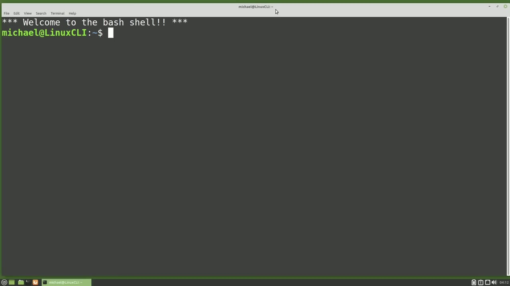
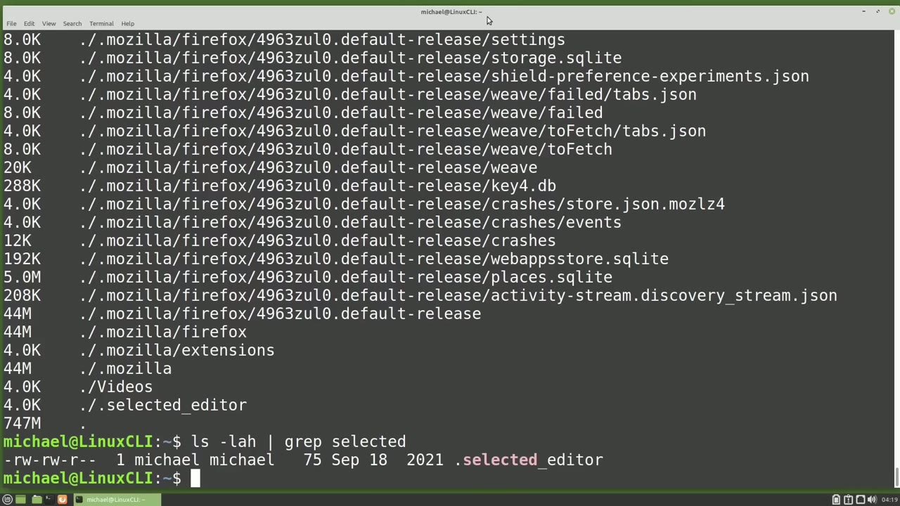
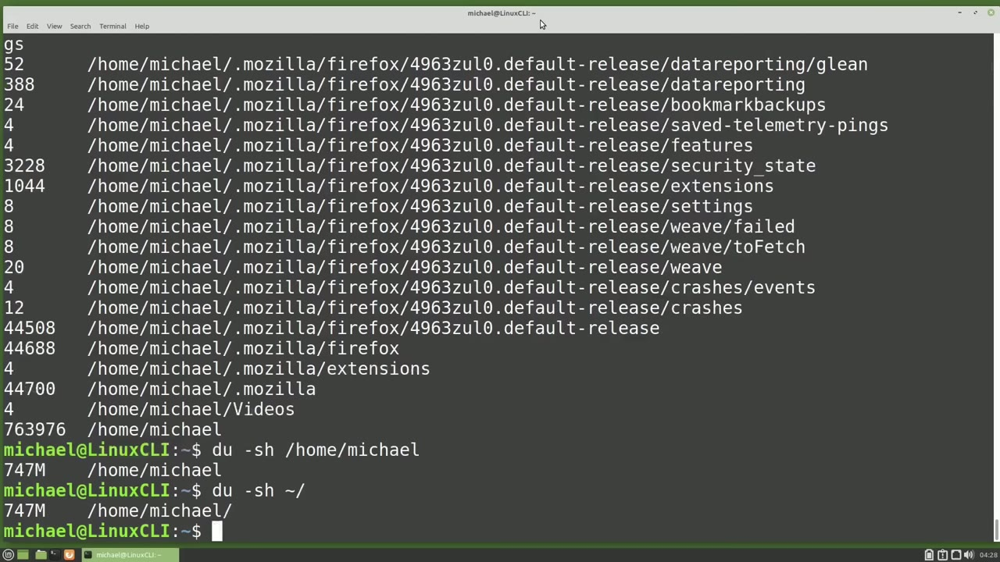
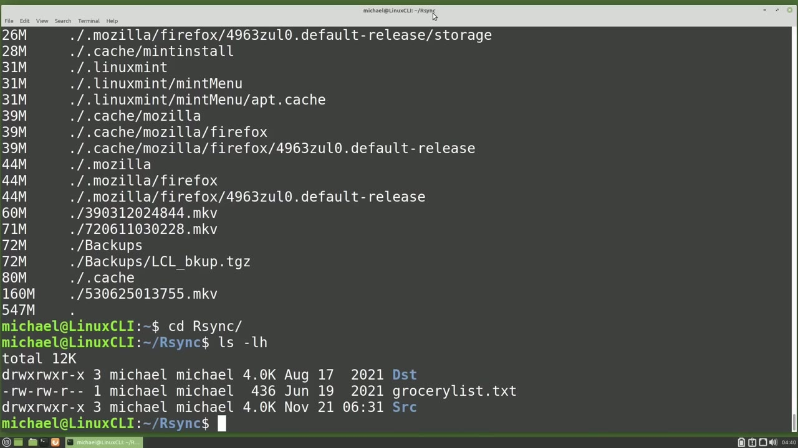
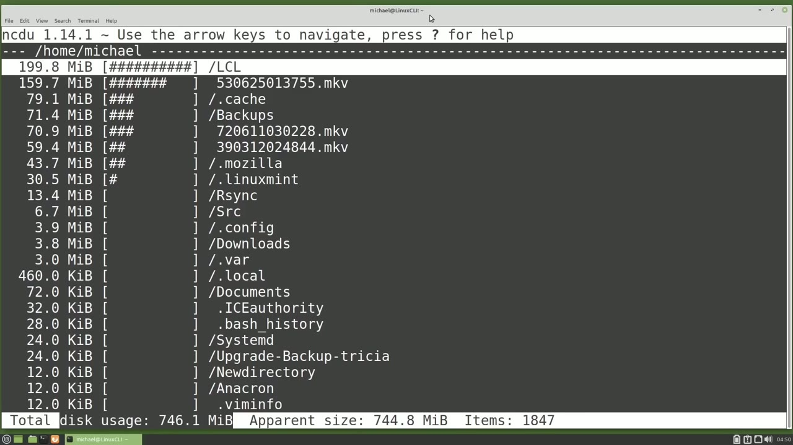

[← Course contents](../../01.md)

# 79. du

**Course:** [Linux Command Line - Entire Tutorial Series](https://www.youtube.com/watch?v=avg65oY7sj4)  
**Transcript:** [`Linux Command Line - Entire Tutorial Series transcript`](../../../../course_videos/Linux%20Command%20Line%20-%20Entire%20Tutorial%20Series/Linux%20Command%20Line%20-%20Entire%20Tutorial%20Series.txt)  
**Video:** 13:26:47–13:39:15 ([open at this time](https://www.youtube.com/watch?v=avg65oY7sj4&t=48407s))

## Introduction

In the last video, we looked at the d.f command to look at the computer's disk file systems, but that command did not show us any information about disk usage. To see File and Directory Size usage, we can use the d.u command, which is short for Disc Usage. Typing du by itself, shows us all the directories and subdirectories that are in the directory where we submitted the command, which for me was my home directory. If you are in the forward /root directory, it will try and list every directory on the file system.

## Detailed Explanation

<details>
  <summary>Step 1 — Run `which`, `du`, `grep`</summary>

### Step 1 — Run `which`, `du`, `grep`

- [x] **Use `which`, `du`**
  - In the last video, we looked at the d.f command to look at the computer's disk file systems, but that command did not show us any information about disk usage.
  - To see File and Directory Size usage, we can use the d.u command, `which` is short for Disc Usage.
  - Typing `du` by itself, shows us all the directories and subdirectories that are in the directory where we submitted the command, `which` for me was my home directory.

- [x] **If you are in the forward /root directory, it will try and list every**
  - If you are in the forward /root directory, it will try and list every directory on the file system.
  - You will probably see a lot of you don't have permission warning messages, and it will take a long time to list every directory and sub directory on the entire system.
  - And most likely you will want to hold down control and press C to cancel out of that long running command.

- [x] **Right now, what we are looking at is every directory and**
  - Right now, what we are looking at is every directory and sub-directority in my home directory.
  - Taking a look at these last few lines, we see Mozilla extensions, Mozilla and videos.
  - And then the last line is the disk space in kilobytes.

- [x] **I'm going to type the d-u command again, but this time**
  - I'm going to type the d-u command again, but this time...
  - I'm going to use the -a option to include all the files as well as all the directories.
  - Now we see the last line, the line above the disk usage, is a file, not a directory.

- [x] **It is a hidden file for the selected editor, and it is showing as 4**
  - It is a hidden file for the selected editor, and it is showing as 4.
  - But we're not sure right now what that 4 is.
  - To clear that up, I'm going to add the lowercase H to the command.

- [x] **Use `grep`**
  - To show me the results in a human readable format.
  - The size of the hidden file selected editor is 4 kilobytes.
  - But if I type l-s-l-a-h, and I'm going to pipe that into `grep` to only list the selected editor file.

- [x] **And we see the file size of the selected editor file is only 75 bytes**
  - And we see the file size of the selected editor file is only 75 bytes.

```bash
which
du
grep
```



</details>

<details>
  <summary>Step 2 — Run `ls`, `du -h`</summary>

### Step 2 — Run `ls`, `du -h`

- [x] **Use `ls`**
  - But the du command is showing it as 4K.
  - The reason for this is the file system sets aside blocks of space for files, even if they don't take up that whole space.
  - So the `ls` command is showing us the actual file size, and the du command is showing us the number of blocks that file is using.

- [x] **If we want to see the file size with the du command, we can add the**
  - If we want to see the file size with the du command, we can add the option -apparent size.
  - Now we see the selected editor file showing as 75 bytes.
  - We're also going to make a note here that the disk space used in this directory is 745 megabytes.

- [x] **When I run this du command without the apparent size, we see that**
  - When I run this du command without the apparent size, we see that total space use.
  - And that's the actual disk space being used for this directory.
  - Sometimes we just want to know how much disk space is being used by a specific file or group of files.

- [x] **Use `du -h`**
  - We can do this by adding the files right after the command.
  - For example, `du -h`, GroceryList.TXT, and Presidentsby height.csv.
  - I can also check the disk space used by a specific file type or file types by adding an asteris before the extension.

- [x] **Use `du -h`**
  - `du -h` asteris. txt, Asteris.csv and Asteris.mkV.
  - And notice there's no grand total here at the bottom.
  - To show a grand total, I will add -tash total.

- [x] **And here we see the total is 291 megabytes for this group of files**
  - And here we see the total is 291 megabytes for this group of files.
  - Instead of typing -tash total, we can use the shortcut for that, which is -c.
  - And I think the C is for count up a total or something along those lines.

- [x] **-C instead of -total gives us the same results**
  - -C instead of -total gives us the same results.
  - And I'll move that C over to be with the H.
  - And now I just want to see the disk space used by my home directory.

- [x] **To do that, I will type d.u /home slash Michael**
  - To do that, I will type d.u /home slash Michael.
  - And this lists out every sub-directority in my home directory, which is the same thing I saw when I type d.u in my home directory.
  - To see just the disk space used for my home directory, I'm going to add the -s option for summarize and I'm also going to add in that H for make this human readable and now I only see what I'm looking for the 747 megabytes of disk space used by this directory and for my home directory I could also have used the till day forward slash

```bash
ls
du -h
```



</details>

<details>
  <summary>Step 3 — Run `du -sh`, `du -ha`, `du -ah`</summary>

### Step 3 — Run `du -sh`, `du -ha`, `du -ah`

- [x] **Use `du -sh`**
  - And since I'm in the home directory I could just type `du -sh` and this shows us the same thing again, only this time it's showing the dot for the current directory.
  - If I want to see the disk space used by all the users in the home directory, I will need to be the root user for that.
  - So I will start the command with S, then du, then I'm going to add the options S to summarize h4 Human Readable, and then I want to see the summarized information for all the directories in that home directory.

- [x] **Press and enter. Here I see all of the users in that home directory**
  - Press and enter. Here I see all of the users in that home directory and their disk space, but it's sorted by id. To sort this by disk space, we can pipe this into sort and then sort on -H for sort by human readable. And if we want this in the reverse order, we can add a -R before
  - The H. And now the largest file is on top.
  - To count up a grand total for all of the Home Directory disk usage, I will take out the R and add the C option to the command.

- [x] **And here we see the total for all the users in this directory is 977**
  - And here we see the total for all the users in this directory is 977 megabytes.
  - I see the Michael user is taking up most of the disk space at 747 megabytes.
  - To see the larger files and directories for the Michael user, I will run the disk usage command with the human readable option and the A for all files.

- [x] **Use `du -ha`**
  - `du -ha` and then I'm going to sort this by the human readable file size.
  - Here we see the large mp4 file starting with 4405 in the directory lcl and then sub-directory, new directory 2.
  - Subdirectory lcl New Directory 2 is showing on this list as well as the lcl directory.

- [x] **Use `du -ah`**
  - So 3 entries on this list are all for the same large file.
  - We can exclude the lcl directory from the results by adding the -d exclude option.
  - So our command would be `du -ah` D-AH-E--exclude lcl and then we're going to sort this by -Now the lcl directory is not included in the du command and the grand total has dropped to 547 megabytes.

- [x] **Use `rsync`, `ls -lh`**
  - There are times when we just want to see what is in the current directory.
  - We don't want to see all the subdirectories listed.
  - To show this better, I'm going to cd into the `rsync` directory and let's see what's in there with `ls -lh`.

```bash
du -sh
du -ha
du -ah
rsync
ls -lh
```



</details>

<details>
  <summary>Step 4 — Run `du -a`, `du -ha --max`, `sudo`</summary>

### Step 4 — Run `du -a`, `du -ha --max`, `sudo`

- [x] **Use `du -a`, `du -ha --max`**
  - Two directories in a file. When I type `du -a` it shows us all the files, directories and sub-directories.
  - I only want to see what is in the current directory. To see that, I will add the Max Depth option, `du -ha --max` depth.
  - And we just want to see the one directory.

- [x] **Now we only see the file and the two directories in the R-sync**
  - Now we only see the file and the two directories in the R-sync directory.
  - Now, instead of typing out max depth, we can use the D option.
  - And normally that order doesn't matter, but since D has the argument for the number that we want to go deep, we need to make the D last when we group the commands.

- [x] **But if we want to group these together, we need to have the D last so**
  - But if we want to group these together, we need to have the D last so that the argument for max depth goes with it. Pressing Enter, we get the same thing. And then to go two directories deep, we just change that one to a two. And to go three deep, we can change this two to a three.
  - And let's also exclude the dst directory. And if we change the max depth option to zero. It shows just the disusage for that directory.
  - The same thing as if we use the -S for summarize option.

- [x] **Use `sudo`**
  - I'm going back to my home directory. There is another command for du that I want to talk about before ending this video. That is ncdu. Now ncdu is not installed by default on my Linux Mint operating system. So I had to install it typing `sudo` Appd, install, ncdu.
  - And we see that it is already installed on my computer.
  - Ncdu is short for n-c-c-d-u is short for n-c-d-u by itself will give us information about the files and directories for the directory we are currently in.

- [x] **To get out of this, I'm going to press the Q key to quit out**
  - To get out of this, I'm going to press the Q key to quit out.
  - And we can also use the ncdu command with the path /home slash Michael.

```bash
du -a
du -ha --max
sudo
```



</details>

<details>
  <summary>Step 5 — the output from ncdu is really nice</summary>

### Step 5 — the output from ncdu is really nice

- [x] **And the output from ncdu is really nice**
  - And the output from ncdu is really nice.
  - At the bottom, we can see the total disk usage of 746.1 MIBs.
  - Mib is short for Mibi byte, which just means it's megabytes calculated using base 2 instead of base 10.

- [x] **We talked about that difference in the last video**
  - We talked about that difference in the last video.
  - They're just trying to be clear here that the numbers are in base 2, which is what we want to see for disk space usage most of the time.
  - Then we see the apparent size, which is the actual file size, but not the disk space used on the disk.

- [x] **Up at the top, we see we can use the arrows to navigate, and then we**
  - Up at the top, we see we can use the arrows to navigate, and then we see the directory we are currently in.
  - Below that, we have a little graphic showing us the largest files and directories.
  - And pressing Enter on a directory or arrow right will take me into that directory.

- [x] **Pressing arrow left or enter on the dot dot will take me up a**
  - Pressing arrow left or enter on the dot dot will take me up a directory.
  - And then the question mark will show me other options available for the ncdu command.
  - In the next video, we will continue to look at the Linux command line.



</details>

<details>
  <summary>Questions and Answers</summary>

## Questions and Answers

### Question 1: What does `which` do in this chapter?

<details>
<summary>Answer</summary>

- [x] To see File and Directory Size usage, we can use the d.u command, `which` is short for Disc Usage.

</details>

### Question 2: What does `du` do in this chapter?

<details>
<summary>Answer</summary>

- [x] Typing `du` by itself, shows us all the directories and subdirectories that are in the directory where we submitted the command, which for me was my home directory.

</details>

### Question 3: What does `grep` do in this chapter?

<details>
<summary>Answer</summary>

- [x] But if I type l-s-l-a-h, and I'm going to pipe that into `grep` to only list the selected editor file.

</details>

### Question 4: What does `ls` do in this chapter?

<details>
<summary>Answer</summary>

- [x] So the `ls` command is showing us the actual file size, and the du command is showing us the number of blocks that file is using.

</details>

### Question 5: What does `du -h` do in this chapter?

<details>
<summary>Answer</summary>

- [x] For example, `du -h`, GroceryList.TXT, and Presidentsby height.csv.

</details>

### Question 6: What does `du -sh` do in this chapter?

<details>
<summary>Answer</summary>

- [x] And since I'm in the home directory I could just type `du -sh` and this shows us the same thing again, only this time it's showing the dot for the current directory.

</details>

### Question 7: What does `du -ha` do in this chapter?

<details>
<summary>Answer</summary>

- [x] `du -ha` and then I'm going to sort this by the human readable file size.

</details>

### Question 8: What does `du -ah` do in this chapter?

<details>
<summary>Answer</summary>

- [x] So our command would be `du -ah` D-AH-E--exclude lcl and then we're going to sort this by -Now the lcl directory is not included in the du command and the grand total has dropped to 547 megabytes.

</details>

### Question 9: What does `rsync` do in this chapter?

<details>
<summary>Answer</summary>

- [x] To show this better, I'm going to cd into the `rsync` directory and let's see what's in there with ls -lh.

</details>

### Question 10: What does `ls -lh` do in this chapter?

<details>
<summary>Answer</summary>

- [x] To show this better, I'm going to cd into the rsync directory and let's see what's in there with `ls -lh`.

</details>

### Question 11: What does `du -a` do in this chapter?

<details>
<summary>Answer</summary>

- [x] Two directories in a file. When I type `du -a` it shows us all the files, directories and sub-directories.

</details>

### Question 12: What does `du -ha --max` do in this chapter?

<details>
<summary>Answer</summary>

- [x] I only want to see what is in the current directory. To see that, I will add the Max Depth option, `du -ha --max` depth.

</details>

</details>

## Summary

This chapter, du, walks through Run which, du, grep; Run ls, du -h; Run du -sh, du -ha, du -ah; Run du -a, du -ha --max, sudo; the output from ncdu is really nice. Commands from the transcript: `which`, `du`, `grep`, `ls`, `du -h`, `du -sh`, `du -ha`, `du -ah`, `rsync`, `ls -lh`, `du -a`, `du -ha --max`, `sudo`.

## References

- [Linux Command Line - Entire Tutorial Series (YouTube)](https://www.youtube.com/watch?v=avg65oY7sj4)
- [This chapter at 13:26:47](https://www.youtube.com/watch?v=avg65oY7sj4&t=48407s)
- [Local transcript](../../../../course_videos/Linux%20Command%20Line%20-%20Entire%20Tutorial%20Series/Linux%20Command%20Line%20-%20Entire%20Tutorial%20Series.txt)
