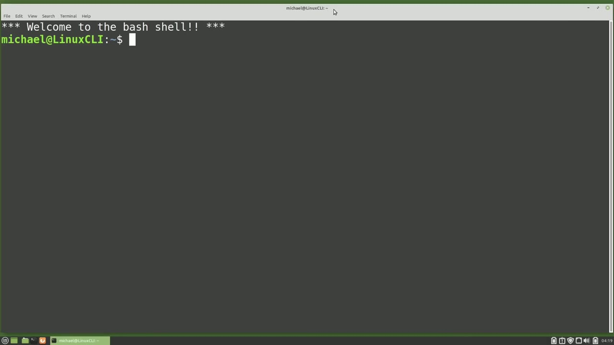
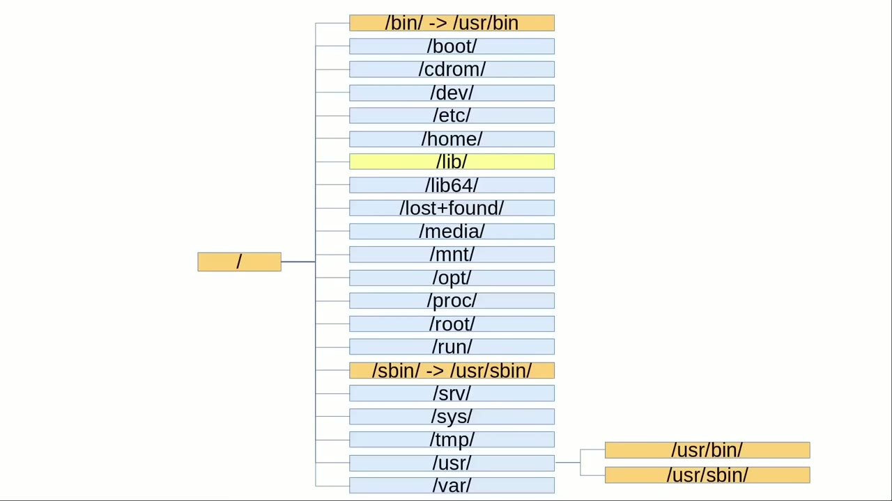
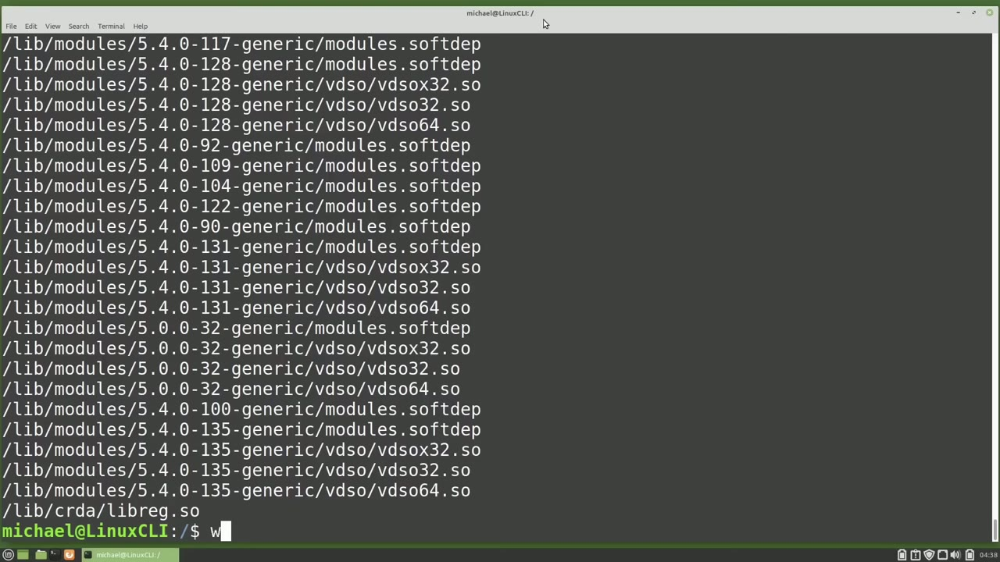
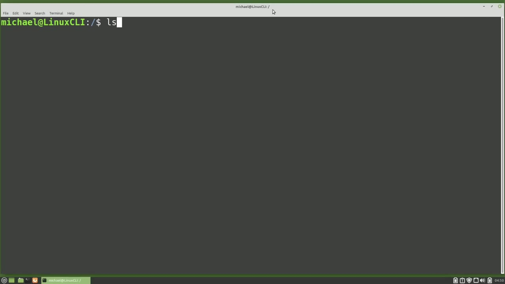

[← Course contents](../../01.md)

# 80. Linux File System pt1

**Course:** [Linux Command Line - Entire Tutorial Series](https://www.youtube.com/watch?v=avg65oY7sj4)  
**Transcript:** [`Linux Command Line - Entire Tutorial Series transcript`](../../../../course_videos/Linux%20Command%20Line%20-%20Entire%20Tutorial%20Series/Linux%20Command%20Line%20-%20Entire%20Tutorial%20Series.txt)  
**Video:** 13:39:15–13:49:06 ([open at this time](https://www.youtube.com/watch?v=avg65oY7sj4&t=49155s))

## Introduction

In this video and the next, we're going to look at the standard layout of the Linux file system. Which means we're going to take a look at the Linux directory structure to see the suggested directories for what files go where. I say suggested because not all Linux operating systems follow the standard as completely as others. To see these directories on a Linux computer, you can type cd forward slash.

## Detailed Explanation

<details>
  <summary>Step 1 — Run `cd forward`, `ls`, `ls /bin`</summary>

### Step 1 — Run `cd forward`, `ls`, `ls /bin`

- [x] **In this video and the next, we're going to look at the standard**
  - In this video and the next, we're going to look at the standard layout of the Linux file system.
  - `which` means we're going to take a look at the Linux directory structure to see the suggested directories for what files go where.
  - I say suggested because not all Linux operating systems follow the standard as completely as others.

- [x] **Use `cd forward`, `ls`**
  - To see these directories on a Linux computer, you can type `cd forward` slash.
  - That takes us to the root directory, then typing `ls`, lists out all the directories and files in this directory.
  - We're just interested in the directories.

- [x] **I've created a picture to show what I'm talking about**
  - I've created a picture to show what I'm talking about.
  - About. We see the forward /root directory on the left, then the first level of directories, and if we turn this picture sideways, we see the forward slash is like a root of a tree or a bush, with the directories connected like branches on a tree growing out from a single root.
  - This first level of branches is what we're going to look at in the rest of this video.

- [x] **And the next one. I'm going to start at the top with the bin directory**
  - And the next one. I'm going to start at the top with the bin directory.
  - But then I'm going to skip around a little bit because I think grouping similar directories together will make more sense and be easier to follow.
  - Bin is short for binaries and binaries are just compiled programs.

- [x] **Use `ls /bin`, `ls`**
  - We created a binary file back in Video 23.
  - Typing `ls /bin` shows over a page of commands.
  - Here we see Cat, Echo, `ls` and `which`.

- [x] **Commands we've already used several times in this tutorial series**
  - Commands we've already used several times in this tutorial series.
  - So the Bin Directory stores the binaries for commands standard users use regularly.
  - Now let's jump down to the S Bin Directory.

- [x] **Use `which`, `fdisk`, `parted`**
  - The S is for System and Bin is for Bionaries.
  - The commands in the System Binary Directory are more for disk management and rebooting.
  - Typing `which` `fdisk`, `which` `parted`, and `which` `reboot` shows all of these commands are in the S-bin directory, and all of these commands need root privileges to run.

- [x] **Use `sudo`**
  - So the bin directory is for binaries everyone on the system can use, and the S-bin directory is bin-directories that require `sudo` before that command can run.
  - Some operating systems will make the bin directory a SIM link of the usr bin directory, and then make the S bin directory a SIM link from the usr S bin directory.
  - We'll talk more about the usr directory in a moment.

- [x] **Before that, I want to look at the lib directory**
  - Before that, I want to look at the lib directory.

```bash
cd forward
ls
ls /bin
which
fdisk
parted
reboot
sudo
```



</details>

<details>
  <summary>Step 2 — Lib is short for library, so the lib directory holds shared library</summary>

### Step 2 — Lib is short for library, so the lib directory holds shared library

- [x] **Lib is short for library, so the lib directory holds shared library**
  - Lib is short for library, so the lib directory holds shared library files that are needed for system commands.
  - Many of the files in the shared lib directory have so in the title.
  - And often there is a version following it.

- [x] **We can see that when we do a find for dot so files in the lib**
  - We can see that when we do a find for dot so files in the lib directory with find slash lib dash, s o dot asteris, end quote.
  - And then taking off that second dot, and re-running the command again, shows files ending with.S.
  - You may also see the directories Lib 64 or Lib 3-2 or the like.

- [x] **These are library files for other system variants, libraries that**
  - These are library files for other system variants, libraries that support more than one binary format, requiring separate libraries.
  - The Lib directories are also often SIM-linked from a directory of the same name in the usr directory.
  - And the next directory we're going to look at is the usr directory.

- [x] **Most people call the usr directory the user directory, but that's not**
  - Most people call the usr directory the user directory, but that's not quite right.
  - It's not much of a user directory when only the root user can update it.
  - Standard users can only read this directory.

- [x] **Only the root user can make updates to the usr directory**
  - Only the root user can make updates to the usr directory.
  - Usr is actually short for Unix System Resources.
  - Linux follows most of the Unix standards and this directory name is one of them.

- [x] **Should it be called lsr for Linux System Resources?**
  - Should it be called lsr for Linux System Resources?
  - Maybe, but I don't see that change happening anytime soon.
  - Now that we know that the usr directory is for System Resources, it does kind of make sense to have SIM links to the Bin and Lib directories from here.

- [x] **When they do that, they're grouping all of the System Resources into**
  - When they do that, they're grouping all of the System Resources into one directory.
  - So then where the default non-system applications stored, programs like Libre Office and Firefox that came pre-installed on Linux Mint.



</details>

<details>
  <summary>Step 3 — Run `which`, `ls -lh`, `cd -rom`</summary>

### Step 3 — Run `which`, `ls -lh`, `cd -rom`

- [x] **Use `which`, `ls -lh`**
  - To see that, I will type `which` Libre Office and `which` Firefox.
  - And we see they're both in the user bin directory for my version of Linux Mint.
  - It's possible, even likely, that different versions of Linux will put these files in different Taking another look at the root directory with `ls -lh` forward slash and I'm going to pipe that into less.

- [x] **Here we see the bin directories and the lib directories are not sim**
  - Here we see the bin directories and the lib directories are not sim linked to the usr directory.
  - If we look down at this initr.mg file, we see the -arrow showing this is a sim link.
  - Also looking at the first letter in the first column on the left, we see L letting us know that this file is linked with another file.

- [x] **Looking at the bin directory, we don't see the -arrow**
  - Looking at the bin directory, we don't see the -arrow.
  - And the first letter in the first column is a D for directory.
  - That is telling us the bin directory for this distro is not sim linked anywhere.

- [x] **That a knitRD file is linked to the boot directory**
  - That a knitRD file is linked to the boot directory.
  - And that is the next directory we're going to talk about.
  - The Boot Directory contains all the bootloader files to boot up this system, including the kernel and the initial RAM files.

- [x] **Use `cd -rom`**
  - That SIM-length file we were just looking at, and itrd, is a file for the initial RAM disk, `which` is part of the boot process.
  - Cdrom is a legacy mountpoint for a `cd -rom`.
  - It's not used very much anymore and not included in all distros.

- [x] **The Dev Directory is the location for device files**
  - The Dev Directory is the location for device files.
  - So even when we connect a physical or virtual hard drive or a webcam or a keyboard, Linux creates a file for that device and places that device file in the Dev directory.

```bash
which
ls -lh
cd -rom
```



</details>

<details>
  <summary>Step 4 — Run `ls -lh`, `grep`</summary>

### Step 4 — Run `ls -lh`, `grep`

- [x] **Use `ls -lh`, `grep`**
  - When I type `ls -lh` slash Dev, and then `grep` for sda, we can see the device files for the hard drive and the two partitions.
  - The next directory on this list is /etc.
  - Some people pronounce this etc, others call this /etc.

- [x] **The /etc directory is a place for system-wide configuration files**
  - The /etc directory is a place for system-wide configuration files.
  - We've already seen a few configuration files in the /etc directory in previous videos.
  - Early on we cated out the /etc/passwd file.

- [x] **And then in the SystemD timer tutorial, we looked in the /etc SystemD**
  - And then in the SystemD timer tutorial, we looked in the /etc SystemD SystemD system directory. So the etc directory is a place where many of the system-wide configuration files are stored. The next directory we see is the Home Directory, and each user on the system will have their own
  - When a user logs into the computer, this is usually their default location.
  - This is a place where the user can keep all their data.

- [x] **Pictures, music, and user configuration settings**
  - Pictures, music, and user configuration settings.
  - Browser customization settings you changed will be saved to your home directory.
  - If you're going to back up a single directory, make it your home directory.

- [x] **Then if the hard drive crashes or goes bad, you can reinstall Linux**
  - Then if the hard drive crashes or goes bad, you can reinstall Linux on a new hard drive, restore your home directory, Then you'll also have to reinstall any programs you installed separately, but after that you'll be back up and running with all the files and settings from your last backup.
  - Now I want to jump down to the root directory, because the root directory is just the home directory of the root user.
  - If you have a specific alias you like to use and have it in your BashRC file, but it's not there when you've pseudoed into the root user, you can just add it in the root.bashr file.

- [x] **The root user home directory is in a separate directory for a couple**
  - The root user home directory is in a separate directory for a couple of reasons, one of which is security. The other is that often people like to put their home directory on a separate partition to make things easier for backups and system upgrades and the like. We want to keep the root user on the same partition
  - As the operating system, then if there's any problems connecting to other drives during the boot-up, we would still be able to log in as root.
  - We'll look at the rest of the Linux File System hierarchy in the next video for the Linux Command Line.

- [x] **We are picking up from where we left off in the last video talking**
  - We are picking up from where we left off in the last video talking about the Linux File System hierarchy.

```bash
ls -lh
grep
```



</details>

<details>
  <summary>Questions and Answers</summary>

## Questions and Answers

### Question 1: What does `cd forward` do in this chapter?

<details>
<summary>Answer</summary>

- [x] To see these directories on a Linux computer, you can type `cd forward` slash.

</details>

### Question 2: What does `ls` do in this chapter?

<details>
<summary>Answer</summary>

- [x] That takes us to the root directory, then typing `ls`, lists out all the directories and files in this directory.

</details>

### Question 3: What does `ls /bin` do in this chapter?

<details>
<summary>Answer</summary>

- [x] Typing `ls /bin` shows over a page of commands.

</details>

### Question 4: What does `which` do in this chapter?

<details>
<summary>Answer</summary>

- [x] Typing `which` fdisk, `which` parted, and `which` reboot shows all of these commands are in the S-bin directory, and all of these commands need root privileges to run.

</details>

### Question 5: What does `fdisk` do in this chapter?

<details>
<summary>Answer</summary>

- [x] Typing which `fdisk`, which parted, and which reboot shows all of these commands are in the S-bin directory, and all of these commands need root privileges to run.

</details>

### Question 6: What does `parted` do in this chapter?

<details>
<summary>Answer</summary>

- [x] Typing which fdisk, which `parted`, and which reboot shows all of these commands are in the S-bin directory, and all of these commands need root privileges to run.

</details>

### Question 7: What does `reboot` do in this chapter?

<details>
<summary>Answer</summary>

- [x] Typing which fdisk, which parted, and which `reboot` shows all of these commands are in the S-bin directory, and all of these commands need root privileges to run.

</details>

### Question 8: What does `sudo` do in this chapter?

<details>
<summary>Answer</summary>

- [x] So the bin directory is for binaries everyone on the system can use, and the S-bin directory is bin-directories that require `sudo` before that command can run.

</details>

### Question 9: What does `ls -lh` do in this chapter?

<details>
<summary>Answer</summary>

- [x] It's possible, even likely, that different versions of Linux will put these files in different Taking another look at the root directory with `ls -lh` forward slash and I'm going to pipe that into less.

</details>

### Question 10: What does `cd -rom` do in this chapter?

<details>
<summary>Answer</summary>

- [x] Cdrom is a legacy mountpoint for a `cd -rom`.

</details>

### Question 11: What does `grep` do in this chapter?

<details>
<summary>Answer</summary>

- [x] When I type ls -lh slash Dev, and then `grep` for sda, we can see the device files for the hard drive and the two partitions.

</details>

</details>

## Summary

This chapter, Linux File System pt1, walks through Run cd forward, ls, ls /bin; Lib is short for library, so the lib directory holds shared library; Run which, ls -lh, cd -rom; Run ls -lh, grep. Commands from the transcript: `cd forward`, `ls`, `ls /bin`, `which`, `fdisk`, `parted`, `reboot`, `sudo`, `ls -lh`, `cd -rom`, `grep`.

## References

- [Linux Command Line - Entire Tutorial Series (YouTube)](https://www.youtube.com/watch?v=avg65oY7sj4)
- [This chapter at 13:39:15](https://www.youtube.com/watch?v=avg65oY7sj4&t=49155s)
- [Local transcript](../../../../course_videos/Linux%20Command%20Line%20-%20Entire%20Tutorial%20Series/Linux%20Command%20Line%20-%20Entire%20Tutorial%20Series.txt)
