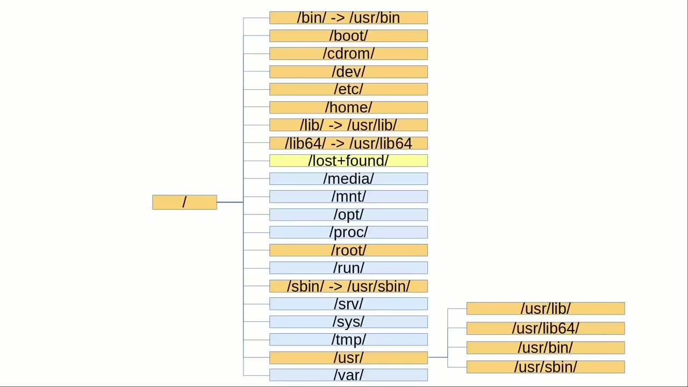
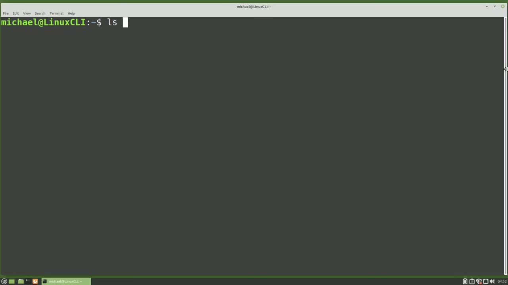
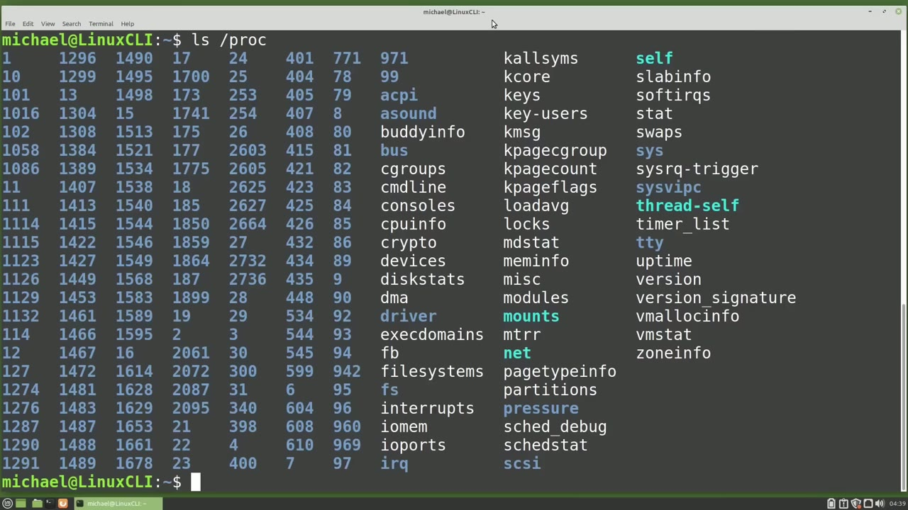
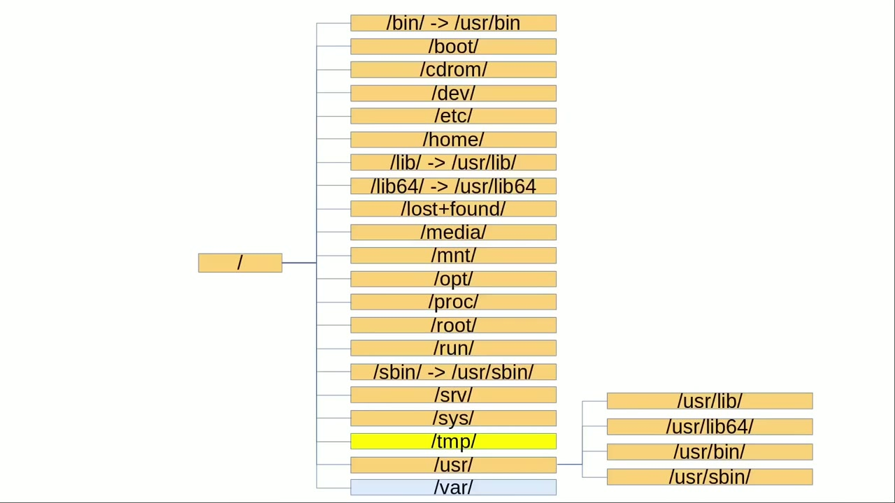

[← Course contents](../../01.md)

# 81. Linux File System pt2

**Course:** [Linux Command Line - Entire Tutorial Series](https://www.youtube.com/watch?v=avg65oY7sj4)  
**Transcript:** [`Linux Command Line - Entire Tutorial Series transcript`](../../../../course_videos/Linux%20Command%20Line%20-%20Entire%20Tutorial%20Series/Linux%20Command%20Line%20-%20Entire%20Tutorial%20Series.txt)  
**Video:** 13:49:06–13:57:52 ([open at this time](https://www.youtube.com/watch?v=avg65oY7sj4&t=49746s))

## Introduction

In Part 1 we talked about all of the directories that are now shaded in the orange color. The next directory on this list to look at is the Lost and Found directory. Lost and Found is a place where the system writes information during a system crash. The system will use the files in this directory when trying to recover from a system crash.

## Detailed Explanation

<details>
  <summary>Step 1 — Run `touch`, `df`, `sudo -file`</summary>

### Step 1 — Run `touch`, `df`, `sudo -file`

- [x] **In Part 1 we talked about all of the directories that are now shaded**
  - In Part 1 we talked about all of the directories that are now shaded in the orange color.
  - The next directory on this list to look at is the Lost and Found directory.
  - Lost and Found is a place where the system writes information during a system crash.

- [x] **Use `touch`**
  - The system will use the files in this directory when trying to recover from a system crash.
  - In general, we don't want to `touch` any files in this directory.
  - The Media Directory is where the system typically mounts drives, like a second hard drive, a USB drive, a network drive, or a cd dvd drive.

- [x] **Use `df`**
  - In Video 78, we learned about the `df` command and typing `df` here.
  - Shows how the second partition for this hard is mounted in the Dev directory under the file system heading.
  - And we can access those files in the Media Directory where Linux Mint has created a Michael directory and mounted that second partition for us.

- [x] **So the Media Directory is where the operating system will mount drives**
  - So the Media Directory is where the operating system will mount drives.
  - Unless that distro is not following this standard or has interpreted the standard differently.
  - And mnt is short for mount, but we just said the system mounts disk drives in the Media Directory.

- [x] **The Man Page says the mnt directory is intended for temporary mounted**
  - The Man Page says the mnt directory is intended for temporary mounted file systems.
  - Some operating systems will use this location to mount temporary USB drives, and even permanent second hard drives.
  - Since Linux Mint mounts my drives in the Media Directory, when I manually mount a drive, I will mount them in the slash mnt directory.

- [x] **We'll look at an example of this when we get to the srv directory**
  - We'll look at an example of this when we get to the srv directory.
  - The Opt Directory is a directory for optional software packages.
  - Vendors use this when there is an add-on to the system.

- [x] **VirtualBox uses this area for the Guest Editions files**
  - VirtualBox uses this area for the Guest Editions files.
  - Some people use the Op Directory as a place for programs they manually installed.
  - Or for programs and scripts they have created.

- [x] **Use `sudo -file`**
  - The proc directory is short for processes, and proc is a mountpoint for a `sudo -file` system.
  - When I say `sudo -file` system, I mean there are no actual files in that directory.

```bash
touch
df
sudo -file
```



</details>

<details>
  <summary>Step 2 — Run `ls proc`, `sudo`, `uptime`</summary>

### Step 2 — Run `ls proc`, `sudo`, `uptime`

- [x] **Use `ls proc`, `sudo`, `uptime`**
  - Typing `ls proc` shows us what looks like files and directories, but what we're looking `at` are actually virtual entries created by the kernel.
  - The `sudo` files and directories in this directory are information about current system processes.
  - A few files that might be of interest in this directory are CPU, Mem Info, `uptime`, and Version.

- [x] **Cating out the Proc CPU Info, and I will pipe this into less, shows**
  - Cating out the Proc CPU Info, and I will pipe this into less, shows us information about the CPUs.
  - And typing Cat.
  - Proc Mem info, and I will also pipe this into less, shows information about the memory.

- [x] **Use `top`, `uptime`**
  - Trying to find information you need quickly here about the CPU or memory will be tricky and time consuming.
  - If you're trying to debug a problem, you will probably find the `top` command to be much more useful.
  - When I cat out the Proc `uptime` file, it shows us some numbers that are totally useless to most of us.

- [x] **Use `uptime`, `top`, `cat proc version`**
  - And the `top` command will show us the `uptime` on the first line, as well as information about the CPUs and memory.
  - When I type `cat proc version`, it will show us which version of Linux we're using.
  - And that one is easier to remember than you name -A, which shows us pretty much the same information.

- [x] **Use `ls slash`, `at`**
  - Typing `ls slash` proc again, Shows us a lot of numbers in this directory.
  - Those numbers are all process IDs for processes running `at` the moment.
  - Each process has a directory of information about that process.

- [x] **When a new process starts, a new process id directory will be created**
  - When a new process starts, a new process id directory will be created.
  - When a process stops running, that process id directory will be deleted.
  - When the system shuts down, there will be nothing in this directory because these files are not really files.

```bash
ls proc
sudo
uptime
top
cat proc version
ls slash
at
```



</details>

<details>
  <summary>Step 3 — Run `sudo`</summary>

### Step 3 — Run `sudo`

- [x] **Use `sudo`**
  - They're `sudo` files.
  - And when the system is off, the kernel is not running to create these `sudo` files.
  - New files for the Proc directory are created on the next system bootup.

- [x] **The Run Directory holds information starting with the boot time and**
  - The Run Directory holds information starting with the boot time and start-up boot process to the current moment.
  - TempFS file information can also be found here.
  - The files in this directory are all deleted when the system shuts down.

- [x] **And new files are created on the next system boot**
  - And new files are created on the next system boot.
  - This directory is used differently by different operating systems.
  - Some operating systems use this for server services.

- [x] **The server service is most likely to be used in the srv directory are**
  - The server service is most likely to be used in the srv directory are Samba, FTP, or nfs.
  - An example would be if a server is hosting nfs files.
  - And nfs just stands for Network Files Share.

- [x] **Our server has a directory of files to share with anyone on the**
  - Our server has a directory of files to share with anyone on the network.
  - We'll call this directory nfs, and we will create this nfs directory in the srv directory on our server.

```bash
sudo
```



</details>

<details>
  <summary>Step 4 — Run `reboot`, `man`</summary>

### Step 4 — Run `reboot`, `man`

- [x] **Now I have a laptop on that same network, and I want this laptop to**
  - Now I have a laptop on that same network, and I want this laptop to have access to the files on that server in the srv nfs directory.
  - I will have to add the nfs Client Service to my laptop, and after that I can mount the nfs directory to my laptop.
  - When I mount that nfs directory, I'm going to mount it in the mnt directory on my laptop, and I will add it in a sub-directorly slash nfs.

- [x] **Now, on my laptop, when I add files to the slash mnt slash nfs**
  - Now, on my laptop, when I add files to the slash mnt slash nfs directory, They're really going to be added to the slash srv slash nfs directory on the server.
  - So in short, if I'm sharing or serving files to other computers, I will place them in the slash srv directory.
  - And if I'm manually mounting a disk, I will mount it in the slash mnt directory.

- [x] **And we will move on to the sis directory**
  - And we will move on to the sis directory.
  - The sis directory is a virtual file system, similar to the proc directory.
  - The difference between sis and proc is that proc shows general kernel data structures and sis shows kernel data structures that describe hardware.

- [x] **Use `reboot`**
  - Tmp is for temporary files and it's exactly what you think it is, a place to save temporary files, files that you won't need beyond the next `reboot`.
  - You might download a file there that you don't intend to keep.
  - And Word processors, as well as other programs, may keep temporary files there.

- [x] **Everyone has access to that directory, but access to the files in**
  - Everyone has access to that directory, but access to the files in that directory is limited to the permissions on that file.
  - The var Directory. The var directory is for files that will vary in size.
  - The best example of this is in the Log files. There are a lot of System Log information files, and one of them...

- [x] **Could get a message that gets printed over and over and that log file**
  - Could get a message that gets printed over and over and that log file could get very large very quickly.
  - The Apache Web Server generally sets the default location as var ww-h-tml.
  - You'll also find the printer spool files in the var directory.

- [x] **Use `man`**
  - The `man` page for the Linux file system hierarchy can be found by typing `man` h-i-e-r.
  - In the next video, we will continue looking at the Linux command line.

```bash
reboot
man
```



</details>

<details>
  <summary>Questions and Answers</summary>

## Questions and Answers

### Question 1: What does `touch` do in this chapter?

<details>
<summary>Answer</summary>

- [x] In general, we don't want to `touch` any files in this directory.

</details>

### Question 2: What does `df` do in this chapter?

<details>
<summary>Answer</summary>

- [x] In Video 78, we learned about the `df` command and typing `df` here.

</details>

### Question 3: What does `sudo -file` do in this chapter?

<details>
<summary>Answer</summary>

- [x] The proc directory is short for processes, and proc is a mountpoint for a `sudo -file` system.

</details>

### Question 4: What does `ls proc` do in this chapter?

<details>
<summary>Answer</summary>

- [x] Typing `ls proc` shows us what looks like files and directories, but what we're looking at are actually virtual entries created by the kernel.

</details>

### Question 5: What does `sudo` do in this chapter?

<details>
<summary>Answer</summary>

- [x] The `sudo` files and directories in this directory are information about current system processes.

</details>

### Question 6: What does `uptime` do in this chapter?

<details>
<summary>Answer</summary>

- [x] A few files that might be of interest in this directory are CPU, Mem Info, `uptime`, and Version.

</details>

### Question 7: What does `cat` do in this chapter?

<details>
<summary>Answer</summary>

- [x] And typing `cat`.

</details>

### Question 8: What does `top` do in this chapter?

<details>
<summary>Answer</summary>

- [x] If you're trying to debug a problem, you will probably find the `top` command to be much more useful.

</details>

### Question 9: What does `cat proc version` do in this chapter?

<details>
<summary>Answer</summary>

- [x] When I type `cat proc version`, it will show us which version of Linux we're using.

</details>

### Question 10: What does `ls slash` do in this chapter?

<details>
<summary>Answer</summary>

- [x] Typing `ls slash` proc again, Shows us a lot of numbers in this directory.

</details>

### Question 11: What does `at` do in this chapter?

<details>
<summary>Answer</summary>

- [x] Those numbers are all process IDs for processes running `at` the moment.

</details>

### Question 12: What does `reboot` do in this chapter?

<details>
<summary>Answer</summary>

- [x] Tmp is for temporary files and it's exactly what you think it is, a place to save temporary files, files that you won't need beyond the next `reboot`.

</details>

</details>

## Summary

This chapter, Linux File System pt2, walks through Run touch, df, sudo -file; Run ls proc, sudo, uptime; Run sudo; Run reboot, man. Commands from the transcript: `touch`, `df`, `sudo -file`, `ls proc`, `sudo`, `uptime`, `top`, `cat proc version`, `ls slash`, `at`, `reboot`, `man`.

## References

- [Linux Command Line - Entire Tutorial Series (YouTube)](https://www.youtube.com/watch?v=avg65oY7sj4)
- [This chapter at 13:49:06](https://www.youtube.com/watch?v=avg65oY7sj4&t=49746s)
- [Local transcript](../../../../course_videos/Linux%20Command%20Line%20-%20Entire%20Tutorial%20Series/Linux%20Command%20Line%20-%20Entire%20Tutorial%20Series.txt)
