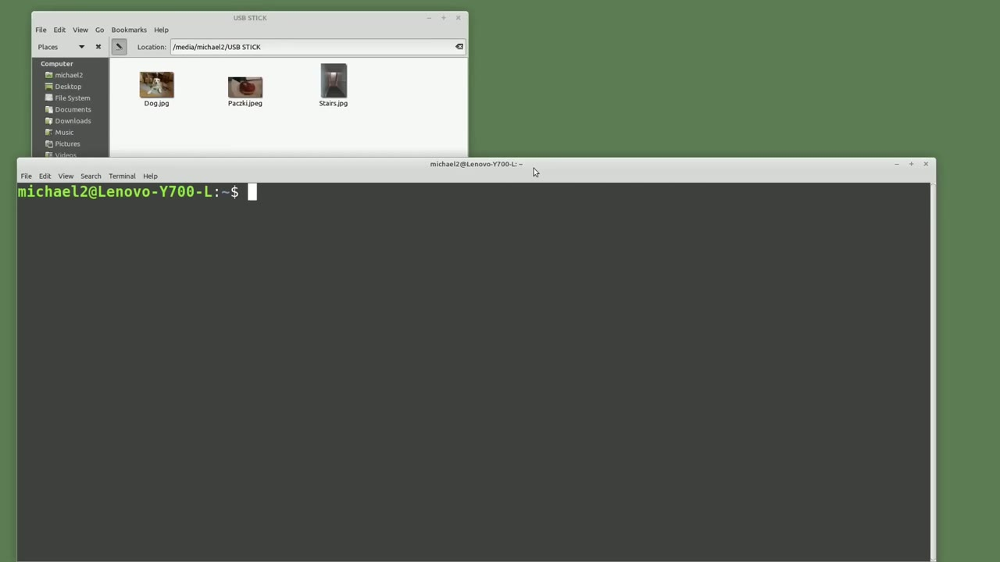
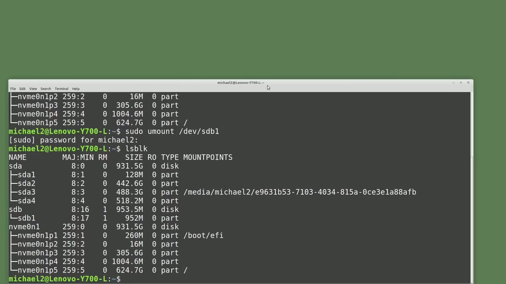
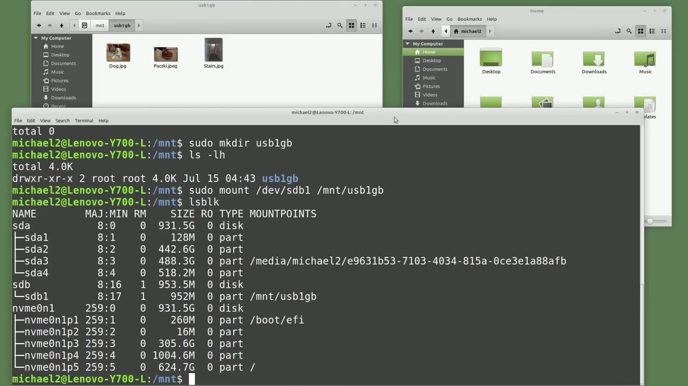
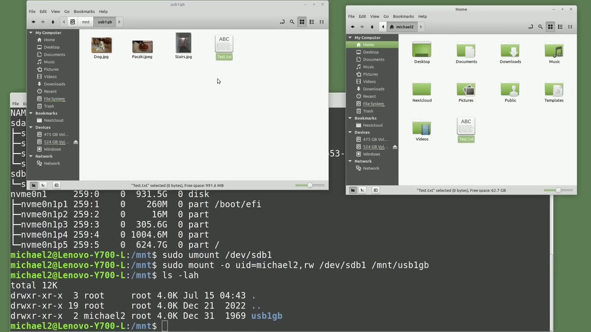

[← Course contents](../../01.md)

# 82. Mount a USB drive

**Course:** [Linux Command Line - Entire Tutorial Series](https://www.youtube.com/watch?v=avg65oY7sj4)  
**Transcript:** [`Linux Command Line - Entire Tutorial Series transcript`](../../../../course_videos/Linux%20Command%20Line%20-%20Entire%20Tutorial%20Series/Linux%20Command%20Line%20-%20Entire%20Tutorial%20Series.txt)  
**Video:** 13:57:52–14:05:54 ([open at this time](https://www.youtube.com/watch?v=avg65oY7sj4&t=50272s))

## Introduction

When I plug a USB flash drive into my Linux Mint operating system, Linux Mint detected that I inserted a USB drive and automatically mounted that drive for me under the slash Media slash Michael 2 directory. It also gave the Michael 2 user read and write permissions to that USB drive. I'm going to type lsblk for list block devices. This shows on this computer we have an NVME drive with five partitions.

## Detailed Explanation

<details>
  <summary>Step 1 — Run `lsblk`, `sudo`</summary>

### Step 1 — Run `lsblk`, `sudo`

- [x] **Use `lsblk`**
  - When I plug a USB flash drive into my Linux Mint operating system, Linux Mint detected that I inserted a USB drive and automatically mounted that drive for me under the slash Media slash Michael 2 directory.
  - It also gave the Michael 2 user read and write permissions to that USB drive.
  - I'm going to type `lsblk` for list block devices.

- [x] **This shows on this computer we have an NVME drive with five partitions**
  - This shows on this computer we have an NVME drive with five partitions.
  - We have an sda drive with four partitions.
  - And we have an sdb drive with a single partition that has 952 megabytes, about one gigabyte.

- [x] **Use `sudo`**
  - And that partition is mounted under slash media.
  - Slash Michael 2. The sbd drive is the USB 1 gigabyte flash drive that I just inserted. I'm going to unmount the USB 1 gigabyte partition. To mount or unmount a partition, I will need to have root privileges. So I will start my command with `sudo`. And then we need to give the command to unmount a drive, which is U mount. And then we need to give the device and partition slash dev.
  - Slash sdb1 and enter unmounts that partition.

- [x] **We can check to make sure it's unmounted by clicking the arrow up to**
  - We can check to make sure it's unmounted by clicking the arrow up to get back to the list block devices command and pressing enter shows that sdb1 is no longer mounted to slash media slash Michael 2.
  - We still see the sdb drive and the sdb one partition but it is not mounted.
  - Now I want to manually mount the sdb1 partition, meaning I want to mount the partition from the command line.

- [x] **A few videos back I mentioned when I manually mounted drive, I prefer**
  - A few videos back I mentioned when I manually mounted drive, I prefer to mount it in the slash mnt directory.

```bash
lsblk
sudo
```



</details>

<details>
  <summary>Step 2 — Run `cd slash`, `ls -lh`, `sudo`</summary>

### Step 2 — Run `cd slash`, `ls -lh`, `sudo`

- [x] **Use `cd slash`, `ls -lh`, `sudo`**
  - Let's go into the slash m&T directory by typing `cd slash` mnti and typing `ls -lh` shows there is nothing in this directory let's create a directory so i'll start it with `sudo` and then mkdiar for make directory and the directory i want to create will be called USB 1gb for one gigabyte USB drive
  - Pressing enter and typing `ls -lh` again shows our directory is created.
  - I can now mount my sdb1 partition to that directory with the command, `sudo`, mount, dev, sdb1, and I want to mount it on slash mnt, USB 1GB.

- [x] **Use `lsblk`**
  - It's now mounted. Now depending on your version of Linux and who you're logged in as, this may be all you need to type in to start working with that partition.
  - Typing `lsblk` shows slash sdb1 is now mounted on slash mnt USB 1GB. Opening a new GUI file browser and changing to the location mnt USB 1GB.
  - Shows the drive was mounted and we have three photos on that partition, so we have read access to that directory.

- [x] **Opening another GUI file browser, I'm going to try and move the**
  - Opening another GUI file browser, I'm going to try and move the test.txt file to the USB 1GB partition.
  - Clicking the Show More Details shows I have a permissions denied error.
  - No problem. We will unmount the sdb1 partition and then mount it again and when we mount the drive we will also give my user id full permissions for that partition.

```bash
cd slash
ls -lh
sudo
sudo mount dev
lsblk
```



</details>

<details>
  <summary>Step 3 — Run `sudo`, `sudo mount`, `type -lowercase`</summary>

### Step 3 — Run `sudo`, `sudo mount`, `type -lowercase`

- [x] **Use `sudo`, `sudo mount`**
  - To unmount USB drive, I will type `sudo`, you mount, slash dev slash sdb1.
  - Now let's remount it and assign permissions when we mount it.
  - We're going to start the command off with `sudo mount`.

- [x] **Use `type -lowercase`**
  - We need to give it an option to assign permissions.
  - So we're going to `type -lowercase` O.
  - And when we look up what the lowercase O stands for, we find that the O is for options.

- [x] **So we are literally giving it the options option**
  - So we are literally giving it the options option.
  - Then I'm going to type UID for user id and equals.
  - And then give the user id I want to assign the permissions, which in this case will be Michael 2.

- [x] **The user id I'm logged in as. Then a comma and the permissions I want**
  - The user id I'm logged in as. Then a comma and the permissions I want to give, which are rw for read right. Then we need to give it the device, which is slash dev sdb1 and where we want to mount it. Slash mn t slash USB 1GB. Pressing enter. I will type l.s -lh. And we see the USB
  - But the group is set at root and the group id has permissions of read execute.

```bash
sudo
sudo mount
type -lowercase
```



</details>

<details>
  <summary>Step 4 — Run `sudo`, `sudo mount -O`, `umask`</summary>

### Step 4 — Run `sudo`, `sudo mount -O`, `umask`

- [x] **Use `sudo`, `sudo mount -O`**
  - Let's first go back to the GUI File Explorer window and make sure we have read-write access to this partition.
  - I am reloading the USB 1GB window and I will try and move the test.txt file to the USB 1GB directory.
  - And it works as expected. Now let's go back to the command line and unmount that partition with `sudo`, U-Mount slash dev sdb1. Now we can mount it again and this time we'll make the Michael 2 id the group as well as the owner. To do that I will type `sudo mount -O` UID equals Michael 2

- [x] **Use `umask`, `ls -lh`**
  - GID equals Michael 2 and now to assign the permissions we're going to use the `umask` equal to 033 the `umask` permissions are calculated by subtracting the permissions you want from 777 we can see here that 777 -744 will give us 033 which is what I have set for the `umask`
  - After setting the permissions we want, we then need to give it the slash device, sdb1, and the location is slash mnt slash USB 1GB.
  - And pressing enter, typing `ls -lh` here shows us the user id and the group id are both Michael 2.

- [x] **And we've changed the permissions to 744 or full permissions for the**
  - And we've changed the permissions to 744 or full permissions for the owner.
  - And read permissions for the group and other.
  - This will stay mounted with these permissions until we you mount the disk or shut down the computer.

- [x] **Use `reboot`**
  - When we `reboot` the computer, we will have to mount that disk again.
  - There is a way to have Linux auto mount a USB drive when we restart the computer, and we'll look at that in the next video for the Linux command line.

```bash
sudo
sudo mount -O
umask
ls -lh
reboot
```



</details>

<details>
  <summary>Questions and Answers</summary>

## Questions and Answers

### Question 1: What does `lsblk` do in this chapter?

<details>
<summary>Answer</summary>

- [x] I'm going to type `lsblk` for list block devices.

</details>

### Question 2: What does `sudo` do in this chapter?

<details>
<summary>Answer</summary>

- [x] Slash Michael 2. The sbd drive is the USB 1 gigabyte flash drive that I just inserted. I'm going to unmount the USB 1 gigabyte partition. To mount or unmount a partition, I will need to have root privileges. So I will start my command with `sudo`. And then we need to give the command to unmount a drive, which is U mount. And then we need to give the device and partition slash dev.

</details>

### Question 3: What does `cd slash` do in this chapter?

<details>
<summary>Answer</summary>

- [x] Let's go into the slash m&T directory by typing `cd slash` mnti and typing ls -lh shows there is nothing in this directory let's create a directory so i'll start it with sudo and then mkdiar for make directory and the directory i want to create will be called USB 1gb for one gigabyte USB drive

</details>

### Question 4: What does `ls -lh` do in this chapter?

<details>
<summary>Answer</summary>

- [x] Let's go into the slash m&T directory by typing cd slash mnti and typing `ls -lh` shows there is nothing in this directory let's create a directory so i'll start it with sudo and then mkdiar for make directory and the directory i want to create will be called USB 1gb for one gigabyte USB drive

</details>

### Question 5: What does `sudo mount dev` do in this chapter?

<details>
<summary>Answer</summary>

- [x] I can now mount my sdb1 partition to that directory with the command, Sudo, mount, dev, sdb1, and I want to mount it on slash mnt, USB 1GB.

</details>

### Question 6: What does `sudo mount` do in this chapter?

<details>
<summary>Answer</summary>

- [x] We're going to start the command off with `sudo mount`.

</details>

### Question 7: What does `type -lowercase` do in this chapter?

<details>
<summary>Answer</summary>

- [x] So we're going to `type -lowercase` O.

</details>

### Question 8: What does `sudo mount -O` do in this chapter?

<details>
<summary>Answer</summary>

- [x] And it works as expected. Now let's go back to the command line and unmount that partition with sudo, U-Mount slash dev sdb1. Now we can mount it again and this time we'll make the Michael 2 id the group as well as the owner. To do that I will type `sudo mount -O` UID equals Michael 2

</details>

### Question 9: What does `umask` do in this chapter?

<details>
<summary>Answer</summary>

- [x] GID equals Michael 2 and now to assign the permissions we're going to use the `umask` equal to 033 the `umask` permissions are calculated by subtracting the permissions you want from 777 we can see here that 777 -744 will give us 033 which is what I have set for the `umask`

</details>

### Question 10: What does `reboot` do in this chapter?

<details>
<summary>Answer</summary>

- [x] When we `reboot` the computer, we will have to mount that disk again.

</details>

</details>

## Summary

This chapter, Mount a USB drive, walks through Run lsblk, sudo; Run cd slash, ls -lh, sudo; Run sudo, sudo mount, type -lowercase; Run sudo, sudo mount -O, umask. Commands from the transcript: `lsblk`, `sudo`, `cd slash`, `ls -lh`, `sudo mount dev`, `sudo mount`, `type -lowercase`, `sudo mount -O`, `umask`, `reboot`.

## References

- [Linux Command Line - Entire Tutorial Series (YouTube)](https://www.youtube.com/watch?v=avg65oY7sj4)
- [This chapter at 13:57:52](https://www.youtube.com/watch?v=avg65oY7sj4&t=50272s)
- [Local transcript](../../../../course_videos/Linux%20Command%20Line%20-%20Entire%20Tutorial%20Series/Linux%20Command%20Line%20-%20Entire%20Tutorial%20Series.txt)
