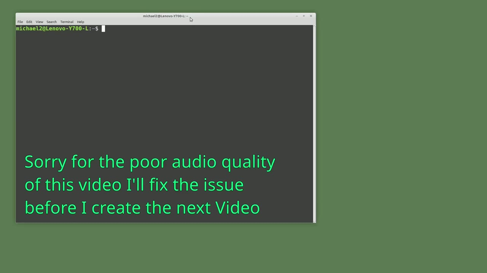
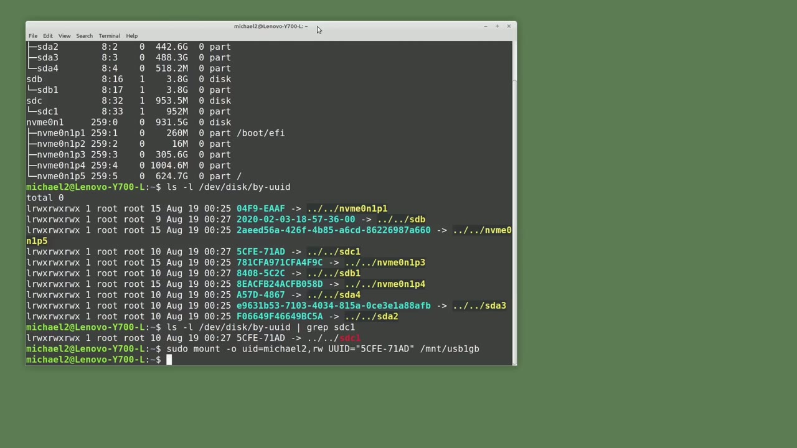
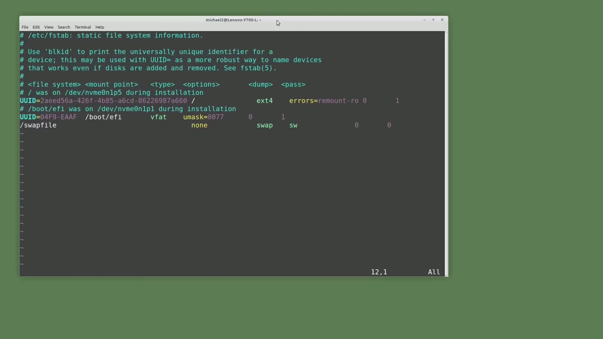
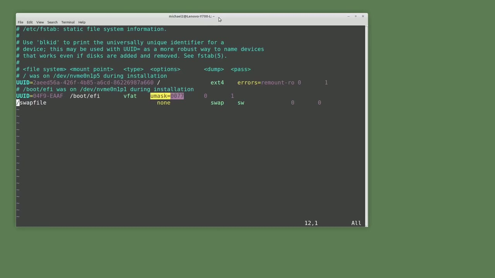
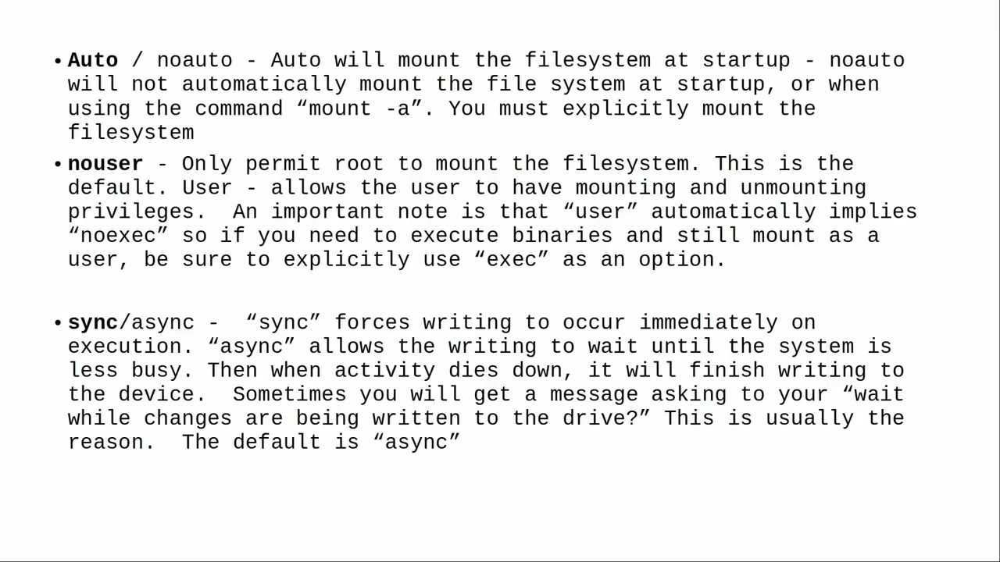

[← Course contents](../../01.md)

# 83. Mount a USB drive at startup

**Course:** [Linux Command Line - Entire Tutorial Series](https://www.youtube.com/watch?v=avg65oY7sj4)  
**Transcript:** [`Linux Command Line - Entire Tutorial Series transcript`](../../../../course_videos/Linux%20Command%20Line%20-%20Entire%20Tutorial%20Series/Linux%20Command%20Line%20-%20Entire%20Tutorial%20Series.txt)  
**Video:** 14:05:54–14:17:55 ([open at this time](https://www.youtube.com/watch?v=avg65oY7sj4&t=50754s))

## Introduction

We mounted a USB flash drive using the mount command after the system had already booted up. In this video, we want to mount our USB drive when the system boots up, but it's going to create a problem for us. I'm going to type lsblk, and we see here that the sdb1 drive is now a 3.8 gigabyte partition. And the one gigabyte USB drive is now sdc1.

## Detailed Explanation

<details>
  <summary>Step 1 — Run `mount`, `lsblk`, `ls -ld -ev`</summary>

### Step 1 — Run `mount`, `lsblk`, `ls -ld -ev`

- [x] **Use `mount`, `lsblk`**
  - We mounted a USB flash drive using the `mount` command after the system had already booted up.
  - In this video, we want to `mount` our USB drive when the system boots up, but it's going to create a problem for us.
  - I'm going to type `lsblk`, and we see here that the sdb1 drive is now a 3.8 gigabyte partition.

- [x] **And the one gigabyte USB drive is now sdc1**
  - And the one gigabyte USB drive is now sdc1.
  - The problem is we can't always count on our one gigabyte USB drive as being the sdb1 drive.
  - To make sure we `mount` the correct drive, we need a way to uniquely identify a hard drive.

- [x] **UUID stands for universally unique identifier**
  - UUID stands for universally unique identifier.
  - It's like a fingerprint, so we can use the UUID to make sure we `mount` the correct drive on startup.
  - The first thing we need to do is find the UUID of the disk we want to auto `mount`.

- [x] **Use `ls -ld -ev`, `grep s-d-c-1`**
  - There are different ways to get the UUID.
  - I'm going to use the command `ls -ld -ev` slash disk slash by-hyphen UUID.
  - We have a couple of disk drives. A way that we can filter this out is by adding pipe, grep, s-d-c-1.

- [x] **It loses the highlighting, but it filters down the output to just one**
  - It loses the highlighting, but it filters down the output to just one record.
  - And I can see the UUID is 5C-F-E-Hin 7-1-A-D.
  - We can now manually `mount` that USB drive, just like we did in the last video, substituting the UUID for the dev sdb1. Here's the command from the last video and I'm going to change the dev sdb1 to u u.uid equals quote 5cf e -71 ad and then end double quote pressing enter

```bash
mount
lsblk
ls -ld -ev
grep s-d-c-1
```



</details>

<details>
  <summary>Step 2 — Run `lsblk`, `df -uppercase`, `sudo -u-Mount`</summary>

### Step 2 — Run `lsblk`, `df -uppercase`, `sudo -u-Mount`

- [x] **Use `lsblk`**
  - Should be mounted let's check it with `lsblk` and there we see sdc 1 mounted mounted on slash mnt slash USB 1GB.
  - I'm going to leave this mounted for now.
  - Now we want to `mount` that partition when we boot up the system.

- [x] **To do that, we're going to want to update the /etc fs tab file**
  - To do that, we're going to want to update the /etc fs tab file.
  - Fstab just stands for File System Table.
  - The line we're going to add to the fs tab file is similar to the command we use to `mount` the USB drive, but it's slightly different.

- [x] **And there is one more thing we need to know before we can create the**
  - And there is one more thing we need to know before we can create the line in our fs tab file.
  - We're going to need to know the partition type of our sdb1 partition.
  - We'll talk more about the different partition types in the next video.

- [x] **Use `df -uppercase`**
  - For now, we just want to know what the partition type is so we can add it to our fs tab command.
  - To get the partition type for the sdc partition, I'm going to type `df -uppercase` T slash dev slash sdc1.
  - This shows us the sdc partition has a file type of vfat.

- [x] **Use `sudo -u-Mount`**
  - And this command is why I left the partition mounted.
  - I'll unmount it now with `sudo -u-Mount` slash dev slash sdc1.
  - And typing lsb-l-k shows us now the drive's unmounted.

- [x] **Use `sudo -cp`**
  - The f-t command again gives us incorrect information, showing us that the partition needs to be mounted to get the file type this way.
  - We're almost ready to update the fs tab file.
  - Before I make any change to the fs tab file, I'm going to make a backup of it with `sudo -cp` slash /etc-slash-F-S-Tab.

- [x] **Use `sudo vim`**
  - The reason for this is, if we have a typo or the like in our fs tab update, there's a chance of us making the machine unbootable.
  - If that happens, we need to log in with the Live Linux Distro and restore our fs tab file from the backup we just took.
  - Now I'm ready to update the fs tab file with vim, so we'll need to have root privileges, so I'm going to type `sudo vim` at C, fstab.

- [x] **Now we're in the fs tab file. We see a lot of comments**
  - Now we're in the fs tab file. We see a lot of comments.
  - Every line that starts with a hash mark symbol is a comment.
  - There is one comment that I want to focus on.

- [x] **Use `mount`**
  - And that's the one with file type, `mount` point, type, options, dump, and pass.
  - Because that's the format the fs tab file follows.
  - Let's look at the first line that is not a comment.

- [x] **We see here it starts off with UUID equals and then a very long UUID**
  - We see here it starts off with UUID equals and then a very long UUID.
  - No big deal. We know what that UUID is, and this drive just has a very long UUID.
  - And the `mount` point for this UID is a single forward slash meaning the root directory so there's nothing new for us in these first two fields they follow the `mount` format that we're already familiar with the next field is the file type here we see it's exte 4 we'll talk about that in the next video but i will mention now that it is a journaling file type the next three are options dump and pass let me make this a little longer

- [x] **We're going to come back to the options in a moment**
  - We're going to come back to the options in a moment.

```bash
lsblk
df -uppercase
sudo -u-Mount
sudo -cp
sudo vim
mount
```



</details>

<details>
  <summary>Step 3 — They're binary options, so they can only be zero or one</summary>

### Step 3 — They're binary options, so they can only be zero or one

- [x] **They're binary options, so they can only be zero or one**
  - They're binary options, so they can only be zero or one.
  - Dump is an outdated method of backup for cases when the system went down.
  - There's no reason to use this, so we're always going to want the dump value to be zero.

- [x] **The last field, pass, that tells the system whether or not to perform**
  - The last field, pass, that tells the system whether or not to perform a file system check on boot.
  - So do we want to run an fs check when mounting the drive?
  - Reason one is it is our root file system.

- [x] **We know that from the forward slash for the mount point**
  - We know that from the forward slash for the mount point.
  - And reason two is the file system is ExtE4, which I mentioned is a journaling file system.
  - And that fs check can help the journaling file system recover after a system crash.

- [x] **This might not recover the system every time, but it does work pretty**
  - This might not recover the system every time, but it does work pretty well.
  - To make things easy, most of the time when we add a drive, we're going to set the dump and pass both to zero.
  - Options are special settings for the partition.

- [x] **Like in the last video, when we mounted the USB drive, we wanted to**
  - Like in the last video, when we mounted the USB drive, we wanted to assign special permissions for the user and the group's id.
  - Those same options work in the fs tab file as well.
  - To keep this video from going on forever, we're just going to look at some of the most common options.

- [x] **Let's start with the option for the home directory that has errors**
  - Let's start with the option for the home directory that has errors equals remount -ro.
  - In short, this option says if there's an error when trying to load this partition, remount it as read only.
  - The theory behind this is that your hard drive is failing and you don't want to write over anything.

- [x] **And you should probably make a backup of anything you really need off**
  - And you should probably make a backup of anything you really need off that hard drive as soon as possible.
  - Looking down at the next partition, the fs tab file is mounting.



</details>

<details>
  <summary>Step 4 — Run `umask`</summary>

### Step 4 — Run `umask`

- [x] **Use `umask`**
  - This has an option of `umask` equals 077.
  - And we talked about the `umask` option in the previous video.
  - This is the equivalent of giving the permissions 700.

- [x] **Often you'll see default as the option, and that's what I'm going to**
  - Often you'll see default as the option, and that's what I'm going to use.
  - Let's take a quick look at the default options, and then we'll update the fs tab file.
  - The default options are, rw, which is read and write for this partition, SUID. When this is set, the mounted partition will recognize a set UID executable.

- [x] **Set UID was covered in Video 25. The opposite is no SUID**
  - Set UID was covered in Video 25. The opposite is no SUID.
  - Dev. Mounting as no dev specifies that the file system cannot contain special devices.
  - It's a security precaution. The default is dev, allowing the creation of character devices.

- [x] **Then we've got Exec, No Exec, Permit Prevent the Execution of**
  - Then we've got Exec, No Exec, Permit Prevent the Execution of Bionaries from the File System.
  - Looking into this a little bit, it looks like there are ways around this, and the usefulness of the No Exec option are questionable.
  - Then the last three are Auto, No Auto, Auto will mount the file system at Startup, No Auto will not automatically mount the file system at startup.

```bash
umask
```



</details>

<details>
  <summary>Step 5 — Run `mount -A`, `sudo mount`, `sudo mount fav`</summary>

### Step 5 — Run `mount -A`, `sudo mount`, `sudo mount fav`

- [x] **Use `mount -A`**
  - Or when using the command, `mount -A`, you must explicitly mount the file system.
  - No user only permit root to mount the file system.
  - User allows the user to have mounting and unmounting privileges.

- [x] **An important note is that user automatically implies no exec**
  - An important note is that user automatically implies no exec.
  - So if you need to execute binaries and still mount as user, be sure to explicitly use exec as an option.
  - So if it doesn't work, you might have it in the wrong order.

- [x] **Sync async. Sync forces writing to occur immediately on execution**
  - Sync async. Sync forces writing to occur immediately on execution.
  - Async allows the writing to wait until the system is less busy.
  - Then, when the activity dies down, it will finish writing to that device.

- [x] **Sometimes you'll get a message asking you to wait while the changes**
  - Sometimes you'll get a message asking you to wait while the changes are being written to the drive.
  - This is usually the reason. The default is async.
  - Okay, let's add our line. I'm going to start with UUID equals 5C-FE.

- [x] **Use `sudo mount`**
  - 7 1 ad and we want to mount this on M&T slash USB 1GB.
  - I'm going to press tab here and type vfat for the file type, tab, and then my options as defaults.
  - After we save the file, we want to run a test mount and this can be done with `sudo mount`.

- [x] **Use `sudo mount fav`, `sudo mount -Fav`**
  - -a actually i'm going to make an error in our fs tab just to show what one might look like let's change the 5c to 5d now that is incorrect so now when we type `sudo mount fav` we see we get an error can't find u u id 5d f efe and we can do the same thing with
  - So I can't find it. Let's go in and fix our problem.
  - `sudo mount -Fav`.

- [x] **Use `cd m-n-t`**
  - We see it's successfully mounted, and if we do the A as well, we don't get the message like we do with fav.
  - So it's mounted, and we can see that with l-s-b-l-k, and we can also go into it by typing cd, m-n-t, USB, 1GB.
  - Now our drive should mount every time we restart the computer.

- [x] **In the next video, we'll continue looking at the Linux command line**
  - In the next video, we'll continue looking at the Linux command line.
  - In these next few videos, we're going to look at working with partitions on a USB drive.

```bash
mount -A
sudo mount
sudo mount fav
sudo mount -Fav
cd m-n-t
```



</details>

<details>
  <summary>Questions and Answers</summary>

## Questions and Answers

### Question 1: What does `mount` do in this chapter?

<details>
<summary>Answer</summary>

- [x] We mounted a USB flash drive using the `mount` command after the system had already booted up.

</details>

### Question 2: What does `lsblk` do in this chapter?

<details>
<summary>Answer</summary>

- [x] I'm going to type `lsblk`, and we see here that the sdb1 drive is now a 3.8 gigabyte partition.

</details>

### Question 3: What does `ls -ld -ev` do in this chapter?

<details>
<summary>Answer</summary>

- [x] I'm going to use the command `ls -ld -ev` slash disk slash by-hyphen UUID.

</details>

### Question 4: What does `grep s-d-c-1` do in this chapter?

<details>
<summary>Answer</summary>

- [x] We have a couple of disk drives. A way that we can filter this out is by adding pipe, grep, s-d-c-1.

</details>

### Question 5: What does `df -uppercase` do in this chapter?

<details>
<summary>Answer</summary>

- [x] To get the partition type for the sdc partition, I'm going to type `df -uppercase` T slash dev slash sdc1.

</details>

### Question 6: What does `sudo -u-Mount` do in this chapter?

<details>
<summary>Answer</summary>

- [x] I'll unmount it now with `sudo -u-Mount` slash dev slash sdc1.

</details>

### Question 7: What does `sudo -cp` do in this chapter?

<details>
<summary>Answer</summary>

- [x] Before I make any change to the fs tab file, I'm going to make a backup of it with `sudo -cp` slash /etc-slash-F-S-Tab.

</details>

### Question 8: What does `sudo vim` do in this chapter?

<details>
<summary>Answer</summary>

- [x] Now I'm ready to update the fs tab file with vim, so we'll need to have root privileges, so I'm going to type `sudo vim` at C, fstab.

</details>

### Question 9: What does `umask` do in this chapter?

<details>
<summary>Answer</summary>

- [x] This has an option of `umask` equals 077.

</details>

### Question 10: What does `mount -A` do in this chapter?

<details>
<summary>Answer</summary>

- [x] Or when using the command, `mount -A`, you must explicitly mount the file system.

</details>

### Question 11: What does `sudo mount` do in this chapter?

<details>
<summary>Answer</summary>

- [x] After we save the file, we want to run a test mount and this can be done with `sudo mount`.

</details>

### Question 12: What does `sudo mount fav` do in this chapter?

<details>
<summary>Answer</summary>

- [x] -a actually i'm going to make an error in our fs tab just to show what one might look like let's change the 5c to 5d now that is incorrect so now when we type `sudo mount fav` we see we get an error can't find u u id 5d f efe and we can do the same thing with

</details>

</details>

## Summary

This chapter, Mount a USB drive at startup, walks through Run mount, lsblk, ls -ld -ev; Run lsblk, df -uppercase, sudo -u-Mount; They're binary options, so they can only be zero or one; Run umask; Run mount -A, sudo mount, sudo mount fav. Commands from the transcript: `mount`, `lsblk`, `ls -ld -ev`, `grep s-d-c-1`, `df -uppercase`, `sudo -u-Mount`, `sudo -cp`, `sudo vim`, `umask`, `mount -A`, `sudo mount`, `sudo mount fav`, `sudo mount -Fav`, `cd m-n-t`.

## References

- [Linux Command Line - Entire Tutorial Series (YouTube)](https://www.youtube.com/watch?v=avg65oY7sj4)
- [This chapter at 14:05:54](https://www.youtube.com/watch?v=avg65oY7sj4&t=50754s)
- [Local transcript](../../../../course_videos/Linux%20Command%20Line%20-%20Entire%20Tutorial%20Series/Linux%20Command%20Line%20-%20Entire%20Tutorial%20Series.txt)
