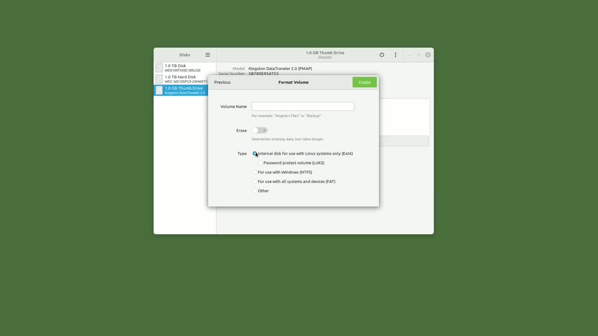
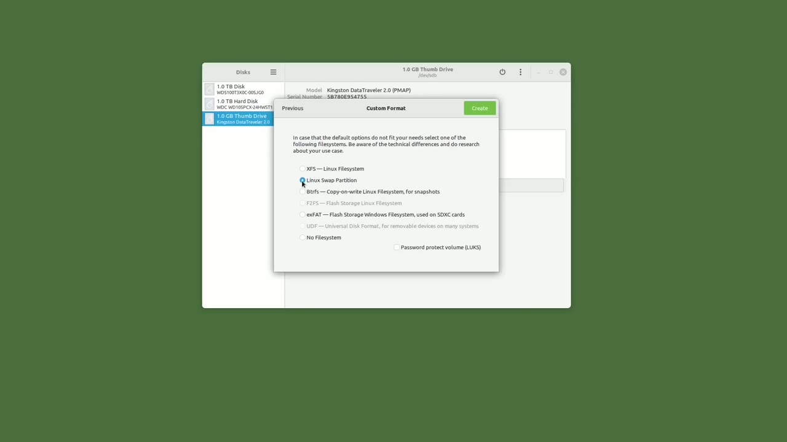

[← Course contents](../../01.md)

# 84. Partition a USB drive (GUI)

**Course:** [Linux Command Line - Entire Tutorial Series](https://www.youtube.com/watch?v=avg65oY7sj4)  
**Transcript:** [`Linux Command Line - Entire Tutorial Series transcript`](../../../../course_videos/Linux%20Command%20Line%20-%20Entire%20Tutorial%20Series/Linux%20Command%20Line%20-%20Entire%20Tutorial%20Series.txt)  
**Video:** 14:17:55–14:29:40 ([open at this time](https://www.youtube.com/watch?v=avg65oY7sj4&t=51475s))

## Introduction

In this video, we're going to look at deleting, adding, and resizing partitions of a USB drive using a GUI environment. Because in a GUI environment it is a lot easier to visualize the process and follow the steps of what is going on. Then in the next video we're going to do the same thing from a command line environment. The first thing I'm going to do is plug in my 1 gigabyte flash drive.

## Detailed Explanation

<details>
  <summary>Step 1 — In this video, we're going to look at deleting, adding, and resizing</summary>

### Step 1 — In this video, we're going to look at deleting, adding, and resizing

- [x] **In this video, we're going to look at deleting, adding, and resizing**
  - In this video, we're going to look at deleting, adding, and resizing partitions of a USB drive using a GUI environment.
  - Because in a GUI environment it is a lot easier to visualize the process and follow the steps of what is going on.
  - Then in the next video we're going to do the same thing from a command line environment.

- [x] **The first thing I'm going to do is plug in my 1 gigabyte flash drive**
  - The first thing I'm going to do is plug in my 1 gigabyte flash drive.
  - And then I'm going to open up the GUI program disks.
  - Over on the left I see three hard drives.

- [x] **My 1 gigabyte flash drive is here at the bottom, so I will click on**
  - My 1 gigabyte flash drive is here at the bottom, so I will click on that.
  - At the top we see model, serial number, size, and partitioning of Master Boot Record.
  - We are going to talk about the Master Boot Record in an upcoming video.

- [x] **In this video, we're only looking at deleting, adding, and resizing**
  - In this video, we're only looking at deleting, adding, and resizing partitions.
  - This shows we have a single partition for the entire drive.
  - The information below volume shows the single partition has a size of 997 megabytes.

- [x] **The contents, or disk format, is fat 32. We see the device is slash**
  - The contents, or disk format, is fat 32. We see the device is slash dev slash sdb1, and has a UUID of b0d4-c2f3, and the partition type of Windows 95 Fat 32.
  - I want to change the partitions on this disk and to make any changes I will need to unmount the drive.
  - Moving my mouse over the square shows the message unmount the selected partition.

- [x] **We only have one partition and it is selected so I will click on the**
  - We only have one partition and it is selected so I will click on the square to unmount the partition.
  - The square becomes a triangle or play button to mount the partition showing it is...
  - Unmounted. From here, I can press the red -sign to remove the partition, or I can reformat it by clicking on these gears for additional partition options, and then clicking on format partition.

- [x] **I'm going to click on the red -sign and delete the partition and**
  - I'm going to click on the red -sign and delete the partition and confirm it, and we see now that the volume shows we have one gigabyte of free space.
  - My play stop button has changed to a plus sign and hovering over it shows create partition in unallocated space.
  - I will click that and I want this partition to take the entire one gigabyte.

- [x] **We're going to leave the volume name blank**
  - We're going to leave the volume name blank.
  - We're not going to talk about volume names in this video.
  - That just forces in zeros before creating the partition.

- [x] **And for type, we see the default is for use with all systems and**
  - And for type, we see the default is for use with all systems and devices fat.
  - Above that, we have for use with Windows ntfs.
  - And above that, we see Internal Disc for use with Linux systems only, ExtE4.

- [x] **Those are the three most common file types for Linux users**
  - Those are the three most common file types for Linux users.


</details>

<details>
  <summary>Step 2 — most likely, you'll use one of those three file types</summary>

### Step 2 — most likely, you'll use one of those three file types

- [x] **So most likely, you'll use one of those three file types**
  - So most likely, you'll use one of those three file types.
  - Depending on what type of data you're planning on putting on the USB drive, or what file systems you're planning on using it with.
  - If I click here on Other and then next, we'll see there are more file systems to choose from.

- [x] **We see XFS Linux File System, Linux Swap Partition, btrfs, Copy on**
  - We see XFS Linux File System, Linux Swap Partition, btrfs, Copy on Write, Linux File System for Snapshots, exfat, Flash Storage, Windows File Systems used on sdxc cards, and no file system.
  - But the file system options do not stop there.
  - I'm going to open up G-Parted, another disk tool, and going into the devices, sdb, new file system types.

- [x] **And we see we have even more options here**
  - And we see we have even more options here.
  - I'm going to close this and go back to disks.
  - Because there's way too many file options in G-Parted.

- [x] **Discs gives us a good enough variety to look at**
  - Discs gives us a good enough variety to look at.
  - We can talk about the difference between the file systems and why we might choose one over another.
  - Let's go back to the previous screen and start with the Exte4 file system.

- [x] **Exty4 is the fourth generation of the extended file system**
  - Exty4 is the fourth generation of the extended file system.
  - It was based on the Minix file system and was able to extend some of the file limitations of the Minix file system.


</details>

<details>
  <summary>Step 3 — We see ExtE4 is specific to Linux file systems only</summary>

### Step 3 — We see ExtE4 is specific to Linux file systems only

- [x] **We see ExtE4 is specific to Linux file systems only**
  - We see ExtE4 is specific to Linux file systems only.
  - In the last video we talked about Exty4 being a journaling file system, which means it keeps track of the changes not yet committed, and in the event of a system crash, If we have the fs check enabled, it is possible to recover from a system crash on the next system boot.
  - So Exti4 is a great file system option for the Linux operating system, but it might not be the best option for our 1 gigabyte USB drive.

- [x] **Linux and Windows computers will have no problems reading the ntfs**
  - Linux and Windows computers will have no problems reading the ntfs file system.
  - So if you know you're only going to use this USB drive with Windows and Linux operating systems, ntfs is an option you may want to consider.
  - The third option, fat, works with all file systems and is the default.

- [x] **That's the one that I use most often for my USB drives, because I**
  - That's the one that I use most often for my USB drives, because I never know when I might have to read a file off one of my USB drives on a Windows or Mac computer.
  - Fat does have a file limitation size of 4 gigabytes.
  - So if I try to move a single file that is larger than 4 gigabytes to a fat formatted USB drive, it will fail.

- [x] **This USB drive is only 1 gigabyte, so fat is what I will use for this**
  - This USB drive is only 1 gigabyte, so fat is what I will use for this USB drive.
  - In the way that it is a journaling file system and supports very large files and file systems.
  - It is a default file system for most of the Red Hat file-based distributions.

- [x] **There are differences between the two, but most of them are**
  - There are differences between the two, but most of them are negligible for most of us Home Linux users.
  - I think that Red Hat Enterprise Linux, or rel systems, use XFS over Exty4, Because of the file benefits it gets when working with millions of files daily, which some corporations do.
  - Situations most of us home users will never even come close to.

- [x] **One difference I did notice between the XFS file system and ExtE4**
  - One difference I did notice between the XFS file system and ExtE4 file system was XFS file partitions cannot be decreased in size.
  - XFS file partitions can be increased in size, but to reduce an XFS file partition, You'll have to delete the partition and then recreate it as a smaller size.
  - We'll look at increasing and decreasing file partitions later in this video.



</details>

<details>
  <summary>Step 4 — Run `top`</summary>

### Step 4 — Run `top`

- [x] **Use `top`**
  - We talked about this when we were going over the `top` command in Video 60 and 61.
  - The swap partition is the overflow space for RAM memory.
  - Btrfs, some people pronounce this butter fs or better fs.

- [x] **Is a copy-on-write Linux file system for snapshots**
  - Is a copy-on-write Linux file system for snapshots.
  - The copy-on-write is also known as cow, and when you open or view data, you're looking at a copy or a pointer to that resource.
  - Then when an update is made, it is only saving the change.

- [x] **So a snapshot isn't a backup, but a picture of what the computer**
  - So a snapshot isn't a backup, but a picture of what the computer looked like at that moment the snapshot was made, keeping only the changes since the last snapshot.
  - It is very quick and easy to restore to that snapshot moment in time if needed.
  - Snapshots are not recommended as a long-term backup solution.

- [x] **Backups and snapshots are two different things**
  - Backups and snapshots are two different things.
  - A backup is a copy of your entire file system volume at the time the backup was performed.
  - A snapshot is more of a fancy set of copy on write hard links that are limited to that same btrfs partition.

- [x] **X-fat is a file system for USB drives and sd cards from Microsoft**
  - X-fat is a file system for USB drives and sd cards from Microsoft.
  - The advantage of x-fat over the fat file system is that x-fat can handle files larger than 4 gigabytes.

```bash
top
```



</details>

<details>
  <summary>Step 5 — The USB drive I'm using today is only 1 gigabyte, so fat is a great</summary>

### Step 5 — The USB drive I'm using today is only 1 gigabyte, so fat is a great

- [x] **The USB drive I'm using today is only 1 gigabyte, so fat is a great**
  - The USB drive I'm using today is only 1 gigabyte, so fat is a great choice for that.
  - But if I have a USB that is greater than 4 gigabytes, I might consider formatting that as x-fat.
  - Just because there's a chance I may want to place a file larger than 4 gigabytes on that drive.

- [x] **And then the last option is no file system**
  - And then the last option is no file system.
  - Okay, I'm going to the previous screen, and I'm going to format this as fat for use with all systems and devices.
  - And then clicking Create, and we've created a single file partition using all the space on this USB drive.

- [x] **To do that, I will need to reduce the size of the current partition**
  - To do that, I will need to reduce the size of the current partition, and then add in the second partition.
  - Now, if this was formatted as an XFS file system, we would not be able to reduce the size of the volume.
  - Let's go into the gears and click resize.

- [x] **Here's the current partition size, 999 megabytes**
  - Here's the current partition size, 999 megabytes.
  - If I click the -sign, it goes down to 998.
  - 997 I want to change this by we'll see 300 pressing the tab key resets all those numbers and I'll have free space of 300 megabytes so let's resize this and here we see partition 1 is formatted as fat and we've got free space here so I'm going to click on the free space of 300 megabytes and I want to create a partition in the unallocated space

- [x] **I want the partition size to take up all 300 megabytes**
  - I want the partition size to take up all 300 megabytes.
  - And instead of making this one fat, I'm going to make this one an ExtE4 partition.
  - Clicking Create is creating that partition right now, and it's completed.

- [x] **So now we have our single one gigabyte USB drive formatted to two**
  - So now we have our single one gigabyte USB drive formatted to two partitions.
  - The first partition is 699 megabytes of the fat formatted partition.
  - And our second partition is a 300 megabyte ExtE4 partition.

- [x] **In the next video, we're going to do the same thing using only the**
  - In the next video, we're going to do the same thing using only the Linux command line.


</details>

<details>
  <summary>Questions and Answers</summary>

## Questions and Answers

### Question 1: What does `top` do in this chapter?

<details>
<summary>Answer</summary>

- [x] We talked about this when we were going over the `top` command in Video 60 and 61.

</details>

### Question 2: What does step 1 cover (In this video, we're going to look at deleting, adding, and resizing)?

<details>
<summary>Answer</summary>

- [x] In this video, we're going to look at deleting, adding, and resizing partitions of a USB drive using a GUI environment.
- [x] Because in a GUI environment it is a lot easier to visualize the process and follow the steps of what is going on.
- [x] Then in the next video we're going to do the same thing from a command line environment.

</details>

### Question 3: What does step 2 cover (most likely, you'll use one of those three file types)?

<details>
<summary>Answer</summary>

- [x] So most likely, you'll use one of those three file types.
- [x] Depending on what type of data you're planning on putting on the USB drive, or what file systems you're planning on using it with.
- [x] If I click here on Other and then next, we'll see there are more file systems to choose from.

</details>

### Question 4: What does step 3 cover (We see ExtE4 is specific to Linux file systems only)?

<details>
<summary>Answer</summary>

- [x] We see ExtE4 is specific to Linux file systems only.
- [x] In the last video we talked about Exty4 being a journaling file system, which means it keeps track of the changes not yet committed, and in the event of a system crash, If we have the fs check enabled, it is possible to recover from a system crash on the next system boot.
- [x] So Exti4 is a great file system option for the Linux operating system, but it might not be the best option for our 1 gigabyte USB drive.

</details>

### Question 5: What does step 4 cover (Run top)?

<details>
<summary>Answer</summary>

- [x] We talked about this when we were going over the `top` command in Video 60 and 61.
- [x] The swap partition is the overflow space for RAM memory.
- [x] Btrfs, some people pronounce this butter fs or better fs.

</details>

### Question 6: What does step 5 cover (The USB drive I'm using today is only 1 gigabyte, so fat is a great)?

<details>
<summary>Answer</summary>

- [x] The USB drive I'm using today is only 1 gigabyte, so fat is a great choice for that.
- [x] But if I have a USB that is greater than 4 gigabytes, I might consider formatting that as x-fat.
- [x] Just because there's a chance I may want to place a file larger than 4 gigabytes on that drive.

</details>

</details>

## Summary

This chapter, Partition a USB drive (GUI), walks through In this video, we're going to look at deleting, adding, and resizing; most likely, you'll use one of those three file types; We see ExtE4 is specific to Linux file systems only; Run top; The USB drive I'm using today is only 1 gigabyte, so fat is a great. Commands from the transcript: `top`.

## References

- [Linux Command Line - Entire Tutorial Series (YouTube)](https://www.youtube.com/watch?v=avg65oY7sj4)
- [This chapter at 14:17:55](https://www.youtube.com/watch?v=avg65oY7sj4&t=51475s)
- [Local transcript](../../../../course_videos/Linux%20Command%20Line%20-%20Entire%20Tutorial%20Series/Linux%20Command%20Line%20-%20Entire%20Tutorial%20Series.txt)
