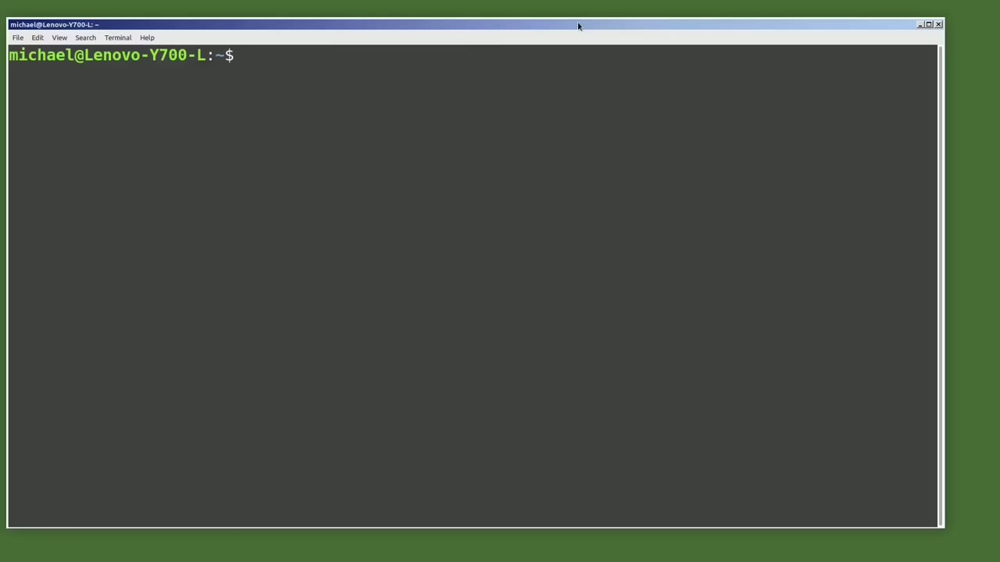
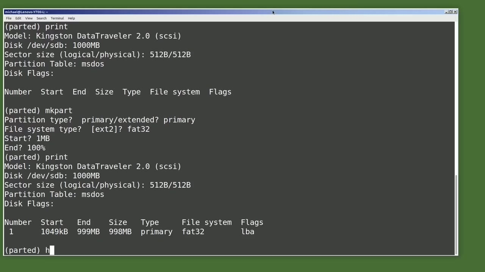
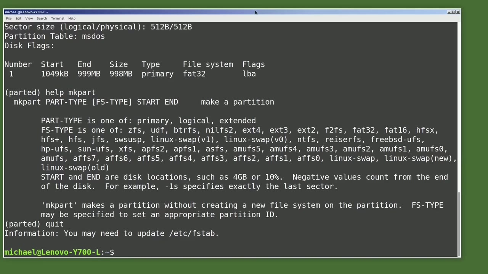
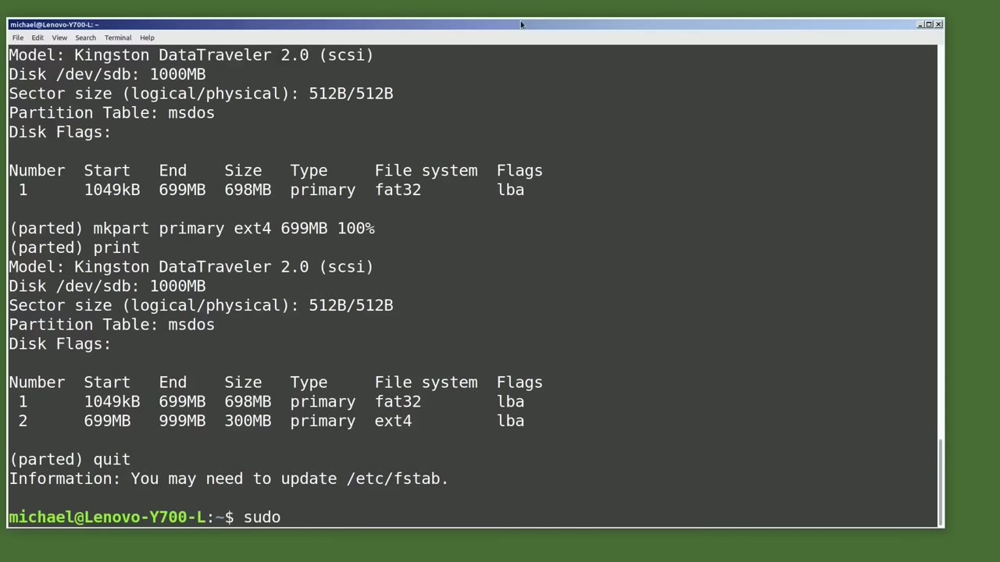

[← Course contents](../../01.md)

# 85. Partition a USB drive using CLI

**Course:** [Linux Command Line - Entire Tutorial Series](https://www.youtube.com/watch?v=avg65oY7sj4)  
**Transcript:** [`Linux Command Line - Entire Tutorial Series transcript`](../../../../course_videos/Linux%20Command%20Line%20-%20Entire%20Tutorial%20Series/Linux%20Command%20Line%20-%20Entire%20Tutorial%20Series.txt)  
**Video:** 14:29:40–14:41:16 ([open at this time](https://www.youtube.com/watch?v=avg65oY7sj4&t=52180s))

## Introduction

I just plugged in the USB drive we reformatted in the last video, and I'm typing lsblk. We see we have two partitions on the sdb drive. I will unmount those two partitions with you mount slash dev sdb1 and you mount slash dev sdb2 and typing lsblk again shows that the two two partitions are unmounted. There are two popular command line tools for disk partitioning. They are fdisk and parted. In this video we're going to use parted. We'll take a look at fdisk in a future tutorial. We need to have root privileges to work with the parted command so i will start the command with sudo and then type parted since we did not tell parted which disk we wanted to work with it defaulted to the first disc it

## Detailed Explanation

<details>
  <summary>Step 1 — Run `lsblk`, `fdisk`, `parted`</summary>

### Step 1 — Run `lsblk`, `fdisk`, `parted`

- [x] **Use `lsblk`, `fdisk`, `parted`**
  - I just plugged in the USB drive we reformatted in the last video, and I'm typing `lsblk`.
  - We see we have two partitions on the sdb drive.
  - I will unmount those two partitions with you mount slash dev sdb1 and you mount slash dev sdb2 and typing `lsblk` again shows that the two two partitions are unmounted. There are two popular command line tools for disk partitioning. They are `fdisk` and `parted`. In this video we're going to use `parted`.

- [x] **Use `fdisk`, `parted`, `sudo`**
  - We'll take a look at `fdisk` in a future tutorial. We need to have root privileges to work with the `parted` command so i will start the command with `sudo` and then type `parted` since we did not tell `parted` which disk we wanted to work with it defaulted to the first disc it
  - Found which is dev sda that is definitely not the drive i want to work with so i'm going to quit out of this by typing quit i'm going to `clear` the screen by typing `clear` I'm going to type `sudo parted` again, but this time I'm going to add on slash dev slash sdb.
  - I'm typing sdb to tell `parted`.

- [x] **I want to work with the entire sdb drive**
  - I want to work with the entire sdb drive.
  - Now I see that I'm using slash dev slash sdb.
  - And that is the drive that we want to work with.

- [x] **Use `parted`, `help`**
  - Now I'm in the `parted` prompt.
  - I see a little welcome message that says I can type `help` to see a list of commands.
  - So I will type `help`.

- [x] **Use `rm`**
  - And here I see a list of commands and a lot of these are what we're going to use in this video.
  - We're going to use the print to display partition information.
  - We're going to use `rm` number to delete the partitions that are currently there.

- [x] **We're going to use mk Part to create a partition**
  - We're going to use mk Part to create a partition.
  - We will use Resize Part to shrink our Fat partition.
  - And then we will use mk Part again to create our second Linux partition.

- [x] **So we're going to do the same thing we did in the last video, only**
  - So we're going to do the same thing we did in the last video, only this time from the command line.
  - And that shows us some general disk information and then the two partitions created in the last video.
  - Our fat 32 partition is partition number one and our ExtT4 partition is partition number two.

- [x] **I'm going to remove the fat 32 partition with rm1**
  - I'm going to remove the fat 32 partition with rm1.
  - And then I'm going to type print to show that it's gone.
  - Now I'll remove partition number two with rm2.

- [x] **And then I'll print that out to show that there are now no partitions**
  - And then I'll print that out to show that there are now no partitions on this USB drive.
  - Now I want to create the Fat 32 partition, just like we did in the last video.
  - And I'll do that with mk Part for Make Partition.

- [x] **Now it's asking us for a partition type, primary or extended**
  - Now it's asking us for a partition type, primary or extended.

```bash
lsblk
fdisk
parted
sudo
clear
sudo parted
help
rm
```



</details>

<details>
  <summary>Step 2 — Run `help`, `parted`</summary>

### Step 2 — Run `help`, `parted`

- [x] **We didn't have this question when we used the GUI partition creator**
  - We didn't have this question when we used the GUI partition creator.
  - Well, actually, we did have that option in the GUI screen.
  - Here's a picture of the creative partition from the GUI screen, and we see there is a checkbox for extended partition.

- [x] **We did not check the checkbox in the last video**
  - We did not check the checkbox in the last video.
  - We made our partition a primary partition in the last video by not checking that checkbox, so I will make this partition a primary partition here as well.
  - We'll go over the difference between primary and extended partitions in the next video now it's asking us for a file system type we want fat 32 and now it's asking us where do we want to start this partition we want to start it at the beginning so i will type in 1 mb now it's asking us where do we want this partition to end i will

- [x] **Use 100% use up all of the free space on this disk. Pressing Enter**
  - Use 100% use up all of the free space on this disk. Pressing Enter and our partition is created.
  - Let's make sure it was created by typing print and we see our partition right there.
  - We have a single fat partition using all of the space on this USB drive.

- [x] **Use `help`**
  - Now from here I'm going to type `help` mk Part.
  - For `help` with the mk Part command that we just used.
  - The first thing that it shows us is that we could have typed all of the options on one line.

- [x] **Use `parted`**
  - Since I only typed mk `parted` went into interactive mode to `help` me complete the rest of the command, but I could have typed all the parts on a single line and hit Enter.
  - We'll do that when we create our Linux partition.
  - Looking at the next line of `help`, we see Part Type, Primary, Logical, Extended.

- [x] **In the next video then we see f s type and it lists all the types**
  - In the next video then we see f s type and it lists all the types that we can format the partitions to we are only using fat 32 and exte 4 in this video then we see start and end for the partition disk locations we can type a number or the percentage we wanted to use i'll use both in this video
  - But while doing some research for this video, I saw some people recommending percentages over the memory locations.
  - Now, these last lines of the `help` are very important.

- [x] **Use `parted`**
  - It says mk Part makes a partition without creating a new file system on that partition.
  - What this means is `parted` has created a partition, and the partition information says the file system on this partition is fat 32.
  - But inside the partition, `parted` has not created a file system.

- [x] **Use `parted`**
  - That's something that we, the command line users, will have to do.
  - I'm going to quit out of `parted`.
  - The command to make a file system is mkfs, but we will need root privileges to use this command.

```bash
help
parted
```



</details>

<details>
  <summary>Step 3 — Run `sudo`, `parted`, `sudo parted`</summary>

### Step 3 — Run `sudo`, `parted`, `sudo parted`

- [x] **Use `sudo`, `parted`, `sudo parted`**
  - So I will start this with `sudo`, then mkfs, then a period, and the file system we want this to be in this case, fat and then we want to give it the option of uppercase f32 for the fat 32 option then we want to give it the partition that we want formatted which is slash dev slash sdb1 and press and enter it made our
  - file system for us okay let's go back into `parted` with `sudo parted` devsdbb And I'll type print just to show what we have right now.
  - And we see the single partition, which is fat 32.

- [x] **Now what I want to do is resize this partition to shrink it down to**
  - Now what I want to do is resize this partition to shrink it down to make room for our Linux partition.
  - And I want this to be for partition number one.
  - And I want it to end at, I'm going to make it 300 megabytes.

- [x] **So instead of 999 mb, I want this to be 699 mb**
  - So instead of 999 mb, I want this to be 699 mb.
  - Now, I could also have typed -300 mb to free up 300 megabytes, but I chose to use the ending megabytes.
  - And now when I type print, we see that our ending megabyte is 699 mb.

- [x] **Now I want to create our second partition, our Linux partition, on a**
  - Now I want to create our second partition, our Linux partition, on a single line command.
  - And now we know the format that part it is expecting.
  - So I will type mk part and then primary.

- [x] **We're making this one also a primary partition, just like we did the**
  - We're making this one also a primary partition, just like we did the last video.
  - We want this to be a file type of ExtE4.
  - So it will use all the free space available after 699 mb.

- [x] **The first one, fat 32 and our second one, ExtE4**
  - The first one, fat 32 and our second one, ExtE4.
  - Now we've created our Linux partition, but we haven't yet created the file system on that partition.
  - And now I want to make that file system, the ExtE4 file system.

```bash
sudo
parted
sudo parted
```



</details>

<details>
  <summary>Step 4 — Run `sudo`, `parted`</summary>

### Step 4 — Run `sudo`, `parted`

- [x] **Use `sudo`**
  - So I'll type `sudo`.
  - Now it's telling us that it created an EXT4 file system on there already, which is interesting since the help screen was telling us that it did not create one.
  - So I'm not sure if the documentation's off or not, but I'm going to proceed anyway and write this EXT4 partition over the ext partition that's already there.

- [x] **Now, it would be preferable if they just would have added that mkfs**
  - Now, it would be preferable if they just would have added that mkfs command as part of the mk Part command, but they didn't.
  - So we had to manually add in the file system.
  - Now, what if in part ed, I said the file system is Fat 32 and then I added an ExtE4 file system in place of that on Linux machine?

- [x] **That won't be a problem for the most part**
  - That won't be a problem for the most part.
  - There may be a program or two that does not like that, but for the most part, it should work on a Linux computer.
  - On a Windows computer, Windows will not be able to read that ExtE4 partition and want to reformat it, so we can read it.

- [x] **Use `parted`**
  - I'm going to go back into `parted` and type print.
  - And we see our two partitions are created, the first one showing a 699 megabyte fat 32 partition.
  - And the second, a 300 megabyte Linux ExtE4 partition, just like we did in the previous video, only this time from the command line.

- [x] **In the next video, we're going to look at disk label partition table**
  - In the next video, we're going to look at disk label partition table for the Linux command line.

```bash
sudo
parted
```



</details>

<details>
  <summary>Questions and Answers</summary>

## Questions and Answers

### Question 1: What does `lsblk` do in this chapter?

<details>
<summary>Answer</summary>

- [x] I just plugged in the USB drive we reformatted in the last video, and I'm typing `lsblk`.

</details>

### Question 2: What does `fdisk` do in this chapter?

<details>
<summary>Answer</summary>

- [x] I will unmount those two partitions with you mount slash dev sdb1 and you mount slash dev sdb2 and typing lsblk again shows that the two two partitions are unmounted. There are two popular command line tools for disk partitioning. They are `fdisk` and parted. In this video we're going to use parted.

</details>

### Question 3: What does `parted` do in this chapter?

<details>
<summary>Answer</summary>

- [x] I will unmount those two partitions with you mount slash dev sdb1 and you mount slash dev sdb2 and typing lsblk again shows that the two two partitions are unmounted. There are two popular command line tools for disk partitioning. They are fdisk and `parted`. In this video we're going to use `parted`.

</details>

### Question 4: What does `sudo` do in this chapter?

<details>
<summary>Answer</summary>

- [x] We'll take a look at fdisk in a future tutorial. We need to have root privileges to work with the parted command so i will start the command with `sudo` and then type parted since we did not tell parted which disk we wanted to work with it defaulted to the first disc it

</details>

### Question 5: What does `clear` do in this chapter?

<details>
<summary>Answer</summary>

- [x] Found which is dev sda that is definitely not the drive i want to work with so i'm going to quit out of this by typing quit i'm going to `clear` the screen by typing `clear` I'm going to type sudo parted again, but this time I'm going to add on slash dev slash sdb.

</details>

### Question 6: What does `sudo parted` do in this chapter?

<details>
<summary>Answer</summary>

- [x] Found which is dev sda that is definitely not the drive i want to work with so i'm going to quit out of this by typing quit i'm going to clear the screen by typing clear I'm going to type `sudo parted` again, but this time I'm going to add on slash dev slash sdb.

</details>

### Question 7: What does `help` do in this chapter?

<details>
<summary>Answer</summary>

- [x] I see a little welcome message that says I can type `help` to see a list of commands.

</details>

### Question 8: What does `rm` do in this chapter?

<details>
<summary>Answer</summary>

- [x] We're going to use `rm` number to delete the partitions that are currently there.

</details>

</details>

## Summary

This chapter, Partition a USB drive using CLI, walks through Run lsblk, fdisk, parted; Run help, parted; Run sudo, parted, sudo parted; Run sudo, parted. Commands from the transcript: `lsblk`, `fdisk`, `parted`, `sudo`, `clear`, `sudo parted`, `help`, `rm`.

## References

- [Linux Command Line - Entire Tutorial Series (YouTube)](https://www.youtube.com/watch?v=avg65oY7sj4)
- [This chapter at 14:29:40](https://www.youtube.com/watch?v=avg65oY7sj4&t=52180s)
- [Local transcript](../../../../course_videos/Linux%20Command%20Line%20-%20Entire%20Tutorial%20Series/Linux%20Command%20Line%20-%20Entire%20Tutorial%20Series.txt)
