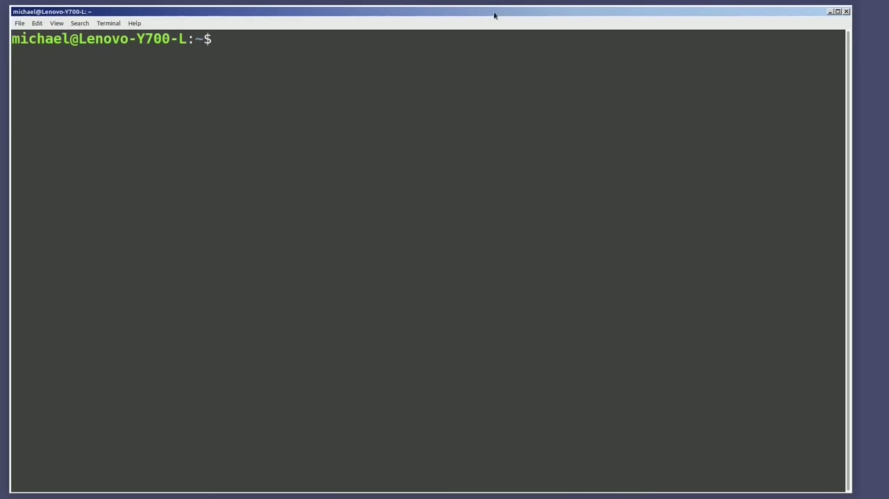
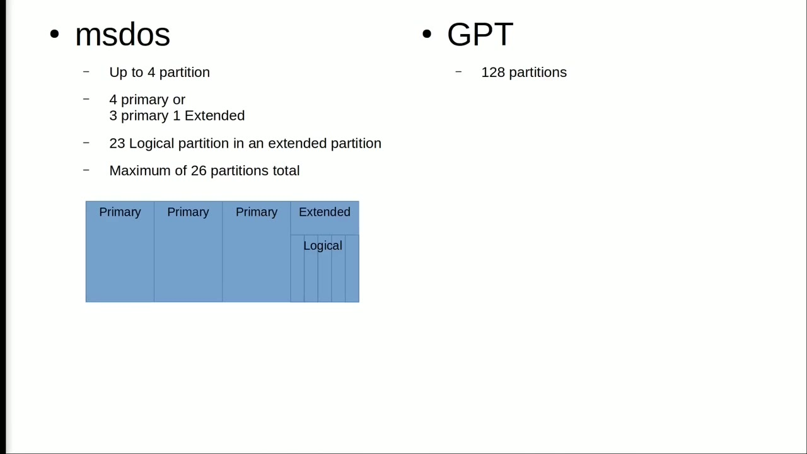
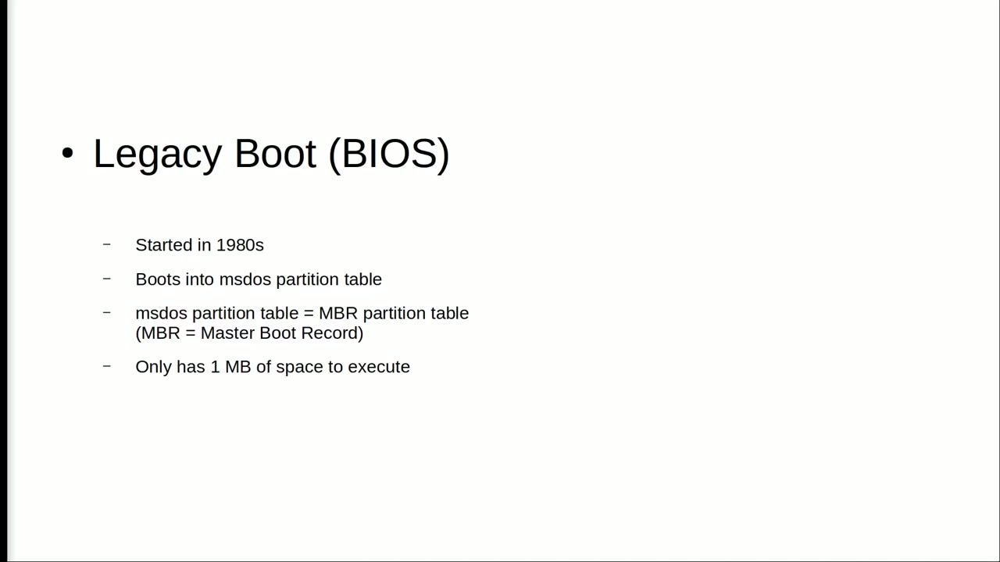
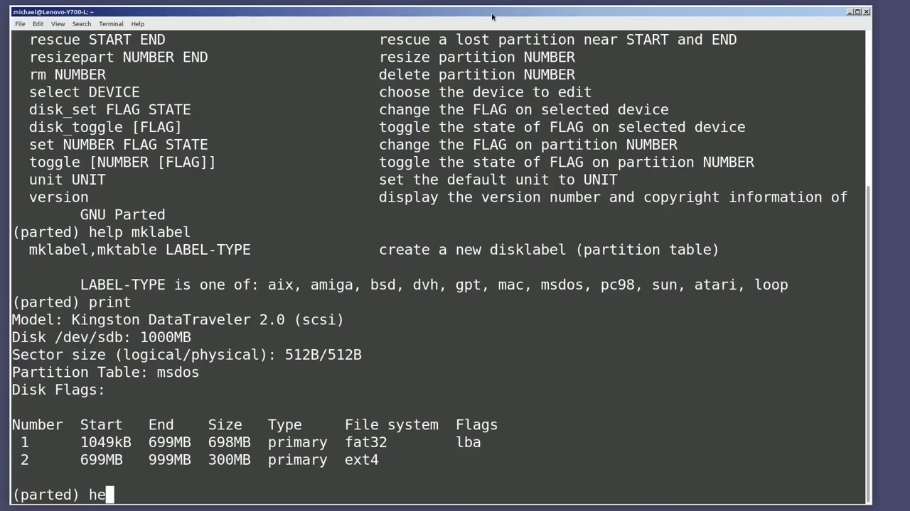

[← Course contents](../../01.md)

# 86. mklabel, mktable

**Course:** [Linux Command Line - Entire Tutorial Series](https://www.youtube.com/watch?v=avg65oY7sj4)  
**Transcript:** [`Linux Command Line - Entire Tutorial Series transcript`](../../../../course_videos/Linux%20Command%20Line%20-%20Entire%20Tutorial%20Series/Linux%20Command%20Line%20-%20Entire%20Tutorial%20Series.txt)  
**Video:** 14:41:16–14:50:25 ([open at this time](https://www.youtube.com/watch?v=avg65oY7sj4&t=52876s))

## Introduction

In the last video, we looked at parted. So I'm going to open up parted again for my flash drive in this video with Sudo parted. Dev sdb. And I'm going to type Help. One of the commands that we did not look at in the last video is called Make Label, Make Table, and that will create a new disk label partition table. I'm going to type Help Make Label. And partage shows us label type is one of, and then it lists a bunch of label types. We're only going to look at two of the label types in this video, GPT and ms dos.

## Detailed Explanation

<details>
  <summary>Step 1 — Run `parted`, `sudo parted`, `help`</summary>

### Step 1 — Run `parted`, `sudo parted`, `help`

- [x] **Use `parted`, `sudo parted`, `help`**
  - In the last video, we looked at `parted`.
  - So I'm going to open up `parted` again for my flash drive in this video with `sudo parted`.
  - Dev sdb. And I'm going to type `help`. One of the commands that we did not look at in the last video is called Make Label, Make Table, and that will create a new disk label partition table. I'm going to type `help` Make Label. And partage shows us label type is one of, and then it lists a bunch of label types.

- [x] **We're only going to look at two of the label types in this video, GPT**
  - We're only going to look at two of the label types in this video, GPT and ms dos.
  - GPT and ms dos are the most common and understanding them will give you a good head start if you ever need to use one of the other label types listed here.
  - When we make a disk label partition table, we are reformatting the hard drive and creating a disk partition table that will define how many partitions we can have on that USB drive.

- [x] **It does a few other things that we'll look at later in this video**
  - It does a few other things that we'll look at later in this video, but for the moment, we are going to focus on the partitions for an ms-dos disk partition table, and the partitions for a GPT disk partition table.
  - The ms-dos disk partition table will allow up to four partitions, which means we can have up to four primary partitions or up to three primary partitions and a single extended partition.
  - The advantage of the extended partition is that the extended partition can then be split into logical partitions.

- [x] **The total number of logical partitions is 23**
  - The total number of logical partitions is 23.
  - An ms-dos disk partition limit is 26 partitions, which is pretty good.
  - That's a lot of partitions more than I've ever needed.

- [x] **I've created a little diagram here of what an ms dos disk may look**
  - I've created a little diagram here of what an ms dos disk may look like with three primary partitions and an extended partition with five logical partitions for a total of eight partitions on this disk.
  - A GPT disk partition table will allow up to 128 partitions.

```bash
parted
sudo parted
help
```



</details>

<details>
  <summary>Step 2 — GPT does not know anything about primary or extended partitions</summary>

### Step 2 — GPT does not know anything about primary or extended partitions

- [x] **GPT does not know anything about primary or extended partitions**
  - GPT does not know anything about primary or extended partitions. They're all just partitions.
  - We're just looking at partitions for a portable USB drive, so I was just talking specifically about partitions.
  - To get a better understanding of the difference between ms dos and GPT, it might be better to start from the beginning.

- [x] **And when I say the beginning, I mean when we power on the computer**
  - And when I say the beginning, I mean when we power on the computer.
  - When we power on a computer, the motherboard on that computer has a chip with some software on it called BIOS. BIOS stands for basic input output system. And it does things like test the memory, sets the system clock. It also configures the keyboard, mouse, and other hardware attached to the computer.
  - After it does all that, it looks for a drive with a bootloader on it. And the bootloader, in our case, is going to have an ms dos partition table or GPT partition table. That brings us to the two main types of BIOS on the motherboard.

- [x] **Now I know some of you are thinking, it's not UEFI BIOS**
  - Now I know some of you are thinking, it's not UEFI BIOS.
  - I understand that, but for the sake of this explanation, I'm calling it UEFI BIOS.
  - And Legacy BIOS is called Legacy BIOS or Legacy Boot on UEFI computers.

- [x] **On all the other computers, it's just called BIOS**
  - On all the other computers, it's just called BIOS.
  - Bios, now known as Legacy Bios, legacy boot, came first.
  - Bios was created in the 1980s and would boot into an ms dos partition table.

- [x] **The ms dos partition table is also known as the MBR partition table**
  - The ms dos partition table is also known as the MBR partition table.
  - It's called the Master Boot Record because there is a 1 megabyte boot sector on the hard drive for the partition table information.



</details>

<details>
  <summary>Step 3 — that would be the master boot record that one master boot sector could</summary>

### Step 3 — that would be the master boot record that one master boot sector could

- [x] **And that would be the master boot record that one master boot sector**
  - And that would be the master boot record that one master boot sector could get corrupt and you would need to restore it or all the data on that disk would be lost the ms dOS mBR partition table has a limit of two terabytes which in the 1980s was huge but today hard drives with more than two
  - Terabytes of storage is common and the ms dOS mbr partition table can only use two terabytes of that The ms-dos MBR partition table runs in a 16-bit processor mode.
  - Efi stands for Extensible Firmware Interface.

- [x] **Shortly after that came UEFI, Unified Extensible Firmware Interface**
  - Shortly after that came UEFI, Unified Extensible Firmware Interface.
  - GPT stands for the guid partition table.
  - So the pt is for partition table, and the guid stands for globally unique identifier.

- [x] **With the globally unique identifier added, we can now add secure**
  - With the globally unique identifier added, we can now add secure boot, which can ensure that only trusted software can be executed on our system.
  - We are no longer limited to a one megabyte disk sector.
  - The GPT partition table is copied redundantly on the disk, so if one area is corrupt, the disk can still be red. The limit is now 9.4 zeta bytes, which is about the size of the entire internet today.

- [x] **It can run in 32-bit or 64-bit mode. The UEFI BIOS can handle a lot**
  - It can run in 32-bit or 64-bit mode. The UEFI BIOS can handle a lot more hardware details for the CPU, memory, storage, and fans.
  - It also supports newer technologies like USB 3.0, NVME, and PCIs. UEFI is backwards compatible, so secure boot can be turned off and operating systems created before uEFI can be loaded on a uEFI computer i'm still imparted in the command line window and i'm going to type print we see the two
  - Partitions we created in the last video and if we look up under partition table we will see ms dos showing this is a disk partition table of ms dos which we know is also known as MBR Master Boot Record Disc Partition.

- [x] **I want to change this to a g-p-t partition table**
  - I want to change this to a g-p-t partition table.



</details>

<details>
  <summary>Step 4 — Run `help`, `sudo`, `parted`</summary>

### Step 4 — Run `help`, `sudo`, `parted`

- [x] **Use `help`**
  - I'm going to type `help` to show our options again, and then I'm going to type M-K-T-A-B-L-E-G-T.
  - I'm getting a warning that the partitions are still mounted, so let's cancel this, quit, and type l-s-b-l-k.
  - And then we're going to you mount dev sdb1 and you mount sdb2 and go back and departed.

- [x] **Let's try the command again, make table GPT**
  - Let's try the command again, make table GPT.
  - Now it's telling me that all the data on the disk will be destroyed.
  - And it's showing us now that we've got a partition table of GPT.

- [x] **Let's make a partition with m-k-p-a-r-t**
  - Let's make a partition with m-k-p-a-r-t.
  - And notice now it's asking us for a partition name and not if we want to make this a primary or extended partition.
  - I want to use the entire USB drive, so I will type 100%.

- [x] **Use `sudo`**
  - And notice it did not ask us what type of file system we plan on adding to this partition.
  - I'm going to quit out and add a file system.
  - Let's add the file system with `sudo` make fs.

- [x] **Use `parted`**
  - We'll make this a fat file system, f32 for 32 bit, dev sdb.
  - One it's made let's go back in to `parted` and type print and there we see we've created a fat 32 file system on our single partition on that disk drive in the next video we will continue looking at the Linux command line in the last video we

```bash
help
sudo
parted
```



</details>

<details>
  <summary>Questions and Answers</summary>

## Questions and Answers

### Question 1: What does `parted` do in this chapter?

<details>
<summary>Answer</summary>

- [x] In the last video, we looked at `parted`.

</details>

### Question 2: What does `sudo parted` do in this chapter?

<details>
<summary>Answer</summary>

- [x] So I'm going to open up parted again for my flash drive in this video with `sudo parted`.

</details>

### Question 3: What does `help` do in this chapter?

<details>
<summary>Answer</summary>

- [x] Dev sdb. And I'm going to type `help`. One of the commands that we did not look at in the last video is called Make Label, Make Table, and that will create a new disk label partition table. I'm going to type `help` Make Label. And partage shows us label type is one of, and then it lists a bunch of label types.

</details>

### Question 4: What does `sudo` do in this chapter?

<details>
<summary>Answer</summary>

- [x] Let's add the file system with `sudo` make fs.

</details>

### Question 5: What does step 1 cover (Run parted, sudo parted, help)?

<details>
<summary>Answer</summary>

- [x] In the last video, we looked at `parted`.
- [x] So I'm going to open up `parted` again for my flash drive in this video with `sudo parted`.
- [x] Dev sdb. And I'm going to type `help`. One of the commands that we did not look at in the last video is called Make Label, Make Table, and that will create a new disk label partition table. I'm going to type `help` Make Label. And partage shows us label type is one of, and then it lists a bunch of label types.

</details>

### Question 6: What does step 2 cover (GPT does not know anything about primary or extended partitions)?

<details>
<summary>Answer</summary>

- [x] GPT does not know anything about primary or extended partitions. They're all just partitions.
- [x] We're just looking at partitions for a portable USB drive, so I was just talking specifically about partitions.
- [x] To get a better understanding of the difference between ms dos and GPT, it might be better to start from the beginning.

</details>

### Question 7: What does step 3 cover (that would be the master boot record that one master boot sector could)?

<details>
<summary>Answer</summary>

- [x] And that would be the master boot record that one master boot sector could get corrupt and you would need to restore it or all the data on that disk would be lost the ms dOS mBR partition table has a limit of two terabytes which in the 1980s was huge but today hard drives with more than two
- [x] Terabytes of storage is common and the ms dOS mbr partition table can only use two terabytes of that The ms-dos MBR partition table runs in a 16-bit processor mode.
- [x] Efi stands for Extensible Firmware Interface.

</details>

### Question 8: What does step 4 cover (Run help, sudo, parted)?

<details>
<summary>Answer</summary>

- [x] I'm going to type `help` to show our options again, and then I'm going to type M-K-T-A-B-L-E-G-T.
- [x] I'm getting a warning that the partitions are still mounted, so let's cancel this, quit, and type l-s-b-l-k.
- [x] And then we're going to you mount dev sdb1 and you mount sdb2 and go back and departed.

</details>

</details>

## Summary

This chapter, mklabel, mktable, walks through Run parted, sudo parted, help; GPT does not know anything about primary or extended partitions; that would be the master boot record that one master boot sector could; Run help, sudo, parted. Commands from the transcript: `parted`, `sudo parted`, `help`, `sudo`.

## References

- [Linux Command Line - Entire Tutorial Series (YouTube)](https://www.youtube.com/watch?v=avg65oY7sj4)
- [This chapter at 14:41:16](https://www.youtube.com/watch?v=avg65oY7sj4&t=52876s)
- [Local transcript](../../../../course_videos/Linux%20Command%20Line%20-%20Entire%20Tutorial%20Series/Linux%20Command%20Line%20-%20Entire%20Tutorial%20Series.txt)
