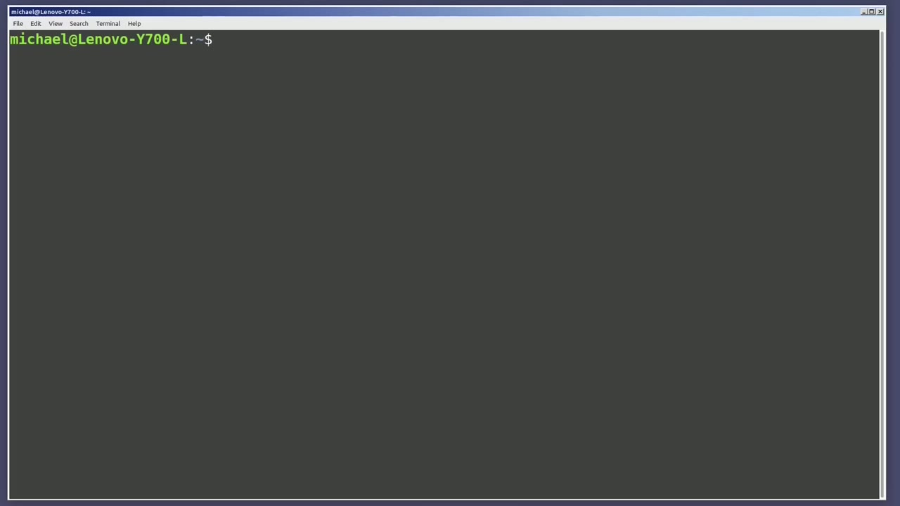
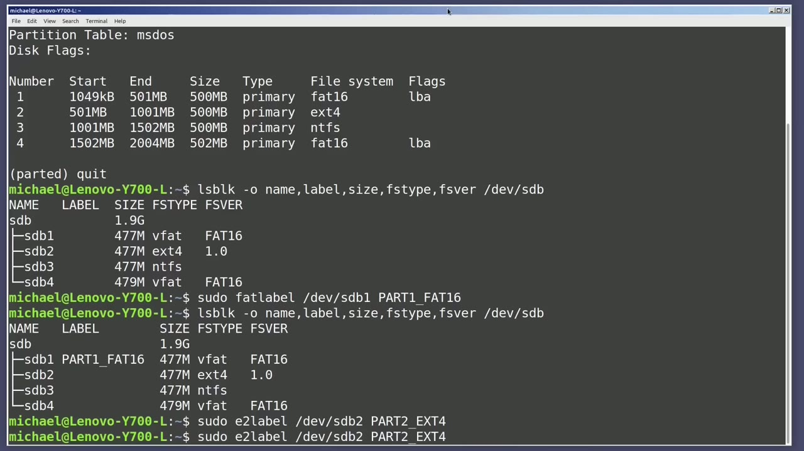
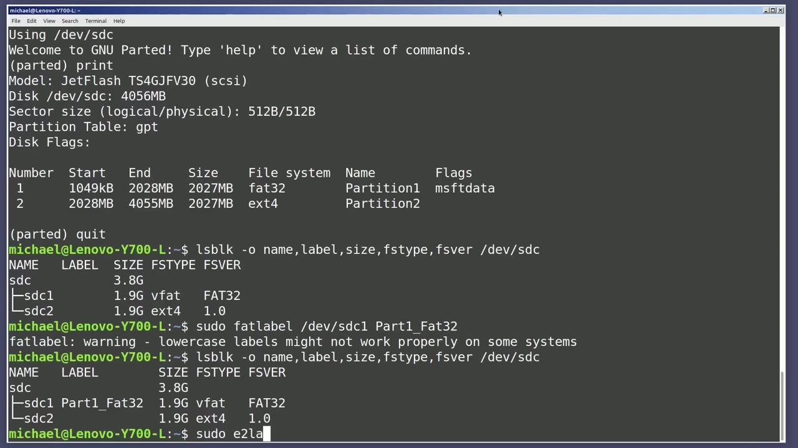
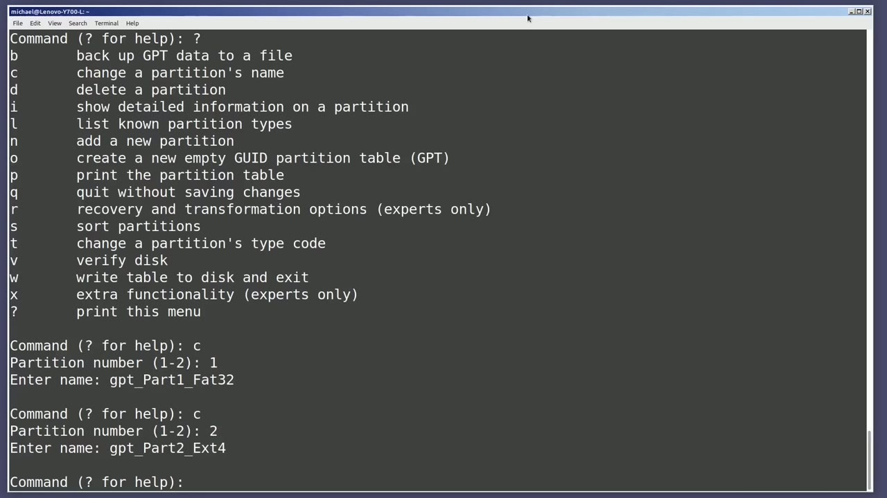

[← Course contents](../../01.md)

# 87. Partition Label

**Course:** [Linux Command Line - Entire Tutorial Series](https://www.youtube.com/watch?v=avg65oY7sj4)  
**Transcript:** [`Linux Command Line - Entire Tutorial Series transcript`](../../../../course_videos/Linux%20Command%20Line%20-%20Entire%20Tutorial%20Series/Linux%20Command%20Line%20-%20Entire%20Tutorial%20Series.txt)  
**Video:** 14:50:25–14:59:50 ([open at this time](https://www.youtube.com/watch?v=avg65oY7sj4&t=53425s))

## Introduction

Talked about disk label partition tables in this video we're going to talk partition labels. Since we're already familiar with parted, I'm going to type Sudo parted slash dev slash sdb. And then I'll type print. We see here that we have an ms-dos partition table and we have four partitions. The first one is fat 16. The second one is ExtE4. The third one is an ntfs partition and the fourth partition is fat 16. I want to label these partitions to show the file system in the partition label.

## Detailed Explanation

<details>
  <summary>Step 1 — Run `parted`, `sudo parted`, `lsblk -o`</summary>

### Step 1 — Run `parted`, `sudo parted`, `lsblk -o`

- [x] **Use `parted`, `sudo parted`, `lsblk -o`**
  - Talked about disk label partition tables in this video we're going to talk partition labels. Since we're already familiar with `parted`, I'm going to type `sudo parted` slash dev slash sdb. And then I'll type print. We see here that we have an ms-dos partition table and we have four partitions. The first one is fat 16. The second one is
  - ExtE4. The third one is an ntfs partition and the fourth partition is fat 16. I want to label these partitions to show the file system in the partition label.
  - So I'll quit out of here with quit. And I'm going to view the current partition labels, as well as some other partition information with the command, `lsblk -o`. And then I want to show the fields name, label, size. I'm also going to show the file system type and the file system version for the device sdb.

- [x] **And we see in that second column label that nothing is labeled**
  - And we see in that second column label that nothing is labeled.
  - I'm going to create a file partition label for the first partition, and the first partition has a file system type of fat.
  - So I'll use the fat label command to update that partition label.

- [x] **Use `sudo`**
  - I'll need to be a privileged user, so I'll type `sudo`, then fat label.
  - Then I want to give it the device, dev, sdb1, and then the name of the label I want to put on this partition.
  - I'll call this Part 1 underscore Fat 16.

- [x] **Use `ls block`**
  - There are other ways to rename a Fat file system label.
  - Pressing Enter, the partition names on an ms dos partition label are limited to 11 characters, and it's recommended to use uppercase.
  - And then pressing the arrow up to bring back that `ls block` command, shows the Fat 16 Partition 1 was renamed to Part 1 underscore Fat 16.

- [x] **Use `sudo`**
  - Our second partition has a file system of ExtE4, so the Fat label command won't work here.
  - To rename the Exte4 partition label, I'm going to use the command, `sudo` e2 label slash dev slash sdb2, and I'm going to rename this to Part 2 underscore ExtE4.
  - And there are other ways to rename an EXT4 partition label.

```bash
parted
sudo parted
lsblk -o
sudo
ls block
```



</details>

<details>
  <summary>Step 2 — Run `ls block`, `sudo -ntfs label`, `sudo`</summary>

### Step 2 — Run `ls block`, `sudo -ntfs label`, `sudo`

- [x] **Use `ls block`, `sudo -ntfs label`**
  - Pressing the arrow up again to bring back the `ls block` command shows our ExtE4 partition has a label of part two underscore Exte4.
  - Our third partition is formatted as an ntfs `file` system.
  - To label an ntfs partition, I will use `sudo -ntfs label`.

- [x] **Slash dev slash sdb3 and then we'll call it p-a-r-t-3 underscore ntfs**
  - Slash dev slash sdb3 and then we'll call it p-a-r-t-3 underscore ntfs.
  - And then arrowing up shows that that label has been updated.
  - And then the last partition is again another fat 16.

- [x] **Use `sudo`, `ls block`, `lsblk`**
  - So I'll type `sudo` fat label slash dev slash sdb4 part.
  - 4 underscore fat 16 and once again hitting that arrow up to go back to `ls block` command shows all our partitions are labeled typing the `lsblk` command again shows I have another flash drive assigned here is sdc with two partitions sdc 1 and sdc 2 typing `sudo parted` slash DevSDC and then print shows this partition table is formatted as GPT.
  - We have two partitions. Partition 1 is a fat 32 and partition 2 is an ExtE4 partition.

- [x] **Use `lsblk`, `file`**
  - I'm going to quit out of here with quit and type the `lsblk` command again.
  - And again, I want the name, label, size, `file` system type, `file` system version for device sdc.
  - Once again, we see the partitions do not have any labels in that column two.

- [x] **Use `sudo`, `ls block`**
  - So I'm going to relabel that with `sudo` fat label dev sdc1, part one underscore fat 32.
  - And the gp t dis partition tables can handle lowercase letters in the `file` name but as a message says they might not work properly on some systems let's see how it works here by bringing back the `ls block` and it looks fine i'm going to re-label the ext4 partition with

```bash
ls block
sudo -ntfs label
sudo
lsblk
sudo parted
file
```



</details>

<details>
  <summary>Step 3 — Run `sudo`, `sudo -g -disc`</summary>

### Step 3 — Run `sudo`, `sudo -g -disc`

- [x] **Use `sudo`**
  - `sudo` e2 label dev sdc2 and we're going to call this p-a-r-t-2 underscore e-x-t-4.
  - And showing that the labels are created with the lsb-l-k command, and they're both there.
  - From here, I want to look at another disk command called G-Disc.

- [x] **Use `sudo -g -disc`**
  - To get into G-Disc, I will type `sudo -g -disc`.
  - The first thing it's asking for is it's asking me what device do I want to open with G disk.
  - It looks around and tells us that it found a GPT disk partition for the device we requested.

- [x] **And it tells us we can type a question mark for help**
  - And it tells us we can type a question mark for help.
  - And we can see we can do a lot of things here.
  - The one that I'm interested in is the C change a partition's name.

- [x] **It's asking us which partition we want to change**
  - It's asking us which partition we want to change.
  - And we're going to call this partition GPT underscore Part 1 underscore Fat 32.
  - While we're here, let's change the other partition name.

- [x] **I'll do that again with C, partition number two, and we'll give that**
  - I'll do that again with C, partition number two, and we'll give that the name, GPT underscore Part 2 underscore ExtT4.

```bash
sudo
sudo -g -disc
```



</details>

<details>
  <summary>Step 4 — Run `w`, `ls block`, `parted`</summary>

### Step 4 — Run `w`, `ls block`, `parted`

- [x] **Use `w`**
  - I'll need to write these changes by typing `w`.
  - Now I'm getting a big warning here that it's going to overwrite the existing partitions.
  - I don't have anything written on those partitions, so it's okay for me.

- [x] **Use `ls block`**
  - And it lets me know that I wrote a new guid partition.
  - Let's check the labels now with the `ls block` command that we used earlier.
  - And there's no change to the partition labels.

- [x] **That's because GDisc told us it was going to update the partition name**
  - That's because GDisc told us it was going to update the partition name.
  - But we still see the partition name as sdc 1 and sdc2.
  - So how do we see that updated partition name?

- [x] **Use `parted`, `sudo parted`**
  - One way is with `parted`.
  - `sudo parted` slash dev sdc.
  - There we see the file partition names of the GPT Part 1, Fat 32, and the GPT Part 2, Ext, 4.

- [x] **Use `ls block`**
  - And another way to see the partition name is to add in to our `ls block` the field part label.
  - So we're going to have the label, then the part label, then the size, fs type, and fs version.
  - And there we also can see the partition name that we updated with the G-disc command.

- [x] **In the next video, we'll continue looking at the Linux command line**
  - In the next video, we'll continue looking at the Linux command line.

```bash
w
ls block
parted
sudo parted
```



</details>

<details>
  <summary>Questions and Answers</summary>

## Questions and Answers

### Question 1: What does `parted` do in this chapter?

<details>
<summary>Answer</summary>

- [x] Talked about disk label partition tables in this video we're going to talk partition labels. Since we're already familiar with `parted`, I'm going to type Sudo `parted` slash dev slash sdb. And then I'll type print. We see here that we have an ms-dos partition table and we have four partitions. The first one is fat 16. The second one is

</details>

### Question 2: What does `sudo parted` do in this chapter?

<details>
<summary>Answer</summary>

- [x] Talked about disk label partition tables in this video we're going to talk partition labels. Since we're already familiar with parted, I'm going to type `sudo parted` slash dev slash sdb. And then I'll type print. We see here that we have an ms-dos partition table and we have four partitions. The first one is fat 16. The second one is

</details>

### Question 3: What does `lsblk -o` do in this chapter?

<details>
<summary>Answer</summary>

- [x] So I'll quit out of here with quit. And I'm going to view the current partition labels, as well as some other partition information with the command, `lsblk -o`. And then I want to show the fields name, label, size. I'm also going to show the file system type and the file system version for the device sdb.

</details>

### Question 4: What does `sudo` do in this chapter?

<details>
<summary>Answer</summary>

- [x] I'll need to be a privileged user, so I'll type `sudo`, then fat label.

</details>

### Question 5: What does `ls block` do in this chapter?

<details>
<summary>Answer</summary>

- [x] And then pressing the arrow up to bring back that `ls block` command, shows the Fat 16 Partition 1 was renamed to Part 1 underscore Fat 16.

</details>

### Question 6: What does `sudo -ntfs label` do in this chapter?

<details>
<summary>Answer</summary>

- [x] To label an ntfs partition, I will use `sudo -ntfs label`.

</details>

### Question 7: What does `lsblk` do in this chapter?

<details>
<summary>Answer</summary>

- [x] 4 underscore fat 16 and once again hitting that arrow up to go back to ls block command shows all our partitions are labeled typing the `lsblk` command again shows I have another flash drive assigned here is sdc with two partitions sdc 1 and sdc 2 typing sudo Parted slash DevSDC and then print shows this partition table is formatted as GPT.

</details>

### Question 8: What does `file` do in this chapter?

<details>
<summary>Answer</summary>

- [x] And again, I want the name, label, size, `file` system type, `file` system version for device sdc.

</details>

### Question 9: What does `sudo -g -disc` do in this chapter?

<details>
<summary>Answer</summary>

- [x] To get into G-Disc, I will type `sudo -g -disc`.

</details>

### Question 10: What does `w` do in this chapter?

<details>
<summary>Answer</summary>

- [x] I'll need to write these changes by typing `w`.

</details>

</details>

## Summary

This chapter, Partition Label, walks through Run parted, sudo parted, lsblk -o; Run ls block, sudo -ntfs label, sudo; Run sudo, sudo -g -disc; Run w, ls block, parted. Commands from the transcript: `parted`, `sudo parted`, `lsblk -o`, `sudo`, `ls block`, `sudo -ntfs label`, `lsblk`, `file`, `sudo -g -disc`, `w`.

## References

- [Linux Command Line - Entire Tutorial Series (YouTube)](https://www.youtube.com/watch?v=avg65oY7sj4)
- [This chapter at 14:50:25](https://www.youtube.com/watch?v=avg65oY7sj4&t=53425s)
- [Local transcript](../../../../course_videos/Linux%20Command%20Line%20-%20Entire%20Tutorial%20Series/Linux%20Command%20Line%20-%20Entire%20Tutorial%20Series.txt)
