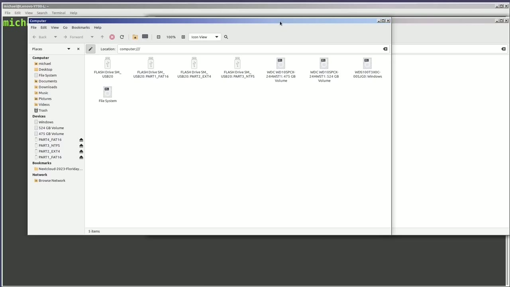
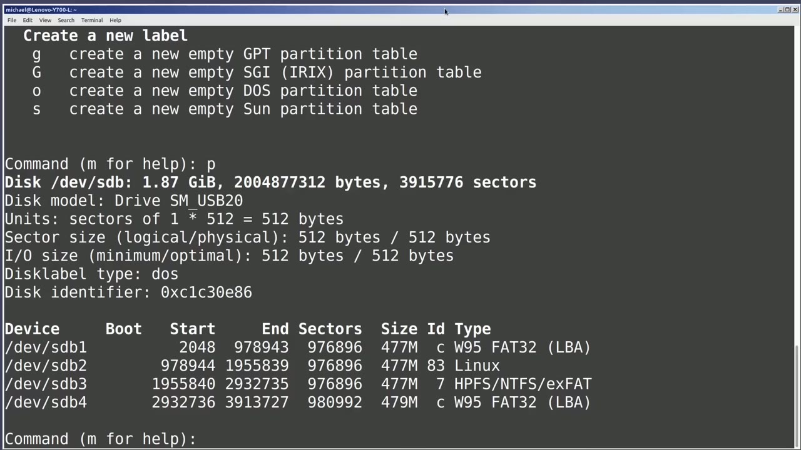
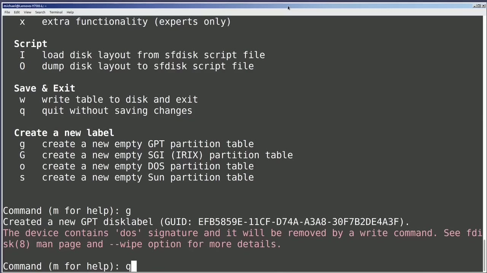
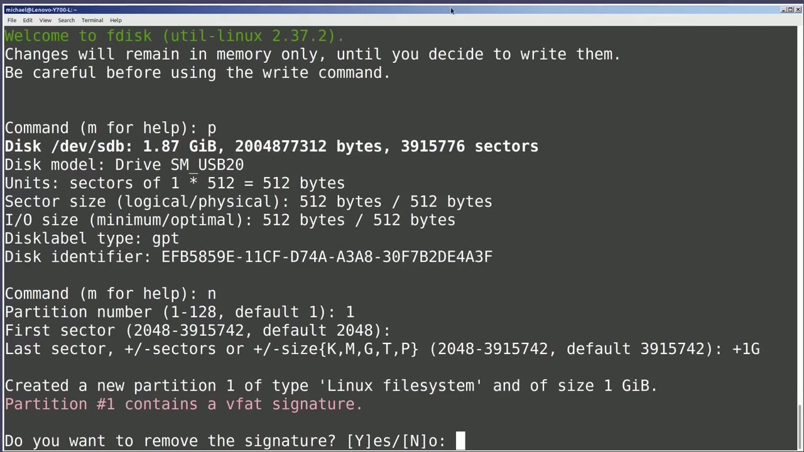
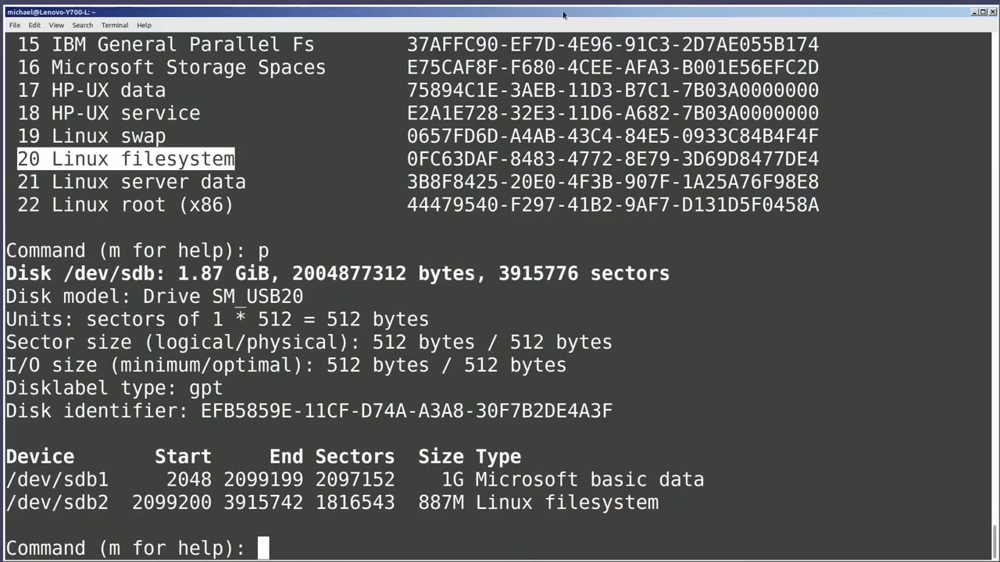

[← Course contents](../../01.md)

# 88. fdisk

**Course:** [Linux Command Line - Entire Tutorial Series](https://www.youtube.com/watch?v=avg65oY7sj4)  
**Transcript:** [`Linux Command Line - Entire Tutorial Series transcript`](../../../../course_videos/Linux%20Command%20Line%20-%20Entire%20Tutorial%20Series/Linux%20Command%20Line%20-%20Entire%20Tutorial%20Series.txt)  
**Video:** 14:59:50–15:12:02 ([open at this time](https://www.youtube.com/watch?v=avg65oY7sj4&t=53990s))

## Introduction

Before we start to look at f-disc, I want to show where we see the labels that we updated in the last video. And I'm plugging in the USB drive that we updated in the last video. And here we see the four different partition labels. We see we've got partition 1 being the fat partition, partition 2 being the ExtE4 partition and so on.

## Detailed Explanation

<details>
  <summary>Step 1 — Run `fdisk`, `sudo`, `parted`</summary>

### Step 1 — Run `fdisk`, `sudo`, `parted`

- [x] **Before we start to look at f-disc, I want to show where we see the**
  - Before we start to look at f-disc, I want to show where we see the labels that we updated in the last video.
  - And I'm plugging in the USB drive that we updated in the last video.
  - And here we see the four different partition labels.

- [x] **Use `fdisk`**
  - We see we've got partition 1 being the fat partition, partition 2 being the ExtE4 partition and so on.
  - Okay, on to `fdisk`.
  - I'm switching to the command line window and we need to have root privileges to use the `fdisk` command.

- [x] **Use `sudo`, `fdisk`**
  - So I will have to type `sudo` before typing the `fdisk` command.
  - `sudo` F-disc -L and F-Disc lists the disk information about all the disks it finds on this computer.
  - Most of the time this is more information than we need.

- [x] **And we want to just see information about a single drive**
  - And we want to just see information about a single drive.
  - I'm going to clear the screen and arrow up to bring back that F-disc command again and add on slash dev slash sdb.
  - And now we only see information about the sdb drive.

- [x] **Use `parted`**
  - And the output is very similar to what we saw with the `parted` print commands.
  - We can see that the disk label type is ms dos or just dos as it is shown here.
  - And then we see the four partitions that we created in the last video.

- [x] **To get into F-Disc command mode, I'm going to arrow up to bring back**
  - To get into F-Disc command mode, I'm going to arrow up to bring back that last command.
  - And now instead of listing out the dev sdb drive, I will be an F-disc command mode for the dev sdb drive.
  - We're getting a message that the disk is currently in use.

- [x] **We want to unmount the sdb partitions before we start to work with it**
  - We want to unmount the sdb partitions before we start to work with it.
  - We're out of F-disc, and I will unmount the four partitions.
  - With U-Mount slash dev sdb1, sdb2, sdb3, and sdb4.

- [x] **Use `sudo`, `fdisk`**
  - And let's go back into F-Disc with `sudo` F-Disc, Dev, sdb.
  - And now we get the standard Welcome to F-Disc message, and it's telling us that we need to write out the changes before we exit F-Disc, or our changes will not be made.
  - And then we see the `fdisk` prompt asking us what `fdisk` command we want to run, and it's telling us we can type M for help.

- [x] **Use `fdisk`**
  - I'm not going to go through every single one of these, but we'll look at enough to get us familiar with `fdisk`.
  - Under the misc heading, we see M is used to print this menu.
  - I want to see what is currently on this USB drive.

- [x] **And to do that, I will type P for print the partition table**
  - And to do that, I will type P for print the partition table.

```bash
fdisk
sudo
parted
```



</details>

<details>
  <summary>Step 2 — Run `fdisk -L`, `fdisk`, `w`</summary>

### Step 2 — Run `fdisk -L`, `fdisk`, `w`

- [x] **Use `fdisk -L`, `fdisk`**
  - And we see the same output that we saw when we typed `fdisk -L` slash dev slash sdb.
  - We've got four partitions and I want to delete them using `fdisk`.
  - I'm going to scroll up a bit and here under generic, I see D delete a partition.

- [x] **It's asking me what partition I want to delete**
  - It's asking me what partition I want to delete.
  - This time I'll delete partition number three.
  - Oh, and let's take a look at what that looks like.

- [x] **And now we see that we only have partitions two and four**
  - And now we see that we only have partitions two and four.
  - And now when I press D, It doesn't ask us what partition because there's only one there.
  - I'll type P again to take a look at our partition table.

- [x] **And we see there are no partitions and we have a disk label type of**
  - And we see there are no partitions and we have a disk label type of dos.
  - I want to change this partition table to a GPT disk partition table.
  - And here at the bottom we see create a new label.

- [x] **And under that we see G create a new empty GPT partition table**
  - And under that we see G create a new empty GPT partition table.
  - I will type the lowercase G and then enter.
  - And we get a warning that this device contains a dos signature and it will be removed.

- [x] **Use `w`**
  - Most of the time, that's what we're going to want to do to wipe the signatures when relabeling to avoid possible collisions.
  - I will now type `w`.
  - To write out the changes and those changes were to remove the four partitions and then to make this a gpt disk partition table.

- [x] **Now instead of w if I type Q right now, I would quit out without**
  - Now instead of `w` if I type Q right now, I would quit out without writing.
  - So those four partitions would still remain as they were and the disk partition table would stay as dos because we have not written anything out yet.

```bash
fdisk -L
fdisk
w
```



</details>

<details>
  <summary>Step 3 — Run `w`, `fdisk`</summary>

### Step 3 — Run `w`, `fdisk`

- [x] **Use `w`, `fdisk`**
  - I want to write out those changes so I am going to use `w` and press Enter.
  - `fdisk` makes our changes and returns me to the regular command line.
  - I'll go back into `fdisk` for the sdb drive by pressing the arrow up and then enter.

- [x] **And now I'll press P to print the disk information**
  - And now I'll press P to print the disk information.
  - We see that we currently have no partitions and our disk partition table has been updated to GPT.
  - Now I want to add a new disk partition to this disk.

- [x] **And it's asking me what partition number I want to give it**
  - And it's asking me what partition number I want to give it.
  - And now it's asking for the first sector, meaning where do we want the starting point of this partition to be?
  - It can be a number greater than or equal to 2048, but it must be less than 3915742.

- [x] **Use `fdisk`**
  - The default is that lowest number 2048, so I will press Enter, making our starting sector 2048.
  - Now `fdisk` is asking us for the last sector of the partition, meaning how big do we want this partition?
  - If we want one single partition to take the entire disk, we could type 391-5742.

- [x] **Or we could just press Enter and FDisc will assume we want to make**
  - Or we could just press Enter and FDisc will assume we want to make this a single partition taking up all the free space available.
  - I want this partition to be one gigabyte, so I will type plus 1G, meaning add 1GB from the starting point of this partition.

```bash
w
fdisk
```



</details>

<details>
  <summary>Step 4 — FDisc is telling me it created a new Linux file system partition, but</summary>

### Step 4 — FDisc is telling me it created a new Linux file system partition, but

- [x] **FDisc is telling me it created a new Linux file system partition, but**
  - FDisc is telling me it created a new Linux file system partition, but this partition has a signature of vfat.
  - I'm going to type N for no because I want to make this a fat file system.
  - I'm going to type M to bring up that menu.

- [x] **And under generic, we see T change a partition type**
  - And under generic, we see T change a partition type.
  - Typing T, we get the question, what partition type do we want to make this?
  - And we can type L to list all. I'll type L.

- [x] **And here we see a big list. I can scroll down and up using my arrow**
  - And here we see a big list. I can scroll down and up using my arrow keys.
  - I want to make this an ms dos partition.
  - And we see the numbers 10 through 14 are all Microsoft Windows partition types.

- [x] **Well, we talked about this in a previous video**
  - Well, we talked about this in a previous video.
  - The partition type doesn't really make that big of a difference.
  - It's the file system that we put on that partition that makes the difference.

- [x] **Just the same, I want to make this partition show as a Microsoft**
  - Just the same, I want to make this partition show as a Microsoft partition.
  - So I'm going to choose number 11, Microsoft Basic Data.
  - I'm going to press Q to quit out of the partition type listing.

- [x] **And then I'll type 11 for the Microsoft Basic Data**
  - And then I'll type 11 for the Microsoft Basic Data.
  - Now I want to make a second new partition.
  - And now it's showing me the first free sector as 2099,200, the default.

- [x] **So I will press enter to have that be the starting position**
  - So I will press enter to have that be the starting position.
  - And the ending position, I'm going to press enter for the default of 391, 5742.
  - And our partition two type Linux file system has been created.

- [x] **And if we want to see what number the Linux file system is, I can**
  - And if we want to see what number the Linux file system is, I can type L to list the file types.
  - And we see here that number 20 is the Linux file system.
  - And I'm going to type P to look at what we're going to make this drive.

- [x] **The first one is a Microsoft Basic Data**
  - The first one is a Microsoft Basic Data.
  - And the second one is a Linux file system.



</details>

<details>
  <summary>Step 5 — Run `w`, `fdisk`, `sudo`</summary>

### Step 5 — Run `w`, `fdisk`, `sudo`

- [x] **Use `w`, `fdisk`**
  - I want to write these changes out, so I'm going to type `w`.
  - And `fdisk` makes those changes and puts me back into a regular Linux command prompt.
  - Now I still need to make my file systems for the two partition.

- [x] **Use `sudo`**
  - That we just created, I will make my first file system of fat 32 with the command, `sudo`, mkfs, make file system.
  - Dot, fat, and we're going to make this a -f32, and we want to put this on slash dev slash sdb1.
  - And now let's make our ExtE4 file system with the command, mkfs make file system, Exty 4, and also for the dev sdb, but this time we want it for partition number 2.

- [x] **Use `lsblk -o`**
  - Let's check everything to make sure it all looks good with the command.
  - `lsblk -o` and I want to see the name, label, size, f-s-type, fs version for...
  - Device sdb. And here we see we created a one gigabyte partition that has a fat 32 file system and a second partition that is less than a gigabyte but is formatted with the ExtE4 partition. There's also a command out there called CFDisc. Let's run that right now with

- [x] **Use `sudo`**
  - `sudo` cf disk slash dev slash sdb.
  - This might be a little easier to work with for some.
  - It's the same F-disc command, only with a nicer format.

- [x] **The C is because it's a cursus-based program**
  - The C is because it's a cursus-based program.
  - We will still have to write out our changes before we exit, or those changes will not be made, just like the regular F-disc command.
  - I'll quit out of here by pressing Enter.

- [x] **In the next video, we'll continue looking at the Linux command line**
  - In the next video, we'll continue looking at the Linux command line.

```bash
w
fdisk
sudo
lsblk -o
```



</details>

<details>
  <summary>Questions and Answers</summary>

## Questions and Answers

### Question 1: What does `fdisk` do in this chapter?

<details>
<summary>Answer</summary>

- [x] Okay, on to `fdisk`.

</details>

### Question 2: What does `sudo` do in this chapter?

<details>
<summary>Answer</summary>

- [x] So I will have to type `sudo` before typing the fdisk command.

</details>

### Question 3: What does `parted` do in this chapter?

<details>
<summary>Answer</summary>

- [x] And the output is very similar to what we saw with the `parted` print commands.

</details>

### Question 4: What does `fdisk -L` do in this chapter?

<details>
<summary>Answer</summary>

- [x] And we see the same output that we saw when we typed `fdisk -L` slash dev slash sdb.

</details>

### Question 5: What does `w` do in this chapter?

<details>
<summary>Answer</summary>

- [x] I will now type `w`.

</details>

### Question 6: What does `lsblk -o` do in this chapter?

<details>
<summary>Answer</summary>

- [x] `lsblk -o` and I want to see the name, label, size, f-s-type, fs version for...

</details>

### Question 7: What does step 1 cover (Run fdisk, sudo, parted)?

<details>
<summary>Answer</summary>

- [x] Before we start to look at f-disc, I want to show where we see the labels that we updated in the last video.
- [x] And I'm plugging in the USB drive that we updated in the last video.
- [x] And here we see the four different partition labels.

</details>

### Question 8: What does step 2 cover (Run fdisk -L, fdisk, w)?

<details>
<summary>Answer</summary>

- [x] And we see the same output that we saw when we typed `fdisk -L` slash dev slash sdb.
- [x] We've got four partitions and I want to delete them using `fdisk`.
- [x] I'm going to scroll up a bit and here under generic, I see D delete a partition.

</details>

### Question 9: What does step 3 cover (Run w, fdisk)?

<details>
<summary>Answer</summary>

- [x] I want to write out those changes so I am going to use `w` and press Enter.
- [x] `fdisk` makes our changes and returns me to the regular command line.
- [x] I'll go back into `fdisk` for the sdb drive by pressing the arrow up and then enter.

</details>

### Question 10: What does step 4 cover (FDisc is telling me it created a new Linux file system partition, but)?

<details>
<summary>Answer</summary>

- [x] FDisc is telling me it created a new Linux file system partition, but this partition has a signature of vfat.
- [x] I'm going to type N for no because I want to make this a fat file system.
- [x] I'm going to type M to bring up that menu.

</details>

</details>

## Summary

This chapter, fdisk, walks through Run fdisk, sudo, parted; Run fdisk -L, fdisk, w; Run w, fdisk; FDisc is telling me it created a new Linux file system partition, but; Run w, fdisk, sudo. Commands from the transcript: `fdisk`, `sudo`, `parted`, `fdisk -L`, `w`, `lsblk -o`.

## References

- [Linux Command Line - Entire Tutorial Series (YouTube)](https://www.youtube.com/watch?v=avg65oY7sj4)
- [This chapter at 14:59:50](https://www.youtube.com/watch?v=avg65oY7sj4&t=53990s)
- [Local transcript](../../../../course_videos/Linux%20Command%20Line%20-%20Entire%20Tutorial%20Series/Linux%20Command%20Line%20-%20Entire%20Tutorial%20Series.txt)
