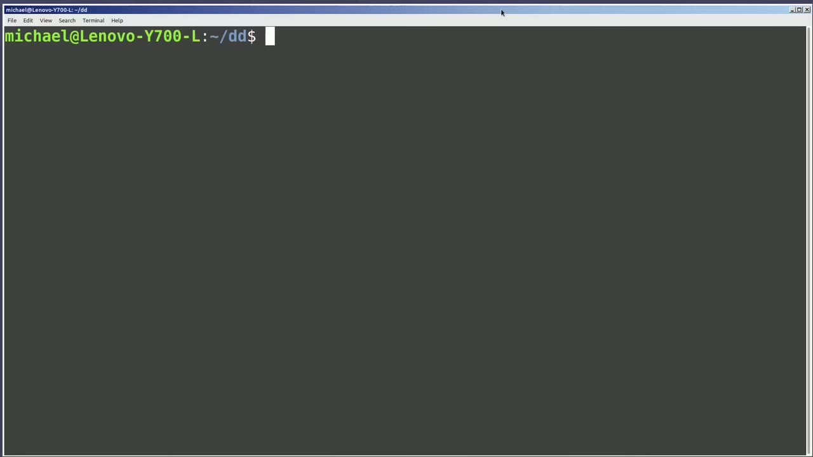
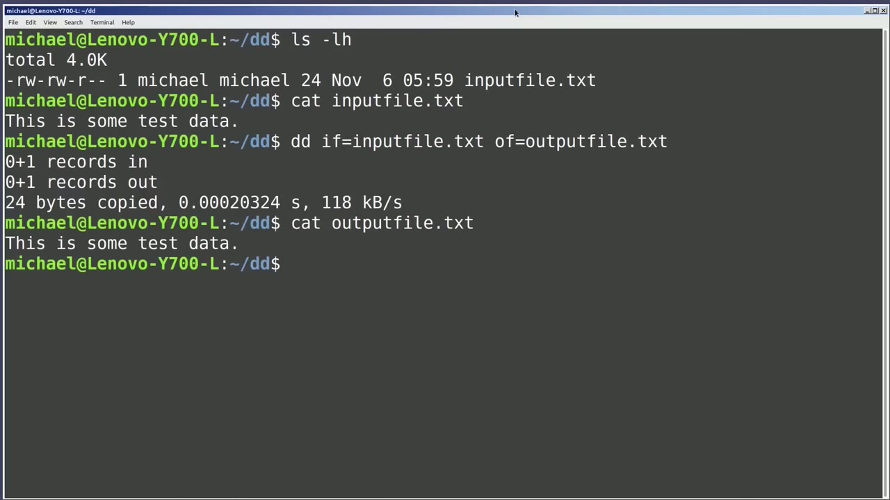
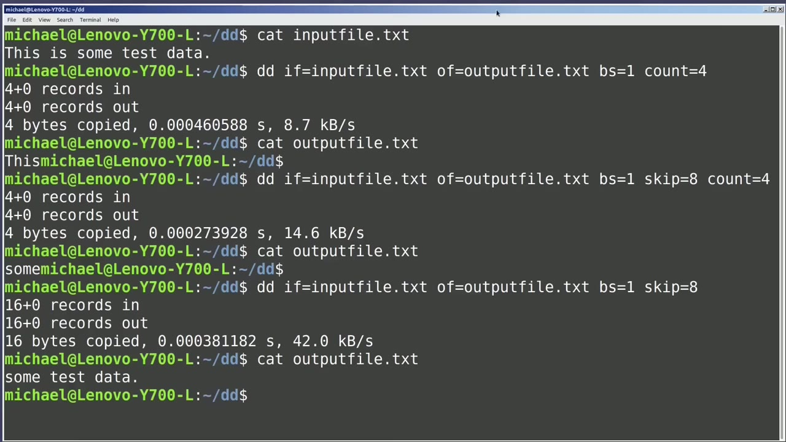
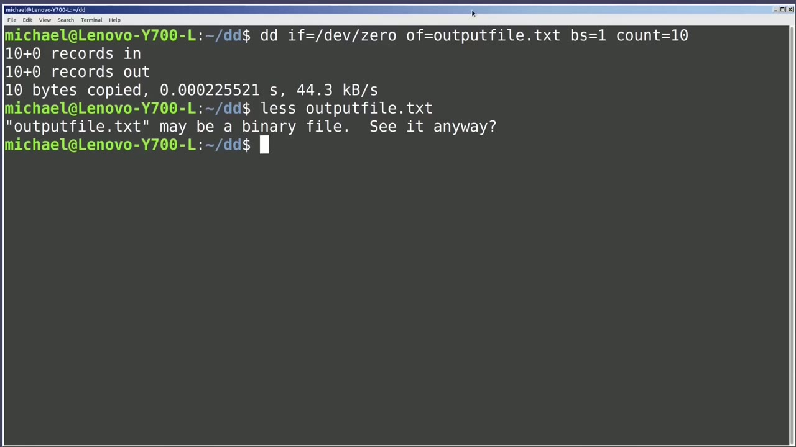

[← Course contents](../../01.md)

# 89. dd pt1

**Course:** [Linux Command Line - Entire Tutorial Series](https://www.youtube.com/watch?v=avg65oY7sj4)  
**Transcript:** [`Linux Command Line - Entire Tutorial Series transcript`](../../../../course_videos/Linux%20Command%20Line%20-%20Entire%20Tutorial%20Series/Linux%20Command%20Line%20-%20Entire%20Tutorial%20Series.txt)  
**Video:** 15:12:02–15:23:03 ([open at this time](https://www.youtube.com/watch?v=avg65oY7sj4&t=54722s))

## Introduction

The dd command is often used to copy disks, and we will do that in the next video. In this video, we're going to take a closer look at the dd command itself. We're going to start using the dd command to just copy a file. Typing ls -lh shows we have a single file in this directory called inputfile.T.

## Detailed Explanation

<details>
  <summary>Step 1 — Run `dd`, `ls -lh`</summary>

### Step 1 — Run `dd`, `ls -lh`

- [x] **Use `dd`**
  - The `dd` command is often used to copy disks, and we will do that in the next video.
  - In this video, we're going to take a closer look at the `dd` command itself.
  - We're going to start using the `dd` command to just copy a file.

- [x] **Use `ls -lh`**
  - Typing `ls -lh` shows we have a single file in this directory called inputfile.T.
  - I want to copy this file to a file I will call Output. txt, and I'll create it with the d-d command by typing d-d, if for Input File, then an equals sign, and then Inputf. txt, then of for Outputf, then an equals sign.
  - And I will type in the output file name of Outputfile.T.

- [x] **Pressing Enter shows there's one record in, one record out, 24 bytes**
  - Pressing Enter shows there's one record in, one record out, 24 bytes were copied, and we see it took a fraction of a second to run, and it was copied at a rate of 118 kilobytes per second.
  - Cating out that output file with Cat, Outputfile. txt, shows the full file was copied as expected.
  - Now let's say we only want to copy the first word from the input file to the output file.

- [x] **Use `dd`**
  - We can do that, but we need to make a few changes to the `dd` statement.
  - Looking at the output from the `dd` command, we can see that we had one record in and one record out.
  - The record length will be the block size, and the default block size is 512 bytes.

- [x] **Why is the default block size 512 bytes?**
  - Why is the default block size 512 bytes?

```bash
dd
ls -lh
```



</details>

<details>
  <summary>Step 2 — Run `sudo fdisk -L`, `cat`</summary>

### Step 2 — Run `sudo fdisk -L`, `cat`

- [x] **Use `sudo fdisk -L`**
  - Well, when I type `sudo fdisk -L` slash dev slash sdb, We see a sector size of 512 bytes, and that is where they get the default block size from.
  - I'm going to arrow up a couple of times to get back to that dd command that we just ran.
  - I can change the block size by adding the option bs equals 1.

- [x] **Pressing Enter, we see 24 records in, 24 records out, and 24 bytes**
  - Pressing Enter, we see 24 records in, 24 records out, and 24 bytes copied.
  - So this time, each character was 1 record.
  - If I bring back that dd statement again and change the block size to 2, Pressing Enter. Now we only see 12 records in and 12 records out.

- [x] **Use `cat`**
  - But 24 bytes were still copied, but because the block size was two, it read them in two at a time instead of one.
  - Typing `cat` output file.T shows the entire file was copied over, just as we expected.
  - I'm going to clear the screen and `cat` out that input file again.

- [x] **And I'm going to bring back that same dd statement, changing the**
  - And I'm going to bring back that same dd statement, changing the block size back to one, so it will only read one byte at a time again.
  - But this time I wanted to stop after reading four records, or four characters in this case.
  - And that would be the first four characters, t-h-i-s.

- [x] **To do that, I will add the option, count equals four**
  - To do that, I will add the option, count equals four.
  - Equals 4 says read 4 records then stop without count it will continue reading till it reaches the end of file pressing enter we see four records in 4 records out and 4 bytes copied i will `cat` the output file and we see this then there's no line return because we did not read to the end of the line
  - But we did get the first four characters, which is what we were looking for.

- [x] **Now let's say we just want to print out the word some**
  - Now let's say we just want to print out the word some.
  - So we're going to skip 1, 2, 3, 4, 5, 6, 7, 8 characters, or records in this case, and then read 4 records and then stop.
  - I'm going to arrow up to bring back the last dd command.

- [x] **And I'm going to add in the option skip equals 8 so we will skip 8**
  - And I'm going to add in the option skip equals 8 so we will skip 8 characters we will read 4 characters and then stop `cat` in the output file.t xt shows the word sum and if we take off the count equals 4 and rerun the command it skips 8 characters and then prints out the rest of the file.

```bash
sudo fdisk -L
cat
```



</details>

<details>
  <summary>Step 3 — Run `dd`, `less`</summary>

### Step 3 — Run `dd`, `less`

- [x] **Use `dd`**
  - One thing that I want to mention here about the `dd` command is that the order does not matter.
  - So if I type `dd` and I start with bs equals 1 and then skip equals 8 and then the output file, then the count, then the input file, it will not make a difference.
  - Pressing Enter and then Cat outputfile.T still shows some.

- [x] **Use `dd`**
  - So the `dd` command is just `dd` space option equals value, space option equals value for however many options that `dd` statement has in any order.
  - A few videos back, I used the `dd` command to stress a CPU. To do that, I type the command.
  - Running that command stressed out a single CPU, taking it to around 100% usage.

- [x] **And if we wanted to stress out more CPUs, we could submit that**
  - And if we wanted to stress out more CPUs, we could submit that command again for each CPU we want to stress.
  - Looking at that command a little closer, we have the output file of dev slash null.
  - Now there's not much more we can say about that.

- [x] **When we write to slash dev slash null, the output is just gone**
  - When we write to slash dev slash null, the output is just gone.
  - So it's like sending the output to a black hole.
  - But the input file of slash dev slash zero could be handy if we want to zero out a file.

- [x] **I'm going to change the dd output file from slash dev slash null to**
  - I'm going to change the `dd` output file from slash dev slash null to output file.
  - And then I'm going to add bs equals 1 and count equals 10.
  - Running that shows 10 records in, 10 records out, and 10 bytes copied.

- [x] **Use `less`**
  - Now when I say it's writing zeros to the output file, if I type `less`, Output file.TXT, you might think we are going to see 10 zeros written in there.
  - When I press Enter, we see Outputfile.T may be a binary file.
  - I'm going to type N for no and not `less` that file.

```bash
dd
less
```



</details>

<details>
  <summary>Step 4 — Run `xxd`, `dd`, `ls -lh`</summary>

### Step 4 — Run `xxd`, `dd`, `ls -lh`

- [x] **Use `xxd`**
  - We can see the hex values of what is in that file with the command `xxd` output file that txt and we see all the bits are set to zero to explain this a little better let's write 10 character zeros to the output file that txt i'll do that with echo one two three four five six seven eight nine ten zeros and we're going to send that to output file that txt
  - And when we look at that in hex with `xxd` output file.TXT, we see the hex value for the number zero is actually 3.0.
  - And then that last value of 0A is a line return.

- [x] **Now instead of filling our file with zeros, I might want to fill that**
  - Now instead of filling our file with zeros, I might want to fill that output file with some random characters.
  - Bringing back that `dd` command, I will change the 0 to be U random.
  - The random feature is said to have some blocking issues and U random is said to be for unlimited random numbers.

- [x] **Some systems have random as an alias to U random**
  - Some systems have random as an alias to U random.
  - So in those cases, it does not even matter.
  - Now, if we try and cat out that output file, we see junk.

- [x] **Use `xxd`**
  - And looking at in hex with `xxd`, output file.TXT, we see the random characters placed in the output file.
  - Now, you might be thinking, why is this useful?
  - And it is useful if you need to create a file of a specific size.

- [x] **Use `dd`, `ls -lh`**
  - Let's say we want to create a 10 megabyte output file.
  - I'll bring back the `dd` command and change the block size from one byte to one megabyte.
  - Pressing enter and then `ls -lh` we see the output file has a size of 10 megabytes.

- [x] **Use `ls -lh`**
  - If we need a one gigabyte file, I'll bring back that command, change the one megabyte to one This time it'll take a little longer to create a gigabyte of data.
  - One gigabyte, but we only want to count to one to get one gigabyte of data.
  - Now I'm running it again and typing `ls -lh` shows our output file.

- [x] **Use `dd`**
  - In the next video we will continue looking at the `dd` command with disk images for the Linux command line.
  - In this video we're going to look at the `dd` command specifically for copying disks.

```bash
xxd
dd
ls -lh
```



</details>

<details>
  <summary>Questions and Answers</summary>

## Questions and Answers

### Question 1: What does `dd` do in this chapter?

<details>
<summary>Answer</summary>

- [x] The `dd` command is often used to copy disks, and we will do that in the next video.

</details>

### Question 2: What does `ls -lh` do in this chapter?

<details>
<summary>Answer</summary>

- [x] Typing `ls -lh` shows we have a single file in this directory called inputfile.T.

</details>

### Question 3: What does `sudo fdisk -L` do in this chapter?

<details>
<summary>Answer</summary>

- [x] Well, when I type `sudo fdisk -L` slash dev slash sdb, We see a sector size of 512 bytes, and that is where they get the default block size from.

</details>

### Question 4: What does `cat` do in this chapter?

<details>
<summary>Answer</summary>

- [x] Typing `cat` output file.T shows the entire file was copied over, just as we expected.

</details>

### Question 5: What does `less` do in this chapter?

<details>
<summary>Answer</summary>

- [x] Now when I say it's writing zeros to the output file, if I type `less`, Output file.TXT, you might think we are going to see 10 zeros written in there.

</details>

### Question 6: What does `xxd` do in this chapter?

<details>
<summary>Answer</summary>

- [x] We can see the hex values of what is in that file with the command `xxd` output file that txt and we see all the bits are set to zero to explain this a little better let's write 10 character zeros to the output file that txt i'll do that with echo one two three four five six seven eight nine ten zeros and we're going to send that to output file that txt

</details>

### Question 7: What does step 1 cover (Run dd, ls -lh)?

<details>
<summary>Answer</summary>

- [x] The `dd` command is often used to copy disks, and we will do that in the next video.
- [x] In this video, we're going to take a closer look at the `dd` command itself.
- [x] We're going to start using the `dd` command to just copy a file.

</details>

### Question 8: What does step 2 cover (Run sudo fdisk -L, cat)?

<details>
<summary>Answer</summary>

- [x] Well, when I type `sudo fdisk -L` slash dev slash sdb, We see a sector size of 512 bytes, and that is where they get the default block size from.
- [x] I'm going to arrow up a couple of times to get back to that dd command that we just ran.
- [x] I can change the block size by adding the option bs equals 1.

</details>

### Question 9: What does step 3 cover (Run dd, less)?

<details>
<summary>Answer</summary>

- [x] One thing that I want to mention here about the `dd` command is that the order does not matter.
- [x] So if I type `dd` and I start with bs equals 1 and then skip equals 8 and then the output file, then the count, then the input file, it will not make a difference.
- [x] Pressing Enter and then Cat outputfile.T still shows some.

</details>

### Question 10: What does step 4 cover (Run xxd, dd, ls -lh)?

<details>
<summary>Answer</summary>

- [x] We can see the hex values of what is in that file with the command `xxd` output file that txt and we see all the bits are set to zero to explain this a little better let's write 10 character zeros to the output file that txt i'll do that with echo one two three four five six seven eight nine ten zeros and we're going to send that to output file that txt
- [x] And when we look at that in hex with `xxd` output file.TXT, we see the hex value for the number zero is actually 3.0.
- [x] And then that last value of 0A is a line return.

</details>

</details>

## Summary

This chapter, dd pt1, walks through Run dd, ls -lh; Run sudo fdisk -L, cat; Run dd, less; Run xxd, dd, ls -lh. Commands from the transcript: `dd`, `ls -lh`, `sudo fdisk -L`, `cat`, `less`, `xxd`.

## References

- [Linux Command Line - Entire Tutorial Series (YouTube)](https://www.youtube.com/watch?v=avg65oY7sj4)
- [This chapter at 15:12:02](https://www.youtube.com/watch?v=avg65oY7sj4&t=54722s)
- [Local transcript](../../../../course_videos/Linux%20Command%20Line%20-%20Entire%20Tutorial%20Series/Linux%20Command%20Line%20-%20Entire%20Tutorial%20Series.txt)
