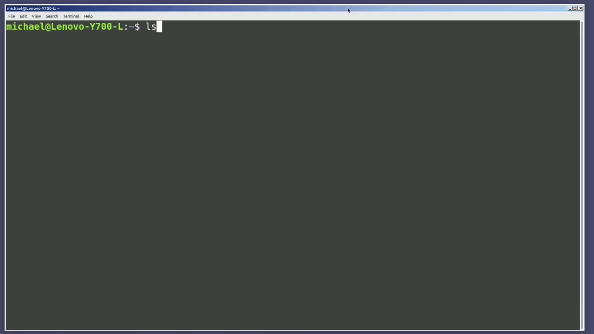
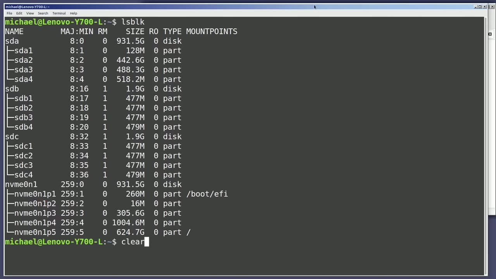
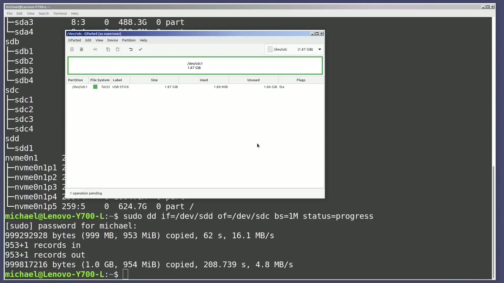
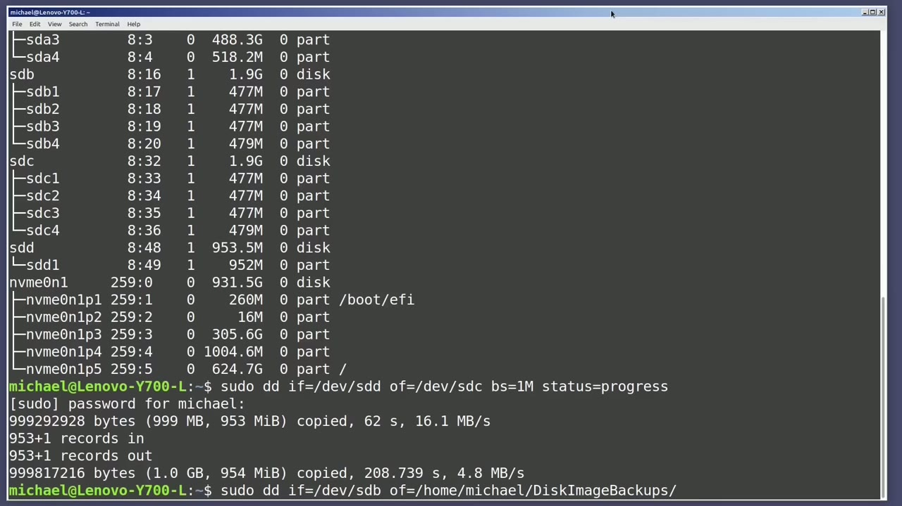
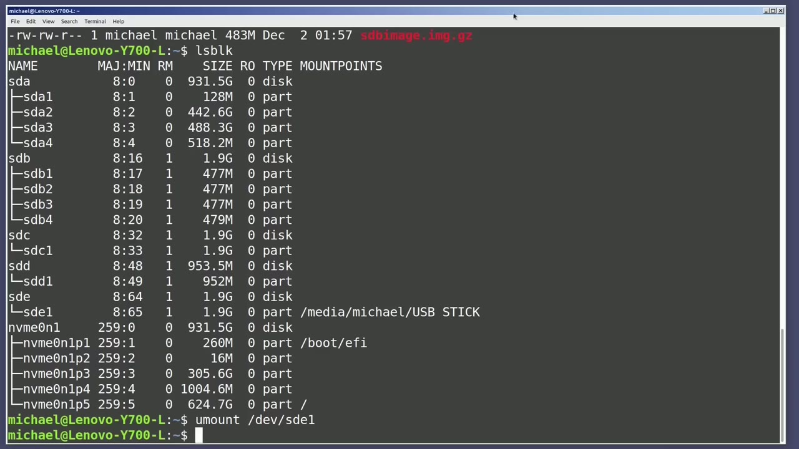

[← Course contents](../../01.md)

# 90. dd pt2

**Course:** [Linux Command Line - Entire Tutorial Series](https://www.youtube.com/watch?v=avg65oY7sj4)  
**Transcript:** [`Linux Command Line - Entire Tutorial Series transcript`](../../../../course_videos/Linux%20Command%20Line%20-%20Entire%20Tutorial%20Series/Linux%20Command%20Line%20-%20Entire%20Tutorial%20Series.txt)  
**Video:** 15:23:03–15:35:58 ([open at this time](https://www.youtube.com/watch?v=avg65oY7sj4&t=55383s))

## Introduction

I will type lsblk to show that I have two 2GB USB drives in my computer. One of the 2 gigabyte USB drives is sdb and it has 4 partitions on it. The second 2 gigabyte USB drive is sdc, and that has two partitions on it. Before I run the dd command to copy a USB drive, I'm going to unmount both of the USB drives.

## Detailed Explanation

<details>
  <summary>Step 1 — Run `lsblk`, `dd`, `sudo`</summary>

### Step 1 — Run `lsblk`, `dd`, `sudo`

- [x] **Use `lsblk`**
  - I will type `lsblk` to show that I have two 2GB USB drives in my computer.
  - One of the 2 gigabyte USB drives is sdb and it has 4 partitions on it.
  - The second 2 gigabyte USB drive is sdc, and that has two partitions on it.

- [x] **Use `dd`, `lsblk`**
  - Before I run the `dd` command to copy a USB drive, I'm going to unmount both of the USB drives.
  - We may not need to unmount the input file disk, but I prefer to unmount both discs before I use the `dd` command.
  - And again, I'll type the `lsblk` to show that they are now both unmounted.

- [x] **Use `dd`**
  - I'm now ready to copy the sdb drive to the sdc drive, and in this case, both drives are the same size, 2 gigabytes.
  - They don't have to be the same size, but the output file device needs to be the same size or larger than the input file device, or that image won't fit.
  - To copy a disk, I will start the `dd` command with `dd`, then if for input file.

- [x] **And I want the input file to be slash dev slash sdb then a space then**
  - And I want the input file to be slash dev slash sdb then a space then of for output file then the equals and slash dev slash sdc so this command is going to wipe out whatever is on the slash dev slash sdc drive before hitting enter make sure to double check your input and output devices.
  - A typo when using this command could be catastrophic.
  - When I press Enter, I get a permissions denied message.

- [x] **Use `dd`, `sudo`**
  - I did not need to be a privileged user when I ran the `dd` command in the last video, and that's because in the last video, we were not trying to read or write to any USB devices in the slash dev directory.
  - So I'll press the arrow up and bring back that command.
  - And I'm going to add `sudo` to the beginning of it.

- [x] **And I'm also going to change the block size**
  - And I'm also going to change the block size.
  - I'll change that block size by adding bs equals 1M.
  - I ran some tests with different block sizes.

- [x] **And I found that 1 megabyte worked well on this computer**
  - And I found that 1 megabyte worked well on this computer.
  - And then the last thing I'm going to add to this command is Status equals progress.
  - Adding status equals progress will show how far along we are in the command.

- [x] **I'll press Enter and our dd statement is running**
  - I'll press Enter and our `dd` statement is running.
  - I'm going to pause the recording until the command has completed.
  - The command has completed and I want to mention at this time that sometimes the lights are still flashing on the USB drives after the command completes.

- [x] **It's best to wait until the lights stop flashing on the USB drives**
  - It's best to wait until the lights stop flashing on the USB drives before doing anything with them.
  - The command is done. We see the number of records in, number of records out, and total bytes.
  - The seconds it took, in this case, 409.853, which is just around 7 minutes.

- [x] **Use `lsblk`**
  - It transferred at a rate of 4.9 megabytes per second.
  - I will clear the screen and type `lsblk`.
  - And we see that the dev sdb and the dev sdc are now exactly the same, which is just what we expected.

- [x] **So that's how we can copy one drive to another drive of the same size**
  - So that's how we can copy one drive to another drive of the same size.

```bash
lsblk
dd
sudo
```



</details>

<details>
  <summary>Step 2 — Run `lsblk`, `dd`, `sudo -dd -if`</summary>

### Step 2 — Run `lsblk`, `dd`, `sudo -dd -if`

- [x] **Use `lsblk`**
  - I'm going to clear the screen again and type `lsblk`.
  - And we'll notice that the sdc drive is mounted again because I unplug the sdc drive and plugged it back in.
  - So it auto mounted for me and then i've added an sdd drive which is only one gigabyte in size and that is mounted as well i'm going to unmount those partitions with you mount slash dev slash sdc1 and then we're going to do the same for two three and four we're also going to unmount s d

- [x] **Use `lsblk`, `dd`**
  - D1 and typing `lsblk` shows that they are all unmounted.
  - So the sdd drive is only 1 gigabyte and the sdc drive has 2 gigabytes.
  - If I use the `dd` command to try and copy the 2 gigabyte dev sdc drive to the 1 gigabyte devSDD drive, we will get an error once the disk runs out of space.

- [x] **Use `dd`**
  - The error will tell us that there is no space left on the device.
  - But when I run the `dd` command the other way, and we write the 1 gigabyte drive to the 2 gigabyte drive, it will write as expected, but the space on the 2 gigabyte drive will be limited to 1 gigabyte.
  - Let me run this command right now, so we can see what the problem is and how to fix it.

- [x] **Use `sudo -dd -if`, `dd`**
  - `sudo -`dd` -if` equals dev-SDD-D.
  - I want the block size equal to one megabyte and the status equals progress.
  - The command is running and once again, I will pause the video while the `dd` command runs.

- [x] **Use `parted`**
  - The job completed and I'm going to open up the GUI program G `parted`.
  - So we can get a good look at what the sdc device looks like now.
  - Here we see the device sdc1 is now using only 952 megabytes.

- [x] **The 1 gigabyte image was copied over to the 2 gigabyte drive, but it**
  - The 1 gigabyte image was copied over to the 2 gigabyte drive, but it only wrote out that 1 gigabyte image, meaning it is only using 1 gigabyte of that drive space.
  - We still have one more gigabyte of drive space going unused. The easiest way to make the entire disk usable is to resize that partition in G-`parted`.
  - I will click on the partition and then I'll click in the menu partition and then click resize slash move. A pop-up opens up with a bar showing how much disk space that partition is using.

- [x] **I will click and drag this arrow over on the right all the way over**
  - I will click and drag this arrow over on the right all the way over to fill up the entire disk space.
  - I'll click on the resize move button and it returns me to the home screen.

```bash
lsblk
dd
sudo -dd -if
parted
```



</details>

<details>
  <summary>Step 3 — Run `fdisk`, `sudo -dif`</summary>

### Step 3 — Run `fdisk`, `sudo -dif`

- [x] **Use `fdisk`**
  - No action's been done yet. Just like the `fdisk` command, we have to apply our changes or write them out.
  - To do that, I will go under Edit and then apply all operations.
  - Clicking the Apply All Operations is giving me a second chance to review my changes before making them permanent.

- [x] **I want to apply these changes, so I will click Apply**
  - I want to apply these changes, so I will click Apply.
  - And the disk is being updated to use all the available space on that disk drive.
  - I don't need to save the details, so I will click close.

- [x] **And that's the easiest way to copy a drive over to a larger drive**
  - And that's the easiest way to copy a drive over to a larger drive.
  - Now I want to write a disk image to a file so that I can restore back to that image whenever I like.
  - Now we cannot just copy a disk image to a directory like we did when copying to another USB drive.

- [x] **Use `sudo -dif`**
  - What I mean to say is if I type `sudo -dif` equals Dev-Sdb, o-f equals Home Michael Disc Image backups, this will not work.
  - We would get a failed to open error or not allowed to write a device to a directory.
  - And the reason it won't work here is just what the error would tell us.

- [x] **We cannot write a device to a directory**
  - We cannot write a device to a directory.
  - We can write a partition into a directory this way, but it will not work the way I have this command showing right here.

```bash
fdisk
sudo -dif
```



</details>

<details>
  <summary>Step 4 — Run `sudo -dife-Equels`, `gzip`, `dd`</summary>

### Step 4 — Run `sudo -dife-Equels`, `gzip`, `dd`

- [x] **Use `sudo -dife-Equels`, `gzip`**
  - To `dd` a device into a directory, we will need to write it into a file first.
  - So to write this device to a file, we'll start off the same way with the `sudo -dife-Equels` dev slash sdb, but I'm going to remove this o-f output file.
  - And instead I'm going to pipe this into `gzip`.

- [x] **Use `gzip`, `dd`**
  - And then I'm going to send the output from the `gzip` command to the Home Michael Disc Image Backups directory.
  - And then I'll give it a file name of sdbimage.img.g.g.g.
  - If I want to add the block size or status, I cannot add them to the end because that's not the `dd` command anymore.

- [x] **Use `gzip`**
  - This is the `gzip` command.
  - To add the block size 1M, I will have to go to the left of the pipe symbol and add it there.
  - Bs equals 1M and I will add status equals progress.

- [x] **Use `ls -lhlh-H-Michael`**
  - I'll press Enter to get it going and once again I'll pause the video.
  - And to see the file, I'm going to type `ls -lhlh-H-Michael` Disc Image Backups.
  - And there we see the image backup of sdbimage.img.img.g.

- [x] **Use `cd -rom`**
  - Now, what we've created is an image backup.
  - Our backup is the same thing we have when we download a Linux distribution ISO file.
  - The name ISO comes from a format to create `cd -rom` images.

- [x] **Use `lsblk`**
  - The backup we just took can be considered an ISO image.
  - I'm going to type `lsblk` again and we'll see that I've just added another 2 gigabyte USB drive slash dev slash sde that we're going to restore our backup into.
  - The first thing I want to do is unmount that USB drive with U mount slash dev slash sde1.

```bash
sudo -dife-Equels
gzip
dd
ls -lhlh-H-Michael
cd -rom
lsblk
```



</details>

<details>
  <summary>Step 5 — Run `gzip -dc`, `which`, `sudo -dof`</summary>

### Step 5 — Run `gzip -dc`, `which`, `sudo -dof`

- [x] **Use `gzip -dc`, `which`**
  - To restore from our GZipped backup file, I'm going to type `gzip -dc`.
  - Now the D is to decompress and the C is to send the data to standard out.
  - Then I'll give it the file name I wanted to use, `which` is Home, Michael.

- [x] **Use `sudo -dof`**
  - Disk image backups and then the file itself is s db image.img.m.g.g.g.
  - And what I'm going to do now is I'm going to pipe that into `sudo -dof` for output file equals slash dev slash s-d-e.
  - Now this input file could be a Linux ISO file.

- [x] **If it's already compressed, we would use that same command. If the**
  - If it's already compressed, we would use that same command. If the ISO file is already unzipped, we would leave off the D and just have -C before the file name.
  - I'm going to press enter to start this restore.
  - And again, I'll pause the video until the command completes.

- [x] **Use `lsblk`**
  - The restore is complete. I'm going to type `lsblk` to show the disks once again.
  - We're going to be looking specifically at the sde drive.
  - And here we see that the sde drive was restored to our backup, `which` was a backup of the sdb drive.

- [x] **In the next video, we will continue looking at the Linux command line**
  - In the next video, we will continue looking at the Linux command line.

```bash
gzip -dc
which
sudo -dof
lsblk
```



</details>

<details>
  <summary>Questions and Answers</summary>

## Questions and Answers

### Question 1: What does `lsblk` do in this chapter?

<details>
<summary>Answer</summary>

- [x] I will type `lsblk` to show that I have two 2GB USB drives in my computer.

</details>

### Question 2: What does `dd` do in this chapter?

<details>
<summary>Answer</summary>

- [x] Before I run the `dd` command to copy a USB drive, I'm going to unmount both of the USB drives.

</details>

### Question 3: What does `sudo` do in this chapter?

<details>
<summary>Answer</summary>

- [x] And I'm going to add `sudo` to the beginning of it.

</details>

### Question 4: What does `sudo -dd -if` do in this chapter?

<details>
<summary>Answer</summary>

- [x] `sudo -dd -if` equals dev-SDD-D.

</details>

### Question 5: What does `parted` do in this chapter?

<details>
<summary>Answer</summary>

- [x] The job completed and I'm going to open up the GUI program G `parted`.

</details>

### Question 6: What does `fdisk` do in this chapter?

<details>
<summary>Answer</summary>

- [x] No action's been done yet. Just like the `fdisk` command, we have to apply our changes or write them out.

</details>

### Question 7: What does `sudo -dif` do in this chapter?

<details>
<summary>Answer</summary>

- [x] What I mean to say is if I type `sudo -dif` equals Dev-Sdb, o-f equals Home Michael Disc Image backups, this will not work.

</details>

### Question 8: What does `sudo -dife-Equels` do in this chapter?

<details>
<summary>Answer</summary>

- [x] So to write this device to a file, we'll start off the same way with the `sudo -dife-Equels` dev slash sdb, but I'm going to remove this o-f output file.

</details>

### Question 9: What does `gzip` do in this chapter?

<details>
<summary>Answer</summary>

- [x] And instead I'm going to pipe this into `gzip`.

</details>

### Question 10: What does `ls -lhlh-H-Michael` do in this chapter?

<details>
<summary>Answer</summary>

- [x] And to see the file, I'm going to type `ls -lhlh-H-Michael` Disc Image Backups.

</details>

### Question 11: What does `cd -rom` do in this chapter?

<details>
<summary>Answer</summary>

- [x] The name ISO comes from a format to create `cd -rom` images.

</details>

### Question 12: What does `gzip -dc` do in this chapter?

<details>
<summary>Answer</summary>

- [x] To restore from our GZipped backup file, I'm going to type `gzip -dc`.

</details>

</details>

## Summary

This chapter, dd pt2, walks through Run lsblk, dd, sudo; Run lsblk, dd, sudo -dd -if; Run fdisk, sudo -dif; Run sudo -dife-Equels, gzip, dd; Run gzip -dc, which, sudo -dof. Commands from the transcript: `lsblk`, `dd`, `sudo`, `sudo -dd -if`, `parted`, `fdisk`, `sudo -dif`, `sudo -dife-Equels`, `gzip`, `ls -lhlh-H-Michael`, `cd -rom`, `gzip -dc`, `which`, `sudo -dof`.

## References

- [Linux Command Line - Entire Tutorial Series (YouTube)](https://www.youtube.com/watch?v=avg65oY7sj4)
- [This chapter at 15:23:03](https://www.youtube.com/watch?v=avg65oY7sj4&t=55383s)
- [Local transcript](../../../../course_videos/Linux%20Command%20Line%20-%20Entire%20Tutorial%20Series/Linux%20Command%20Line%20-%20Entire%20Tutorial%20Series.txt)
