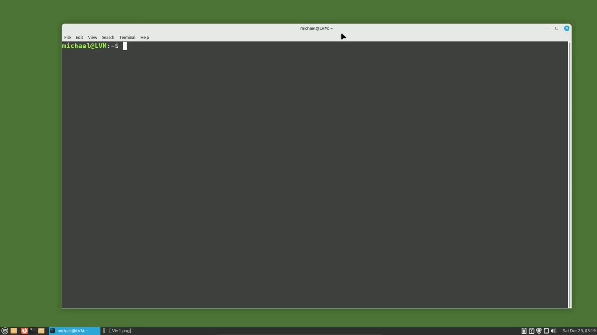
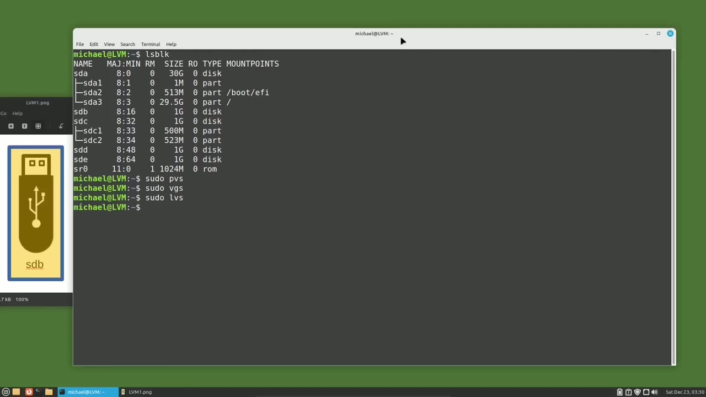
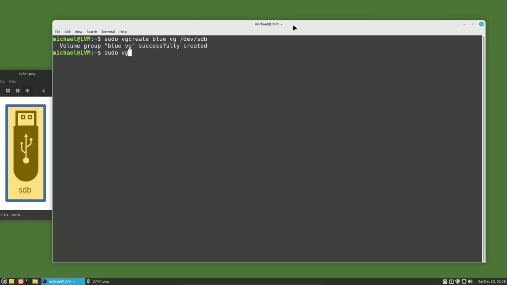
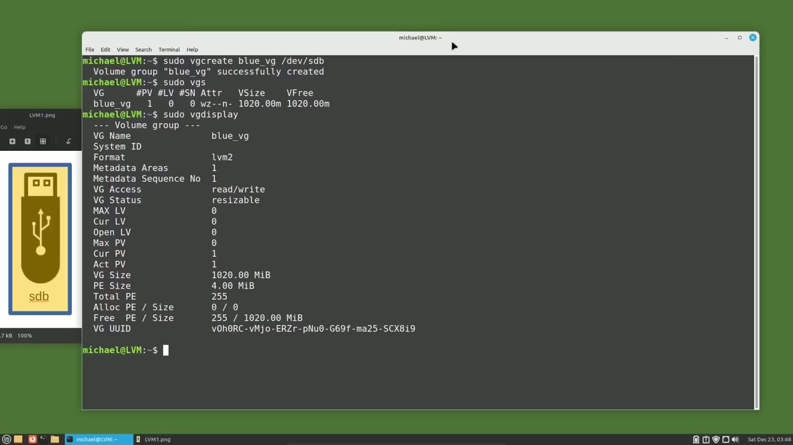

[← Course contents](../../01.md)

# 91. LVM pt1

**Course:** [Linux Command Line - Entire Tutorial Series](https://www.youtube.com/watch?v=avg65oY7sj4)  
**Transcript:** [`Linux Command Line - Entire Tutorial Series transcript`](../../../../course_videos/Linux%20Command%20Line%20-%20Entire%20Tutorial%20Series/Linux%20Command%20Line%20-%20Entire%20Tutorial%20Series.txt)  
**Video:** 15:35:58–15:47:04 ([open at this time](https://www.youtube.com/watch?v=avg65oY7sj4&t=56158s))

## Introduction

In this video, as well as the next few videos, we're going to look at LVM. LVM stands for Logical Volume Manager, and it's another way of managing disk storage. LVM makes it easy to add a second disk drive and then expand into that new drive space. Or we can create a mirror copy or create a snapshot, all using LVM.

## Detailed Explanation

<details>
  <summary>Step 1 — Run `sudo apt install lvm2`, `lsblk`, `sudo`</summary>

### Step 1 — Run `sudo apt install lvm2`, `lsblk`, `sudo`

- [x] **In this video, as well as the next few videos, we're going to look at**
  - In this video, as well as the next few videos, we're going to look at LVM.
  - LVM stands for Logical Volume Manager, and it's another way of managing disk storage.
  - LVM makes it easy to add a second disk drive and then expand into that new drive space.

- [x] **Or we can create a mirror copy or create a snapshot, all using LVM**
  - Or we can create a mirror copy or create a snapshot, all using LVM.
  - And we will look into all of those things in this group of tutorials.
  - Let's first look at what we need to use LVM.

- [x] **Use `sudo apt install lvm2`**
  - The first thing we're going to do is make sure that we have lvm2 installed on our system.
  - It is normally installed on Ubuntu-based systems, but I will check by trying to install it with the command, `sudo`, Apt, install, lvm2.
  - And we see here that it's already installed, so I'm good.

- [x] **When using LVM, there are three parts of the logical volume manager**
  - When using LVM, there are three parts of the logical volume manager that we should be familiar with.
  - They are the pv physical volume, the vg, which is the volume group sometimes referred to as the virtual group and then there's the lv which is the logical volume we will see those initials are often used with lvm so that's why i'm introducing them to you at the beginning of this video let's start with the p v physical volume first physical volumes are hard drives i'm showing a picture of usb drives here to show that we are talking about actual physical hard drives
  - They can be USB drives, internal drives, ssd drives, any physical hard drive.

- [x] **And notice that the sdc drive has two partitions**
  - And notice that the sdc drive has two partitions.
  - With LVM, we can use the full device drives like sdb and sdd, or partitions like sdc1 and sdc2.
  - We will have to run a command to make that physical disk a usable pv physical volume for LVM.

- [x] **Right now, we're going to continue on to the second thing I said we**
  - Right now, we're going to continue on to the second thing I said we needed to be familiar with for LVM, and that is the vg or volume group. In this picture, we can see that the blue area represents a volume group, which is made up of four drives, or five partitions. The sdc has two partitions.
  - You can think of a volume group as a virtual hard drive. That's why vg is sometimes referred to as a virtual group.
  - Because it's not a real hard drive, but Linux will recognize this group as a single device.

- [x] **So we can have multiple physical volumes used to create a single**
  - So we can have multiple physical volumes used to create a single volume group.
  - And then we can add more physical volumes or remove them from a volume group as needed.
  - The third thing we need for LVM is an lv, a logical volume.

- [x] **And the logical volume works like a partition, the way a volume group**
  - And the logical volume works like a partition, the way a volume group works like a hard drive.
  - In this picture, the orange is meant to represent a logical volume on the blue volume group, which is all on a single sdb physical volume.
  - And we're going to use the rest of this video to show how to set up LVM like this image.

- [x] **Use `lsblk`**
  - I have the image on the left here so we can refer to it as we type in the LVM commands.
  - To see what physical drives I have to work with, I'm going to type `lsblk`.
  - And we see I have added drives to this computer, sdb, sdc, which has two partitions, sdc1 and sdc2, sdd and sde.

- [x] **Use `sudo`**
  - We are only using sdb in the picture on the left, so that's the only drive we're going to use in this video.
  - Before we set up the sdb device for LVM, I want to show some LVM commands.
  - A privileged user to use LVM. So I will start all of my LVM commands with `sudo`.

- [x] **Use `sudo pvs`, `sudo vgs`**
  - The commands I want to show right now are `sudo pvs`, which stands for physical volume summary.
  - And since we don't have any physical volumes created yet, nothing shows.
  - The next one I want to show is `sudo vgs`, which stands for volume group summary.

- [x] **Use `sudo -lvs`**
  - And the last one is `sudo -lvs` for logical volume summary.
  - I'm hoping you see the LVM command pattern here.
  - That's why I started out the video telling you about the pv physical volume, vg volume group, and lv logical volume.

- [x] **It's time to set up the sdb device for LVM, which will be our LVM pv**
  - It's time to set up the sdb device for LVM, which will be our LVM pv physical volume.

```bash
sudo apt install lvm2
lsblk
sudo
sudo pvs
sudo vgs
sudo -lvs
```



</details>

<details>
  <summary>Step 2 — Run `sudo`, `sudo pvs`</summary>

### Step 2 — Run `sudo`, `sudo pvs`

- [x] **Use `sudo`**
  - The command we will use to set up the pv physical volume is `sudo` pv create slash dev slash sdb.
  - And we see the response, physical volume slash dev slash sdb successfully created.
  - So now we can use this dev sdb device for LVM.

- [x] **Use `sudo pvs`**
  - I want to make sure this physical volume was actually created.
  - So I'm going to type the physical volume summary command, `sudo pvs`.
  - And we see here that our device, sdb, is created with a format of lvm2, physical size of one gigabyte, and the entire gigabyte is free.

- [x] **Use `sudo`**
  - Another command we use a lot in LVM is `sudo` pv Display.
  - And this shows pretty much the same information as the pv summary for the physical volume.
  - And now we're on to the second thing I said we need for LVM, the vg volume group.

- [x] **Use `sudo`**
  - To create the volume group, I will type the command, `sudo`, vg, create.
  - Then we need to give the volume group a name.
  - Since the picture has a blue volume group, I will call this volume group blue.

- [x] **And then to remind me that this is a volume group, I will add an**
  - And then to remind me that this is a volume group, I will add an underscore vg.
  - To remind me this is a volume group, you do not need to add in the underscore vg.
  - And then lastly, I will need to tell LVM where I want this volume group to be placed.

- [x] **And I want this to go on the slash dev slash sdb device**
  - And I want this to go on the slash dev slash sdb device.

```bash
sudo
sudo pvs
```



</details>

<details>
  <summary>Step 3 — Run `sudo`</summary>

### Step 3 — Run `sudo`

- [x] **That's the one we already set up for LVM**
  - That's the one we already set up for LVM.
  - If I wanted this volume group to be on more devices, I could add them here.
  - Like slash dev sdc1 and slash dev slash sdd.

- [x] **And then the blue underscore vg volume group would be the size of the**
  - And then the blue underscore vg volume group would be the size of the sdb drive, the sdd drive, and the sdc1 partition.
  - And you might say, hey, but you didn't yet format those other two devices for LVM.
  - When creating a volume group, LVM will just think, you must have forgotten to format that physical volume.

- [x] **So I will format that physical volume for you**
  - So I will format that physical volume for you.
  - So did I lie when I said we had to create the physical volume first?
  - It still gets done first, but steps one and two are just done together.

- [x] **I'm going to remove the other two devices here**
  - I'm going to remove the other two devices here.
  - So we just have the one sdb physical volume that we already set up for LVM.
  - Pressing enter, we see our volume group.

- [x] **Use `sudo`**
  - Blue underscore vg successfully created.
  - And then typing `sudo` vg for volume group summary shows us the volume group name of Blue underscore vg.
  - And the size of the volume group is 120 megabytes.

- [x] **Use `sudo`**
  - Now typing `sudo` vg display.
  - This shows us the volume group name of blue underscore vg.
  - One thing I do want to point out here is the volume group size of 120 Mibi bytes.

- [x] **Pe stands for physical extent, which has a size of four Mibibytes**
  - Pe stands for physical extent, which has a size of four Mibibytes.
  - And then we see the total pe is 255, which is just 102 divided by 4.
  - This doesn't mean much now, but in future tutorials, we'll see why this is important.

- [x] **I do want to point out that in real life, 1,000 megabytes equals 1**
  - I do want to point out that in real life, 1,000 megabytes equals 1 gigabyte, and 1024 mebbybytes equals 1 gibbyte.
  - But for this video and the entire LVM grouping here of videos, I'll try and use the correct word.
  - So please forgive me when I use megabytes and I mean mebibytes.

- [x] **Now we just need to add that third part, the logical volume**
  - Now we just need to add that third part, the logical volume.

```bash
sudo
```



</details>

<details>
  <summary>Step 4 — Run `sudo`, `sudo lvs`</summary>

### Step 4 — Run `sudo`, `sudo lvs`

- [x] **Use `sudo`**
  - And I will create that with the command, `sudo` lv create.
  - And then I'm going to add a -lowercase L.
  - And that lowercase L lets LVM know that we're going to give it a percent of how much this space we want to use.

- [x] **I want to use 100% of the free disk space available**
  - I want to use 100% of the free disk space available.
  - Then we will need to tell it which volume group we want to use 100% of that free disk space.
  - And that will be the volume group Blue underscore vg.

- [x] **We also want to give our logical volume and name**
  - We also want to give our logical volume and name.
  - Then the space, and we will call this logical volume, Orange underscore lv.
  - And again, the underscore lv is just for me.

- [x] **Use `sudo lvs`**
  - We do not need this to be part of the name.
  - When I press Enter, we get the message, Logical Volume, Orange underscore lv, created.
  - Just like the other LVM commands, I'm going to check this out with `sudo lvs`.

- [x] **The volume group, and the size 102 megabytes**
  - The volume group, and the size 102 megabytes.
  - We cannot yet read or write to our LVM logical volume because we have not yet added a file system to that logical volume.
  - We will also need to mount that logical volume before we can use it.

- [x] **And we will do that in the next video for the Linux command line**
  - And we will do that in the next video for the Linux command line.

```bash
sudo
sudo lvs
```



</details>

<details>
  <summary>Questions and Answers</summary>

## Questions and Answers

### Question 1: What does `sudo apt install lvm2` do in this chapter?

<details>
<summary>Answer</summary>

- [x] It is normally installed on Ubuntu-based systems, but I will check by trying to install it with the command, Sudo, Apt, install, lvm2.

</details>

### Question 2: What does `lsblk` do in this chapter?

<details>
<summary>Answer</summary>

- [x] To see what physical drives I have to work with, I'm going to type `lsblk`.

</details>

### Question 3: What does `sudo` do in this chapter?

<details>
<summary>Answer</summary>

- [x] A privileged user to use LVM. So I will start all of my LVM commands with `sudo`.

</details>

### Question 4: What does `sudo pvs` do in this chapter?

<details>
<summary>Answer</summary>

- [x] The commands I want to show right now are `sudo pvs`, which stands for physical volume summary.

</details>

### Question 5: What does `sudo vgs` do in this chapter?

<details>
<summary>Answer</summary>

- [x] The next one I want to show is `sudo vgs`, which stands for volume group summary.

</details>

### Question 6: What does `sudo -lvs` do in this chapter?

<details>
<summary>Answer</summary>

- [x] And the last one is `sudo -lvs` for logical volume summary.

</details>

### Question 7: What does `sudo lvs` do in this chapter?

<details>
<summary>Answer</summary>

- [x] Just like the other LVM commands, I'm going to check this out with `sudo lvs`.

</details>

### Question 8: What does step 1 cover (Run sudo apt install lvm2, lsblk, sudo)?

<details>
<summary>Answer</summary>

- [x] In this video, as well as the next few videos, we're going to look at LVM.
- [x] LVM stands for Logical Volume Manager, and it's another way of managing disk storage.
- [x] LVM makes it easy to add a second disk drive and then expand into that new drive space.

</details>

### Question 9: What does step 2 cover (Run sudo, sudo pvs)?

<details>
<summary>Answer</summary>

- [x] The command we will use to set up the pv physical volume is `sudo` pv create slash dev slash sdb.
- [x] And we see the response, physical volume slash dev slash sdb successfully created.
- [x] So now we can use this dev sdb device for LVM.

</details>

### Question 10: What does step 3 cover (Run sudo)?

<details>
<summary>Answer</summary>

- [x] That's the one we already set up for LVM.
- [x] If I wanted this volume group to be on more devices, I could add them here.
- [x] Like slash dev sdc1 and slash dev slash sdd.

</details>

</details>

## Summary

This chapter, LVM pt1, walks through Run sudo apt install lvm2, lsblk, sudo; Run sudo, sudo pvs; Run sudo; Run sudo, sudo lvs. Commands from the transcript: `sudo apt install lvm2`, `lsblk`, `sudo`, `sudo pvs`, `sudo vgs`, `sudo -lvs`, `sudo lvs`.

## References

- [Linux Command Line - Entire Tutorial Series (YouTube)](https://www.youtube.com/watch?v=avg65oY7sj4)
- [This chapter at 15:35:58](https://www.youtube.com/watch?v=avg65oY7sj4&t=56158s)
- [Local transcript](../../../../course_videos/Linux%20Command%20Line%20-%20Entire%20Tutorial%20Series/Linux%20Command%20Line%20-%20Entire%20Tutorial%20Series.txt)
