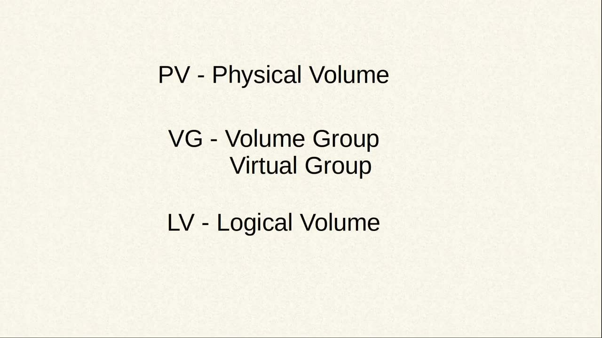
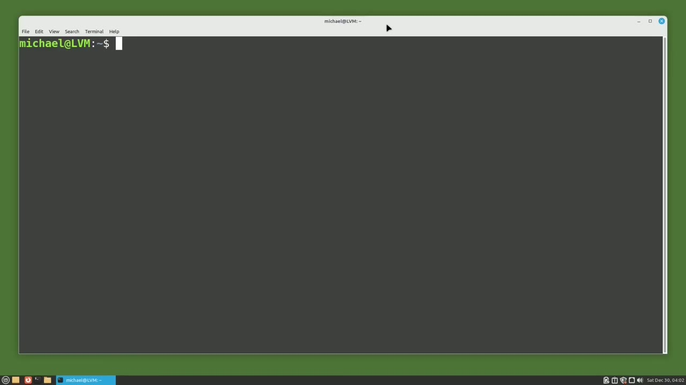
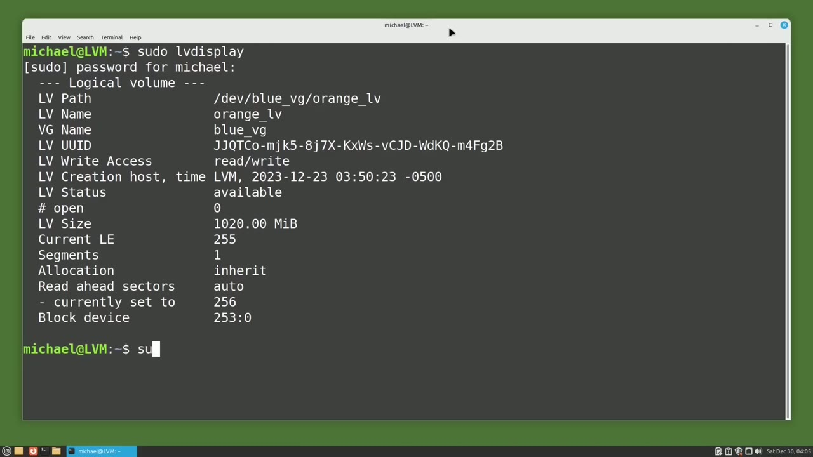
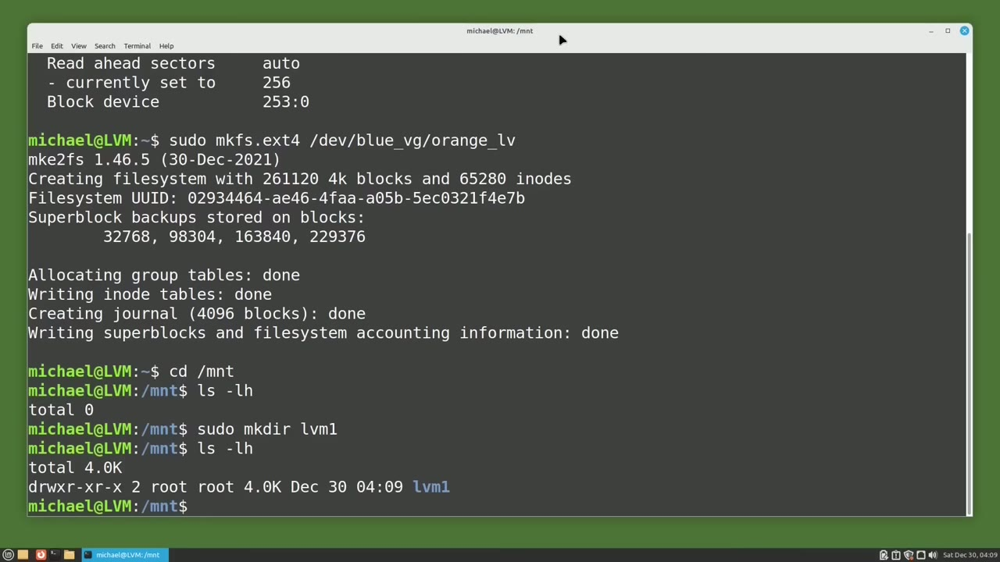
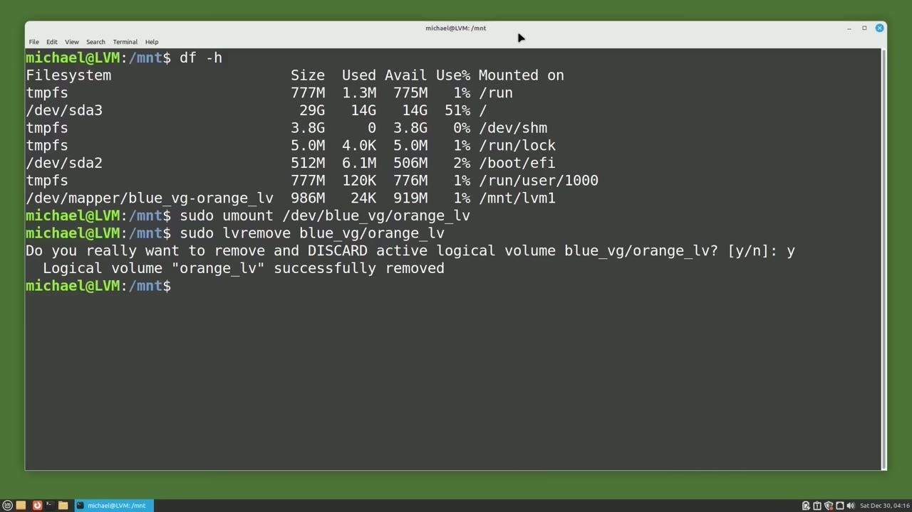

[← Course contents](../../01.md)

# 92. LVM pt2 - Add a File System and Remove LVM

**Course:** [Linux Command Line - Entire Tutorial Series](https://www.youtube.com/watch?v=avg65oY7sj4)  
**Transcript:** [`Linux Command Line - Entire Tutorial Series transcript`](../../../../course_videos/Linux%20Command%20Line%20-%20Entire%20Tutorial%20Series/Linux%20Command%20Line%20-%20Entire%20Tutorial%20Series.txt)  
**Video:** 15:47:04–15:54:10 ([open at this time](https://www.youtube.com/watch?v=avg65oY7sj4&t=56824s))

## Introduction

In the last video, we started looking at LVM and we said that there are three main parts of LVM. The pv physical volume, the vg volume group, and the lv logical volume. Then we made the device Dev sdb and LVM physical volume. And we created a volume group with just that single Dev sdb hard drive, and we called our new volume group Blue underscore vg.

## Detailed Explanation

<details>
  <summary>Step 1 — Run `sudo -lv display`</summary>

### Step 1 — Run `sudo -lv display`

- [x] **In the last video, we started looking at LVM and we said that there**
  - In the last video, we started looking at LVM and we said that there are three main parts of LVM.
  - The pv physical volume, the vg volume group, and the lv logical volume.
  - Then we made the device Dev sdb and LVM physical volume.

- [x] **And we created a volume group with just that single Dev sdb hard**
  - And we created a volume group with just that single Dev sdb hard drive, and we called our new volume group Blue underscore vg.
  - And we said that the volume group would be recognized by Linux as a single device like a new hard drive.
  - The last thing we did in the previous video was create a logical volume on our volume group.

- [x] **And we gave our logical volume the name Orange underscore lv**
  - And we gave our logical volume the name Orange underscore lv.
  - And we said that the logical volume acts like a partition.
  - Now we want to add a physical system to the Orange lv logical volume.

- [x] **Use `sudo -lv display`**
  - But before I do that, I want to see some information about the logical volume.
  - So I will type `sudo -lv display`.
  - And the line I'm interested here is the lv path.

- [x] **And we see that it is slash dev slash blue underscore vg slash orange**
  - And we see that it is slash dev slash blue underscore vg slash orange underscore lv.
  - And we can recognize that format as slash dev slash volume group slash logical volume.

```bash
sudo -lv display
```





</details>

<details>
  <summary>Step 2 — Run `sudo`, `cd slash`, `ls -lh`</summary>

### Step 2 — Run `sudo`, `cd slash`, `ls -lh`

- [x] **Use `sudo`**
  - We make a file system on the logical volume.
  - The same way we make a file system on a standard partition, but instead of the partition name, we give it the slash dev slash volume group slash logical volume.
  - So I will type `sudo` mkfs, then a dot, and then the file system we want to use.

- [x] **And then I will add the logical volume file path**
  - And then I will add the logical volume file path.
  - Pressing Enter, we see that the Exti 4 file system is now created on our logical volume Orange underscore lv.
  - Now I want to mount that logical volume with the ExtE4 file system on it, but I have not yet set up a location to mount it.

- [x] **Use `cd slash`, `ls -lh`, `sudo mkdir`**
  - I want to mount it in my slash mnt directory, so I will type `cd slash` mnt.
  - And `ls -lh` to see what we have in there.
  - So I will create a directory with `sudo mkdir` for Make Directory.

- [x] **Use `ls -lh`**
  - And then an `ls -lh` to show that it's there.
  - And I see the new lvm1 directory is created.

```bash
sudo
cd slash
ls -lh
sudo mkdir
```



</details>

<details>
  <summary>Step 3 — Run `sudo mount`, `df -H`, `sudo`</summary>

### Step 3 — Run `sudo mount`, `df -H`, `sudo`

- [x] **Use `sudo mount`**
  - To mount that logical volume to our new directory, I'm going to type `sudo mount`. And then I'm going to use that same logical volume path that we use to create the file system slash dev slash blue underscore vg slash orange underscore lv. Then a space and then the directory that we want to mount this to, which in this
  - Now anything we put in the slash mnt slash lvm1 directory will go on our sdb drive.
  - At least until we unmount that drive or shut down the system.

- [x] **Use `df -H`**
  - I'm going to clear the screen and we can see that file system was added by typing `df -H`.
  - Then we see at the bottom the slash dev mapper slash blue underscore vg -orange underscore lv.
  - Is mounted on slash mNT slash lvm1 and is using 986 megabytes.

- [x] **And if we want to mount the LVM volume every time the system starts**
  - And if we want to mount the LVM volume every time the system starts up, we'd go back to Video 83 that shows how to mount a hard drive on startup.
  - And now that we have LVM all set up and working, I'm going to show how to totally remove LVM from the system.
  - And we will start by unmounting the logical volume.

- [x] **Use `sudo`, `sudo -lv remove`**
  - With the command, `sudo`, U-Mount, slash dev slash blue underscore vg slash orange underscore lv.
  - Now I want to remove the orange underscore lv logical volume.
  - To do that, I'll run the command `sudo -lv remove`.

- [x] **And then we need to give it the volume group as well as the logical**
  - And then we need to give it the volume group as well as the logical volume name, because we may have multiple volume groups and that same logical volume name could appear on more than one volume group.
  - So I will type blue underscore vg, then a forward slash, then the logical volume name of Orange underscore lv.
  - And LVM is asking me to confirm that I really want to remove the logical volume orange underscore lv in the volume group Blue underscore vg.

- [x] **And we see the message logical volume orange underscore lv**
  - And we see the message logical volume orange underscore lv successfully removed.

```bash
sudo mount
df -H
sudo
sudo -lv remove
```



</details>

<details>
  <summary>Step 4 — Run `sudo lvs`, `sudo vgs`, `sudo`</summary>

### Step 4 — Run `sudo lvs`, `sudo vgs`, `sudo`

- [x] **Use `sudo lvs`, `sudo vgs`, `sudo`**
  - To show that it's actually gone, I will type `sudo lvs` for logical volume summary.
  - And nothing is there. Let's show that the volume group is still there with `sudo vgs` for volume group summary.
  - And we still have one volume group. I will remove that with `sudo` vg remove Blue underscore vg.

- [x] **Use `sudo vgs`**
  - And we see volume group blue underscore vg was successfully removed.
  - Now when I type `sudo vgs`, Nothing shows.
  - And then the last thing we need to do is remove the LVM physical volume.

- [x] **Use `sudo pvs`, `sudo`**
  - I will show that it's there with `sudo pvs`.
  - And if I spell `sudo` correctly, `sudo pvs`, it should work this time.
  - There we see the single LVM physical volume setup.

- [x] **Use `sudo`**
  - And I will remove that with the command `sudo` pv remove.
  - Typing SuduPVS again shows that there's no LVM on this system.
  - In the next tutorial, we will continue looking at LVM for the Linux command line.

```bash
sudo lvs
sudo vgs
sudo
sudo pvs
```



</details>

<details>
  <summary>Questions and Answers</summary>

## Questions and Answers

### Question 1: What does `sudo -lv display` do in this chapter?

<details>
<summary>Answer</summary>

- [x] So I will type `sudo -lv display`.

</details>

### Question 2: What does `sudo` do in this chapter?

<details>
<summary>Answer</summary>

- [x] So I will type `sudo` mkfs, then a dot, and then the file system we want to use.

</details>

### Question 3: What does `cd slash` do in this chapter?

<details>
<summary>Answer</summary>

- [x] I want to mount it in my slash mnt directory, so I will type `cd slash` mnt.

</details>

### Question 4: What does `ls -lh` do in this chapter?

<details>
<summary>Answer</summary>

- [x] And `ls -lh` to see what we have in there.

</details>

### Question 5: What does `sudo mkdir` do in this chapter?

<details>
<summary>Answer</summary>

- [x] So I will create a directory with `sudo mkdir` for Make Directory.

</details>

### Question 6: What does `sudo mount` do in this chapter?

<details>
<summary>Answer</summary>

- [x] To mount that logical volume to our new directory, I'm going to type `sudo mount`. And then I'm going to use that same logical volume path that we use to create the file system slash dev slash blue underscore vg slash orange underscore lv. Then a space and then the directory that we want to mount this to, which in this

</details>

### Question 7: What does `df -H` do in this chapter?

<details>
<summary>Answer</summary>

- [x] I'm going to clear the screen and we can see that file system was added by typing `df -H`.

</details>

### Question 8: What does `sudo -lv remove` do in this chapter?

<details>
<summary>Answer</summary>

- [x] To do that, I'll run the command `sudo -lv remove`.

</details>

### Question 9: What does `sudo lvs` do in this chapter?

<details>
<summary>Answer</summary>

- [x] To show that it's actually gone, I will type `sudo lvs` for logical volume summary.

</details>

### Question 10: What does `sudo vgs` do in this chapter?

<details>
<summary>Answer</summary>

- [x] And nothing is there. Let's show that the volume group is still there with `sudo vgs` for volume group summary.

</details>

### Question 11: What does `sudo pvs` do in this chapter?

<details>
<summary>Answer</summary>

- [x] I will show that it's there with `sudo pvs`.

</details>

</details>

## Summary

This chapter, LVM pt2 - Add a File System and Remove LVM, walks through Run sudo -lv display; Run sudo, cd slash, ls -lh; Run sudo mount, df -H, sudo; Run sudo lvs, sudo vgs, sudo. Commands from the transcript: `sudo -lv display`, `sudo`, `cd slash`, `ls -lh`, `sudo mkdir`, `sudo mount`, `df -H`, `sudo -lv remove`, `sudo lvs`, `sudo vgs`, `sudo pvs`.

## References

- [Linux Command Line - Entire Tutorial Series (YouTube)](https://www.youtube.com/watch?v=avg65oY7sj4)
- [This chapter at 15:47:04](https://www.youtube.com/watch?v=avg65oY7sj4&t=56824s)
- [Local transcript](../../../../course_videos/Linux%20Command%20Line%20-%20Entire%20Tutorial%20Series/Linux%20Command%20Line%20-%20Entire%20Tutorial%20Series.txt)
