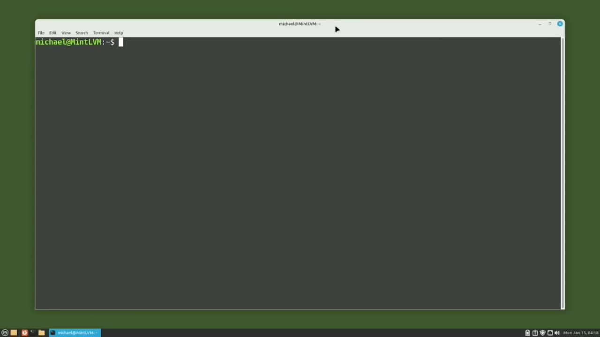
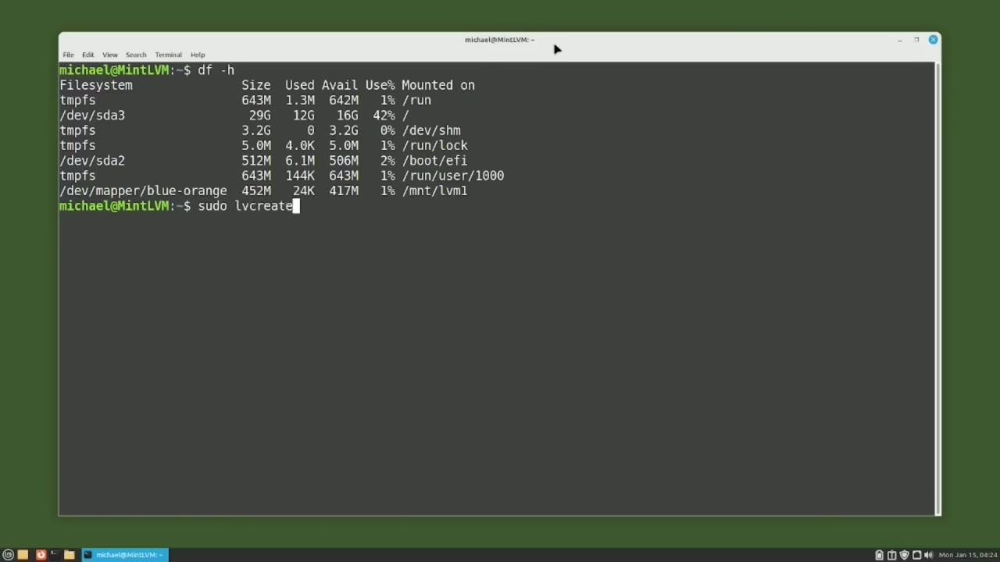
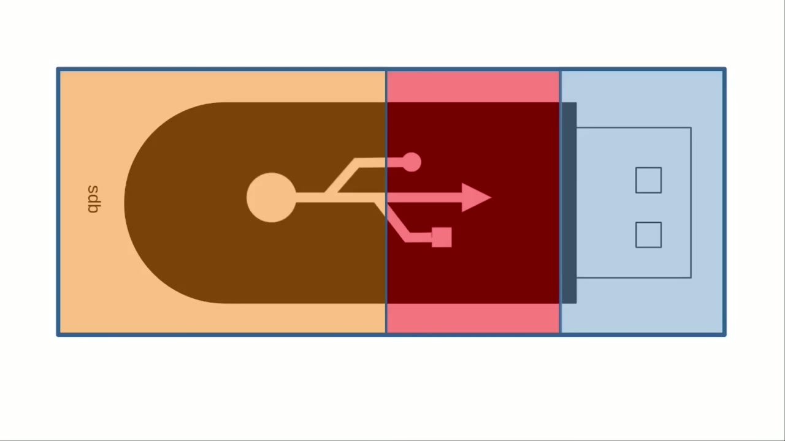
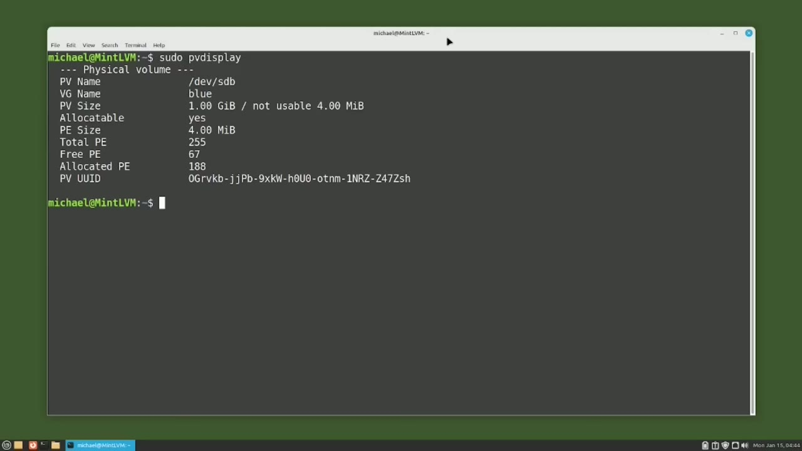
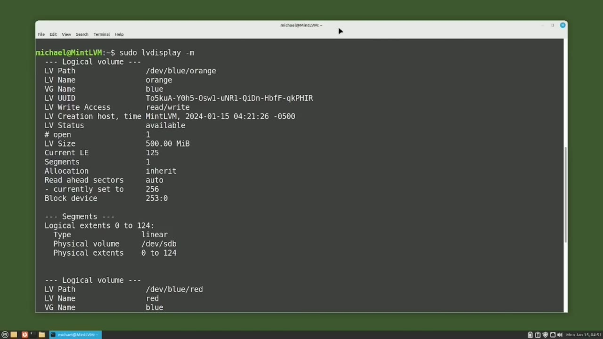

[← Course contents](../../01.md)

# 93. LVM pt3 - LVM a Closer Look

**Course:** [Linux Command Line - Entire Tutorial Series](https://www.youtube.com/watch?v=avg65oY7sj4)  
**Transcript:** [`Linux Command Line - Entire Tutorial Series transcript`](../../../../course_videos/Linux%20Command%20Line%20-%20Entire%20Tutorial%20Series/Linux%20Command%20Line%20-%20Entire%20Tutorial%20Series.txt)  
**Video:** 15:54:10–16:06:14 ([open at this time](https://www.youtube.com/watch?v=avg65oY7sj4&t=57250s))

## Introduction

In the last video, I deleted the LVM we created and now I'm realizing that maybe I should not have deleted it quite yet. So I'm going to quickly set up LVM similar to the one that we had. I'm going to start by creating the Blue Volume Group with Sudo vg Create Blue slash Dev slash sdb. And we see two lines here showing that LVM created an LVM physical volume on device devSDB and then created a volume group with the name Blue.

## Detailed Explanation

<details>
  <summary>Step 1 — Run `sudo`, `sudo mount slash`, `df -H`</summary>

### Step 1 — Run `sudo`, `sudo mount slash`, `df -H`

- [x] **Use `sudo`**
  - In the last video, I deleted the LVM we created and now I'm realizing that maybe I should not have deleted it quite yet.
  - So I'm going to quickly set up LVM similar to the one that we had.
  - I'm going to start by creating the Blue Volume Group with `sudo` vg Create Blue slash Dev slash sdb.

- [x] **Use `sudo`**
  - And we see two lines here showing that LVM created an LVM physical volume on device devSDB and then created a volume group with the name Blue.
  - On that physical volume. Now I'll set up a logical volume with the command, `sudo`, lv, create, and this time I'm going to use a -uppercase L.
  - Last time we used the lowercase L to set a percentage. This time I'm using the uppercase L to tell LVM that I'm going to give it a specific size. And I want that specific size to be 500 megabytes. And that will go on the Blue Volume Group and then I'll add -N to give this a volume name of Orange.

- [x] **And then we get the message, logical volume Orange was created**
  - And then we get the message, logical volume Orange was created.
  - I want to add a file system to that logical volume.
  - And that will go on slash dev slash blue slash orange.

- [x] **Use `sudo mount slash`**
  - And then we want to mount that on the directory we created in the previous videos.
  - So I will type `sudo mount slash` dev slash blue slash orange.
  - And we're going to mount that on mnt slash lvm1.

- [x] **Use `df -H`**
  - And that lvm1 directory is one we created previously.
  - To make sure that was mounted okay, I'm going to clear the screen and type `df -H`.
  - And at the bottom we see DevMapper Blue -Orange is mounted on mnt lvm1.

- [x] **Now let's create another logical volume with the command**
  - Now let's create another logical volume with the command.

```bash
sudo
sudo mount slash
df -H
```



</details>

<details>
  <summary>Step 2 — Run `sudo`, `sudo mkdir`, `sudo mount slash`</summary>

### Step 2 — Run `sudo`, `sudo mkdir`, `sudo mount slash`

- [x] **Use `sudo`**
  - `sudo` lv create.
  - Again, I'll use the -uppercase L to give it a specific size of 250 megabytes.
  - I want to put this logical volume on the blue volume group.

- [x] **For the logical volume name and I will give this volume group a name**
  - For the logical volume name and I will give this volume group a name of red.
  - Notice we get a message here, rounding the size to full physical extent, 252 mibi bytes. We'll talk about this in a few moments.
  - And then the other message we see is that the logical volume red was created.

- [x] **I'm going to add a file system to our logical volume red with the**
  - I'm going to add a file system to our logical volume red with the command, MakeFS for Make File System.
  - And I'm going to make this an XFS file system just to be different than the EXT4 that we have on orange.
  - And we need to add in the dev blue, red.

- [x] **Use `sudo mkdir`, `sudo mount slash`**
  - Now I want to mount this, but first I need to create a directory.
  - So I will type the command `sudo`, mkdir.
  - And then I can mount our new file system to the lvm2 directory with the command `sudo mount slash` dev slash blue slash red.

- [x] **Use `df -H`**
  - And then we're going to mount that on mnt, lvm2.
  - And to make sure it's mounted okay, I'm going to clear the screen and type `df -H`.
  - And we see it there at the bottom. DevMapper Blue-Red is mounted on slash mnt slash lvm2.

- [x] **At this point, we have an LVM setup that looks something like this**
  - At this point, we have an LVM setup that looks something like this.
  - And I've color coordinated our slide to match the name of our volume group and our logical volumes.
  - We started with a one-gabyte hard drive shown here in this picture as a USB drive.

- [x] **LVM also created the LVM physical volume on the slash dev slash sdb**
  - LVM also created the LVM physical volume on the slash dev slash sdb device.
  - Then we created the orange logical volume that uses half of the blue volume group.
  - After that, we created the red logical volume that is the size of about a quarter of the entire volume group, leaving that last quarter free for another logical volume.

- [x] **Or expansion of one or more of the logical volumes already in this**
  - Or expansion of one or more of the logical volumes already in this volume group.
  - And I went over that pretty quick because this is pretty much a review of what we did over the last two videos.
  - Now, we know our LVM looks like this because we just created it and it's fresh in our minds.

- [x] **Six months or a year from now, we will probably have forgotten what**
  - Six months or a year from now, we will probably have forgotten what this LVM looks like.

```bash
sudo
sudo mkdir
sudo mount slash
df -H
```



</details>

<details>
  <summary>Step 3 — Run `sudo`</summary>

### Step 3 — Run `sudo`

- [x] **Use `sudo`**
  - So now we're going to use the LVM commands as we would in six months or a year from now.
  - To recreate this picture. Let's start by looking at the physical volumes. I will type the command `sudo` pv display. And we see that the physical volume.
  - Name is dev sdb the physical volume size is one gibby byte and we have four mebby bytes that are not usable the pv extent size is four mibby bytes and we have a total pe of 255 let's look at these a little closer the first one the physical volume name it's pretty obvious it is just the physical hard disk setup for lvm use if we had more drives set up for lvm

- [x] **They would be listed in that pv display as well**
  - They would be listed in that pv display as well.
  - The pv size is showing us that there is one Ghibi byte available for this physical volume, which is the same as 102.4 mebby bytes, but four mebby bytes are unavailable, probably used by LVM.
  - So only 102-0 mebibytes are available for this volume.

- [x] **So the physical extent size is 4 mebbybytes**
  - So the physical extent size is 4 mebbybytes.
  - Physical extents are important because physical extents are what LVM uses to store the LVM data.
  - And all the LVM data is stored on these little 4 mebbyte physical extents.

- [x] **And then we have a total of 255 physical extents, which is the amount**
  - And then we have a total of 255 physical extents, which is the amount of LVM disk storage that the slash dev slash sdb device has to work with.
  - And you've probably already noticed that the 102 Mebibytes divided by 4 mebibytes is 255, the number of physical extents available.
  - We also see on the screen the allocated physical extents of 188 and the 67 physical extents that are still free or available.

```bash
sudo
```



</details>

<details>
  <summary>Step 4 — Run `sudo`</summary>

### Step 4 — Run `sudo`

- [x] **Use `sudo`**
  - Now let's look at the volume group information with the command `sudo` vg display.
  - At the top here, we see the volume group name is blue.
  - If we had multiple volume groups on this LVM, they would show here as well.

- [x] **Other things of interest here are that we have two logical volumes on**
  - Other things of interest here are that we have two logical volumes on this volume group, and that this volume group is on a single physical volume.
  - We see the vg size of 102 meby bytes and the physical extent size of four mebibytes.
  - Then we see our total physical extents of 255 with the allocated of 188 and the free of 67, which is the same as used 188 and still available of 67.

- [x] **Use `sudo`**
  - And those are also shown in mebyby bytes.
  - Now let's look at the logical volume information with `sudo` lv display.
  - But before I hit enter, I'm going to add a -M to this command.

- [x] **To also include the logical volume mappings**
  - To also include the logical volume mappings.
  - This is showing us both logical volumes.
  - Let's go to the top and start with the orange logical volume.

- [x] **And we can tell which logical volume we are looking at from the lv**
  - And we can tell which logical volume we are looking at from the lv name we are looking at orange at the moment.
  - Our logical volume has a logical volume size of 500 mebbyby bytes.

```bash
sudo
```



</details>

<details>
  <summary>Step 5 — which is the same as 125 logical extents, which is 500 divided by 4</summary>

### Step 5 — which is the same as 125 logical extents, which is 500 divided by 4

- [x] **which is the same as 125 logical extents, which is 500 divided by 4**
  - which is the same as 125 logical extents, which is 500 divided by 4.
  - And looking down in the mappings section, we see that the logical volume orange is on physical volume slash dev slash sdb.
  - And we said that we were using 125 logical extents.

- [x] **And those logical extends are on physical extents, 0 through 124**
  - And those logical extends are on physical extents, 0 through 124.
  - On the slash dev slash sdb drive and it's zero through 124 because with computers we always start with zero to see that more visually let's go to a picture back in our picture at the top we see the logical extents of zero through 124 and then at the bottom we see the volume group physical
  - Extents of zero through 124 Now let's look at our logical volume red and the information for that.

- [x] **We'll first start with the logical volume name**
  - We'll first start with the logical volume name.
  - And we see that's on the volume group blue.
  - And then our logical volume size is 252 meby bytes.

- [x] **Remember a few minutes ago when I requested 250 megabytes for this**
  - Remember a few minutes ago when I requested 250 megabytes for this logical volume?
  - But LVM bumped me up to 252 megabytes and gave me a message letting me know what it was doing.
  - Now we know the reason for that bump of 2 megabytes.

- [x] **LVM wanted to make sure it would use all the disk space**
  - LVM wanted to make sure it would use all the disk space.
  - And since LVM stores its data in 4 mebibite extents, it bumped me up to 252 mebibytes, which is a number evenly divisible by 4.
  - 252 megabytes is the same as 63 logical extents.

- [x] **So then down at the bottom, we see that the physical volume is dev s**
  - So then down at the bottom, we see that the physical volume is dev s db and that the logical volume logical logical extents are 0 through 62 and then they sit on physical extents 125 through 187 so now our picture looks like this up at the top we see the red logical extents there's 68
  - Of them and they're sitting on logical extent zero through 67 At the bottom of the picture, we see the physical extents.
  - So the 68 logical extents are on physical extents 125 through 187.

- [x] **And then physical extents 188 to 255 are still available for that**
  - And then physical extents 188 to 255 are still available for that volume group.
  - We will expand our volume group and our logical volumes in the next tutorial for the Linux command line.



</details>

<details>
  <summary>Questions and Answers</summary>

## Questions and Answers

### Question 1: What does `sudo` do in this chapter?

<details>
<summary>Answer</summary>

- [x] I'm going to start by creating the Blue Volume Group with `sudo` vg Create Blue slash Dev slash sdb.

</details>

### Question 2: What does `sudo mount slash` do in this chapter?

<details>
<summary>Answer</summary>

- [x] So I will type `sudo mount slash` dev slash blue slash orange.

</details>

### Question 3: What does `df -H` do in this chapter?

<details>
<summary>Answer</summary>

- [x] To make sure that was mounted okay, I'm going to clear the screen and type `df -H`.

</details>

### Question 4: What does `sudo mkdir` do in this chapter?

<details>
<summary>Answer</summary>

- [x] So I will type the command Sudo, mkdir.

</details>

### Question 5: What does step 1 cover (Run sudo, sudo mount slash, df -H)?

<details>
<summary>Answer</summary>

- [x] In the last video, I deleted the LVM we created and now I'm realizing that maybe I should not have deleted it quite yet.
- [x] So I'm going to quickly set up LVM similar to the one that we had.
- [x] I'm going to start by creating the Blue Volume Group with `sudo` vg Create Blue slash Dev slash sdb.

</details>

### Question 6: What does step 2 cover (Run sudo, sudo mkdir, sudo mount slash)?

<details>
<summary>Answer</summary>

- [x] `sudo` lv create.
- [x] Again, I'll use the -uppercase L to give it a specific size of 250 megabytes.
- [x] I want to put this logical volume on the blue volume group.

</details>

### Question 7: What does step 3 cover (Run sudo)?

<details>
<summary>Answer</summary>

- [x] So now we're going to use the LVM commands as we would in six months or a year from now.
- [x] To recreate this picture. Let's start by looking at the physical volumes. I will type the command `sudo` pv display. And we see that the physical volume.
- [x] Name is dev sdb the physical volume size is one gibby byte and we have four mebby bytes that are not usable the pv extent size is four mibby bytes and we have a total pe of 255 let's look at these a little closer the first one the physical volume name it's pretty obvious it is just the physical hard disk setup for lvm use if we had more drives set up for lvm

</details>

### Question 8: What does step 4 cover (Run sudo)?

<details>
<summary>Answer</summary>

- [x] Now let's look at the volume group information with the command `sudo` vg display.
- [x] At the top here, we see the volume group name is blue.
- [x] If we had multiple volume groups on this LVM, they would show here as well.

</details>

### Question 9: What does step 5 cover (which is the same as 125 logical extents, which is 500 divided by 4)?

<details>
<summary>Answer</summary>

- [x] which is the same as 125 logical extents, which is 500 divided by 4.
- [x] And looking down in the mappings section, we see that the logical volume orange is on physical volume slash dev slash sdb.
- [x] And we said that we were using 125 logical extents.

</details>

</details>

## Summary

This chapter, LVM pt3 - LVM a Closer Look, walks through Run sudo, sudo mount slash, df -H; Run sudo, sudo mkdir, sudo mount slash; Run sudo; Run sudo; which is the same as 125 logical extents, which is 500 divided by 4. Commands from the transcript: `sudo`, `sudo mount slash`, `df -H`, `sudo mkdir`.

## References

- [Linux Command Line - Entire Tutorial Series (YouTube)](https://www.youtube.com/watch?v=avg65oY7sj4)
- [This chapter at 15:54:10](https://www.youtube.com/watch?v=avg65oY7sj4&t=57250s)
- [Local transcript](../../../../course_videos/Linux%20Command%20Line%20-%20Entire%20Tutorial%20Series/Linux%20Command%20Line%20-%20Entire%20Tutorial%20Series.txt)
