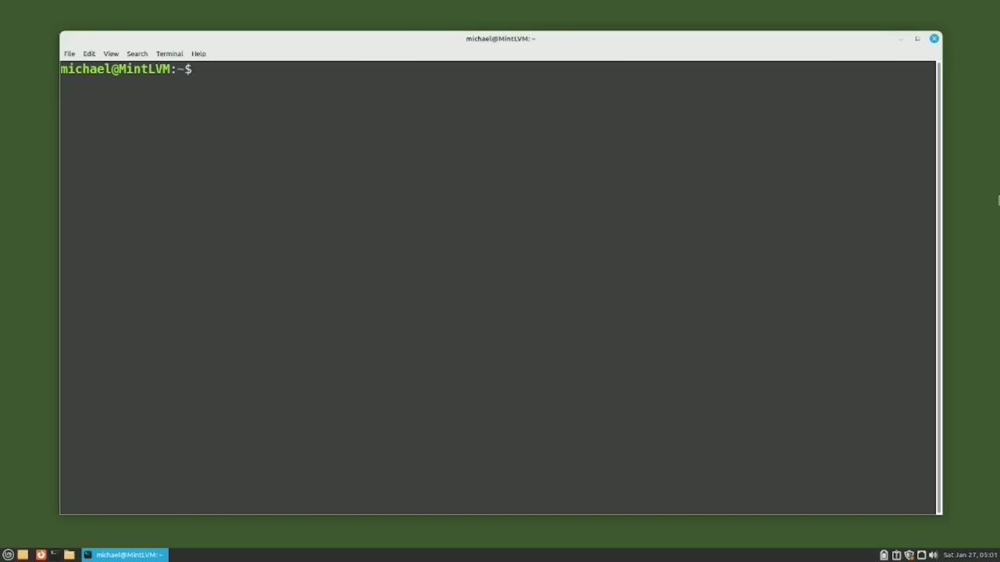
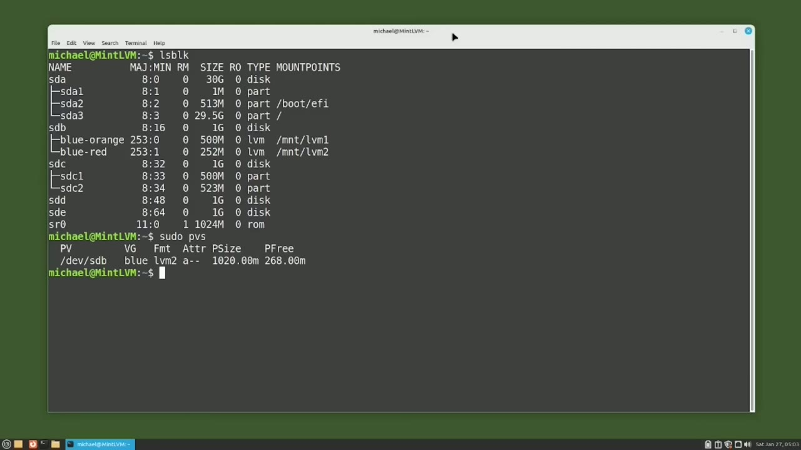
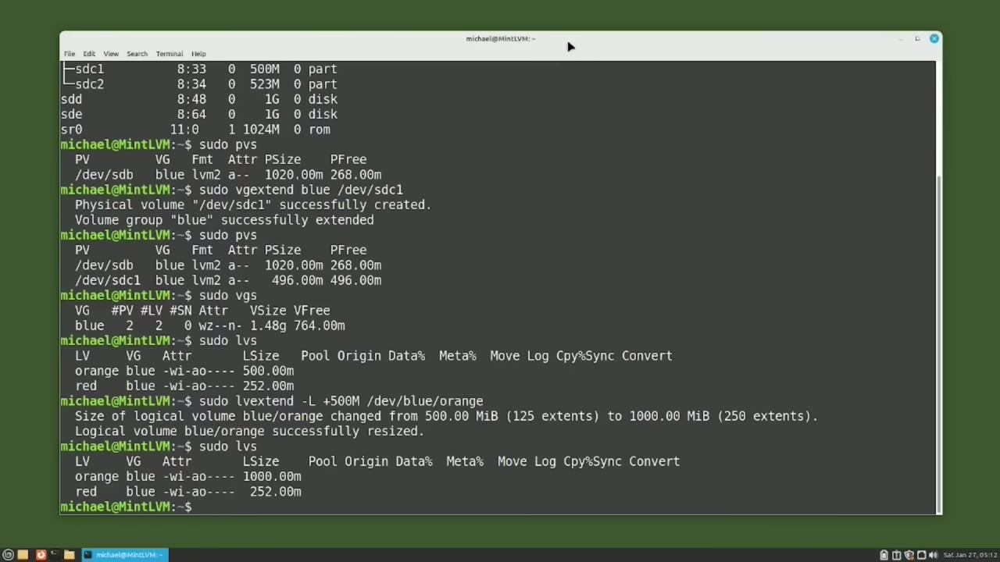
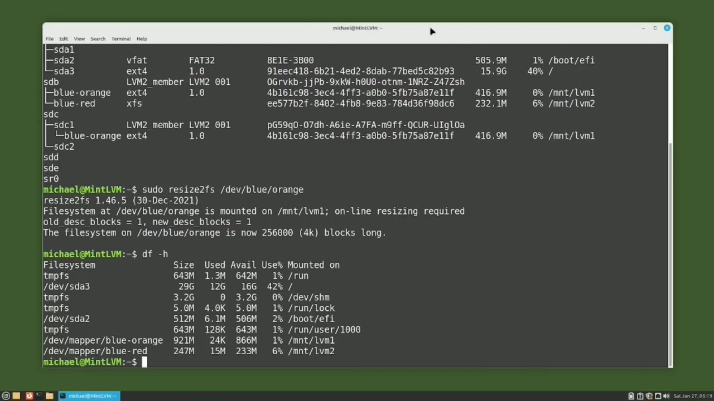
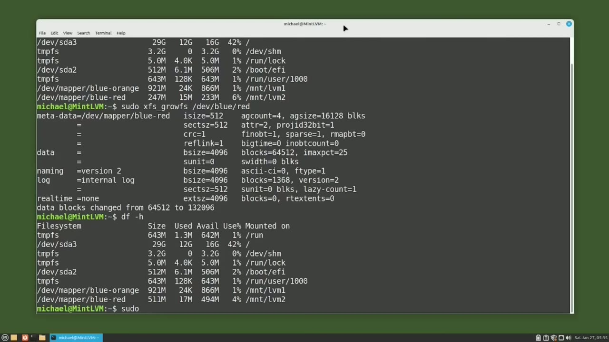

[← Course contents](../../01.md)

# 94. LVM pt4 - Expand LVM

**Course:** [Linux Command Line - Entire Tutorial Series](https://www.youtube.com/watch?v=avg65oY7sj4)  
**Transcript:** [`Linux Command Line - Entire Tutorial Series transcript`](../../../../course_videos/Linux%20Command%20Line%20-%20Entire%20Tutorial%20Series/Linux%20Command%20Line%20-%20Entire%20Tutorial%20Series.txt)  
**Video:** 16:06:14–16:18:49 ([open at this time](https://www.youtube.com/watch?v=avg65oY7sj4&t=57974s))

## Introduction

We are picking up from where we left off in the last video, where we have already set up LVM to look like this picture. What I want to do now is double the size of the orange logical volume. But there is not enough disk space on this device. So I'm going to add another device to this volume group.

## Detailed Explanation

<details>
  <summary>Step 1 — Run `lsblk`</summary>

### Step 1 — Run `lsblk`

- [x] **We are picking up from where we left off in the last video, where we**
  - We are picking up from where we left off in the last video, where we have already set up LVM to look like this picture.
  - What I want to do now is double the size of the orange logical volume.
  - But there is not enough disk space on this device.

- [x] **Use `lsblk`**
  - So I'm going to add another device to this volume group.
  - I'm going to check what devices are on this computer with the command `lsblk`.
  - And we see sdc, sdd, and sde are all available.

- [x] **I'm going to use the partition sdc1 on the sdc device just to show**
  - I'm going to use the partition sdc1 on the sdc device just to show that LVM can use partitions as well as an entire disk.
  - I want to expand the blue volume group to include partition sdc1.
  - But before I do that, I want to show what physical volumes are currently being used by LVM.

```bash
lsblk
```



</details>

<details>
  <summary>Step 2 — Run `sudo`, `vgs`, `sudo vgs`</summary>

### Step 2 — Run `sudo`, `vgs`, `sudo vgs`

- [x] **Use `sudo`**
  - Now I will add the Dev sdc1 to the Blue Volume Group with the command `sudo` vg extend Blue slash Dev slash sdc1.
  - The first one, physical volume dev sdc1.
  - Was successfully created. We could have done that step manually. And the second message is volume group blue successfully extended. Let's double check to make sure the new partition was added with the command, SuduPVS. We see we now have two physical volumes. Dev sdb with the volume

- [x] **Use `vgs`, `sudo vgs`**
  - With the volume group blue and a physical size of 496.
  - So it looks like our sdc1 partition was added to volume group blue as expected.
  - Now let's check the volume group with the `vgs` command, `sudo vgs`.

- [x] **Use `sudo -lvs`, `sudo`**
  - And we see volume group blue now has two physical volumes and two logical volumes.
  - Of 1.48 gigabytes. So the volume group was extended as expected. Check in our logical volumes with the command, `sudo -lvs`, shows logical volume orange is still 500 megabytes and logical volume red is still 252 megabytes. So we have not extended any logical volumes yet. I want to extend the logical volume
  - I'll do that with the command, `sudo`, lv, extend, dash, uppercase L plus 500M slash dev slash blue slash orange.

- [x] **And I'm using the uppercase L because I want to give it a specific**
  - And I'm using the uppercase L because I want to give it a specific size.
  - And the plus sign before that 500 megabytes is very important.
  - We need the plus sign to say we are adding.

```bash
sudo
vgs
sudo vgs
sudo -lvs
```



</details>

<details>
  <summary>Step 3 — Run `df -h`, `lsblk -F`, `sudo resize`</summary>

### Step 3 — Run `df -h`, `lsblk -F`, `sudo resize`

- [x] **500 megabytes to our logical volume. Pressing enter, we see a message**
  - 500 megabytes to our logical volume. Pressing enter, we see a message that logical volume, blue orange, has changed from 500 to 1,000 megabytes, or from 125 extents to 250 extents. Then we see that logical volume blue orange was successfully resized.
  - To make sure the logical volume has resized as expected, I will type SudoLVS for logical volume summary.
  - And we see the logical volume orange on volume group blue is now 1000 megabytes.

- [x] **Use `df -h`**
  - Now let's confirm the file system size was updated properly by clearing the screen and typing `df -h`.
  - And we see that file system blue orange has a size of 452 megabytes.
  - We had a similar situation in Video 90 and I used the GUI application G-parted to increase the file system size.

- [x] **In the comments of Video 90, YouTuber Creative srm called me out for**
  - In the comments of Video 90, YouTuber Creative srm called me out for using the graphical tool G-parted to resize a partition.
  - And a command line tutorial series and wanted to know how to resize a partition in the command line.
  - Well, G-parted does not work with LVM logical volumes, so I cannot use that GUI partition tool to increase the file system this time.

- [x] **Use `lsblk -F`**
  - Before I can submit the CLI command to increase the file system, I will have to know what kind of file system we have on that logical volume.
  - Is with the command `lsblk -F` and the F is for file system.
  - And here we see that orange is using ExtE4 and red is using XFS.

- [x] **Use `sudo resize`**
  - To increase the size of the EXT4 file system of the orange logical volume, I will type `sudo resize` 2FS dev blue orange.
  - And I'll note that Resize 2FS is only used for the ExtE4 file systems.
  - We'll use a different command for the XFS file system.

- [x] **Use `df -h`**
  - And to make sure this worked, I will type `df -h`.
  - And we see here that the disk size of the blue-orange volume group has increased to 921 megabytes.

```bash
df -h
lsblk -F
sudo resize
```



</details>

<details>
  <summary>Step 4 — Run `sudo`, `sudo -lvs`, `df -H`</summary>

### Step 4 — Run `sudo`, `sudo -lvs`, `df -H`

- [x] **Use `sudo`**
  - Now let's check that volume group with the `sudo`.
  - I'll go up to orange and we see the lv name is orange.
  - The lv size is 1000 maybe bytes and the lv logical extents is 250.

- [x] **And then down in the mappings, LVM started adding extents on device**
  - And then down in the mappings, LVM started adding extents on device sdb.
  - On the physical extents 188 to 254 and then it ran out of room so then it went down to the dev sdc device and added the logical extents 192 to 249 on physical extents 0 to 57 let's put this all together now with some pictures we ended the last video started this video with the logical volume orange at a size of 500 megabytes
  - The logical volume red with the size of 250 megabytes and then there was still 250 megabytes available on the blue volume group we extended the volume group blue another 500 megabytes by adding partition dev sdc1 then we added 500 megabytes to the orange logical volume and our image now looks like this we see lvm was able to add 67 extents or

- [x] **268 megabytes on device sdb, and then it ran out of room, and it**
  - 268 megabytes on device sdb, and then it ran out of room, and it added the remaining 58 extents on device dev sdc1 on physical extents 0 through 57.
  - Now let's extend the logical volume red to take up the rest of the free disk space in the blue volume group.
  - -lowercase L plus 100% free slash dev slash blue slash red and here we're using the lowercase L LVM a percentage and again we need to make sure we have that plus sign before that 100% free to show that we are adding the space and then we put in the dev volume group of blue

- [x] **Use `sudo -lvs`, `df -H`**
  - Pressing enter, we get the message that the logical volume red has changed from 252 mibbytes to 516 maybe bytes, and the logical volume blue red was successfully resized.
  - Typing `sudo -lvs` shows logical volume red has been increased to 516 megabytes.
  - By clearing the screen and typing `df -H`.

- [x] **Use `sudo`, `df -h`**
  - We see here that DevMapper Blue Red is still only at 247 megabytes.
  - To expand the XFS file system on Logical Volume Red, I will type the command `sudo` XFS underscore GrowFS slash dev slash blue slash red.
  - And let's check that file system size again with `df -H`.

- [x] **And we see it's now at 511 megabytes, so it was extended as expected**
  - And we see it's now at 511 megabytes, so it was extended as expected.
  - Let's check the updated volume group and mappings now with the command.

```bash
sudo
sudo -lvs
df -H
df -h
```



</details>

<details>
  <summary>Step 5 — Run `sudo -lv display -M`, `sudo`, `sudo -lv-extend -uppercase`</summary>

### Step 5 — Run `sudo -lv display -M`, `sudo`, `sudo -lv-extend -uppercase`

- [x] **Use `sudo -lv display -M`**
  - `sudo -lv display -M`.
  - And we see that LVM added logical extents 63 to 128 on partition Dev sdc 1 on physical extents 58 to 123.
  - And we see that logical extends 63 through 128 are on device devsdc on physical extents 58 to 128.

- [x] **There is one more thing I want to do here before I end this video**
  - There is one more thing I want to do here before I end this video, and that is to add another.
  - 500 megabytes to the orange logical volume. Let's check what devices we still have available with the command.
  - L-s-b-l-k. And we see s-d-d in s-e. I'm going to use the S-D-D-Drive.

- [x] **Use `sudo`**
  - So I want to expand the blue volume group onto the s-d-d drive with the command.
  - `sudo` V-G-extend blue slash dev slash sdd.
  - And now I want to expand the logical volume Orange, 500 megabytes, but this time I want to also expand the file system at the same time.

- [x] **Use `sudo -lv-extend -uppercase`**
  - To do that, I will submit the command, `sudo -lv-extend -uppercase` L plus 500M slash dev slash blue slash orange.
  - The first one is the size of the logical volume blue orange was changed from 1,000 megabytes to 1.46 gigabytes.
  - The second message tells us the logical volume blue orange was successfully resized.

- [x] **Use `df -h`**
  - And the last group of messages tells us the file system at DevMapper Blue Orange mounted on lvm1 was also resized.
  - Let's check that out by clearing the screen and typing `df -h`.
  - And now we see that the disk space of logical volume Blue Orange is now 1.4 gigabytes.

- [x] **So it did increase the file system size when the logical volume was**
  - So it did increase the file system size when the logical volume was extended.
  - In the next video, We'll continue looking at LVM for the Linux command line.

```bash
sudo -lv display -M
sudo
sudo -lv-extend -uppercase
df -h
```



</details>

<details>
  <summary>Questions and Answers</summary>

## Questions and Answers

### Question 1: What does `lsblk` do in this chapter?

<details>
<summary>Answer</summary>

- [x] I'm going to check what devices are on this computer with the command `lsblk`.

</details>

### Question 2: What does `sudo` do in this chapter?

<details>
<summary>Answer</summary>

- [x] Now I will add the Dev sdc1 to the Blue Volume Group with the command `sudo` vg extend Blue slash Dev slash sdc1.

</details>

### Question 3: What does `vgs` do in this chapter?

<details>
<summary>Answer</summary>

- [x] Now let's check the volume group with the `vgs` command, Sudo `vgs`.

</details>

### Question 4: What does `sudo vgs` do in this chapter?

<details>
<summary>Answer</summary>

- [x] Now let's check the volume group with the vgs command, `sudo vgs`.

</details>

### Question 5: What does `sudo -lvs` do in this chapter?

<details>
<summary>Answer</summary>

- [x] Of 1.48 gigabytes. So the volume group was extended as expected. Check in our logical volumes with the command, `sudo -lvs`, shows logical volume orange is still 500 megabytes and logical volume red is still 252 megabytes. So we have not extended any logical volumes yet. I want to extend the logical volume

</details>

### Question 6: What does `df -h` do in this chapter?

<details>
<summary>Answer</summary>

- [x] Now let's confirm the file system size was updated properly by clearing the screen and typing `df -h`.

</details>

### Question 7: What does `lsblk -F` do in this chapter?

<details>
<summary>Answer</summary>

- [x] Is with the command `lsblk -F` and the F is for file system.

</details>

### Question 8: What does `sudo resize` do in this chapter?

<details>
<summary>Answer</summary>

- [x] To increase the size of the EXT4 file system of the orange logical volume, I will type `sudo resize` 2FS dev blue orange.

</details>

### Question 9: What does `sudo -lv display -M` do in this chapter?

<details>
<summary>Answer</summary>

- [x] `sudo -lv display -M`.

</details>

### Question 10: What does `sudo -lv-extend -uppercase` do in this chapter?

<details>
<summary>Answer</summary>

- [x] To do that, I will submit the command, `sudo -lv-extend -uppercase` L plus 500M slash dev slash blue slash orange.

</details>

</details>

## Summary

This chapter, LVM pt4 - Expand LVM, walks through Run lsblk; Run sudo, vgs, sudo vgs; Run df -h, lsblk -F, sudo resize; Run sudo, sudo -lvs, df -H; Run sudo -lv display -M, sudo, sudo -lv-extend -uppercase. Commands from the transcript: `lsblk`, `sudo`, `vgs`, `sudo vgs`, `sudo -lvs`, `df -h`, `lsblk -F`, `sudo resize`, `df -H`, `sudo -lv display -M`, `sudo -lv-extend -uppercase`.

## References

- [Linux Command Line - Entire Tutorial Series (YouTube)](https://www.youtube.com/watch?v=avg65oY7sj4)
- [This chapter at 16:06:14](https://www.youtube.com/watch?v=avg65oY7sj4&t=57974s)
- [Local transcript](../../../../course_videos/Linux%20Command%20Line%20-%20Entire%20Tutorial%20Series/Linux%20Command%20Line%20-%20Entire%20Tutorial%20Series.txt)
