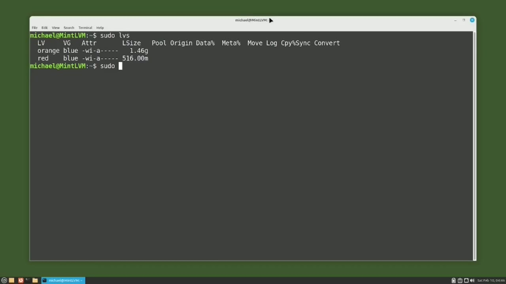
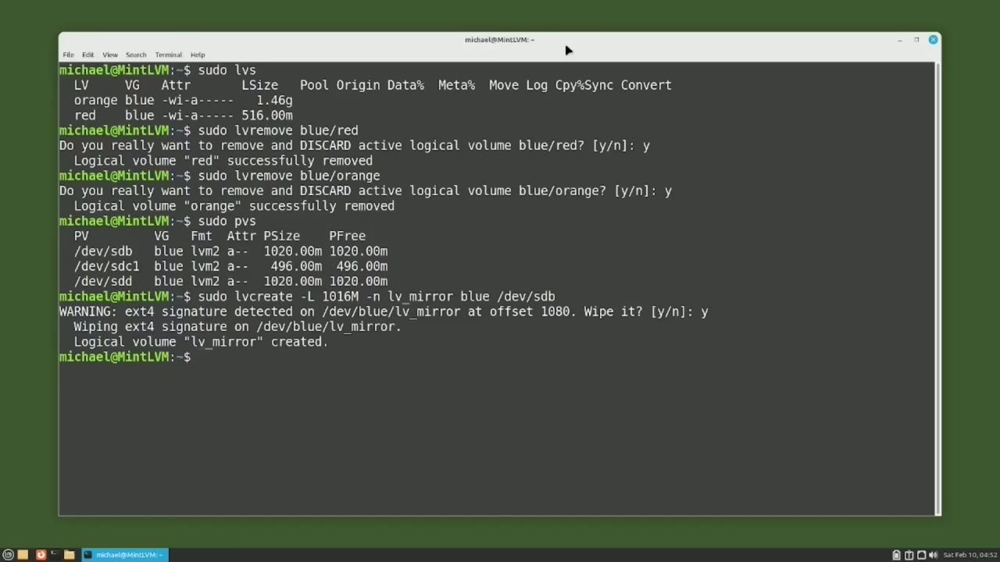
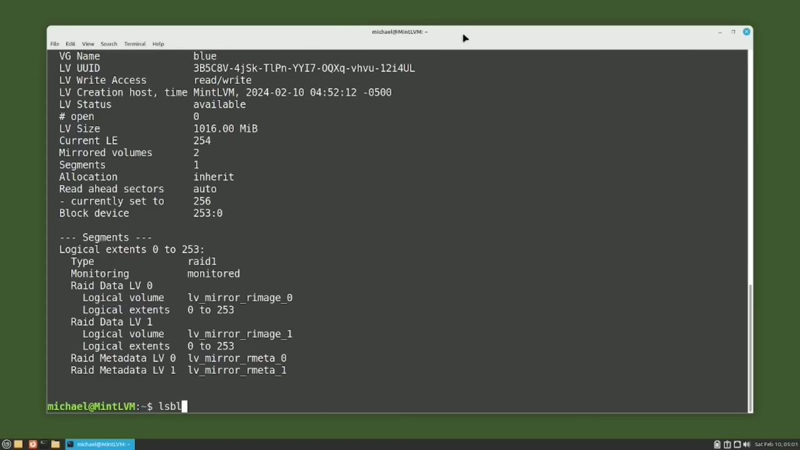
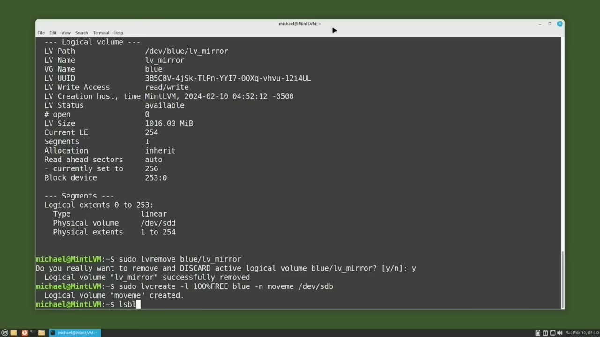
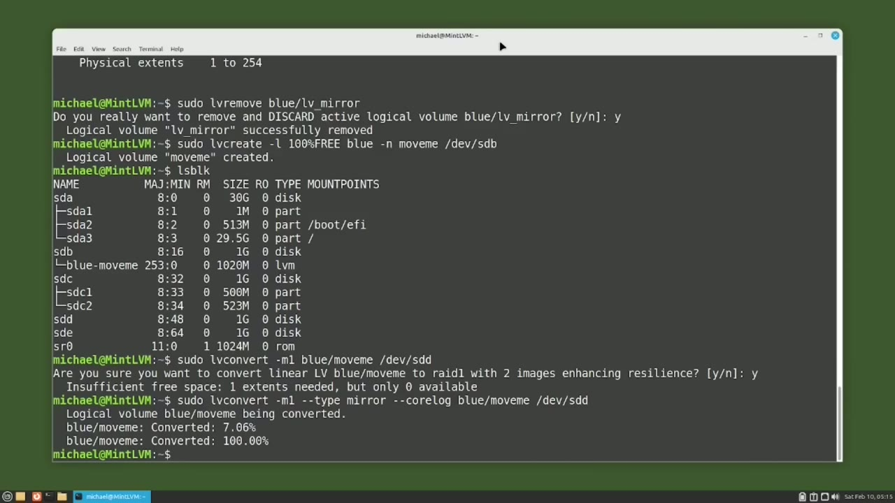

[← Course contents](../../01.md)

# 95. LVM pt5 - LVM RAID1 Mirror

**Course:** [Linux Command Line - Entire Tutorial Series](https://www.youtube.com/watch?v=avg65oY7sj4)  
**Transcript:** [`Linux Command Line - Entire Tutorial Series transcript`](../../../../course_videos/Linux%20Command%20Line%20-%20Entire%20Tutorial%20Series/Linux%20Command%20Line%20-%20Entire%20Tutorial%20Series.txt)  
**Video:** 16:18:49–16:31:28 ([open at this time](https://www.youtube.com/watch?v=avg65oY7sj4&t=58729s))

## Introduction

Typing SudoLVS shows that we're picking up from where we left off in the last video. And I'm going to remove the logical volumes used in the last few videos with the commands. Sudo lv remove blue slash red. And then Sudo lv remove.

## Detailed Explanation

<details>
  <summary>Step 1 — Run `sudo`, `sudo pvs`</summary>

### Step 1 — Run `sudo`, `sudo pvs`

- [x] **Use `sudo`**
  - Typing SudoLVS shows that we're picking up from where we left off in the last video.
  - And I'm going to remove the logical volumes used in the last few videos with the commands.
  - `sudo` lv remove blue slash red.

- [x] **Use `sudo`, `sudo pvs`**
  - And then `sudo` lv remove.
  - Blue slash orange and yes i want to remove that one as well we're going to keep the blue volume group and i want to see what physical volumes make up the blue volume group with the command `sudo pvs` we have two one gigabyte disk drives devsdb and dev sdd then we also have a partition dev sdc one
  - That is 500 megabytes. In this video, we're going to create an LVM mirror, and an LVM mirror is the same as an LVM RAID 1. Rade stands for redundant array of independent disks.

- [x] **In short, a RAID 1 or a mirror is when we have two disk drives that**
  - In short, a RAID 1 or a mirror is when we have two disk drives that have the same data on both disks.
  - So they are a mirror image of each other.
  - We can have three or more disks with the same image.

- [x] **It would still be considered a mirror or a RAID 1**
  - It would still be considered a mirror or a RAID 1.
  - You might be thinking why would we want to have two disk drives with the same data?
  - We won't have to wait while we restore from the last backup, and we would still have lost any data entered between the last backup and the disc failing.

- [x] **That mirror copy will have all the data and can continue on if one of**
  - That mirror copy will have all the data and can continue on if one of the mirror discs fails.
  - Looking at the size of our disk drives, we're going to want to have the discs we mirror be the same size.
  - We see that sdb and sdd are both 102 megabytes, so we'll use them.

- [x] **A gigabyte is 102-4 megabytes, but LVM is using 4 megabytes or one**
  - A gigabyte is 102-4 megabytes, but LVM is using 4 megabytes or one extent for the LVM.
  - When we set up our mirror, LVM is going to need one extent or another 4 megabytes to support that LVM mirror.
  - So instead of making our logical volume 100% of our usable space, we're going to want to make our new LVM logical volume 4 megabytes less than the total amount available.

- [x] **Use `sudo`**
  - To create my first dataset for the mirror, I'm going to use the regular lv create command.
  - `sudo`, lv create, -uppercase L, and I'm going to type in the size 1016M, then a -N for the name, and I'm going to name this lv underscore mirror. I want to put this on the blue volume group, and I want it to go on the disc.
  - We get the warning as signature is detected and do we want to wipe it?

- [x] **And we see the logical volume LVMere was created**
  - And we see the logical volume LVMere was created.

```bash
sudo
sudo pvs
```



</details>

<details>
  <summary>Step 2 — Run `sudo -lv display -M`, `sudo`, `sudo -lvs`</summary>

### Step 2 — Run `sudo -lv display -M`, `sudo`, `sudo -lvs`

- [x] **Use `sudo -lv display -M`**
  - Let's see what that looks like by typing `sudo -lv display -M`.
  - And here we see the logical volume name is LVMere.
  - Is 1016 mibi bytes. And right now, we see this has a type of linear.

- [x] **Use `sudo`**
  - Now let's convert our LVM linear logical volume into an LVM, Rade 1 Mirror, with the command, `sudo`, lv, convert, dash, lv, mir, blue slash lv, mir, slash, slash, dev, sdd, as in dog.
  - The M is for mirror, and the 1 is for the number of mirrors we want.
  - If we wanted to make two disk mirrors, we would make this m2.

- [x] **And then we would add another disk at the end here**
  - And then we would add another disk at the end here.
  - I only have one disk this size available in my volume group.
  - And at the end where we have the slash dev slash sdd, that is the disk that we want to add as the mirror.

- [x] **Use `sudo -lvs`**
  - It's asking us if we're sure we want to convert the linear logical volume into a Rade 1 with two images enhancing the resilience.
  - And our volume was successfully converted.
  - Typing `sudo -lvs` shows the logical volume lvmir is on the blue volume group, has a size of 1016 megabytes.

- [x] **And we can see here that it is 100% synced**
  - And we can see here that it is 100% synced.
  - Typing SudoLV display -M shows we have the same logical volume name, Mirror underscore lv, the same volume group, blue, the same volume size of 1016 Mibbytes.
  - But looking down in the segments, we now see a type of Rade 1.

- [x] **And below that we see that we have an R-image 0 and an R-image 1 for**
  - And below that we see that we have an R-image 0 and an R-image 1 for R-image 0 and R-image 1.

```bash
sudo -lv display -M
sudo
sudo -lvs
```



</details>

<details>
  <summary>Step 3 — Run `lsblk`, `sudo`, `yes`</summary>

### Step 3 — Run `lsblk`, `sudo`, `yes`

- [x] **Use `lsblk`**
  - Typing `lsblk` shows us that Rade Image 0 is on sdb and Rade Image 1 is on s-d.
  - Now we'll say we have a problem or we just want to remove the sdb as in Boy Drive from the mirror.
  - This would then make the sdd, as in dog drive, a linear logical volume.

- [x] **Use `sudo`**
  - And we're going to do that with the command, `sudo`, lv, convert.
  - And we want to do that for volume group blue and logical volume lv underscore mirror.
  - And the device we want to remove is slash dev.

- [x] **Use `yes`, `sudo`, `sudo -lv -rove`**
  - Slash sdb and i'm asked if i'm sure i want to convert raid one back to a type linear losing all resilience i'm going to type `yes` and again i'm going to type `sudo` lv display -m and this shows the raid one is gone now we just have a linear lvm logical volume but we move the logical volume to a new device
  - And now I'm going to remove the LVM logical volume, LVMere, with the command `sudo -lv -rove`, Blue-LV-Mir.
  - `yes`, I want to remove and discard active logical volume, blue lv mirror.

- [x] **Use `sudo`**
  - Now I'm going to create another logical volume, but this time I'm going to use all of the disk space available.
  - On that disk drive. `sudo` lv Create -lowercase L, 100% free.
  - And this is for the blue volume group -N.

- [x] **And I'm going to put this on dev slash sdb**
  - And I'm going to put this on dev slash sdb.
  - So I'm saying use 100% of the free disk space on device.

```bash
lsblk
sudo
yes
sudo -lv -rove
```



</details>

<details>
  <summary>Step 4 — Run `lsblk`, `sudo -lv-Convert -m1`</summary>

### Step 4 — Run `lsblk`, `sudo -lv-Convert -m1`

- [x] **Use `lsblk`**
  - Typing `lsblk`.
  - So his logical volume Move Me was created on device sdb and is using 102 megabytes or all of the free space on the drive.
  - Now I want to just move this logical volume from slash sdb as in boy to slash sdd as in dog.

- [x] **Use `sudo -lv-Convert -m1`**
  - Maybe that drive is old and I just want to move this to a newer device.
  - To move the logical volume, I'm going to use the command, `sudo -lv-Convert -m1`, blue slash move-me slash dev slash sdd.
  - It's asking me if I want to convert this to a Rade 1.

- [x] **Insufficient free space one extent needed zero available the problem**
  - Insufficient free space one extent needed zero available the problem is LVM needs one extent to make the logical volume a mirror but we use the entire disk when we created the volume we're just going to move this logical volume to another disc and then remove the mirror on the device sdb so what I'm going to do is
  - I'm going to write that LVM one extent to memory and I'll do that with the command lv convert -m1, dash, type, mirror, dash, core log.
  - And this is for the blue volume group, move me, logical volume, and the device we want to put this on is devsdd.

```bash
lsblk
sudo -lv-Convert -m1
```



</details>

<details>
  <summary>Step 5 — Run `ls blk`, `sudo`, `sudo -lv`</summary>

### Step 5 — Run `ls blk`, `sudo`, `sudo -lv`

- [x] **Use `ls blk`, `sudo`**
  - Let's check these results with ls, blk.
  - I'll also type `sudo` lv Display -M.
  - And we see this time we have a type mirror.

- [x] **Use `sudo`**
  - And since now we're only moving the data from sdb to sdd, I want to remove the mirror by removing the version on the sdb as in boy.
  - With the command, `sudo`...
  - Lv convert -m0, blue slash MoveMe slash dev slash sdb.

- [x] **Again, the sdb is the one we want to remove**
  - Again, the sdb is the one we want to remove.
  - And we see that our blue MoveMe was converted.
  - Double check that with the lv display -M.

- [x] **Use `sudo -lv`**
  - Because we were just moving that data, it was okay to store the LVM mirror.
  - Information and memory. But if we want to set up a mirror for a logical volume that takes up an entire disk, we don't want to store the LVM information and memory because when the computer shuts down and back up, that will be gone. So we want to put that on a disk. Let's check out what disk space is
  - Available with sudupvs. And we see that we have sdc1 in this volume group. And that is where we can log information. To store the mirror log information in the blue volume group, I'm going to type `sudo -lv` convert -m1, dash, type mirror. And then I want the -mir log to go to disk.

- [x] **And that will be for the blue slash move me. Pressing enter. And**
  - And that will be for the blue slash move me. Pressing enter. And again, I've got a typo.
  - Let's see where LVM placed everything by typing l-s-b-l-k.
  - And we see Image 1 is on sdb, Image 0 is on s-dd, and the mirror log information is on s-dc.

- [x] **In the next video, we will continue looking at LVM for the Linux**
  - In the next video, we will continue looking at LVM for the Linux command line.

```bash
ls blk
sudo
sudo -lv
```



</details>

<details>
  <summary>Questions and Answers</summary>

## Questions and Answers

### Question 1: What does `sudo` do in this chapter?

<details>
<summary>Answer</summary>

- [x] `sudo` lv remove blue slash red.

</details>

### Question 2: What does `sudo pvs` do in this chapter?

<details>
<summary>Answer</summary>

- [x] Blue slash orange and yes i want to remove that one as well we're going to keep the blue volume group and i want to see what physical volumes make up the blue volume group with the command `sudo pvs` we have two one gigabyte disk drives devsdb and dev sdd then we also have a partition dev sdc one

</details>

### Question 3: What does `sudo -lv display -M` do in this chapter?

<details>
<summary>Answer</summary>

- [x] Let's see what that looks like by typing `sudo -lv display -M`.

</details>

### Question 4: What does `sudo -lvs` do in this chapter?

<details>
<summary>Answer</summary>

- [x] Typing `sudo -lvs` shows the logical volume lvmir is on the blue volume group, has a size of 1016 megabytes.

</details>

### Question 5: What does `lsblk` do in this chapter?

<details>
<summary>Answer</summary>

- [x] Typing `lsblk` shows us that Rade Image 0 is on sdb and Rade Image 1 is on s-d.

</details>

### Question 6: What does `yes` do in this chapter?

<details>
<summary>Answer</summary>

- [x] Slash sdb and i'm asked if i'm sure i want to convert raid one back to a type linear losing all resilience i'm going to type `yes` and again i'm going to type sudo lv display -m and this shows the raid one is gone now we just have a linear lvm logical volume but we move the logical volume to a new device

</details>

### Question 7: What does `sudo -lv -rove` do in this chapter?

<details>
<summary>Answer</summary>

- [x] And now I'm going to remove the LVM logical volume, LVMere, with the command `sudo -lv -rove`, Blue-LV-Mir.

</details>

### Question 8: What does `sudo -lv-Convert -m1` do in this chapter?

<details>
<summary>Answer</summary>

- [x] To move the logical volume, I'm going to use the command, `sudo -lv-Convert -m1`, blue slash move-me slash dev slash sdd.

</details>

### Question 9: What does `ls blk` do in this chapter?

<details>
<summary>Answer</summary>

- [x] Let's check these results with ls, blk.

</details>

### Question 10: What does `sudo -lv` do in this chapter?

<details>
<summary>Answer</summary>

- [x] Available with sudupvs. And we see that we have sdc1 in this volume group. And that is where we can log information. To store the mirror log information in the blue volume group, I'm going to type `sudo -lv` convert -m1, dash, type mirror. And then I want the -mir log to go to disk.

</details>

</details>

## Summary

This chapter, LVM pt5 - LVM RAID1 Mirror, walks through Run sudo, sudo pvs; Run sudo -lv display -M, sudo, sudo -lvs; Run lsblk, sudo, yes; Run lsblk, sudo -lv-Convert -m1; Run ls blk, sudo, sudo -lv. Commands from the transcript: `sudo`, `sudo pvs`, `sudo -lv display -M`, `sudo -lvs`, `lsblk`, `yes`, `sudo -lv -rove`, `sudo -lv-Convert -m1`, `ls blk`, `sudo -lv`.

## References

- [Linux Command Line - Entire Tutorial Series (YouTube)](https://www.youtube.com/watch?v=avg65oY7sj4)
- [This chapter at 16:18:49](https://www.youtube.com/watch?v=avg65oY7sj4&t=58729s)
- [Local transcript](../../../../course_videos/Linux%20Command%20Line%20-%20Entire%20Tutorial%20Series/Linux%20Command%20Line%20-%20Entire%20Tutorial%20Series.txt)
