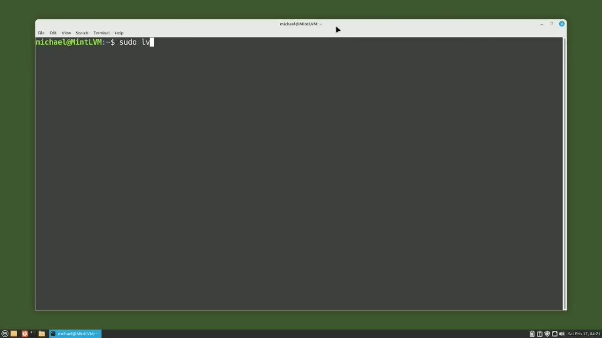
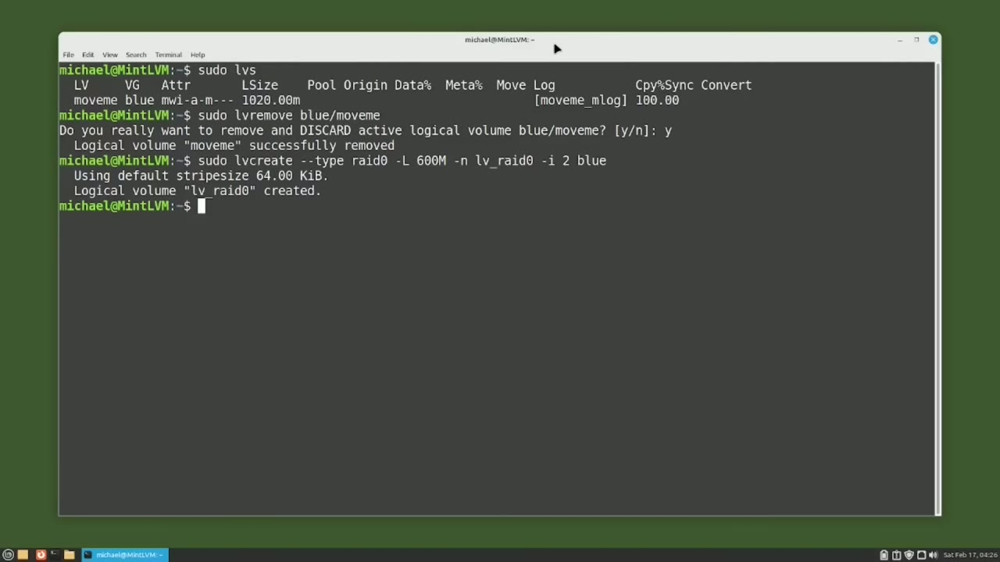
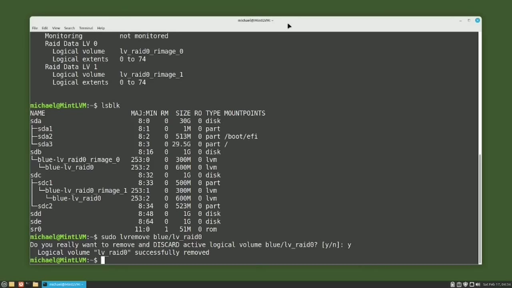

[← Course contents](../../01.md)

# 96. LVM pt6 - LVM RAID 0

**Course:** [Linux Command Line - Entire Tutorial Series](https://www.youtube.com/watch?v=avg65oY7sj4)  
**Transcript:** [`Linux Command Line - Entire Tutorial Series transcript`](../../../../course_videos/Linux%20Command%20Line%20-%20Entire%20Tutorial%20Series/Linux%20Command%20Line%20-%20Entire%20Tutorial%20Series.txt)  
**Video:** 16:31:28–16:37:09 ([open at this time](https://www.youtube.com/watch?v=avg65oY7sj4&t=59488s))

## Introduction

Sudo lvs. And we see the logical volume we used in the last video. I'm going to remove that with Sudo lv remove. What we're going to do in this video is to look at how to set up an LVM Rade Zero.

## Detailed Explanation

<details>
  <summary>Step 1 — Run `sudo lvs`, `sudo`</summary>

### Step 1 — Run `sudo lvs`, `sudo`

- [x] **Use `sudo lvs`, `sudo`**
  - `sudo lvs`.
  - And we see the logical volume we used in the last video.
  - I'm going to remove that with `sudo` lv remove.

- [x] **What we're going to do in this video is to look at how to set up an**
  - What we're going to do in this video is to look at how to set up an LVM Rade Zero.
  - A Rade Zero is also known as a Stripe Set or Striped Volume.
  - Because it stripes data evenly across two or more disks.

- [x] **So if any one of the drives fail, the entire RAID 0 is unusable**
  - So if any one of the drives fail, the entire RAID 0 is unusable.
  - This works similar to the LVM linear logical volume.
  - We set up earlier in this group of videos.

- [x] **We expanded that linear logical volume over multiple disks**
  - We expanded that linear logical volume over multiple disks.
  - And if any one of those disks fail, the entire logical volume is unusable.
  - If you're already using LVM, you are probably going to want to use the standard linear logical volume over a Rade Zero.

- [x] **Use `sudo`**
  - But since LVM does support a Rade Zero, we'll take a look at how to set that up.
  - The command to create an LVM Rade Zero is `sudo`, LVCreat, -type, Rade Zero, dash, uppercase L, And I'm using the uppercase L to give it a specific amount of this space.
  - In this case, I want it to use 600 megabytes.

- [x] **I'll call the name lv underscore Rade Zero**
  - I'll call the name lv underscore Rade Zero.
  - And then I'm going to add -I 2 for the number of stripes.
  - And we're using I for the number of stripes because S, T, and R are already used for other options.

- [x] **And then I want to put this Rade Zero on the volume group Blue**
  - And then I want to put this Rade Zero on the volume group Blue.

```bash
sudo lvs
sudo
```



</details>

<details>
  <summary>Step 2 — Run `sudo lvs`, `sudo`, `lsblk`</summary>

### Step 2 — Run `sudo lvs`, `sudo`, `lsblk`

- [x] **Use `sudo lvs`, `sudo`**
  - Let's see what this looks like with `sudo lvs`.
  - And we see our logical volume lv Rade Zero was created with the size of 600 megabytes.
  - We can see more details with `sudo` lv Display -M.

- [x] **And here we see the logical volume name**
  - And here we see the logical volume name.
  - Is lv Rade 0. It is on Volume Group Blue, has a size of 600 Mbibytes with 150 extents.
  - And then at the bottom, we see a type of Rade 0. And then the 150 extents are split evenly with 75 extents on Rade Image 0 and 75 extents on Rade Image 1.

- [x] **Use `lsblk`**
  - I'm typing `lsblk`.
  - And here we see that Raid Image 0 is using 300 megabytes on device sdb, and Raid Image 1 is using 300 megabytes on device sdc.
  - And then as I mentioned earlier, the Raid 0 will write the information evenly over both disks.

- [x] **Use `sudo -lv remove blue`**
  - To remove the Raid 0, I will type the command, `sudo -lv remove blue` slash lv.
  - Raid 0. And yes, I really want to remove this and it's gone.
  - And this time I want to tell LVM which discs to put that LVM on.

- [x] **And I also want to use 100% of the disk space available**
  - And I also want to use 100% of the disk space available.

```bash
sudo lvs
sudo
lsblk
sudo -lv remove blue
```



</details>

<details>
  <summary>Step 3 — Run `sudo pvs`, `sudo`, `sudo lvs`</summary>

### Step 3 — Run `sudo pvs`, `sudo`, `sudo lvs`

- [x] **Use `sudo pvs`, `sudo`**
  - Let's first see which discs we have available by typing `sudo pvs`.
  - And we see that devices sdb and sdd are the same size, so I will use them.
  - The command I will use to set up this raid is `sudo`, lv create, dash, -type, raid zero.

- [x] **Use `sudo lvs`, `sudo`**
  - Now I'm going to use the -lowercase L, and I want to use 100% free, and I will give it a name with the -N, lv, raid zero, the number of stripes with the lowercase i will be two i'm going to place this on the blue volume group and i want it specifically to go
  - On disks dev sdb and devsddd pressing enter and our raid zero is created let's check it with `sudo lvs` and we see that raid zero is created on volume group blue with 1.99 gigabytes just under 2 gigabytes and typing `sudo` lv display -m shows most of the same information as our last raid but this one has a size of 1.99 gigabytes and 510 logical
  - Extents and following up with l sblk shows us 102 o megabytes used for raid image 0 on s dbb and 102 Omegabytes on Raid Image 1 on device sdd.

- [x] **In the next video, we will continue looking at LVM for the Linux**
  - In the next video, we will continue looking at LVM for the Linux command line.

```bash
sudo pvs
sudo
sudo lvs
```



</details>

<details>
  <summary>Questions and Answers</summary>

## Questions and Answers

### Question 1: What does `sudo lvs` do in this chapter?

<details>
<summary>Answer</summary>

- [x] `sudo lvs`.

</details>

### Question 2: What does `sudo` do in this chapter?

<details>
<summary>Answer</summary>

- [x] I'm going to remove that with `sudo` lv remove.

</details>

### Question 3: What does `lsblk` do in this chapter?

<details>
<summary>Answer</summary>

- [x] I'm typing `lsblk`.

</details>

### Question 4: What does `sudo -lv remove blue` do in this chapter?

<details>
<summary>Answer</summary>

- [x] To remove the Raid 0, I will type the command, `sudo -lv remove blue` slash lv.

</details>

### Question 5: What does `sudo pvs` do in this chapter?

<details>
<summary>Answer</summary>

- [x] Let's first see which discs we have available by typing `sudo pvs`.

</details>

### Question 6: What does step 1 cover (Run sudo lvs, sudo)?

<details>
<summary>Answer</summary>

- [x] `sudo lvs`.
- [x] And we see the logical volume we used in the last video.
- [x] I'm going to remove that with `sudo` lv remove.

</details>

### Question 7: What does step 2 cover (Run sudo lvs, sudo, lsblk)?

<details>
<summary>Answer</summary>

- [x] Let's see what this looks like with `sudo lvs`.
- [x] And we see our logical volume lv Rade Zero was created with the size of 600 megabytes.
- [x] We can see more details with `sudo` lv Display -M.

</details>

### Question 8: What does step 3 cover (Run sudo pvs, sudo, sudo lvs)?

<details>
<summary>Answer</summary>

- [x] Let's first see which discs we have available by typing `sudo pvs`.
- [x] And we see that devices sdb and sdd are the same size, so I will use them.
- [x] The command I will use to set up this raid is `sudo`, lv create, dash, -type, raid zero.

</details>

</details>

## Summary

This chapter, LVM pt6 - LVM RAID 0, walks through Run sudo lvs, sudo; Run sudo lvs, sudo, lsblk; Run sudo pvs, sudo, sudo lvs. Commands from the transcript: `sudo lvs`, `sudo`, `lsblk`, `sudo -lv remove blue`, `sudo pvs`.

## References

- [Linux Command Line - Entire Tutorial Series (YouTube)](https://www.youtube.com/watch?v=avg65oY7sj4)
- [This chapter at 16:31:28](https://www.youtube.com/watch?v=avg65oY7sj4&t=59488s)
- [Local transcript](../../../../course_videos/Linux%20Command%20Line%20-%20Entire%20Tutorial%20Series/Linux%20Command%20Line%20-%20Entire%20Tutorial%20Series.txt)
