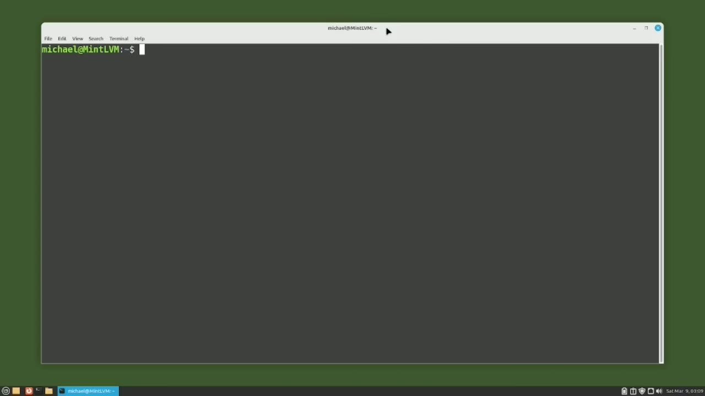
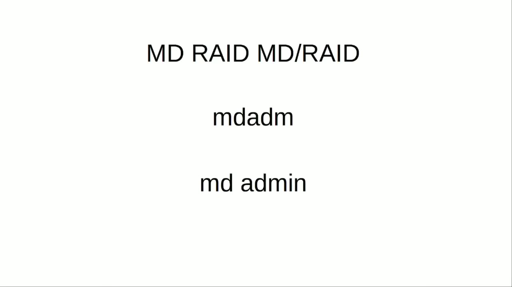
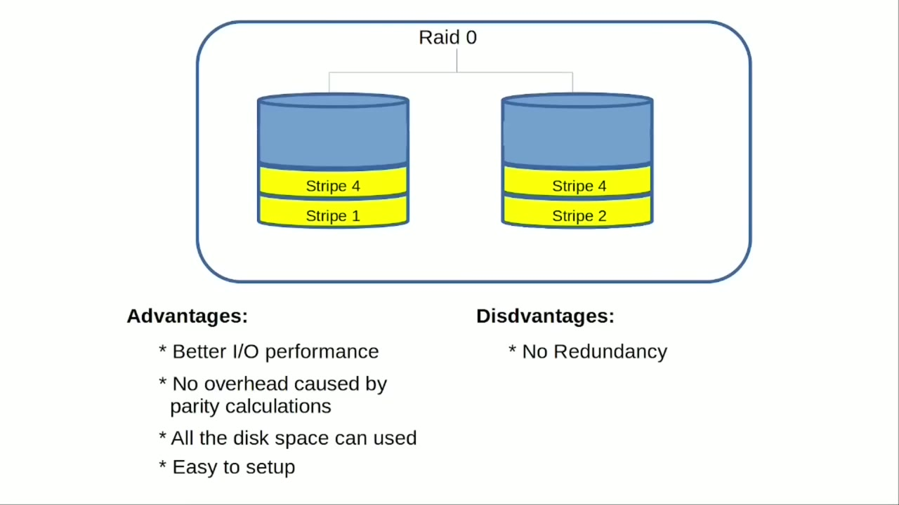
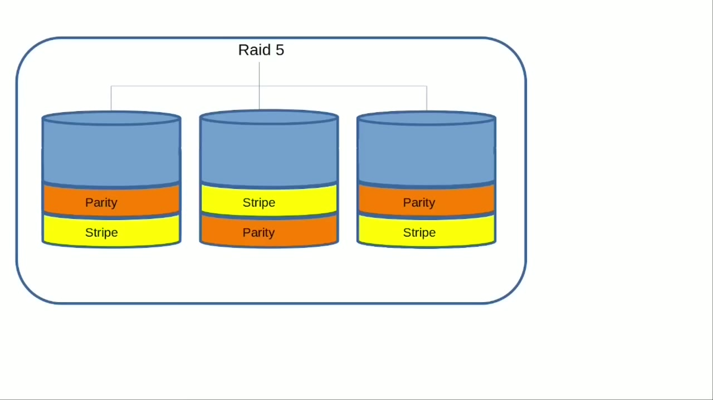

[← Course contents](../../01.md)

# 97. LVM pt7 - LVM Linear or LVM RAID

**Course:** [Linux Command Line - Entire Tutorial Series](https://www.youtube.com/watch?v=avg65oY7sj4)  
**Transcript:** [`Linux Command Line - Entire Tutorial Series transcript`](../../../../course_videos/Linux%20Command%20Line%20-%20Entire%20Tutorial%20Series/Linux%20Command%20Line%20-%20Entire%20Tutorial%20Series.txt)  
**Video:** 16:37:09–16:45:21 ([open at this time](https://www.youtube.com/watch?v=avg65oY7sj4&t=59829s))

## Introduction

In this video, we're going to look at the different LVM logical volume options we have and the advantages and disadvantages of each one. The first one we're going to look at is the LVM linear logical volume that we created in videos 90 and 91. In our blue volume group, we created the linear logical volume orange. Then we added another linear logical volume.

## Detailed Explanation

  
Step 1 — In this video, we're going to look at the different LVM logical volume

### Step 1 — In this video, we're going to look at the different LVM logical volume

- [x] **In this video, we're going to look at the different LVM logical**
  - In this video, we're going to look at the different LVM logical volume options we have and the advantages and disadvantages of each one.
  - The first one we're going to look at is the LVM linear logical volume that we created in videos 90 and 91.
  - In our blue volume group, we created the linear logical volume orange.

- [x] **Then we added another linear logical volume**
  - Then we added another linear logical volume.
  - Then we added more space to the orange logical volume, and we even expanded it onto another disk that was already in our blue volume group.
  - The advantages of using a linear logical volume are the read-right speed is good.

- [x] **The size can also be reduced, but that was not shown in my tutorials**
  - The size can also be reduced, but that was not shown in my tutorials because there is a chance of data loss.
  - When adding disks, disks do not need to be the same size as the original disk, and all the disk space can be used.
  - The disadvantage of using a linear logical volume is there is no redundancy.

- [x] **So if the drive fails, all the data is lost**
  - So if the drive fails, all the data is lost.
  - And if the linear logical volume is using multiple disks, if any one of those drives fail, the entire logical volume is unusable.
  - And raid is just an acronym for redundant array of independent disks.

- [x] **I keep saying LVM raid, as if there was another type of raid option**
  - I keep saying LVM raid, as if there was another type of raid option.
  - Md raid or md slash raid or an md ad adm raid, which some people refer to as an md admin raid.

  
Step 2 — A typical md admin command would start with md adm and look like this

### Step 2 — A typical md admin command would start with md adm and look like this

- [x] **A typical md admin command would start with md adm and look like this**
  - A typical md admin command would start with md adm and look like this.
  - The md raid works outside of an LVM environment, so we're done talking about the md raid for the time being.
  - The next thing we're going to look at is the advantages and disadvantages of the LVM RAID 0 that we created in the previous video.

- [x] **A RAID 0 is also known as Striped Data because it has two disk drives**
  - A RAID 0 is also known as Striped Data because it has two disk drives and the data will be written out or striped in equal amounts to each disc.
  - Meaning the first data will be written to one disk and then to the other, then back to the first drive.
  - Then back to the other drive again and this pattern continues for a raid zero.

- [x] **The idea behind this is that you would get the fastest read and write**
  - The idea behind this is that you would get the fastest read and write times when you...
  - Some people say that was true years ago, but disk drives have improved so much that a raid zero is no longer needed.
  - I've not done any testing on this myself, so I have no idea if that's true or not.

- [x] **For now, we're going to say that Raid Zero has better i.o**
  - For now, we're going to say that Raid Zero has better i.o.
  - Performance, and that will be our first advantage of a Raid Zero.
  - The next advantage is that there is no overhead caused by parity controls.

- [x] **We'll talk about parity in just a moment or two**
  - We'll talk about parity in just a moment or two.
  - And the last advantage is that it is relatively easy to set up.

  
Step 3 — The disadvantages are, If one drive fails, all the data is lost

### Step 3 — The disadvantages are, If one drive fails, all the data is lost

- [x] **The disadvantages are, If one drive fails, all the data is lost**
  - The disadvantages are, If one drive fails, all the data is lost.
  - And then all the disks need to be the same size.
  - Moving on to a Rade 1, also known as a mirror, uses two or more disks that have the same data.

- [x] **If one of the drives fails, the other drive or drives, if there's**
  - If one of the drives fails, the other drive or drives, if there's more than two, can continue on without interruption.
  - The advantages of a Rade 1 are read and write speed is good.
  - Arrade 0 could be better, as we already discussed.

- [x] **Redundant data. If one drive fails, the processing can continue with**
  - Redundant data. If one drive fails, the processing can continue with the data on the other drive or drives, and that there is no overhead caused by parity. The disadvantages are half of the drive space is lost to the redundant copy.
  - All data is written two times. And all the disks need to be the same size.
  - Now we're moving up to a Raid 5. A Raid 5 is also known as Striping with Parity, and it requires a minimum of three disc drives. You can have more.

- [x] **When the data is written to a Raid 5, it is striped or spread across**
  - When the data is written to a Raid 5, it is striped or spread across multiple disks, similar to a RAID 0.
  - But when it writes the data on one drive, it also writes parity data across other drives.
  - So the data is not duplicated, parity checksum data is created for the Striped data written.

- [x] **Creating the parity will slow down the writing of data to the disk**
  - Creating the parity will slow down the writing of data to the disk drive.
  - But if one drive fails, the data can be recreated from that parity data on the other drives.

  
Step 4 — a RAID 5 can continue working if one of the drives fails

### Step 4 — a RAID 5 can continue working if one of the drives fails

- [x] **So a RAID 5 can continue working if one of the drives fails**
  - So a RAID 5 can continue working if one of the drives fails.
  - With RAID 5, we lose one disk drive of disk space for parity, meaning if all three disk drives in this example were 10 gigabytes, we would only have 20 gigabytes of usable disk space available, instead of the 30 gigabytes we would have with an LVM linear configuration.
  - That one disk drive of parity disk space is split onto all of the disks in the RAID 5.

- [x] **The raid 5 can continue with a single failed drive, which can be**
  - The raid 5 can continue with a single failed drive, which can be replaced and then after replacing that bad disk, drive speeds might be a little slower while the data gets populated to that new disk, but after that it will be good as new.
  - The advantages of a raid 5 are read transactions are fast.
  - We don't say redundant data here because the stripes are written and then parity check sums are written.

- [x] **The disadvantages are right transactions are slower because when it**
  - The disadvantages are right transactions are slower because when it writes that data, it must also calculate the parity check sum.
  - You lose one of the disk drives to parity data.
  - You might have a temporary loss of performance after replacing a drive while it's populating that new disk.

- [x] **Now, depending on the disk drive, it could take a long time if it's**
  - Now, depending on the disk drive, it could take a long time if it's many gigabytes or terabytes.
  - And then all the disks need to be the same size.
  - It's like Rade 5, but has double parity.

- [x] **To handle the double parity, it will require a minimum of five disk**
  - To handle the double parity, it will require a minimum of five disk drives.
  - Two of the disk drives are lost to parity, but the Rade will function normally with a loss of up to 2.
  - The last one we're going to talk about is the Raid 10.

- [x] **Raid 10 is combining a Raid 1 and a Raid 0**
  - Raid 10 is combining a Raid 1 and a Raid 0.
  - Then we would make a mirror of the Raid 0.
  - The advantages of this are fast read and write speed for the Raid 0.

- [x] **It can be expensive. You need a minimum of four disk drives**
  - It can be expensive. You need a minimum of four disk drives.
  - Half of that storage is going to the redundant data or mirroring.
  - And then all the disks need to be the same size.

- [x] **Now this is just a short, quick summary of the different LVM logical**
  - Now this is just a short, quick summary of the different LVM logical volume options available.
  - I'm sure there are more advantages and disadvantages that I missed, but I hope I have outlined the different options available to help you make the best choice for your LVM setup.
  - In the next video, we'll continue looking at LVM for the Linux command line.

- [x] **In this video, I'm going to create an LVM Rade 5 logical volume**
  - In this video, I'm going to create an LVM Rade 5 logical volume.

  
Questions and Answers

## Questions and Answers

### Question 1: What does step 1 cover (In this video, we're going to look at the different LVM logical volume)?

Answer

- [x] In this video, we're going to look at the different LVM logical volume options we have and the advantages and disadvantages of each one.
- [x] The first one we're going to look at is the LVM linear logical volume that we created in videos 90 and 91.
- [x] In our blue volume group, we created the linear logical volume orange.

### Question 2: What does step 2 cover (A typical md admin command would start with md adm and look like this)?

Answer

- [x] A typical md admin command would start with md adm and look like this.
- [x] The md raid works outside of an LVM environment, so we're done talking about the md raid for the time being.
- [x] The next thing we're going to look at is the advantages and disadvantages of the LVM RAID 0 that we created in the previous video.

### Question 3: What does step 3 cover (The disadvantages are, If one drive fails, all the data is lost)?

Answer

- [x] The disadvantages are, If one drive fails, all the data is lost.
- [x] And then all the disks need to be the same size.
- [x] Moving on to a Rade 1, also known as a mirror, uses two or more disks that have the same data.

### Question 4: What does step 4 cover (a RAID 5 can continue working if one of the drives fails)?

Answer

- [x] So a RAID 5 can continue working if one of the drives fails.
- [x] With RAID 5, we lose one disk drive of disk space for parity, meaning if all three disk drives in this example were 10 gigabytes, we would only have 20 gigabytes of usable disk space available, instead of the 30 gigabytes we would have with an LVM linear configuration.
- [x] That one disk drive of parity disk space is split onto all of the disks in the RAID 5.

## Summary

This chapter, LVM pt7 - LVM Linear or LVM RAID, walks through In this video, we're going to look at the different LVM logical volume; A typical md admin command would start with md adm and look like this; The disadvantages are, If one drive fails, all the data is lost; a RAID 5 can continue working if one of the drives fails.

## References

- [Linux Command Line - Entire Tutorial Series (YouTube)](https://www.youtube.com/watch?v=avg65oY7sj4)
- [This chapter at 16:37:09](https://www.youtube.com/watch?v=avg65oY7sj4&t=59829s)
- [Local transcript](../../../../course_videos/Linux%20Command%20Line%20-%20Entire%20Tutorial%20Series/Linux%20Command%20Line%20-%20Entire%20Tutorial%20Series.txt)
