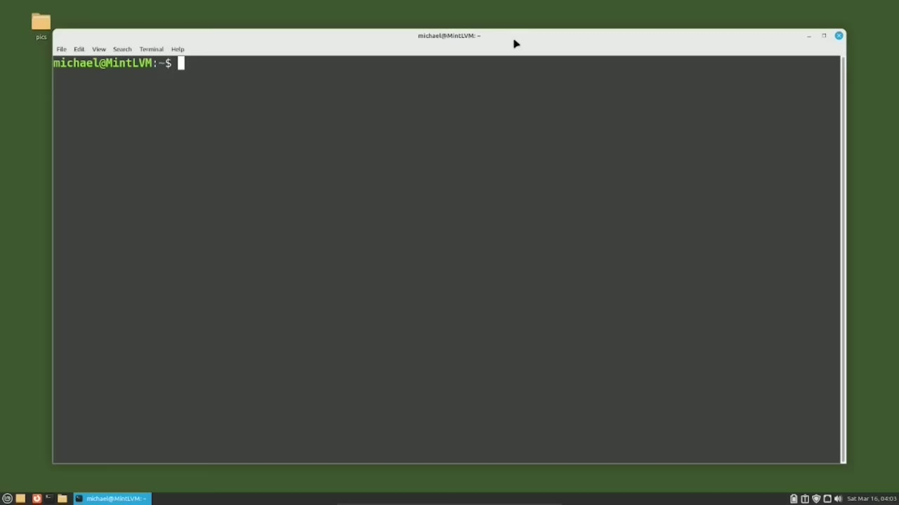
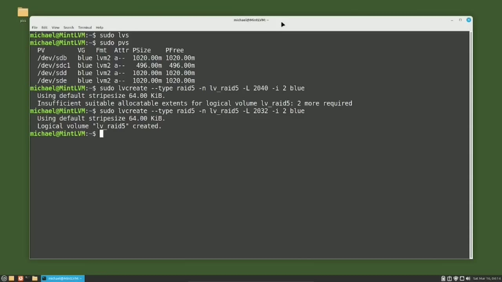
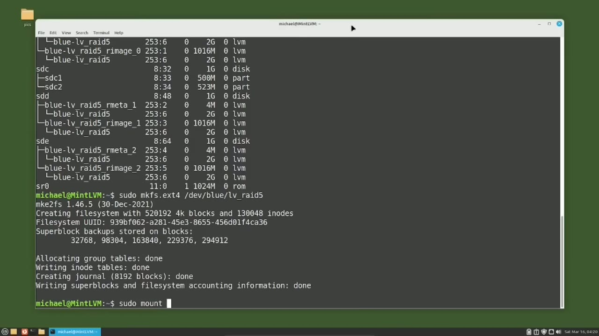
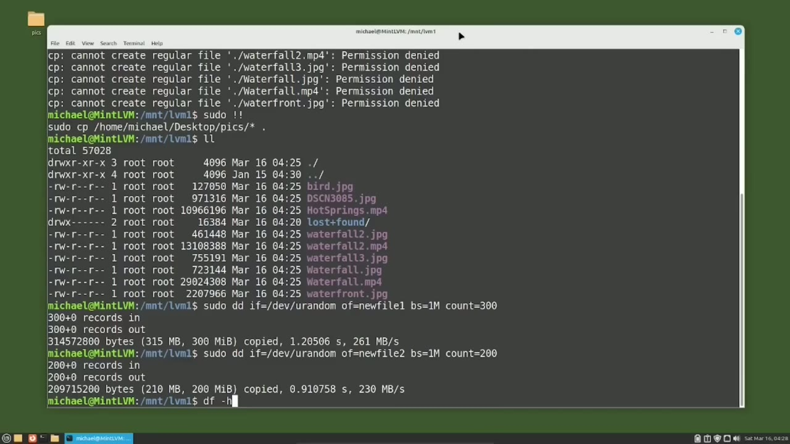
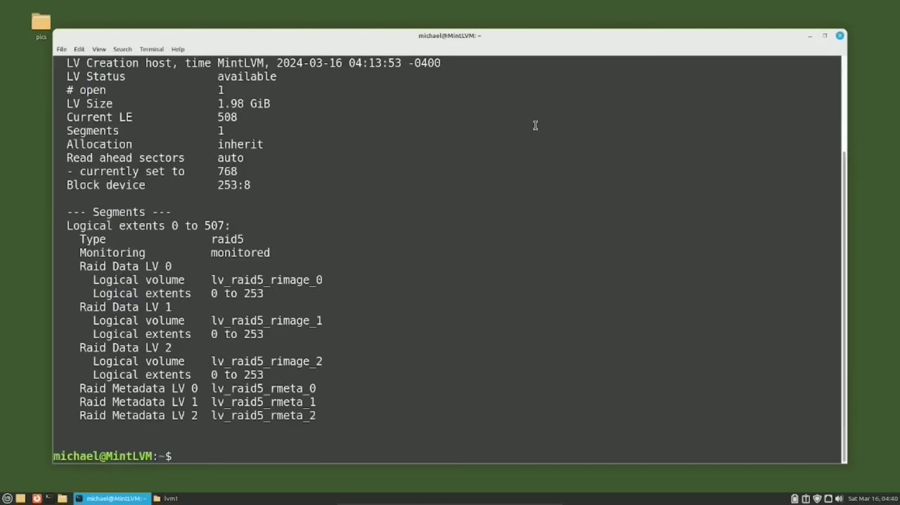

[← Course contents](../../01.md)

# 98. LVM pt8 - LVM RAID 5

**Course:** [Linux Command Line - Entire Tutorial Series](https://www.youtube.com/watch?v=avg65oY7sj4)  
**Transcript:** [`Linux Command Line - Entire Tutorial Series transcript`](../../../../course_videos/Linux%20Command%20Line%20-%20Entire%20Tutorial%20Series/Linux%20Command%20Line%20-%20Entire%20Tutorial%20Series.txt)  
**Video:** 16:45:21–16:58:35 ([open at this time](https://www.youtube.com/watch?v=avg65oY7sj4&t=60321s))

## Introduction

I will add some data, then remove one of the three disk drives, and replace it showing the Rade 5 working as expected throughout the dist drive exchange. The first thing I'm going to do, is to make sure I don't have any leftover logical volumes from the previous tutorials by typing sudo -lvs. And there's nothing showing so I don't have any logical volumes at the moment. I also want to see what physical volumes I have set up and what volume groups they're in, so I'm going to type sudo -pvs.

## Detailed Explanation

<details>
  <summary>Step 1 — Run `sudo -lvs`, `sudo -pvs`, `sudo`</summary>

### Step 1 — Run `sudo -lvs`, `sudo -pvs`, `sudo`

- [x] **Use `sudo -lvs`**
  - I will add some data, then remove one of the three disk drives, and replace it showing the Rade 5 working as expected throughout the dist drive exchange.
  - The first thing I'm going to do, is to make sure I don't have any leftover logical volumes from the previous tutorials by typing `sudo -lvs`.
  - And there's nothing showing so I don't have any logical volumes at the moment.

- [x] **Use `sudo -pvs`**
  - I also want to see what physical volumes I have set up and what volume groups they're in, so I'm going to type `sudo -pvs`.
  - And we see that I've added DevSDE to the blue volume group.
  - And the dev sde has a volume size of 102 megabytes.

- [x] **And now we have four disk drives in the volume group blue that we**
  - And now we have four disk drives in the volume group blue that we created in one of the previous LVM tutorials. Three of them are 102 megabytes. They're actually all one gigabyte, but four megabytes are used to support LVM. So that's why we see 102O megabytes instead of the 104 megabytes.
  - And we have three of the four disk drives, which are the same size.
  - And if you watch the previous video, you'll remember that we will only get two disk drives of space.

- [x] **Use `sudo`**
  - One disk drive of space is needed for the parity checksums, which are stored across all the disks.
  - To create the LVM Raid 5, I will use the command, `sudo`, LVCreat, and then I'm typing dash, dash, Type Raid 5, then a lowercase n for the name, and the name I will give it is lv underscore Rade 5 for logical volume Rade 5.
  - Then I will type a -uppercase L to tell LVM how much disk space I want to use for the Rade 5, and that will be 2040.

- [x] **I'm getting that by looking at the free size on the disks**
  - I'm getting that by looking at the free size on the disks.
  - They all have 102 and I want to use two of them for the usable data and 102 times 2 is 2040 megabytes. Then I've got a -i to tell LVM the number of usable disks we're going to use followed by the number two. Two usable discs, two of the three are usable.
  - And the last thing I have on the line is the volume group name of blue.

- [x] **When I press enter, I get the error insufficient suitable allocatable**
  - When I press enter, I get the error insufficient suitable allocatable extents.
  - Two more required. We've seen this problem before. The problem is LVM needs another 4 megabytes from each disk to support Rade.
  - So what I'm going to do is come over here and change this 2040 to 2032.

- [x] **That is 2040 -8 and now we should be all set**
  - That is 2040 -8 and now we should be all set.

```bash
sudo -lvs
sudo -pvs
sudo
```



</details>

<details>
  <summary>Step 2 — Run `sudo`</summary>

### Step 2 — Run `sudo`

- [x] **Use `sudo`**
  - Let's check that with `sudo` lv Display -M.
  - And we see the path is dev slash blue slash lv Raid 5.
  - And our size is 1.98 gigabytes, just under 2 gigabytes, which is just what we were expecting.

- [x] **1.98 gigabytes gives us 508 logical extents**
  - 1.98 gigabytes gives us 508 logical extents.
  - Scrolling down, we see that the 508 logical extents are on logical extends 0 to 507, and then each disc has 0 through 253, so they each have 254 logical extends.
  - Let's see what the disks look like by typing l-s-b-l-k.

- [x] **Use `sudo`**
  - And we see here that the rate image 0 is on sdb, rate image 1 is on sdd, and rate image 2 is on s-de.
  - And the disk sdc was skipped because it only has 500 megabytes available to the blue volume group.
  - Now let's make a file system on the new logical volume with the command, `sudo`, MakeFS, e-x-d.

- [x] **4 and we want to put that on dev blue lv underscore Rade 5 and we saw**
  - 4 and we want to put that on dev blue lv underscore Rade 5 and we saw this as the path just a moment ago.
  - Now let's mount that file system with the command.

```bash
sudo
```



</details>

<details>
  <summary>Step 3 — Run `sudo mount dev`, `df -H`, `sudo`</summary>

### Step 3 — Run `sudo mount dev`, `df -H`, `sudo`

- [x] **Use `sudo mount dev`, `df -H`**
  - `sudo mount dev` blue lv underscore Rade 5 and we're going to put that on slash mnt.
  - And we created this lvm1 back in video 91.
  - I'm going to clear the screen and type `df -H`.

- [x] **And we see here that our blue -lv Rade 5 is mounted on mnt slash lvm1**
  - And we see here that our blue -lv Rade 5 is mounted on mnt slash lvm1 and has 1.9 gigabytes available.
  - I want to add some data to our new Rade 5.
  - We just have the Lost and Found, which is automatically created with an ExtE4 file system.

- [x] **We see in the upper left I've got some pictures on the desktop**
  - We see in the upper left I've got some pictures on the desktop.
  - I want to copy those pictures onto our Rade 5.
  - I'll do that with cp, Home, Michael, Desktop, Picks.

- [x] **Use `sudo`**
  - And I'm copying everything and I want to copy them all here.
  - And I get a permissions denied because I only gave access to root when I mounted the Rade 5.
  - So I will have to type `sudo` and the same command again.

- [x] **Use `sudo -dif`**
  - So let's add some more with the d-d command.
  - `sudo -dif` equals...
  - I want a block size equal to 1 megabyte, and then a count equal to 300.

- [x] **So that should give us a 300 megabyte file of random data**
  - So that should give us a 300 megabyte file of random data.
  - We'll call this new file 2, and we'll make this one only 200 megabytes.

```bash
sudo mount dev
df -H
sudo
sudo -dif
```



</details>

<details>
  <summary>Step 4 — Run `df -h`, `sudo`, `lsblk`</summary>

### Step 4 — Run `df -h`, `sudo`, `lsblk`

- [x] **Use `df -h`**
  - `df -h` shows we're using about 31% of the disk base available.
  - To see the data, let's open up a file browser.
  - And I want to go to slash mnt slash lvm1.

- [x] **And there we see some pictures and our two files of random data**
  - And there we see some pictures and our two files of random data.
  - Now that we have it up and working well with three discs, I'm going to take out a disk.
  - I don't have any USB drives here, so I cannot just unplug a drive.

- [x] **Use `sudo`, `lsblk`**
  - I will have to turn off the machine, take out a drive, and then add a new blank drive and power back on.
  - Before I do that, let's just type `sudo` lv Display -M to remind us all of what we have out there.
  - And I'll also type `lsblk` just to show everything working as expected how it looks.

- [x] **I'm going to power off and power back on the machine, so I'll be back**
  - I'm going to power off and power back on the machine, so I'll be back in a moment.
  - Okay, I'm back and I've removed one of the Raid 5 disks, and I've added a new disc of the same size.
  - The first thing I want to do is make sure that my data on the Raid 5 is still there.

- [x] **I'll do that by opening up the file browser and going to slash mnt**
  - I'll do that by opening up the file browser and going to slash mnt lvm1.
  - And I did manually mount this drive after restarting.
  - So we see our pictures and the larger files are still there just as we expect, clicking on one of the pictures.

- [x] **Use `sudo -lv display -M`**
  - Let's see what our RAID 5 logical volume looks like now.
  - We'll do that with the command, `sudo -lv display -M`.
  - And right here at the top, we see a warning that one of our devices cannot be found.

```bash
df -h
sudo
lsblk
sudo -lv display -M
```



</details>

<details>
  <summary>Step 5 — Run `sudo pvs`, `lsblk`, `sudo`</summary>

### Step 5 — Run `sudo pvs`, `lsblk`, `sudo`

- [x] **Use `sudo pvs`**
  - Let's see what physical volumes are available by typing `sudo pvs`.
  - Again, we see the warning that a device cannot be found, and we see that device sdb, sdc, and sdd are still there.
  - But what was on device sde is now missing or unknown.

- [x] **Use `lsblk`**
  - I'm going to type `lsblk`.
  - And here we see that Rade 5 image 0 is on sdb.
  - Then we see that the lv-r-v-r-meta-2 disk is missing.

- [x] **Use `sudo`**
  - We do have the new drive I added showing as s-d-e, and because it's new, it has not yet been added to LVM.
  - To add the new disc into the volume group blue, I will type `sudo`.
  - We do see volume dev sde successfully created, and we also see Volume Group Blue successfully extended, but we also see that LVM is complaining that it cannot find the old disk that I had removed.

- [x] **Use `sudo -lv-convert -repair`**
  - We'll come back to that problem in a moment.
  - First, I want to add a new drive to the Rade 5 logical volume.
  - And I'll do that with the command, `sudo` -lv-convert, -repair, and we want to repair the blue slash lv underscore Rade 5.

- [x] **Use `sudo`**
  - I'm getting a message telling me that the repair requires a full device re-sync.
  - Faulty device in blue lv Rade 5 successfully replaced.
  - Let's check out the Rade 5 logical volume now with `sudo` lv display -M.

- [x] **Use `ls blk`, `sudo pvs`**
  - And besides the warning at the top, it looks pretty good. I'll also type ls, blk. And we see nothing is missing here. The Rade 5 has been repaired as expected.
  - But we still get that warning message when we type just about any LVM command, like `sudo pvs`.
  - And there we see the warning could not find device and that vg blue is missing device.

- [x] **Use `sudo`**
  - So to get rid of that message, I'm going to type `sudo` vg reduce -dash remove missing from blue.
  - So we're going to vg reduce, volume group reduce, and we're going to remove the missing from the blue volume group.
  - Our last line there shows wrote out consistent volume group blue.

- [x] **Use `sudo pvs`**
  - Let's test it with that same command, `sudo pvs`, and we no longer get that warning.
  - Let's check out the data on the Rade 5 one more time just to make sure it's still there and working.
  - I'll open back up that file browser and click on a picture.

- [x] **So we've successfully removed and replaced a disk in an LVM Rade 5**
  - So we've successfully removed and replaced a disk in an LVM Rade 5 configuration.
  - In the next video, we'll continue looking at LVM for the Linux command line.

```bash
sudo pvs
lsblk
sudo
sudo -lv-convert -repair
ls blk
```



</details>

<details>
  <summary>Questions and Answers</summary>

## Questions and Answers

### Question 1: What does `sudo -lvs` do in this chapter?

<details>
<summary>Answer</summary>

- [x] The first thing I'm going to do, is to make sure I don't have any leftover logical volumes from the previous tutorials by typing `sudo -lvs`.

</details>

### Question 2: What does `sudo -pvs` do in this chapter?

<details>
<summary>Answer</summary>

- [x] I also want to see what physical volumes I have set up and what volume groups they're in, so I'm going to type `sudo -pvs`.

</details>

### Question 3: What does `sudo` do in this chapter?

<details>
<summary>Answer</summary>

- [x] To create the LVM Raid 5, I will use the command, `sudo`, LVCreat, and then I'm typing dash, dash, Type Raid 5, then a lowercase n for the name, and the name I will give it is lv underscore Rade 5 for logical volume Rade 5.

</details>

### Question 4: What does `sudo mount dev` do in this chapter?

<details>
<summary>Answer</summary>

- [x] `sudo mount dev` blue lv underscore Rade 5 and we're going to put that on slash mnt.

</details>

### Question 5: What does `df -H` do in this chapter?

<details>
<summary>Answer</summary>

- [x] I'm going to clear the screen and type `df -H`.

</details>

### Question 6: What does `sudo -dif` do in this chapter?

<details>
<summary>Answer</summary>

- [x] `sudo -dif` equals...

</details>

### Question 7: What does `lsblk` do in this chapter?

<details>
<summary>Answer</summary>

- [x] And I'll also type `lsblk` just to show everything working as expected how it looks.

</details>

### Question 8: What does `sudo -lv display -M` do in this chapter?

<details>
<summary>Answer</summary>

- [x] We'll do that with the command, `sudo -lv display -M`.

</details>

### Question 9: What does `sudo pvs` do in this chapter?

<details>
<summary>Answer</summary>

- [x] Let's see what physical volumes are available by typing `sudo pvs`.

</details>

### Question 10: What does `sudo -lv-convert -repair` do in this chapter?

<details>
<summary>Answer</summary>

- [x] And I'll do that with the command, sudo -lv-convert, -repair, and we want to repair the blue slash lv underscore Rade 5.

</details>

### Question 11: What does `ls blk` do in this chapter?

<details>
<summary>Answer</summary>

- [x] And besides the warning at the top, it looks pretty good. I'll also type ls, blk. And we see nothing is missing here. The Rade 5 has been repaired as expected.

</details>

</details>

## Summary

This chapter, LVM pt8 - LVM RAID 5, walks through Run sudo -lvs, sudo -pvs, sudo; Run sudo; Run sudo mount dev, df -H, sudo; Run df -h, sudo, lsblk; Run sudo pvs, lsblk, sudo. Commands from the transcript: `sudo -lvs`, `sudo -pvs`, `sudo`, `sudo mount dev`, `df -H`, `sudo -dif`, `df -h`, `lsblk`, `sudo -lv display -M`, `sudo pvs`, `sudo -lv-convert -repair`, `ls blk`.

## References

- [Linux Command Line - Entire Tutorial Series (YouTube)](https://www.youtube.com/watch?v=avg65oY7sj4)
- [This chapter at 16:45:21](https://www.youtube.com/watch?v=avg65oY7sj4&t=60321s)
- [Local transcript](../../../../course_videos/Linux%20Command%20Line%20-%20Entire%20Tutorial%20Series/Linux%20Command%20Line%20-%20Entire%20Tutorial%20Series.txt)
