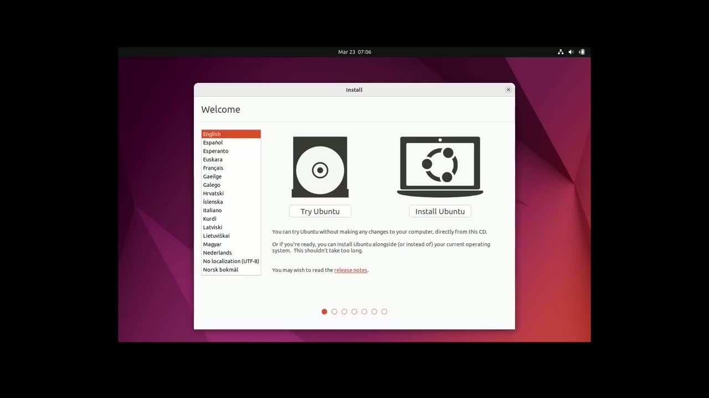
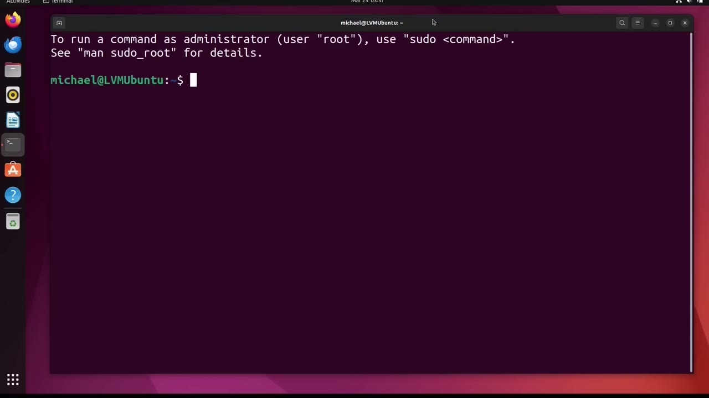
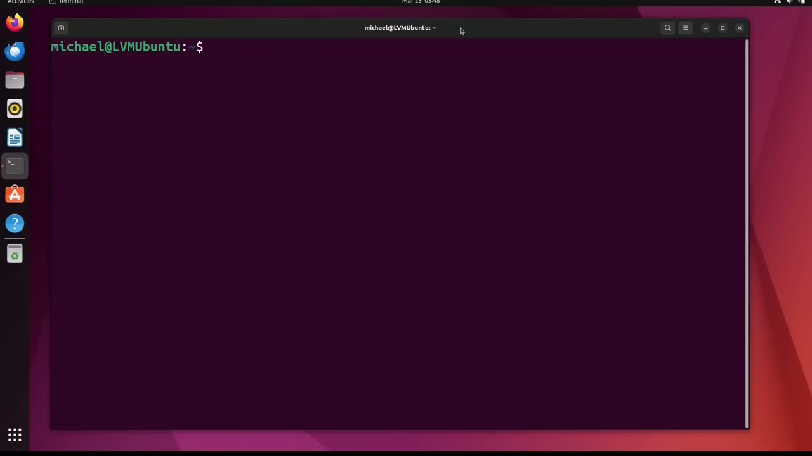
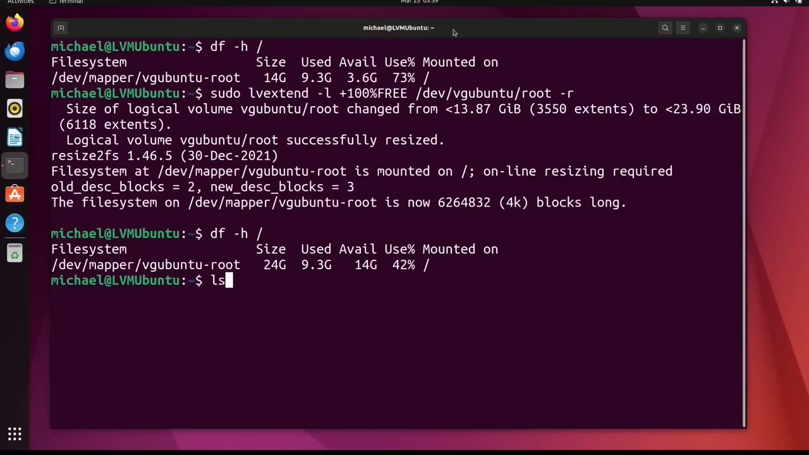

[← Course contents](../../01.md)

# 99. LVM pt9 - LVM Ubuntu

**Course:** [Linux Command Line - Entire Tutorial Series](https://www.youtube.com/watch?v=avg65oY7sj4)  
**Transcript:** [`Linux Command Line - Entire Tutorial Series transcript`](../../../../course_videos/Linux%20Command%20Line%20-%20Entire%20Tutorial%20Series/Linux%20Command%20Line%20-%20Entire%20Tutorial%20Series.txt)  
**Video:** 16:58:35–17:08:41 ([open at this time](https://www.youtube.com/watch?v=avg65oY7sj4&t=61115s))

## Introduction

In this video, we are going to look at using LVM on an Ubuntu operating system. First, I will install Ubuntu to use LVM, then I will use the command line to add a new disk and increase the Ubuntu operating system disk space. I've downloaded and powered up into the most recent stable version of Ubuntu. which at the time of this recording is abuntu 22.04.4 desktop.

## Detailed Explanation

<details>
  <summary>Step 1 — In this video, we are going to look at using LVM on an Ubuntu operating</summary>

### Step 1 — In this video, we are going to look at using LVM on an Ubuntu operating

- [x] **In this video, we are going to look at using LVM on an Ubuntu**
  - In this video, we are going to look at using LVM on an Ubuntu operating system.
  - First, I will install Ubuntu to use LVM, then I will use the command line to add a new disk and increase the Ubuntu operating system disk space.
  - I've downloaded and powered up into the most recent stable version of Ubuntu.

- [x] **which at the time of this recording is abuntu 22.04.4 desktop**
  - which at the time of this recording is abuntu 22.04.4 desktop.
  - And I am at the Tryibuntu or install Ubuntu screen.
  - From here, I'm going to click on Install Ubuntu.

- [x] **And at this keyboard layout screen, I'm going to keep the defaults of**
  - And at this keyboard layout screen, I'm going to keep the defaults of English, us, for both.
  - For the updates and other software, I'm going to select the normal installation.
  - And I will keep the checkbox checked for download updates while installing Ubuntu.

- [x] **And I'm also going to check this install third-party software checkbox**
  - And I'm also going to check this install third-party software checkbox.
  - On the installation type page, this is the page where I want to make some changes.
  - I'm going to click on the advanced features.

- [x] **Then I'm going to click on the radio button for Use LVM**
  - Then I'm going to click on the radio button for Use LVM.
  - With new Ubuntu installation and I am not going to click on the encrypt the new Ubuntu installation.
  - Here it's asking me to confirm I want to write these changes.

- [x] **For the time zone, New York will work. I'll click continue**
  - For the time zone, New York will work. I'll click continue.
  - Now Ubuntu is asking me for my information. I will add in the information.
  - Name, Michael, computer name, LVM, Ubuntu, username Michael, I'll add a password.

- [x] **I'm not using Active Directory and clicking continue**
  - I'm not using Active Directory and clicking continue.
  - I will pause for a moment while that completes.
  - I've restarted the computer and before I started recording I skipped past the Ubuntu first boot questions I've updated Ubuntu and then restart it again and then I started recording now what I want to do is look at how Ubuntu has set up Lvm for this I'm going to open up a terminal by clicking in the lower left here and then I



</details>

<details>
  <summary>Step 2 — Run `sudo pvs`, `sudo`, `sudo lvs`</summary>

### Step 2 — Run `sudo pvs`, `sudo`, `sudo lvs`

- [x] **See terminal I'm going to grab that and drag it over and place it**
  - See terminal I'm going to grab that and drag it over and place it into the Quick Launch toolbar and click on it to open it up.
  - I'll make this a little bigger by holding down Control, Shift, and the plus sign.
  - Now let's use the LVM commands we learned in the previous tutorials to see what's going on.

- [x] **Use `sudo pvs`, `sudo`**
  - I'll start with `sudo pvs`.
  - And we see here there is one disk setup for LVM, Dev sda3, and it is in the Volume Group VG-A-B-Untu, which makes sense. v-g for volume group, and then Ubuntu.
  - Typing `sudo` v-g-s shows us the volume group information, and we see here that we have one physical volume, and we have two logical volumes.

- [x] **Use `sudo lvs`**
  - Let's learn a little more about the logical volumes with the command, `sudo`, lvs.
  - And we see we do have two logical volumes, a root...
  - Logical volume and a swap underscore one logical volume and again this makes sense we need swap space we talked about swap space in an earlier video it helps the ram memory even if we have a ton of ram memory we would still want to set up some swap space and then the root logical volume

- [x] **Use `lsblk`, `df -h`**
  - Is where all the abunto operating system information is and the user information typing `lsblk` Here again we see the root file system and the swap file system and then I'll clear the screen and Type `df -h` and the forward slash for the root file system and we see that the disk size is 14 gigabytes
  - We've used 9.3 so we have 3.6 gigabytes available so 3.6 gigabytes is not a lot of space for everything I might want to put on this computer And since we're using LVM, I can just add another disc to this and then add it into the volume group and we can add it to our logical volume.
  - To do that, I'm going to have to power down, add a hard drive, then I'll power back up and we can add the disk drive to our volume group.

- [x] **Use `lsblk`**
  - Before I power down, let's take another quick look at what we have with `lsblk`.
  - And now I'll power down and add in a new disc.
  - Okay, I've added a 10 gigabyte hard drive and restarted the computer.

```bash
sudo pvs
sudo
sudo lvs
lsblk
df -h
```



</details>

<details>
  <summary>Step 3 — Run `ls blk`, `sudo -lv display -M`, `sudo`</summary>

### Step 3 — Run `ls blk`, `sudo -lv display -M`, `sudo`

- [x] **Use `ls blk`, `sudo -lv display -M`**
  - Let's see what that looks like by typing ls, blk.
  - And here we see sdb is our new 10 gigabyte device.
  - Before I add in the new disc, let's see what the current logical volumes look like with `sudo -lv display -M`.

- [x] **And we see our first logical volume root is on volume group vg Ubuntu**
  - And we see our first logical volume root is on volume group vg Ubuntu.
  - Has disk space of 13.87 gigabytes and is on the volume dev sda3.
  - And then our swap space is also in volume group vg Ubuntu.

- [x] **Use `sudo`**
  - It's only 1.59 gigabytes and is also on physical volume dev sda3.
  - I'm going to add the new disk to the volume group vg Ubuntu with the command, `sudo` vg extend VG-Abuntu slash dev slash sdb.
  - And we see DevSdb successfully created, vg Ubuntu successfully extended.

- [x] **Use `df`**
  - So it looks like everything worked as expected.
  - I'm typing SuduPvS, and we see the new disk drive I added, DevSdb, with a size of 10 gigabytes, and is added to volume group VGabuntu.
  - Now we want to add that new disk space to the root logical volume and we're also going to want to expand the file system as well Let's check out the current file system by clearing the screen and typing `df` dash with the forward slash to show the root directory and here we see the vg abuntu root is 14 gigabytes total

- [x] **Use `sudo -lv-extend`**
  - I'm going to add 10 to it so it should be about 24 gigabytes Do you remember the command from the previous tutorials to add new disk space to a logical volume?
  - It starts out with `sudo -lv-extend`.
  - Then we want to give it the amount of disk space I'm going to extend.

- [x] **And I'm using the -lowercase L because I want to give it a percentage**
  - And I'm using the -lowercase L because I want to give it a percentage.
  - And I need the plus sign because we're adding the percentage.
  - free space available and the free space I'm referring to is in the dev vg Abuntu volume group and we want to add it to the root logical volume and I also want to add a -R to resize the file system as well pressing enter it looks like it was resized properly let's check that out with the F -H forward slash

```bash
ls blk
sudo -lv display -M
sudo
df
sudo -lv-extend
```



</details>

<details>
  <summary>Step 4 — Run `lsblk`, `sudo -lv-Display -M`</summary>

### Step 4 — Run `lsblk`, `sudo -lv-Display -M`

- [x] **Use `lsblk`, `sudo -lv-Display -M`**
  - Let's check out `lsblk`.
  - And there we see sdb has been added to VG-A-B-Rootroot.
  - And now let's check out what the logical volumes look like with `sudo -lv-Display -M`.

- [x] **We see that the size has changed to 23.9 gigabytes**
  - We see that the size has changed to 23.9 gigabytes.
  - And we'll see that it is now on three different segments instead of just one.
  - Then there was some more space on there after the swap space.

- [x] **So that has been added here on dev sda3**
  - So that has been added here on dev sda3.
  - And then also all the disk space from the dev sdb has been added here as well.
  - And then the swap space has not changed.

- [x] **So LVM does work as expected even when we're logged into the LVM file**
  - So LVM does work as expected even when we're logged into the LVM file system, we were able to add disk space.
  - In the next video, we will continue looking at LVM for the Linux command line.

```bash
lsblk
sudo -lv-Display -M
```



</details>

<details>
  <summary>Questions and Answers</summary>

## Questions and Answers

### Question 1: What does `sudo pvs` do in this chapter?

<details>
<summary>Answer</summary>

- [x] I'll start with `sudo pvs`.

</details>

### Question 2: What does `sudo` do in this chapter?

<details>
<summary>Answer</summary>

- [x] Typing `sudo` v-g-s shows us the volume group information, and we see here that we have one physical volume, and we have two logical volumes.

</details>

### Question 3: What does `sudo lvs` do in this chapter?

<details>
<summary>Answer</summary>

- [x] Let's learn a little more about the logical volumes with the command, Sudo, lvs.

</details>

### Question 4: What does `lsblk` do in this chapter?

<details>
<summary>Answer</summary>

- [x] Is where all the abunto operating system information is and the user information typing `lsblk` Here again we see the root file system and the swap file system and then I'll clear the screen and Type df -h and the forward slash for the root file system and we see that the disk size is 14 gigabytes

</details>

### Question 5: What does `df -h` do in this chapter?

<details>
<summary>Answer</summary>

- [x] Is where all the abunto operating system information is and the user information typing lsblk Here again we see the root file system and the swap file system and then I'll clear the screen and Type `df -h` and the forward slash for the root file system and we see that the disk size is 14 gigabytes

</details>

### Question 6: What does `ls blk` do in this chapter?

<details>
<summary>Answer</summary>

- [x] Let's see what that looks like by typing ls, blk.

</details>

### Question 7: What does `sudo -lv display -M` do in this chapter?

<details>
<summary>Answer</summary>

- [x] Before I add in the new disc, let's see what the current logical volumes look like with `sudo -lv display -M`.

</details>

### Question 8: What does `df` do in this chapter?

<details>
<summary>Answer</summary>

- [x] Now we want to add that new disk space to the root logical volume and we're also going to want to expand the file system as well Let's check out the current file system by clearing the screen and typing `df` dash with the forward slash to show the root directory and here we see the vg abuntu root is 14 gigabytes total

</details>

### Question 9: What does `sudo -lv-extend` do in this chapter?

<details>
<summary>Answer</summary>

- [x] It starts out with `sudo -lv-extend`.

</details>

### Question 10: What does `sudo -lv-Display -M` do in this chapter?

<details>
<summary>Answer</summary>

- [x] And now let's check out what the logical volumes look like with `sudo -lv-Display -M`.

</details>

</details>

## Summary

This chapter, LVM pt9 - LVM Ubuntu, walks through In this video, we are going to look at using LVM on an Ubuntu operating; Run sudo pvs, sudo, sudo lvs; Run ls blk, sudo -lv display -M, sudo; Run lsblk, sudo -lv-Display -M. Commands from the transcript: `sudo pvs`, `sudo`, `sudo lvs`, `lsblk`, `df -h`, `ls blk`, `sudo -lv display -M`, `df`, `sudo -lv-extend`, `sudo -lv-Display -M`.

## References

- [Linux Command Line - Entire Tutorial Series (YouTube)](https://www.youtube.com/watch?v=avg65oY7sj4)
- [This chapter at 16:58:35](https://www.youtube.com/watch?v=avg65oY7sj4&t=61115s)
- [Local transcript](../../../../course_videos/Linux%20Command%20Line%20-%20Entire%20Tutorial%20Series/Linux%20Command%20Line%20-%20Entire%20Tutorial%20Series.txt)
