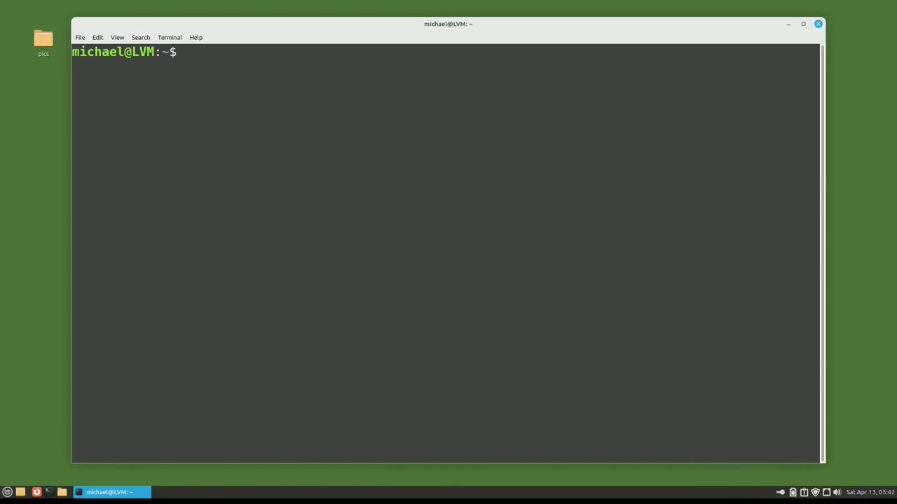
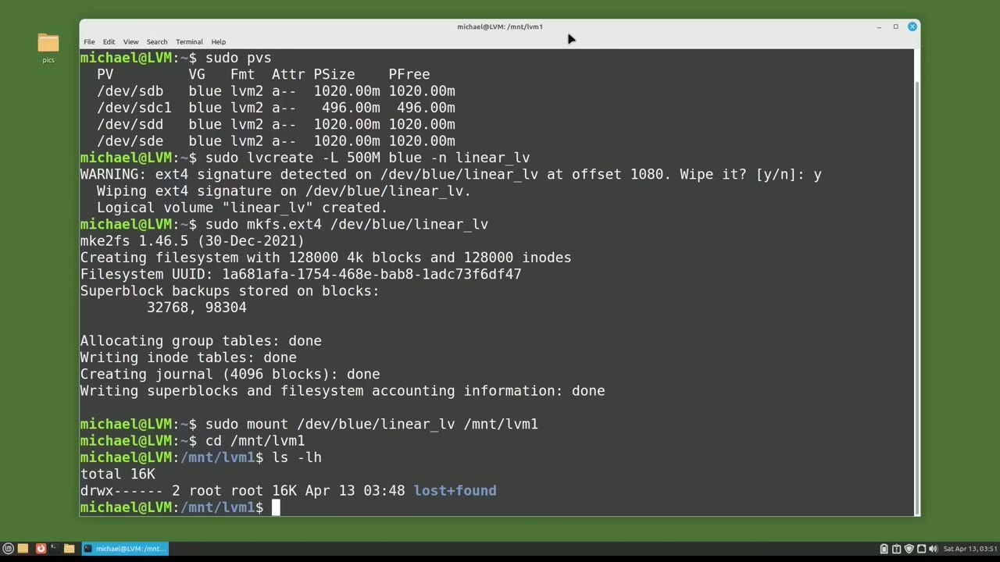
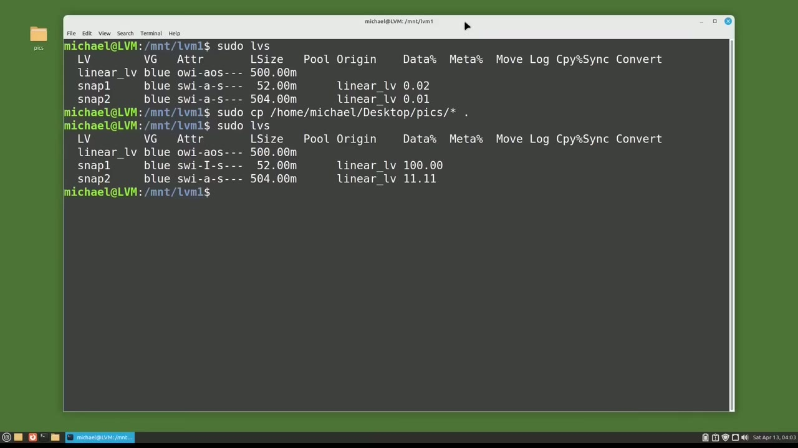
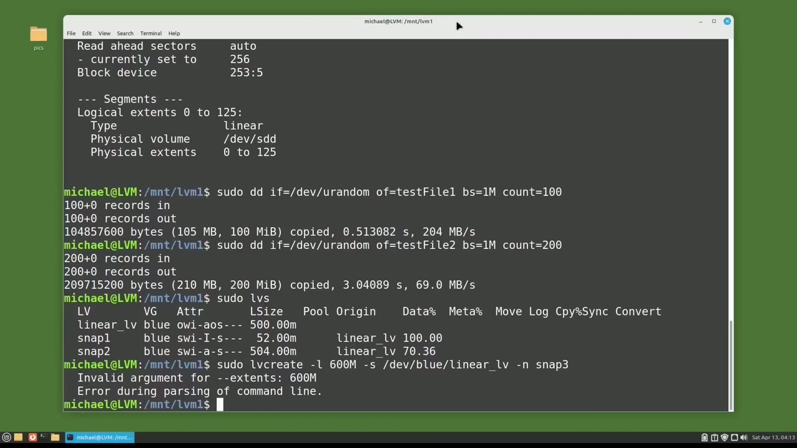

[← Course contents](../../01.md)

# 100. LVM pt10 - LVM Snapshot pt1 - create

**Course:** [Linux Command Line - Entire Tutorial Series](https://www.youtube.com/watch?v=avg65oY7sj4)  
**Transcript:** [`Linux Command Line - Entire Tutorial Series transcript`](../../../../course_videos/Linux%20Command%20Line%20-%20Entire%20Tutorial%20Series/Linux%20Command%20Line%20-%20Entire%20Tutorial%20Series.txt)  
**Video:** 17:08:41–17:18:56 ([open at this time](https://www.youtube.com/watch?v=avg65oY7sj4&t=61721s))

## Introduction

In this tutorial, we're going to look at taking an LVM snapshot. The first thing I'm going to do is make sure that my logical volumes from the previous videos have been removed by typing Sudo. Lvs. And we see nothing showing we have no logical volumes, which is what I want. Now I'm going to look at the LVM physical volumes available for this computer with the command Sudo pvs. And we see we still have the four drives we've used in the previous videos, and they are all in the volume group Blue. I'm going to set up a 500 megabyte LvM linear logical volume.

## Detailed Explanation

<details>
  <summary>Step 1 — Run `sudo`, `lvs`, `sudo pvs`</summary>

### Step 1 — Run `sudo`, `lvs`, `sudo pvs`

- [x] **Use `sudo`, `lvs`**
  - In this tutorial, we're going to look at taking an LVM snapshot.
  - The first thing I'm going to do is make sure that my logical volumes from the previous videos have been removed by typing `sudo`.
  - `lvs`. And we see nothing showing we have no logical volumes, which is what I want.

- [x] **Use `sudo pvs`, `sudo`**
  - Now I'm going to look at the LVM physical volumes available for this computer with the command `sudo pvs`. And we see we still have the four drives we've used in the previous videos, and they are all in the volume group Blue. I'm going to set up a 500 megabyte LvM linear logical volume.
  - On the volume group blue with the command `sudo` lv create then i'm going to add a -uppercase l to tell lvm we want to specify the disk size of 500m and the m is for megabytes i'm going to add this to the volume group blue and then i'm going to finish with a -lowercase n for name
  - And I'm going to give this logical volume the name, linear, under score lv. LVM has found a signature from a previous logical volume and is asking me if it's okay to remove that. It is. I will type Y and enter to remove it.

- [x] **Use `sudo mkfs.ext4`**
  - And our logical volume is created as expected. Now I will add a file system to this logical volume with the command.
  - `sudo mkfs.ext4` slash dev slash blue.
  - Our file system was created as expected.

- [x] **Use `sudo`**
  - Now I want to mount the file system with the command `sudo`.
  - Mount slash dev slash blue slash linear underscore lv.
  - And this will go into the slash mnt slash LvM1.

- [x] **Use `ls -lh`**
  - And we created the slash mnt slash lvm1 directory way back in video 91.
  - To make sure it's mounted okay, I will cd into slash mnt slash LvM1 and type `ls -lh`.
  - We see the default lost and found file that is created by default for the ext file system.

- [x] **So this is telling me that we've mounted the EXT4 file system to this**
  - So this is telling me that we've mounted the EXT4 file system to this directory.
  - What I'm going to do now is create a snapshot of the empty logical volume linear underscore lv.
  - Actually, I'm going to create two snapshots of the empty logical volume.

- [x] **I'll make one really small and the other really large**
  - I'll make one really small and the other really large.

```bash
sudo
lvs
sudo pvs
sudo mkfs.ext4
ls -lh
```



</details>

<details>
  <summary>Step 2 — Run `sudo`, `sudo lvs`, `sudo cp /home`</summary>

### Step 2 — Run `sudo`, `sudo lvs`, `sudo cp /home`

- [x] **Use `sudo`**
  - To make the small one, I will type `sudo` lv create and then a -uppercase L to give this a size just like we did when we created the LVM logical volume.
  - And I want this snapshot to be the size of 50 megabytes.
  - Now I'm going to add a -lowercase S to tell LVM this is a snapshot.

- [x] **And then I'll have to give it the logical volume that I want to make**
  - And then I'll have to give it the logical volume that I want to make that snapshot of, which is dev blue linear underscore lv.
  - Then I'm adding a -lowercase n for the name.
  - And I will give this snapshot the name, Snap 1.

- [x] **And the snapshot will go in the volume group blue because that is**
  - And the snapshot will go in the volume group blue because that is where the logical volume is.
  - A snapshot must go in the same volume group as a logical volume.
  - And we see when it created the snapshot, it was resized to 52 megabytes.

- [x] **Because LVM works in four megabyte extents, as we discussed in an**
  - Because LVM works in four megabyte extents, as we discussed in an earlier video.
  - Now for the larger snapshot, I'm going to press the arrow up to bring back the command.
  - I will change the name from Snap 1 to Snap 2.

- [x] **And instead of 50 megabytes, I'm going to make this 600 megabytes**
  - And instead of 50 megabytes, I'm going to make this 600 megabytes.
  - And I'm picking 600 megabytes because it's larger than the 500 megabyte logical volume that we just created a moment ago.
  - When I press Enter, we see that LVM tells us the maximum usable size is 504 MIBIBytes, which is the size of our logical volume, 500 megabytes, plus 4 megabytes for LVM snapshot management.

- [x] **Use `sudo lvs`**
  - I'm going to clear the screen with clear.
  - And to see what our snapshots look like now, I'm going to type `sudo lvs`.
  - The first thing we see is the linear logical volume.

- [x] **Linear lv. And then we see our two snapshots, Snap 1 and Snap 2**
  - Linear lv. And then we see our two snapshots, Snap 1 and Snap 2.
  - Then we see the attributes for the snapshots start with S for Snapshot.
  - Under Origin, we see the snapshots are both snapshots of the linear lv logical volume.

- [x] **Use `sudo cp /home`**
  - And then under data percent, we can see how full the snapshots are once a snapshot is 100% full it becomes unusable we'll see that in a moment let's add some data to our logical volume i have some pictures on the desktop that we used in a previous tutorial i'll copy them into our logical volume with the command `sudo cp /home` slash michael slash desktop
  - And I'm adding the asteris to copy everything.
  - And I want it all to be copied right here into the mnt lvm1 directory, which is our logical volume, Linear underscore lv.

- [x] **Use `sudo lvs`**
  - Let's see what our logical volumes look like now with `sudo lvs`.
  - And we see that we already maxed out our little 50 megabyte snapshot.

```bash
sudo
sudo lvs
sudo cp /home
```



</details>

<details>
  <summary>Step 3 — Run `sudo`, `dd`, `sudo lvs`</summary>

### Step 3 — Run `sudo`, `dd`, `sudo lvs`

- [x] **Use `sudo`**
  - And one of the attributes has changed to an uppercase I, for inactive. I'm going to type `sudo` lv display -M and then go to the top.
  - We see that we're looking at the logical volume name, Linear lv, which is on the blue volume group, and we see the lv snapshot status has two snapshots. One is inactive, the other is active.
  - And then down under segments, we'll see that linear lv physical volume is on device.

- [x] **Dev sdb. Going down to Snapshot 1, we see that Snapshot 1 is inactive**
  - Dev sdb. Going down to Snapshot 1, we see that Snapshot 1 is inactive and on Dev sdb.
  - And then Snapshot 2 is active and on device sdd.
  - Now we still have device sde empty, so we have space for at least one more snapshot.

- [x] **Use `dd`**
  - But before I take that, let's add another file or two to our logical volume.
  - I'll add some random data files with the `dd` command.
  - And then test file 2 will be 200 megabytes.

- [x] **Use `sudo lvs`**
  - Let's check out our snapshots again with `sudo lvs`.
  - Let's take another snapshot because we'll want to restore to a snapshot with data in it.
  - Remember, snap 2 is a snapshot of the empty logical volume.

- [x] **Use `sudo -lv-Creat`**
  - So I'll create a snapshot with `sudo -lv-Creat`.
  - -l-600m-s slash dev blue linear underscore lv.
  - And then we're going to give it a name of Snap 3.

- [x] **And again, I set the size larger than the current logical volume and**
  - And again, I set the size larger than the current logical volume and LVM will set our snapshot size to be four megabytes over that total logical volume size.

```bash
sudo
dd
sudo lvs
sudo -lv-Creat
```



</details>

<details>
  <summary>Step 4 — Run `sudo lvs`, `ls -lh`</summary>

### Step 4 — Run `sudo lvs`, `ls -lh`

- [x] **Use `sudo lvs`, `ls -lh`**
  - And I have a typo in there. I have the lowercase L which was asking for a percentage and I need the uppercase L. Let's try this again. Now we have Snap3 created. Let's check on the snapshot sizes with `sudo lvs` and we see that our new snapshot 3 is 1% full because we just created that one.
  - Let's take a look at what's in our directory with `ls -lh`.
  - And we see a lot of JPEGs and some MP4s and then our two large test files with random data.

- [x] **These are the files that are in our Snap 3**
  - These are the files that are in our Snap 3.
  - And this is what we're going to restore to in the next video.
  - In this video, we saw how to create a snapshot.

- [x] **We said that the snapshot must go in the same volume group as the**
  - We said that the snapshot must go in the same volume group as the snapshot's logical volume.
  - So there must be enough space on that volume group or that snapshot.
  - And then we talked about the size of a snapshot.

- [x] **If they're too small, they might run out of disk space**
  - If they're too small, they might run out of disk space.
  - In the next tutorial, we'll talk a little more about snapshots.
  - We'll change some data and then restore to this snapshot that we created in this video for the Linux command line.

```bash
sudo lvs
ls -lh
```



</details>

<details>
  <summary>Questions and Answers</summary>

## Questions and Answers

### Question 1: What does `sudo` do in this chapter?

<details>
<summary>Answer</summary>

- [x] The first thing I'm going to do is make sure that my logical volumes from the previous videos have been removed by typing `sudo`.

</details>

### Question 2: What does `lvs` do in this chapter?

<details>
<summary>Answer</summary>

- [x] `lvs`. And we see nothing showing we have no logical volumes, which is what I want.

</details>

### Question 3: What does `sudo pvs` do in this chapter?

<details>
<summary>Answer</summary>

- [x] Now I'm going to look at the LVM physical volumes available for this computer with the command `sudo pvs`. And we see we still have the four drives we've used in the previous videos, and they are all in the volume group Blue. I'm going to set up a 500 megabyte LvM linear logical volume.

</details>

### Question 4: What does `sudo mkfs.ext4` do in this chapter?

<details>
<summary>Answer</summary>

- [x] `sudo mkfs.ext4` slash dev slash blue.

</details>

### Question 5: What does `ls -lh` do in this chapter?

<details>
<summary>Answer</summary>

- [x] To make sure it's mounted okay, I will cd into slash mnt slash LvM1 and type `ls -lh`.

</details>

### Question 6: What does `sudo lvs` do in this chapter?

<details>
<summary>Answer</summary>

- [x] And to see what our snapshots look like now, I'm going to type `sudo lvs`.

</details>

### Question 7: What does `sudo cp /home` do in this chapter?

<details>
<summary>Answer</summary>

- [x] And then under data percent, we can see how full the snapshots are once a snapshot is 100% full it becomes unusable we'll see that in a moment let's add some data to our logical volume i have some pictures on the desktop that we used in a previous tutorial i'll copy them into our logical volume with the command `sudo cp /home` slash michael slash desktop

</details>

### Question 8: What does `dd` do in this chapter?

<details>
<summary>Answer</summary>

- [x] I'll add some random data files with the `dd` command.

</details>

### Question 9: What does `sudo -lv-Creat` do in this chapter?

<details>
<summary>Answer</summary>

- [x] So I'll create a snapshot with `sudo -lv-Creat`.

</details>

</details>

## Summary

This chapter, LVM pt10 - LVM Snapshot pt1 - create, walks through Run sudo, lvs, sudo pvs; Run sudo, sudo lvs, sudo cp /home; Run sudo, dd, sudo lvs; Run sudo lvs, ls -lh. Commands from the transcript: `sudo`, `lvs`, `sudo pvs`, `sudo mkfs.ext4`, `ls -lh`, `sudo lvs`, `sudo cp /home`, `dd`, `sudo -lv-Creat`.

## References

- [Linux Command Line - Entire Tutorial Series (YouTube)](https://www.youtube.com/watch?v=avg65oY7sj4)
- [This chapter at 17:08:41](https://www.youtube.com/watch?v=avg65oY7sj4&t=61721s)
- [Local transcript](../../../../course_videos/Linux%20Command%20Line%20-%20Entire%20Tutorial%20Series/Linux%20Command%20Line%20-%20Entire%20Tutorial%20Series.txt)
