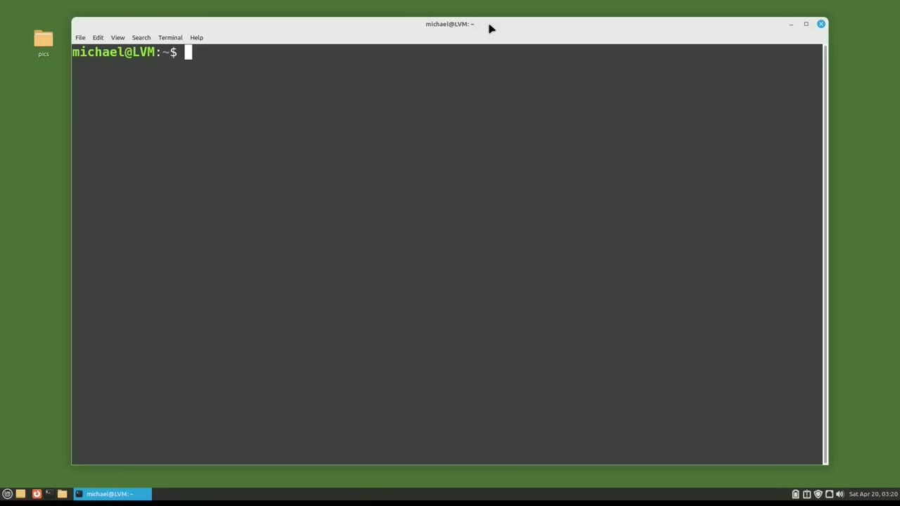
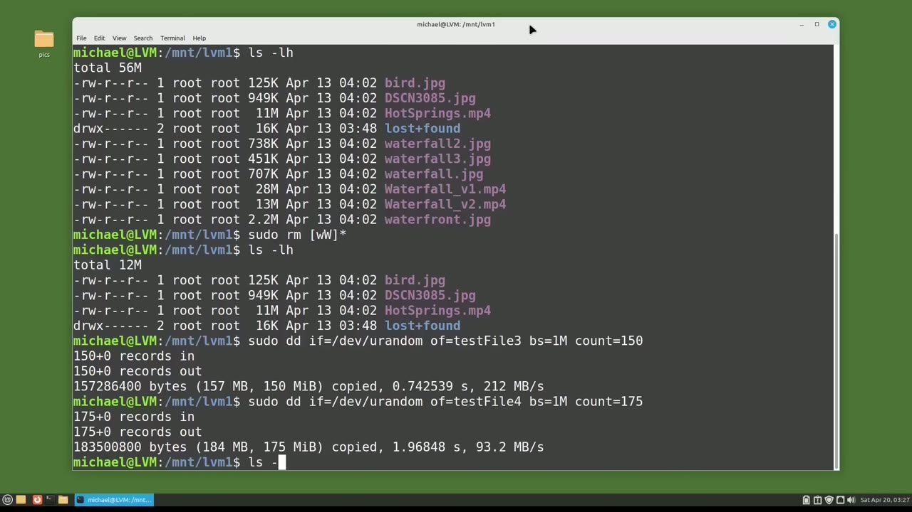
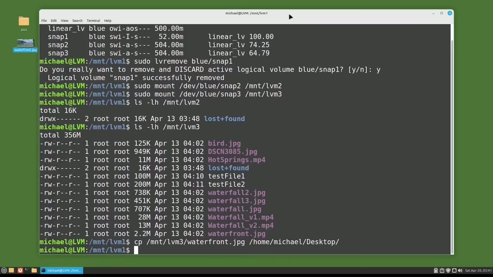
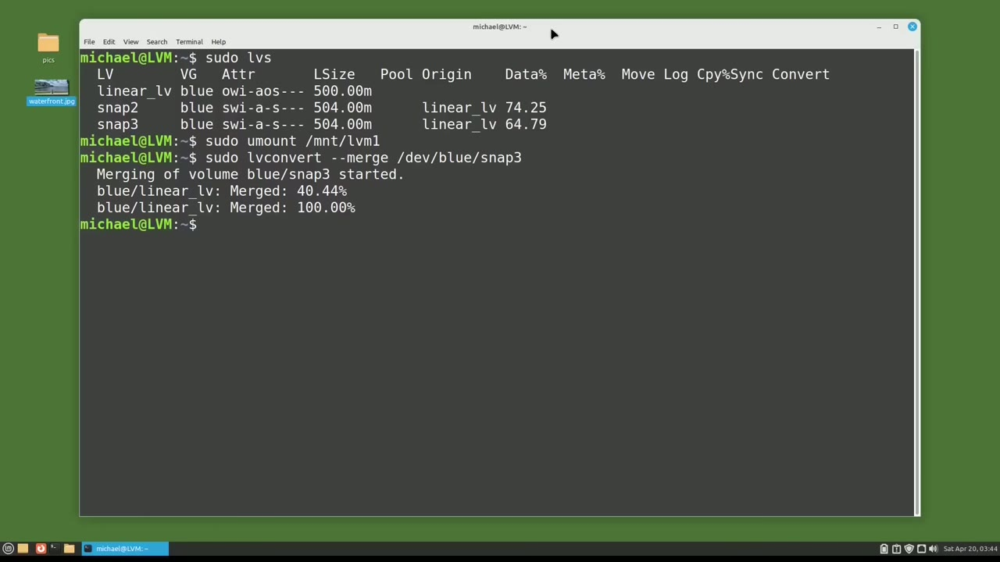

[← Course contents](../../01.md)

# 101. LVM pt11 - LVM Snapshot pt2 - restore

**Course:** [Linux Command Line - Entire Tutorial Series](https://www.youtube.com/watch?v=avg65oY7sj4)  
**Transcript:** [`Linux Command Line - Entire Tutorial Series transcript`](../../../../course_videos/Linux%20Command%20Line%20-%20Entire%20Tutorial%20Series/Linux%20Command%20Line%20-%20Entire%20Tutorial%20Series.txt)  
**Video:** 17:18:56–17:30:25 ([open at this time](https://www.youtube.com/watch?v=avg65oY7sj4&t=62336s))

## Introduction

We are picking up from where we left off in the last video, and I'm going to type sudo -lvs. This shows us everything we created in the last video. We created the logical volume, linear lv with a size of 500 megabytes. And they are all in the volume group blue.

## Detailed Explanation

<details>
  <summary>Step 1 — Run `sudo -lvs`, `ls -lh`, `dd`</summary>

### Step 1 — Run `sudo -lvs`, `ls -lh`, `dd`

- [x] **Use `sudo -lvs`**
  - We are picking up from where we left off in the last video, and I'm going to type `sudo -lvs`.
  - This shows us everything we created in the last video.
  - We created the logical volume, linear lv with a size of 500 megabytes.

- [x] **And they are all in the volume group blue**
  - And they are all in the volume group blue.
  - We'll notice that the data usage for Snap 1 is at 100%.
  - I'm going to cd into the mnt slash lvm1 directory, which is the directory where we mounted the linear underscore lv logical volume.

- [x] **Use `ls -lh`, `dd`**
  - And I'm going to type `ls -lh`.
  - In here we see a lot of JPEGs, a couple of mp4 files, and then the two test files.
  - That we created with the `dd` command.

- [x] **Use `sudo -rm`, `sudo`**
  - And all of these files are on our Copy-On Right Snapshot, Snap 3, that we'll restore to later in this video.
  - I'm going to remove the two test files with `sudo -rm` test asteris, and typing l-s-l-h shows that they're gone.
  - I'm also going to `sudo`...

- [x] **Use `ls -lh`**
  - Remove everything that starts with a lowercase or uppercase W.
  - And typing `ls -lh` shows that we've removed a lot of files.
  - `dd` in file U-Randum, outfile test file 3.

- [x] **And it will write out 150 megabytes of random data**
  - And it will write out 150 megabytes of random data.
  - And make this one, 175, just to make things different.

```bash
sudo -lvs
ls -lh
dd
sudo -rm
sudo
```



</details>

<details>
  <summary>Step 2 — Run `ls -lh`, `sudo lvs`, `sudo -lv- remove blue`</summary>

### Step 2 — Run `ls -lh`, `sudo lvs`, `sudo -lv- remove blue`

- [x] **Use `ls -lh`, `sudo lvs`**
  - And typing `ls -lh` shows we've removed some files, we've added some files.
  - So now this looks nothing like the files that we had when we took that Snap 3.
  - I'm going to clear the screen and type `sudo lvs` once more so that we can take another look at our logical volume and the snapshots for it.

- [x] **Use `sudo -lv- remove blue`**
  - Snap 2 is looking good at 74.25 data percent.
  - Snap 3 is looking good at 64.79 data percent, but Snap 1 is at 100 data percent and is inactive and useless to us.
  - So let's remove that with `sudo -lv- remove blue` Snap 1.

- [x] **Use `sudo mount slash`**
  - It's asking me if we really want to remove that.
  - Snap 2 is showing the data percent of 74.25.
  - I'm going to mount that with `sudo mount slash` dev slash blue slash snap 2.

- [x] **Use `sudo mount dev`**
  - And I'm going to mount that to slash mnt slash lvm2, which we created way back in video 91 or 92.
  - And let's also `sudo mount dev` Blue Snap 3.
  - And I'm going to mount that to mnt slash lvm3.

- [x] **Use `ls -lh`**
  - Snap 2 is using a data percent of 74.25.
  - Let's see what's on that snapshot by typing `ls -lh` mnt slash...
  - LVM 2. And all it shows is the lost and found directory, but it has a data usage of 74.25%.

- [x] **How does it have such a high data percent usage when nothing shows**
  - How does it have such a high data percent usage when nothing shows when I list the files?
  - And the reason is when we made that snapshot, the logical volume was empty.
  - And the snapshot is holding all the copy on write information to return us to that state where we took that snapshot, which for us...

- [x] **Use `ls -lhmtlvmt-L-V-M-3`**
  - Is an empty logical volume. Let's see what's on Snap 3 with `ls -lhmtlvmt-L-V-M-3`.
  - And here we see the files that are in the state they were when we took this snapshot.
  - But this is not a backup. These are copy-on-write links.

- [x] **The snapshot needs the logical volume, Linear underscore lv, to be**
  - The snapshot needs the logical volume, Linear underscore lv, to be present, to return to that point in time.
  - Right now, we can copy a file from this snapshot and get the correct file saved to a new location.
  - I'll do that with cp, mnt, LvM3, Waterfront.jpg.

```bash
ls -lh
sudo lvs
sudo -lv- remove blue
sudo mount slash
sudo mount dev
ls -lhmtlvmt-L-V-M-3
```



</details>

<details>
  <summary>Step 3 — Run `cd`, `sudo`, `sudo lvs`</summary>

### Step 3 — Run `cd`, `sudo`, `sudo lvs`

- [x] **And I'm going to copy that to Home, Michael, Desktop**
  - And I'm going to copy that to Home, Michael, Desktop.
  - And we see the image is restored to the desktop.
  - So what is the advantage of a snapshot over a backup?

- [x] **When we take a backup, it backs up everything**
  - When we take a backup, it backs up everything.
  - And when everything is lost, we can restore everything from that backup.
  - The problem with backups is that they back up everything, and that can take a lot of time to create a backup or restore from a backup, especially if we have gigabytes or terabytes of data.

- [x] **Snapshots, on the other hand, only store the changes**
  - Snapshots, on the other hand, only store the changes...
  - Between the current file and the point we want to restore to.
  - So that makes taking and restoring snapshots quick and easy.

- [x] **Use `cd`, `sudo`, `sudo lvs`**
  - I'm going to go through my home directory by typing `cd`.
  - And then I want to unmount our snapshots with `sudo`, u-m-m-t, LVM, and we'll do them both together.
  - And remind us all of what we have in the logical volume and the snapshots with `sudo lvs`.

- [x] **Use `sudo`, `sudo -lv-Convert -merge`**
  - Before I restore from the snapshot, I want to unmount the logical volume with `sudo`.
  - And to restore from the snapshot, Snap 3, I'm going to type `sudo` -lv-Convert, -merge, dev, Blue, Snap3.
  - We have an update that it's 44.44% merged.

```bash
cd
sudo
sudo lvs
sudo -lv-Convert -merge
```



</details>

<details>
  <summary>Step 4 — Run `sudo mount dev`, `ls -lh`, `sudo -lvs`</summary>

### Step 4 — Run `sudo mount dev`, `ls -lh`, `sudo -lvs`

- [x] **Use `sudo mount dev`, `ls -lh`**
  - Let's remount our logical volume with `sudo`, mount, dev, blue, linear lv, and we want to mount this to lvm1.
  - And now let's see what's on lvm1 with `ls -lh` m-n-t-lvm-1.
  - And there we see all the files that were stored in our Copy-On-Rite Snapshot, Snap3.

- [x] **Use `sudo -lvs`**
  - I'm going to clear the screen and type `sudo -lvs`.
  - And we see that our snapshot, Snap3, is now gone.
  - Well, it's gone because it was merged into our logical volume.

- [x] **So if we want to restore to this point again, which I do here, I will**
  - So if we want to restore to this point again, which I do here, I will have to take another snapshot.
  - So I'll do that with SudoLV create -l600m -S for snapshot slash dev slash blue slash linear lv.
  - And I want to give this a name of snap 4.

- [x] **Use `ls -lh`**
  - Once again, I'm going to `cd` into mnt, lvm1, and `ls -lh`.
  - Once again, I'm going to remove some files with SudoRM.
  - This time we'll remove everything that starts with a lowercase W, uppercase W, and a lowercase T.

- [x] **Use `ls -lh`, `cd`, `sudo -lv-Convert--Murge`**
  - `ls -lh` shows that those were all removed.
  - I'm typing `cd` to go to my home directory.
  - Now let's restore to that snapshot, Snap4, that we just created with `sudo -lv-Convert--Murge` slash dev-blue slash snap4.

- [x] **Use `sudo lvs`**
  - We get the message delaying merge since origin is open.
  - So let's see what the logical volumes look like with `sudo lvs`.
  - And we see that the attribute O for origin is now an uppercase O.

- [x] **And it's an uppercase O to let us know that there is a snapshot merge**
  - And it's an uppercase O to let us know that there is a snapshot merge waiting to happen.
  - Now the easiest way to complete the merge is just to restart the computer.
  - The O will go back to a little O and will be restored to the snap 4 data.

- [x] **Use `sudo`**
  - We just need to deactivate the volume group and reactivate it.
  - First thing we need to do is unmount the logical volume with `sudo`.
  - And I'll deactivate the logical volume right now with the command, `sudo`, lv, change, dash, activate, N.

- [x] **Now that N after Activate does not have a dash by it because it's a**
  - Now that N after Activate does not have a dash by it because it's a setting.
  - We're setting activate to no or deactivating it.
  - And then to reactivate the logical volume, I'll bring back that command and change that N to a Y.

- [x] **Use `ls -lh`**
  - So we're telling it to activate the blue linear logical volume.
  - Now I'm going to remount the logical volume with sudo-mount dev blue to Linear underscore lv to mnt, LvM1, and typing `ls -lh` mnt, lvm1, shows that we have restored all the data from snap4.
  - In the next video, we will continue looking at the Linux command line.

```bash
sudo mount dev
ls -lh
sudo -lvs
cd
sudo -lv-Convert--Murge
sudo lvs
sudo
```



</details>

<details>
  <summary>Questions and Answers</summary>

## Questions and Answers

### Question 1: What does `sudo -lvs` do in this chapter?

<details>
<summary>Answer</summary>

- [x] We are picking up from where we left off in the last video, and I'm going to type `sudo -lvs`.

</details>

### Question 2: What does `ls -lh` do in this chapter?

<details>
<summary>Answer</summary>

- [x] And I'm going to type `ls -lh`.

</details>

### Question 3: What does `dd` do in this chapter?

<details>
<summary>Answer</summary>

- [x] That we created with the `dd` command.

</details>

### Question 4: What does `sudo -rm` do in this chapter?

<details>
<summary>Answer</summary>

- [x] I'm going to remove the two test files with `sudo -rm` test asteris, and typing l-s-l-h shows that they're gone.

</details>

### Question 5: What does `sudo` do in this chapter?

<details>
<summary>Answer</summary>

- [x] I'm also going to `sudo`...

</details>

### Question 6: What does `sudo lvs` do in this chapter?

<details>
<summary>Answer</summary>

- [x] I'm going to clear the screen and type `sudo lvs` once more so that we can take another look at our logical volume and the snapshots for it.

</details>

### Question 7: What does `sudo -lv- remove blue` do in this chapter?

<details>
<summary>Answer</summary>

- [x] So let's remove that with `sudo -lv- remove blue` Snap 1.

</details>

### Question 8: What does `sudo mount slash` do in this chapter?

<details>
<summary>Answer</summary>

- [x] I'm going to mount that with `sudo mount slash` dev slash blue slash snap 2.

</details>

### Question 9: What does `sudo mount dev` do in this chapter?

<details>
<summary>Answer</summary>

- [x] And let's also `sudo mount dev` Blue Snap 3.

</details>

### Question 10: What does `ls -lhmtlvmt-L-V-M-3` do in this chapter?

<details>
<summary>Answer</summary>

- [x] Is an empty logical volume. Let's see what's on Snap 3 with `ls -lhmtlvmt-L-V-M-3`.

</details>

### Question 11: What does `cd` do in this chapter?

<details>
<summary>Answer</summary>

- [x] I'm going to go through my home directory by typing `cd`.

</details>

### Question 12: What does `sudo -lv-Convert -merge` do in this chapter?

<details>
<summary>Answer</summary>

- [x] And to restore from the snapshot, Snap 3, I'm going to type sudo -lv-Convert, -merge, dev, Blue, Snap3.

</details>

</details>

## Summary

This chapter, LVM pt11 - LVM Snapshot pt2 - restore, walks through Run sudo -lvs, ls -lh, dd; Run ls -lh, sudo lvs, sudo -lv- remove blue; Run cd, sudo, sudo lvs; Run sudo mount dev, ls -lh, sudo -lvs. Commands from the transcript: `sudo -lvs`, `ls -lh`, `dd`, `sudo -rm`, `sudo`, `sudo lvs`, `sudo -lv- remove blue`, `sudo mount slash`, `sudo mount dev`, `ls -lhmtlvmt-L-V-M-3`, `cd`, `sudo -lv-Convert -merge`, `sudo -lv-Convert--Murge`.

## References

- [Linux Command Line - Entire Tutorial Series (YouTube)](https://www.youtube.com/watch?v=avg65oY7sj4)
- [This chapter at 17:18:56](https://www.youtube.com/watch?v=avg65oY7sj4&t=62336s)
- [Local transcript](../../../../course_videos/Linux%20Command%20Line%20-%20Entire%20Tutorial%20Series/Linux%20Command%20Line%20-%20Entire%20Tutorial%20Series.txt)
