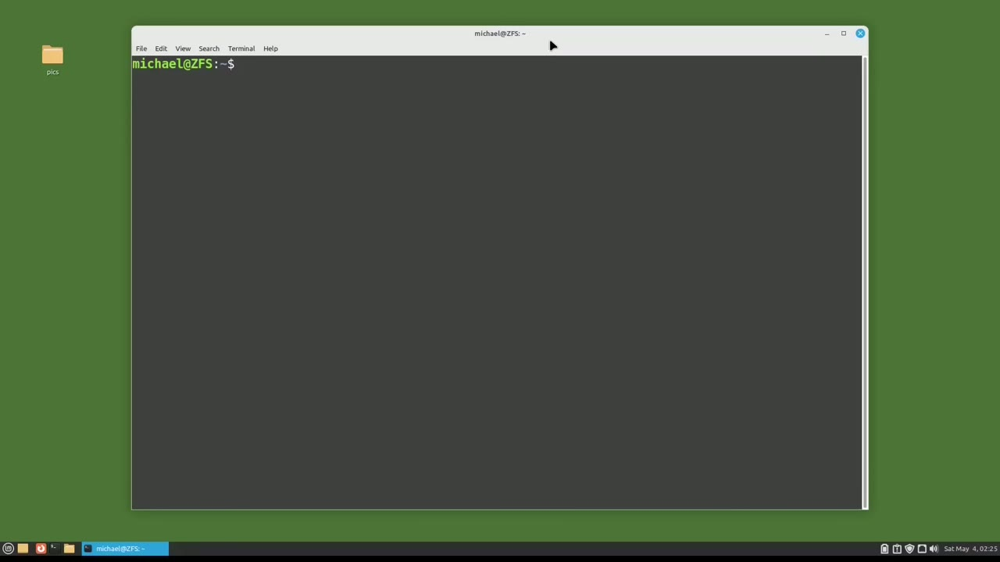
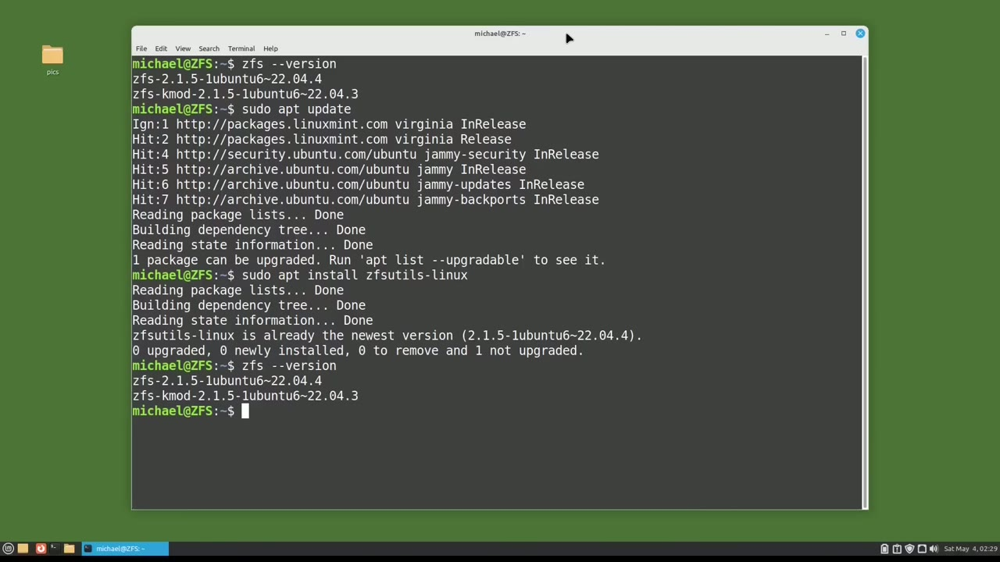
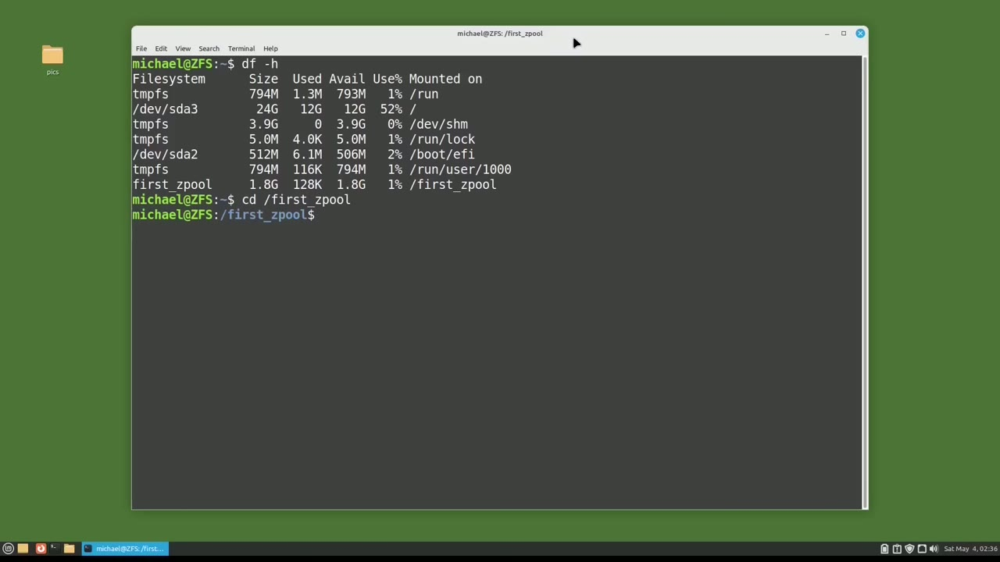
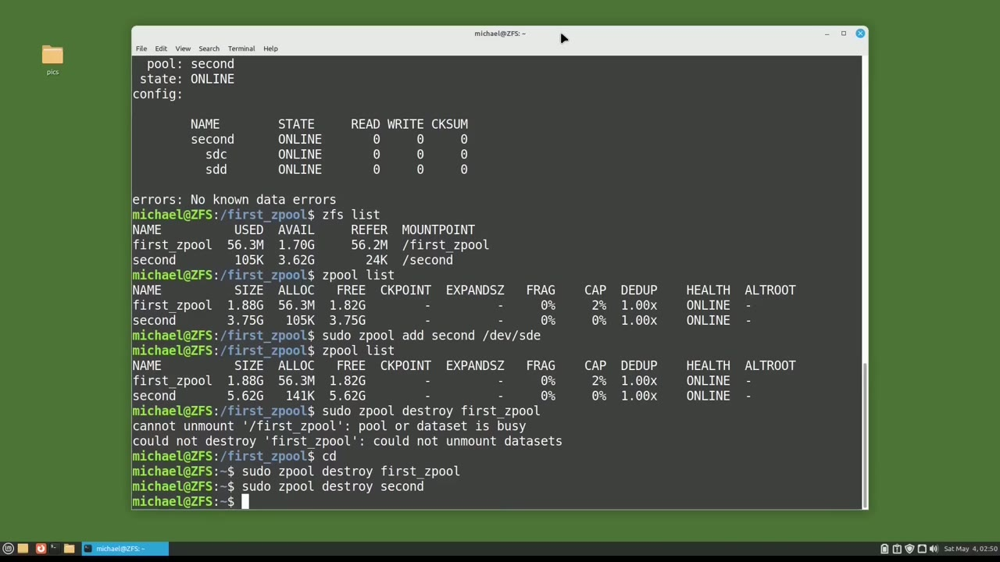

[← Course contents](../../01.md)

# 102. ZFS pt1

**Course:** [Linux Command Line - Entire Tutorial Series](https://www.youtube.com/watch?v=avg65oY7sj4)  
**Transcript:** [`Linux Command Line - Entire Tutorial Series transcript`](../../../../course_videos/Linux%20Command%20Line%20-%20Entire%20Tutorial%20Series/Linux%20Command%20Line%20-%20Entire%20Tutorial%20Series.txt)  
**Video:** 17:30:25–17:38:21 ([open at this time](https://www.youtube.com/watch?v=avg65oY7sj4&t=63025s))

## Introduction

In this group of videos, we're going to look at how to use the ZFS file system. On a Linux-Abuntu-based operating system. Non-American English speakers will call this the z-fs file system. I'm an American, so I will call this the ZFS file system.

## Detailed Explanation

<details>
  <summary>Step 1 — Run `zfs`, `zfs --version`, `sudo -apt update`</summary>

### Step 1 — Run `zfs`, `zfs --version`, `sudo -apt update`

- [x] **Use `zfs`**
  - In this group of videos, we're going to look at how to use the `zfs` file system.
  - On a Linux-Abuntu-based operating system.
  - Non-American English speakers will call this the z-fs file system.

- [x] **Use `zfs`**
  - I'm an American, so I will call this the `zfs` file system.
  - Ubuntu releases 2204 and higher should come with the complete `zfs` Utils-Linix package already installed.
  - I will check to see if `zfs` is installed on this system.

- [x] **Use `zfs --version`, `zfs`, `sudo -apt update`**
  - With the command `zfs --version`.
  - And we see `zfs` is already installed on this computer.
  - If you did not see anything here and you want to install the `zfs` Utils-Linix package, you can do so by typing `sudo -apt update` and then type in `sudo -apt install zfs` Utils -Linux.

- [x] **Use `zfs`, `zfs -dash version`**
  - And we see here that `zfs` Utils -Linux is already at the newest version.
  - And then once installed, you may want to verify the version of `zfs` by typing `zfs -dash version`.
  - We have `zfs` installed.

```bash
zfs
zfs --version
sudo -apt update
sudo -apt install zfs
zfs -dash version
```



</details>

<details>
  <summary>Step 2 — Run `lsblk`, `zfs`, `df -h`</summary>

### Step 2 — Run `lsblk`, `zfs`, `df -h`

- [x] **Use `lsblk`, `zfs`**
  - Now I'm going to look at what disks I have on this operating system by clearing the screen and then listing out the disks we have available by typing `lsblk`.
  - The sda is my operating system, and I've added 5 2GB disk sdb through sdf to work with in this group of videos.
  - The `zfs` file system uses storage pools called Z-Pools.

- [x] **Use `zfs`**
  - A `zfs` storage pool is a single `zfs` container made up of one or more storage devices.
  - The first thing I'm going to do is create a `zfs` storage pool, a Z-Pool, with the command.
  - S-Pool Create, and we will call this first Z-Pool first underscore Z-Pool.

- [x] **Use `zfs`**
  - And I want this first Z-Pool to go on the device slash dev slash sdb.
  - We're done, we can now start using this `zfs` Z-Pool.
  - If you watch some of my earlier videos, you may remember after setting up the storage unit, we would then have to create a file system, mount that file system, and then if we want that file system to mount on the next system boot, we would then have to update the fs tab file.

- [x] **Use `zfs`**
  - With `zfs`, we don't have to do any of that.
  - `zfs` is a combined file system and...
  - Volume Manager. So `zfs` takes care of all that for us.

- [x] **Use `df -h`**
  - I'm going to clear the screen and then type `df -h`.
  - And here we see our Z-Pool First Z-Pool is created.
  - And it is mounted in the root directory as forward slash first Z-pool.

- [x] **Use `cd slash`**
  - Typing `cd slash` First underscore Z-Pool and pressing enter.
  - Puts us into the directory First underscore Z-Pool, which is also the ZFSZPool container, First underscore Z-Pool.

```bash
lsblk
zfs
df -h
cd slash
```



</details>

<details>
  <summary>Step 3 — Run `ls -lh -forw -farw`, `sudo`, `ls`</summary>

### Step 3 — Run `ls -lh -forw -farw`, `sudo`, `ls`

- [x] **Use `ls -lh -forw -farw`, `sudo`**
  - To see the file ownership of our Z-Pool, I will type `ls -lh -forw -farw` then pipe grip first.
  - And we see that the owner and the group are both root.
  - To change the owner and the group to Michael, I will type the standard Linux command, `sudo` Chon Michael dot, forward slash, first underscore Z-Pool.

- [x] **Use `ls`, `mount`**
  - And then going up to that `ls` command again, we see the owner in the group are now set to Michael, and I can edit this directory.
  - This is a lot easier than what we had to do with the mounted discs in earlier videos.
  - If we wanted to change the ownership, we had to unmount the disk, update the owner in the `mount` command, and then remount that disk.

- [x] **Use `zfs`**
  - I have some pictures on the desktop. I'm going to copy those pictures to this `zfs` directory with the command C. Home, Michael, Desktop Picks, and the asteris for everything, and I want to copy them all right here.
  - And we see the files have been copied here.
  - To check the status of my Z pool, I will type Z pool status.

- [x] **Things I'm looking for here are the name of the pool, in this case is**
  - Things I'm looking for here are the name of the pool, in this case is first Z pool, then the state which is showing online, and then if there are any errors, and here we see no data errors.
  - Let's create a second Z-Pool with the command.
  - And I want this to go on two disks this time.

- [x] **Now let's check that Z-Pool status again with Z-Pool status**
  - Now let's check that Z-Pool status again with Z-Pool status.
  - If I only want to see the status of one Z-Pool, I can type Z-Pool status, and then the name of the Z-Pool I want to check the status of.
  - And now I only see the second Z-Pool status.

- [x] **Another z-f-s command we may want to use is z-f-s List**
  - Another z-f-s command we may want to use is z-f-s List.
  - And we get some information about our Z-Pools.
  - And here we get a little more information about the Z-Pools.

- [x] **I want to add some more disk space to our second Z-Pool**
  - I want to add some more disk space to our second Z-Pool.

```bash
ls -lh -forw -farw
sudo
ls
mount
zfs
```



</details>

<details>
  <summary>Step 4 — Run `zfs`</summary>

### Step 4 — Run `zfs`

- [x] **I will do that with the command, sudo-ZPool, add**
  - I will do that with the command, sudo-ZPool, add.
  - And then we want to add to the second Z-Pool.
  - And we're going to add DevS-D-E to our Z-Pool.

- [x] **And then typing Z-Pool List shows we've increased the size of our**
  - And then typing Z-Pool List shows we've increased the size of our second Z-Pool from 3.75 gigabytes to 5.62 gigabytes.
  - The last thing we're going to do in this video is to remove the Z-Pools.
  - I'll remove the first Z-Pool with the command, S-Pool, Destroy First underscore Z-Pool.

- [x] **And when I press center, we get an error that we cannot destroy it**
  - And when I press center, we get an error that we cannot destroy it.
  - We can see that we're in the first underscore Z pool.
  - So I will cd into the home directory and then bring back that command again.

- [x] **Use `zfs`**
  - And then I'm also going to type S-Pool Destroy and we'll make this second.
  - In the next tutorial, we will continue looking at `zfs` for the Linux command line.
  - In the last video, we created a single `zfs` Z-Pool,

```bash
zfs
```



</details>

<details>
  <summary>Questions and Answers</summary>

## Questions and Answers

### Question 1: What does `zfs` do in this chapter?

<details>
<summary>Answer</summary>

- [x] In this group of videos, we're going to look at how to use the `zfs` file system.

</details>

### Question 2: What does `zfs --version` do in this chapter?

<details>
<summary>Answer</summary>

- [x] With the command `zfs --version`.

</details>

### Question 3: What does `sudo -apt update` do in this chapter?

<details>
<summary>Answer</summary>

- [x] If you did not see anything here and you want to install the ZFS Utils-Linix package, you can do so by typing `sudo -apt update` and then type in sudo -apt install ZFS Utils -Linux.

</details>

### Question 4: What does `sudo -apt install zfs` do in this chapter?

<details>
<summary>Answer</summary>

- [x] If you did not see anything here and you want to install the ZFS Utils-Linix package, you can do so by typing sudo -apt Update and then type in `sudo -apt install zfs` Utils -Linux.

</details>

### Question 5: What does `zfs -dash version` do in this chapter?

<details>
<summary>Answer</summary>

- [x] And then once installed, you may want to verify the version of ZFS by typing `zfs -dash version`.

</details>

### Question 6: What does `lsblk` do in this chapter?

<details>
<summary>Answer</summary>

- [x] Now I'm going to look at what disks I have on this operating system by clearing the screen and then listing out the disks we have available by typing `lsblk`.

</details>

### Question 7: What does `df -h` do in this chapter?

<details>
<summary>Answer</summary>

- [x] I'm going to clear the screen and then type `df -h`.

</details>

### Question 8: What does `cd slash` do in this chapter?

<details>
<summary>Answer</summary>

- [x] Typing `cd slash` First underscore Z-Pool and pressing enter.

</details>

### Question 9: What does `ls -lh -forw -farw` do in this chapter?

<details>
<summary>Answer</summary>

- [x] To see the file ownership of our Z-Pool, I will type `ls -lh -forw -farw` then pipe grip first.

</details>

### Question 10: What does `sudo` do in this chapter?

<details>
<summary>Answer</summary>

- [x] To change the owner and the group to Michael, I will type the standard Linux command, `sudo` Chon Michael dot, forward slash, first underscore Z-Pool.

</details>

### Question 11: What does `ls` do in this chapter?

<details>
<summary>Answer</summary>

- [x] And then going up to that `ls` command again, we see the owner in the group are now set to Michael, and I can edit this directory.

</details>

### Question 12: What does `mount` do in this chapter?

<details>
<summary>Answer</summary>

- [x] If we wanted to change the ownership, we had to unmount the disk, update the owner in the `mount` command, and then remount that disk.

</details>

</details>

## Summary

This chapter, ZFS pt1, walks through Run zfs, zfs --version, sudo -apt update; Run lsblk, zfs, df -h; Run ls -lh -forw -farw, sudo, ls; Run zfs. Commands from the transcript: `zfs`, `zfs --version`, `sudo -apt update`, `sudo -apt install zfs`, `zfs -dash version`, `lsblk`, `df -h`, `cd slash`, `ls -lh -forw -farw`, `sudo`, `ls`, `mount`.

## References

- [Linux Command Line - Entire Tutorial Series (YouTube)](https://www.youtube.com/watch?v=avg65oY7sj4)
- [This chapter at 17:30:25](https://www.youtube.com/watch?v=avg65oY7sj4&t=63025s)
- [Local transcript](../../../../course_videos/Linux%20Command%20Line%20-%20Entire%20Tutorial%20Series/Linux%20Command%20Line%20-%20Entire%20Tutorial%20Series.txt)
