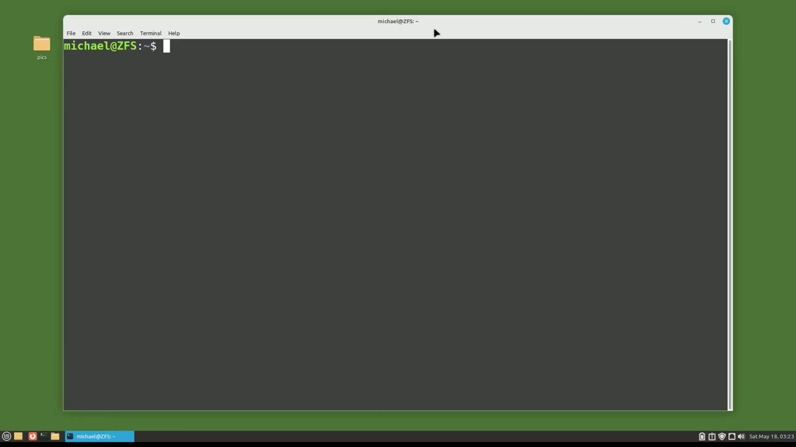
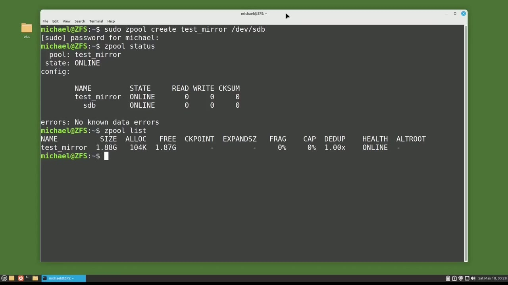
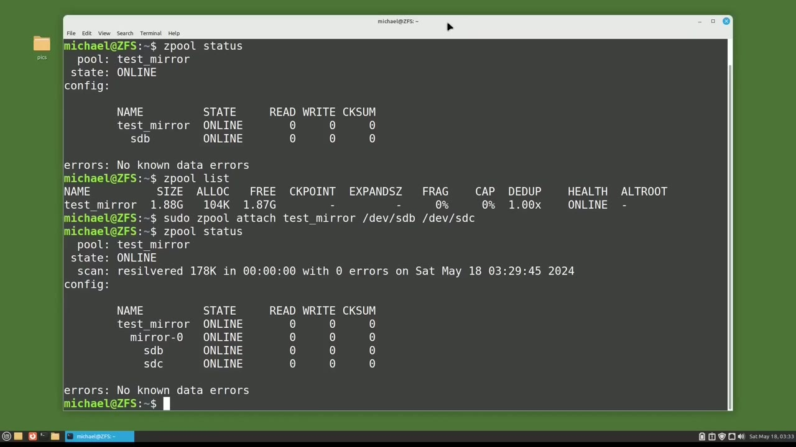

[← Course contents](../../01.md)

# 103. ZFS pt2 - mirror

**Course:** [Linux Command Line - Entire Tutorial Series](https://www.youtube.com/watch?v=avg65oY7sj4)  
**Transcript:** [`Linux Command Line - Entire Tutorial Series transcript`](../../../../course_videos/Linux%20Command%20Line%20-%20Entire%20Tutorial%20Series/Linux%20Command%20Line%20-%20Entire%20Tutorial%20Series.txt)  
**Video:** 17:38:21–17:44:46 ([open at this time](https://www.youtube.com/watch?v=avg65oY7sj4&t=63501s))

## Introduction

And we also created a second Z-Pool with two disks, and then we added a third disc to that Z-Pool. The problem with the Z-Pools we created in the last video is that there is no redundancy. So if one disc goes bad, all of the data on that Z-pool will be lost. In this video, we're going to look at setting up a disk mirror.

## Detailed Explanation

<details>
  <summary>Step 1 — we also created a second Z-Pool with two disks, and then we added a</summary>

### Step 1 — we also created a second Z-Pool with two disks, and then we added a

- [x] **And we also created a second Z-Pool with two disks, and then we added**
  - And we also created a second Z-Pool with two disks, and then we added a third disc to that Z-Pool.
  - The problem with the Z-Pools we created in the last video is that there is no redundancy.
  - So if one disc goes bad, all of the data on that Z-pool will be lost.

- [x] **In this video, we're going to look at setting up a disk mirror**
  - In this video, we're going to look at setting up a disk mirror.
  - I'm going to start by creating a single disk Z-pool, and then we're going to turn that into a mirror.
  - I will create the single disk Z-pool with the command.

- [x] **And I want the test mirror to go on the disk**
  - And I want the test mirror to go on the disk.
  - And we will see what that looks like with Z pool status.
  - And we see that the Z pool with the name Test Mirror is created as a single disk Z pool.

- [x] **Let's check the disk size with Z pool list**
  - Let's check the disk size with Z pool list.
  - And we see that the disk size is 1.88 gigabytes.



</details>

<details>
  <summary>Step 2 — Run `sudo -z`, `zfs`</summary>

### Step 2 — Run `sudo -z`, `zfs`

- [x] **Use `sudo -z`**
  - To turn this single disk Z pool into a mirror, I'm going to type in the command, `sudo -z` pool attach.
  - And notice here we're typing the word attach instead of add, like we did in the last video.
  - Going to add the Z-Pool name that we just created, Test Mirror.

- [x] **And then I'm going to type in the currently attached disk drive**
  - And then I'm going to type in the currently attached disk drive, which is Dev.
  - Now I'm going to add in the new drive that I want to be the mirror device, which is Dev sdc.
  - Pressing Enter and our mirror is now created.

- [x] **And we see that our Z pool with the name Test Mirror is online**
  - And we see that our Z pool with the name Test Mirror is online.
  - Now notice in the line right under state.
  - It has scan and then it says re-silvered 178K with zero errors.

- [x] **Use `zfs`**
  - Resilvering is a `zfs` term that means adding or updating data to a new disk that was just added to a mirror or raid pool.
  - If you have a lot of data, resilvering could take hours or days if there's a real lot of data.
  - We can still use that Z pool while it's resilvering.

- [x] **It just might be a little slower until the resilvering is complete**
  - It just might be a little slower until the resilvering is complete.

```bash
sudo -z
zfs
```



</details>

<details>
  <summary>Step 3 — Run `zpool`, `zfs`</summary>

### Step 3 — Run `zpool`, `zfs`

- [x] **Use `zpool`**
  - To see the size of the Z pool, I will type `zpool` list.
  - And we see that the test mirror is still at 1.88 gigabytes.
  - So that completes the first way we're going to look at creating a Z-Pool mirror.

- [x] **I'm going to remove that Z-Pool that we just created with the command**
  - I'm going to remove that Z-Pool that we just created with the command.
  - And typing Z-Pool List shows that it's gone.
  - And I'm going to create a new Z-Pool mirror with the command, S-Po-Z-Pool Create.

- [x] **Then the Z-Pool name that I want to give it, this time it will be**
  - Then the Z-Pool name that I want to give it, this time it will be called Test Mirror 2.
  - And now I'm going to type Mirror to let z-fs know that I want this Z-Pool to be a mirror.
  - And then I will give it the disks I want to use in the Z-Pool mirror, which are...

- [x] **Our Test underscore Mirror 2 is now created**
  - Our Test underscore Mirror 2 is now created.
  - Let's check out what that looks like with Z-Pool List.
  - We see it's using 1.88 gigabytes and then typing Z-Pool status shows us that the Z-Pool with the name TestMier 2 is online and a mirror.

- [x] **I'm going to remove that Z-Pool with the command, S-Du-zpool Destroy**
  - I'm going to remove that Z-Pool with the command, S-Du-`zpool` Destroy, Test, Mirror 2.
  - And make sure it's gone with Z-Pool List.
  - And I'm going to clear the screen once again.

- [x] **Now I'm going to create another Z-Pool mirror, but this time I'm**
  - Now I'm going to create another Z-Pool mirror, but this time I'm going to create one with four discs.
  - Once again, I'll start the command with S-Pool.
  - Create then i'm going to add the name i want to give this i will call this one test mirror four because we're going to use four discs then i'm adding the word mirror and then i'm going to add the two discs for that mirror dev sdb and dev sdc now i'm going to type mirror again and then give it

- [x] **Use `zpool`**
  - Two more disks which is dev sdd and dev s d e pressing enter and our `zpool` is created i'm going to check the z pool size with the command z pool list we see that the z pool mirror is 3.75 gigabytes which is the equivalent of two discs and then typing z pool status
  - Shows us the name is Test Mirror 4, that it's online, and that we have two mirrors, mirror-0 and mirror-1.
  - So that's the basics of creating Z-Pool mirrors.

- [x] **Use `zfs`**
  - In the next video, we will continue looking at `zfs` for the Linux command line.

```bash
zpool
zfs
```



</details>

<details>
  <summary>Questions and Answers</summary>

## Questions and Answers

### Question 1: What does `sudo -z` do in this chapter?

<details>
<summary>Answer</summary>

- [x] To turn this single disk Z pool into a mirror, I'm going to type in the command, `sudo -z` pool attach.

</details>

### Question 2: What does `zfs` do in this chapter?

<details>
<summary>Answer</summary>

- [x] Resilvering is a `zfs` term that means adding or updating data to a new disk that was just added to a mirror or raid pool.

</details>

### Question 3: What does `zpool` do in this chapter?

<details>
<summary>Answer</summary>

- [x] To see the size of the Z pool, I will type `zpool` list.

</details>

### Question 4: What does step 1 cover (we also created a second Z-Pool with two disks, and then we added a)?

<details>
<summary>Answer</summary>

- [x] And we also created a second Z-Pool with two disks, and then we added a third disc to that Z-Pool.
- [x] The problem with the Z-Pools we created in the last video is that there is no redundancy.
- [x] So if one disc goes bad, all of the data on that Z-pool will be lost.

</details>

### Question 5: What does step 2 cover (Run sudo -z, zfs)?

<details>
<summary>Answer</summary>

- [x] To turn this single disk Z pool into a mirror, I'm going to type in the command, `sudo -z` pool attach.
- [x] And notice here we're typing the word attach instead of add, like we did in the last video.
- [x] Going to add the Z-Pool name that we just created, Test Mirror.

</details>

### Question 6: What does step 3 cover (Run zpool, zfs)?

<details>
<summary>Answer</summary>

- [x] To see the size of the Z pool, I will type `zpool` list.
- [x] And we see that the test mirror is still at 1.88 gigabytes.
- [x] So that completes the first way we're going to look at creating a Z-Pool mirror.

</details>

</details>

## Summary

This chapter, ZFS pt2 - mirror, walks through we also created a second Z-Pool with two disks, and then we added a; Run sudo -z, zfs; Run zpool, zfs. Commands from the transcript: `sudo -z`, `zfs`, `zpool`.

## References

- [Linux Command Line - Entire Tutorial Series (YouTube)](https://www.youtube.com/watch?v=avg65oY7sj4)
- [This chapter at 17:38:21](https://www.youtube.com/watch?v=avg65oY7sj4&t=63501s)
- [Local transcript](../../../../course_videos/Linux%20Command%20Line%20-%20Entire%20Tutorial%20Series/Linux%20Command%20Line%20-%20Entire%20Tutorial%20Series.txt)
